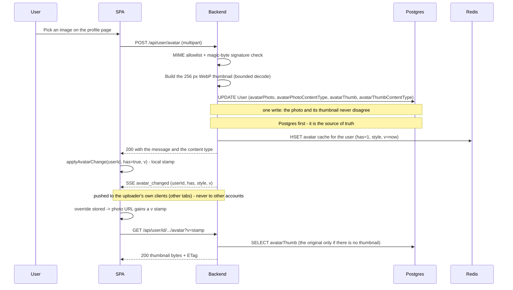
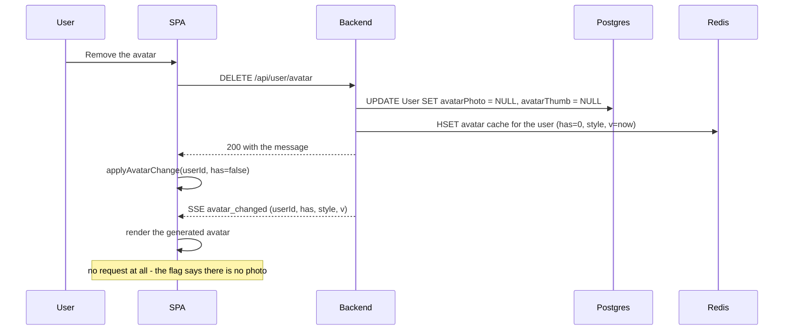
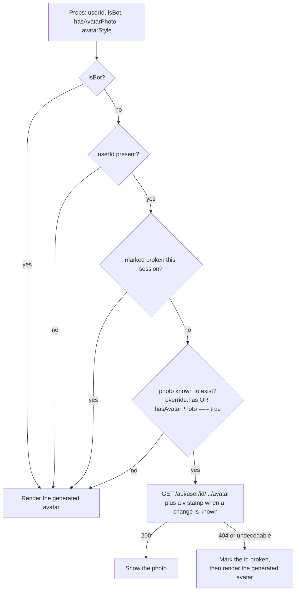
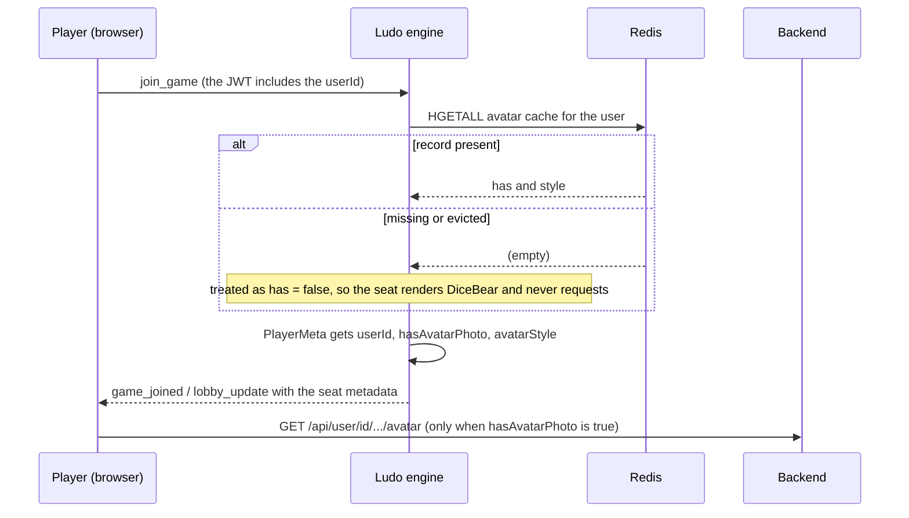
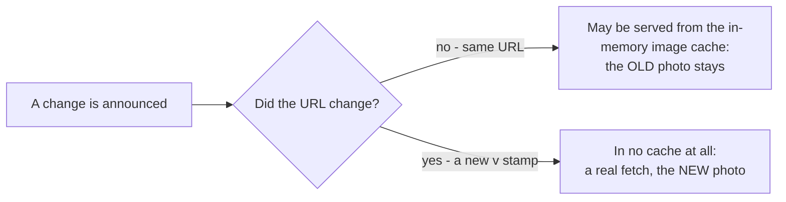

# Avatar System

## Table of Contents

- [Overview](#overview): what the avatar system guarantees and how
- [Files](#files): every file in the pipeline and its role
- [Storage & caching model](#storage--caching-model): the four layers and which one is authoritative
- [Core Logic / Flow](#core-logic--flow): Mermaid diagrams for upload, delete, rendering and game seats
- [Avatar system revamp policies](#avatar-system-revamp-policies): rules the system depends on
- [Failure modes & guarantees](#failure-modes--guarantees): what happens when a piece is missing
- [Verification](#verification): how to check an avatar change end to end
- [Known limitations](#known-limitations): accepted trade-offs and follow-ups


---
---


## Overview

Every account has one avatar. It is either a **photo the user uploaded** or a **generated DiceBear (image library) image**. The system is built around four requirements:

1. A photo must appear, change or disappear on **every open client without a reload**: the owner's own clients are pushed the change (the transient `avatar_changed` event), and every other client picks it up from the next profile/roster payload it reads (all of them carry `hasAvatarPhoto`/`avatarStyle`).
2. A user with **no photo** must never cause a failed request (no 404s in the console).
3. A client must never keep showing a **stale photo** after a re-upload.
4. None of the above may depend on a **mutable identity**: display names are renameable.

The design in one line: **Postgres stores the bytes; a small Redis record stores the facts (does a
photo exist, which DiceBear style); the browser fetches the bytes over a URL it can revalidate; and a URL with a new version marker causes the browser to re-fetch when something changes.**

Three properties make that work:

- **The immutable user id is the key everywhere**: the route, the Redis record, the SSE event, the
  engine's seat metadata and the client store. A display-name rename therefore cannot break a photo.
- **The flag is known before the request is made**: a user without a photo is rendered from DiceBear
  and never fetched at all.
- **A change stamps the URL** (`?v=<stamp>`): React re-rendering alone cannot force a reload; a
  byte-identical URL can be answered from the browser's in-memory image cache with no request at all.

The upload rules that protect the endpoint (the 2 MB cap, the allowed types, and the magic-byte
signature check) are documented in [`security_measures.md`](security_measures.md) under Input
validation and uploads.


---
---


## Files

### Backend

| File | Role |
| --- | --- |
| `backend/src/avatar/avatar-meta.service.ts` | The Redis record `avatar:<userId>` → `{ has, style, v }`. `set()` writes it and returns the change stamp; `get()` reads it; `syncFromUser()` repairs it from a row the caller already loaded — read first, write only when `has`/`style` diverge — and returns the record's stamp; `remove()` cleans up. |
| `backend/src/avatar/avatar-meta.module.ts` | Provides/exports `AvatarMetaService` (the same pattern as `NotificationService`). |
| `backend/src/avatar/avatar-thumbnail.service.ts` | Builds the stored derivative at upload: 256 px WebP via `sharp`, animation preserved (each frame's delay kept, loop forever). Bounded by a 25 MP-per-frame input limit, a 120-frame cap, a 400 KB budget and a 5 s timeout; returns `null` when the image cannot be decoded. |
| `backend/src/avatar/avatar-thumbnail.module.ts` | Provides/exports `AvatarThumbnailService` for `UserModule`. |
| `backend/src/avatar/image-signature.util.ts` | Magic-byte check so the declared MIME type must match the file's leading bytes. |
| `backend/src/user/user.controller.ts` | `POST /api/user/avatar`, `DELETE /api/user/avatar`, `GET /api/user/id/:userId/avatar`. Defines the cache headers and the upload validation. |
| `backend/src/user/user.service.ts` | `uploadAvatar()` builds the thumbnail and writes the original and the derivative in one `UPDATE`; `getAvatarById()` serves the thumbnail and falls back to the original; `deleteAvatar()` clears both. Writes the Redis record **after** the Postgres commit in upload/delete; pushes `avatar_changed` to the owner's own clients (`notifyTransient()`, never `broadcast()`) and writes the owner's own persisted `profile_updated` confirmation; repairs the record on profile reads and echoes its stamp as `avatarV`. |
| `backend/src/auth/auth.service.ts` | Seeds the record on register and on the OAuth creation path; repairs it on `/me`; removes it on account deletion. |
| `backend/src/notification/notification.controller.ts` | Transport for the owner-only `avatar_changed` push: the SSE stream plus its `SSE_HEARTBEAT_MS` keep-alive. |

### Ludo engine (reads the flag; has no database access)

| File | Role |
| --- | --- |
| `backend/app/ludo-engine/src/redis.ts` | `getAvatarMeta(userId)`: reads `avatar:<userId>`; `createGame` defaults `hasAvatarPhoto: false`. |
| `backend/app/ludo-engine/src/types.ts` | `PlayerMeta` includes `userId`, `hasAvatarPhoto`, `avatarStyle`. |
| `backend/app/ludo-engine/src/socket/join-manager.ts` | Fills those fields at join time (and `false` for bots). |
| `backend/app/ludo-engine/src/engine.ts` | `emitLobbyUpdate` sends the real values in the lobby roster. |

### Frontend

| File | Role |
| --- | --- |
| `frontend/src/components/UserAvatar.tsx` | The render decision: photo vs generated avatar, the bot guard, the `?v=` stamp, the `onError` fallback, and the optional `onPhotoError` callback. |
| `frontend/src/avatarCache.ts` | Client avatar state: live overrides (`{ has, style, v }`), a per-user attempt stamp, and the `broken` set. |
| `frontend/src/hooks/useNotifications.tsx` | Applies the `avatar_changed` event to the store. |
| `frontend/src/pages/Profile.tsx` | Sets the change locally on upload/delete, so the uploader's own view needs no SSE; shows upload/reset errors and the `photoLoadError` warning in a message area with a fixed height. |
| every `<UserAvatar>` call site | Passes `userId` (and `isBot` where the seat can be a bot). |


---
---


## Storage & caching model

The same avatar is represented in four places. Only the first is authoritative.

| # | Layer | Holds | Authoritative? | Lifetime |
| --- | --- | --- | --- | --- |
| 1 | **Postgres**: `User.avatarPhoto` (bytes) + `avatarPhotoContentType`, plus the derivative `avatarThumb` (bytes) + `avatarThumbContentType` | the upload exactly as sent, and a 256 px WebP copy of it | **Yes** | durable |
| 2 | **Redis**: `avatar:<userId>` → `{ has, style, v }` | whether a photo exists, its DiceBear style, and a change stamp | No: a cache of Postgres | evictable (`allkeys-lru`, no AOF) |
| 3 | **HTTP**: `GET /api/user/id/:userId/avatar` | the thumbnail bytes (or the original when there is no thumbnail), plus `Cache-Control: public, no-cache, no-transform` and an `ETag` | No | browser cache, **revalidated on every use** |
| 4 | **Client memory**: `frontend/src/avatarCache.ts` | the last state the server announced per user, and which ids failed to load | No | this page session only |

### The served copy is a derivative

`avatarPhoto` keeps the upload byte for byte. What `GET /api/user/id/:userId/avatar` returns is
`avatarThumb` whenever it exists: a 256 px WebP built once, at upload, by `sharp`.

| | `avatarPhoto` | `avatarThumb` |
| --- | --- | --- |
| What | the file as uploaded | 256×256 WebP, centre crop, no upscaling, quality 80 |
| Written by | every upload | the **same** `UPDATE` as the upload |
| Served by the avatar route | only when there is no thumbnail | whenever present |
| Null means | no photo at all | no derivative: serve the original |

The largest avatar on screen is 95 px (`Profile.tsx`) and a roster tile is 30–42 px, so sending the
original meant a 2 MB upload drawn into a 95 px circle. Measured on a 1.77 MB 1800×1800 JPEG:
**2,804 bytes** served instead of 1,773,012 — and every upload gets WebP, including a PNG or GIF
source.

Why at upload and not on `GET`: decoding per request puts libvips' work on the same libuv threadpool
the database driver and bcrypt use, turns every revalidation into CPU work, and makes the cost of a
response depend on the stored file instead of on a fixed artifact. The `GET` stays a byte copy, so it
is still cacheable and still cheap under load — which is also why the route simply serves whichever
bytes the row holds rather than re-encoding anything.

Bounds, because the input is user-supplied: a 25 MP **per-frame** input limit (libvips counts each
frame separately, so an animation passes it once per frame), a 120-frame cap, a 400 KB output budget
(an animation that still overshoots falls back to one still frame), a 5 s timeout, and a decode
failure that stores the original with **no** thumbnail instead of rejecting the upload. An animated
GIF stays animated: the derivative keeps every frame's delay and loops forever.

Plus the **DiceBear fallback**, generated client-side from `username` + `avatarStyle`: it never
touches the network.

Why Redis exists at all: the **ludo engine has no database access**, so without a shared record it
cannot tell "this player has a photo" from "this player does not". Reading a miss as *maybe*
produces a 404 per seat; reading it as *no* hides real photos. The engine already shares the Redis
instance, so it reads the answer for free.

`v` is a change stamp (epoch ms). It is what the client turns into the photo URL's `?v=`.

### What an ETag is

An **ETag** is a short identifier the server sends with a response. It labels the exact version of
the bytes in that response. The next time the browser requests the same URL, it sends the identifier
back in an `If-None-Match` header:

| Server response | Browser action | Result |
| --- | --- | --- |
| `200` + `ETag: "abc"` | stores the image together with the identifier | the photo is shown |
| `304 Not Modified` (identifier unchanged) | reuses the stored copy | no image body is transferred |
| `200` with a new `ETag` (bytes changed) | replaces the stored copy | the new photo is shown |

Express sets the ETag itself from the response body on the avatar route. That is what makes the
stable URL work: an unchanged photo costs one small `304`, and a re-uploaded photo returns the new
bytes.

`no-cache` does not mean "do not store". It means "store, then check with the server before every
reuse". `no-store`, which the `404` for a user with no photo uses, means "do not store this at all".


---
---


## Avatar system policies

1. **Postgres is written first; Redis is written second.** Writing Redis first could leave `has=1`
   with no bytes behind it: a guaranteed 404.
2. **A missing Redis record means "no photo".** Consumers must not guess *maybe*.
3. **Bots are never asked for a photo.** `UserAvatar` takes an explicit `isBot` guard regardless of
   what the flags say, and a bot seat renders the generated avatar seeded from the assistant name the
   lobby gave it.
4. **Nothing is keyed by a display name.** Avatars use `userId` everywhere.
5. **A change adds a new version marker to the URL.** React becoming aware of the change alone cannot stop the browser from serving the image from its in-memory image
   cache.
6. **The flag must be known before the request.** A client that asks anyway logs a 404.
7. **The SSE keep-alive must stay enabled.** SSE has no replay, so a stream that gets reset loses any
   `avatar_changed` event published during the drop.
8. **The original is never overwritten, and the flag never depends on the derivative.** `avatarThumb`
   is a copy written in the same `UPDATE` as `avatarPhoto`, and `hasAvatarPhoto` stays
   `avatarPhotoContentType !== null`. A decode failure therefore leaves `avatarThumb` null without
   ever making a real photo look absent, and a failed thumbnail never fails an upload.


---
---


## Core Logic / Flow

### 1. Upload



Two clients are satisfied by two different paths, and that is deliberate: **the uploader's own view
is updated locally** (`applyAvatarChange`, no network round trip for the decision), while **the
uploader's other tabs learn from the SSE event** - pushed to that user's own clients with
`notifyTransient()`, never to other accounts. Neither path depends on the other, and because the
roster and profile payloads carry `hasAvatarPhoto`/`avatarStyle` too, another user's already-open
view is simply one fetch behind.

### 2. Delete



`has: false` is why a delete produces **no 404s**: every client drops straight back to DiceBear
without asking for an image that does not exist.

### 3. Render decision (`UserAvatar`)



Only the branch that knows a photo exists issues a request. Every other branch renders the generated
avatar directly and sends nothing, which is what keeps the console clean. A flag the client never
received is also treated as "no photo": showing the generated avatar is better than a 404 per seat.

`UserAvatar` also accepts an optional **`onPhotoError`** callback. It runs when a photo was
expected but failed to load: either the server returned 404 for a photo that should exist, or
the browser could not read the bytes. The callback only reports the failure; it does not change
what `UserAvatar` renders. `UserAvatar` still shows the DiceBear image and still records the id
in the `broken` set. The Profile page uses the callback to show a warning translated into the
selected language (`profile.photoLoadError`) in the reserved message area below the avatar
buttons.

### 4. Game seats (waiting room, live game)



The engine has no database access, so this read is its only source of the flag. A record that is
missing or was evicted falls back to the generated avatar, never to a 404, and the backend repairs the record the next time it reads that user (`syncFromUser` on `/me` or a profile read).

**A repair, not a touch.** `syncFromUser` reads the record first and writes only when `has`/`style`
diverge, and it returns the stamp the record holds. That matters because `set()` mints
`v: Date.now()`, and the profile payload now echoes the stamp as `avatarV` (the card's `?v=`): an
unconditional write on every profile view would mint a new URL each time and defeat the cache it
exists to bust. `/me` awaits the repair and reports only the stored flag; the profile read is what
hands the client the stamp.

**Hotseat is the exception, and only for the host.** One socket drives every local seat and none of them
has its own account, so `JoinManager` leaves `PlayerMeta.userId` undefined for those joins
(`join-manager.ts`). Their pilot cards therefore render the generated avatar seeded from the name typed
into the lobby, and they issue no photo request. The host's own seat is the one seat the client can still
describe, because it is the seat this device joined the match with (`activeMatch.color`, always the first
slot): `Game.tsx` reads the store's live `/me` facts for it (`user.id`, `user.hasAvatarPhoto`,
`user.avatarStyle`), so the host keeps an uploaded photo there rather than a generated avatar, and seeds
the fallback with the account username, the same seed the navbar and the lobby host row use. Every other
local seat stays generated.

The arena lobby (`Lobby.tsx`, `/gamelobby/table`) applies the same split before the match exists: the host
seat renders the account avatar, and each local pilot seat (`Seat { type: 'player' }`) renders the
generated DiceBear avatar seeded from the name typed into the roster, because no local seat has an account
to key a photo on. Renaming that seat re-seeds its avatar, and it never issues an avatar request.

**A bot seat takes the generated path too.** `autoStartIfReady` registers a PvE bot with
`hasAvatarPhoto: false` and no `userId` (its identity stays `bot-<color>`), so every bot seat renders the
generated avatar and issues no request. `avatarSeed()` seeds it with the assistant name the lobby assigned
that seat (`bot-<color> (<assistant>)` -> `<assistant>`), so the lobby table, the arena and the results
invoice draw the same bot.

The same three fields are also copied onto each `LastResult.players` row by `Game.tsx`, so
`ResultsModal` renders an opponent's photo as well; in hotseat the host's own row is stamped with the
store's `/me` identity, which is what lets the invoice pick it out by `userId`. See
[frontend/frontend-results-module.md](frontend/frontend-results-module.md) → Avatar Flags.

### 5. Why the URL has a version marker

This is the subtlest part of the system, and the reason `?v=` exists.

The photo URL is **stable**: `/api/user/id/{userId}/avatar`. The response is served
`Cache-Control: public, no-cache, no-transform`, which *should* mean "revalidate before reuse". But a
byte-identical URL can also be answered from the browser's **in-memory image cache without any
request being made at all**, in which case `no-cache` never gets the chance to revalidate and the
client keeps the old photo even though its store already knows about the change.



So whenever a change is known, the URL gains `?v=<stamp>`:

| Source of the stamp | When it applies |
| --- | --- |
| the SSE `avatar_changed` event's `v` | the uploader's other tabs (the event reaches that user's own clients only) |
| `Date.now()` in `Profile.tsx` | the uploader's own client, immediately and without SSE |
| `avatarV` in the `/api/user/:username` payload | the first paint of a profile (own or someone else's, degraded card included), applied through `applyAvatarChange` |

On a **fresh page load** there is nothing cached for the bare URL, so the base URL is fetched and
revalidated normally: the stamp is only needed once a change happens inside a session.


---
---


## Failure modes & guarantees

| What fails | What the user sees | Why it is safe |
| --- | --- | --- |
| The Redis record is missing or evicted | the generated avatar | Consumers read a miss as `has: false`, so nothing is requested; the backend repairs the record the next time it loads that user. |
| The SSE event is missed (stream reset) | the old image until the next mount or reload | The bare URL still revalidates on load, so the client self-corrects. Only the *instant* update is lost. |
| A stale `has: true` with no bytes behind it | one failed load, then the generated avatar | `onError` marks the id broken for the session, so it is not retried. |
| A corrupt or mislabelled upload | `400 Bad Request` | Magic-byte validation runs before anything is written, so a file whose bytes do not match its declared type is never stored. A file with a valid signature that the browser cannot decode is stored, and the client falls back to the generated avatar. |
| An image `sharp` cannot decode (valid signature, broken body) | the original, at full size | The upload is accepted, `avatarThumb` is stored as null, and the route serves `avatarPhoto`. The browser may still render what libvips refused. |
| A row stored before thumbnails existed | the original, at full size | `avatarThumb` is null, which the route reads as "no derivative"; the next upload stores one. |
| An image the browser cannot decode | the generated avatar | Same `onError` path as a 404: the marker covers both. |
| Postgres is unavailable | the upload/delete fails with an error | Redis is only written after the Postgres write succeeds, so a `has: true` record with no stored photo cannot be created. |


---
---


## Verification

```bash
# 1. Headers + ETag on a user who has a photo
curl -skI https://localhost:8443/api/user/id/<userId>/avatar
#    expect 200, Content-Type: image/*, Cache-Control: public, no-cache, no-transform, ETag

# 2. Revalidation is a 304
curl -skI -H 'If-None-Match: <etag>' https://localhost:8443/api/user/id/<userId>/avatar

# 3. No photo -> 404 that can never be cached
curl -skI https://localhost:8443/api/user/id/<userId-without-photo>/avatar
#    expect 404 + Cache-Control: no-store

# 4. The Redis record
docker exec redis sh -c 'redis-cli -p 6479 -a "$REDIS_PASSWORD" --no-auth-warning \
  hgetall avatar:<userId>'
#    expect has / style / v, and v changing on each upload or delete

# 5. The response is the derivative, not the upload
curl -sk -b cookies.txt -o /tmp/avatar.bin https://localhost:8443/api/user/id/<userId>/avatar
file /tmp/avatar.bin      # expect "RIFF (little-endian) data ... Web/P image", 256x256
wc -c < /tmp/avatar.bin   # expect a few KB, not the multi-megabyte original

# 6. The row holds both copies
docker exec db sh -c 'psql -U "$POSTGRES_USER" -d "$POSTGRES_DB" -tAc \
  "select octet_length(\"avatarPhoto\"), octet_length(\"avatarThumb\"), \"avatarThumbContentType\" \
   from \"User\" where username = '\''<username>'\''"'
#    expect: the original's size, a much smaller thumbnail, image/webp
```

Then in the browser, with DevTools open:

1. Upload an avatar; **Network** must show `/api/user/id/…/avatar?v=…` returning `200`, **not**
   `(memory cache)`.
2. Reload the page; the photo is still correct and the bare URL is revalidated (`304`).
3. Delete the avatar; it falls back to DiceBear with **no image request at all**.
4. In a waiting room, watch the other player's seat update **without a reload**, and confirm the
   console has no avatar 404s.
5. Play a two-player game against someone with a photo, then read the results invoice: that opponent's
   row shows their photo, and every row without a photo keeps the generated avatar and requests nothing.
6. Launch a hotseat game from an account with a photo: in the arena lobby every seat shows an avatar (the
   host's uploaded photo on seat 0, a generated avatar on each named local pilot seat), the host's seat
   falls back to the generated avatar **with no** request once the photo is deleted, and a rename
   re-seeds that local pilot's avatar. Then in the game itself the host's own seat shows the photo, every
   other local seat shows the generated avatar, and **Network** gets one avatar request (the host's); the
   other seats have no account to key a photo on. The host's generated fallback is seeded from the account
   username, like the navbar's own avatar.
7. Start a PvE match from the table screen: every bot seat shows a generated avatar in the lobby roster
   and in the arena's pilot cards, and **Network** shows no avatar request for them.
8. Upload an animated GIF: it still animates, and **Network** shows one `image/webp` response of a few
   KB rather than the GIF itself.


---
---


## Known limitations

- **The Redis record can be evicted** (`allkeys-lru`, `appendonly no`). A miss shows the generated
  avatar, never a 404, and is repaired from Postgres on the next `/me` or public-profile read. The
  record has no TTL, so repair is the only mechanism that corrects it.
- **`PlayerMeta` stores the flag at join time.** A change made while players sit in the room arrives
  through the SSE event. A client that misses that event shows the old image until the next mount,
  when the plain URL is revalidated. Reading the records again in `emitLobbyUpdate` would reduce that
  window. The results invoice renders the same snapshot, so a change made after the game ended reaches
  it through the SSE event as well.
- **Uploads are checked by MIME and magic bytes before anything is decoded.** The bytes are then
  decoded once to build the thumbnail, but a decode failure is not a rejection: the original is stored
  and served at full size. In the other direction, an image the server decodes can still fail in a
  particular browser; the `broken` marker handles that case instead of retrying it.
- **The thumbnail is built while the upload request waits.** Measured: ~30 ms for a still photo and
  ~0.4 s for a 120-frame animation, on the same libuv threadpool the rest of the backend uses.
  Downscaling in the browser before the upload would cut both the transfer and that latency, but the
  server would still have to decode the bytes it stores, because a client's claim about its own file
  is not evidence. Left out for now: it is an upload-latency optimisation, not a correctness one.
- **The crop is a plain centre crop.** A subject off to one side can be cropped out of the square.
  Saliency-based cropping (`sharp`'s `attention`) was left out on purpose: on an animation it can pick
  a different region per frame and make the thumbnail jitter.
- **`PlayerMeta.username` lags a rename.** Avatars use `userId` and do not depend on it, but other
  checks that compare `playerMeta.username` with `user?.username` break after a rename. `displayName`
  is the name the UI shows: the client prefers it over `username`, and a bot seat takes it from the
  match (`bot-<color> (<assistant>)`). The results invoice resolves the viewer's own row by `userId`
  first and falls back to the name only when a row carries no id, so it survives a rename.
