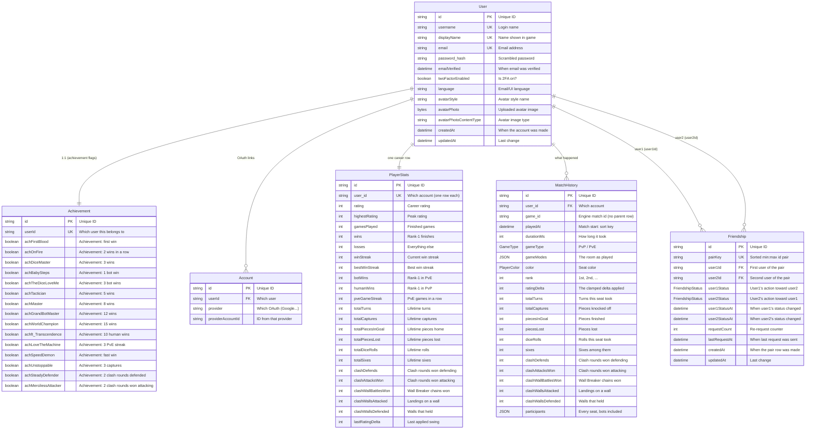

# Database Schema

## Table of Contents

- [Overview](#overview) — Prisma ORM schema for PostgreSQL
- [Enums](#enums) — All enum types used in the database
- [Models](#models) — All 6 models with fields, types, and relations
- [Entity Relationships](#entity-relationships) — ER diagram showing model relations
- [Indexes](#indexes) — Database indexes for query performance


---
---


## Overview

The database uses PostgreSQL 16 with Prisma ORM (Prisma 7, `@prisma/adapter-pg`). The schema defines **6 models** and **3 enums**, one table per job: `User` for the account, `PlayerStats` for the career, `MatchHistory` for what happened, plus `Achievement`, `Account` and `Friendship`. Notifications are not a table: the bell lives in Redis (see [backend-notification-module.md](./backend-notification-module.md) and D12 in `todo.md`). The Prisma client is generated into `backend/generated` (gitignored).

> **Notable shift (2026-11-01):** the career left `User`. `rating`, the
> win/loss record and every streak now live on **`PlayerStats`** (one row per
> account), and a finished match is one **`MatchHistory`** row per seat. `Game`
> and `GameParticipant` are gone with the `GameStatus` enum they needed, and
> `Achievement` still holds **only the achievement flags**.


---
---


## Enums


---
---


### FriendshipStatus

A directional friendship state. Each `Friendship` row stores two of these — one per
side of the pair (`user1Status` / `user2Status`) — so a block on one side can never
be silently rewritten from the other.

```prisma
enum FriendshipStatus {
  none
  pending
  accepted
  declined
  blocked
}
```


---
---


### PlayerColor

```prisma
enum PlayerColor {
  RED
  GREEN
  YELLOW
  BLUE
}
```


---
---


### GameType

```prisma
enum GameType {
  PVP
  PVE
}
```

> There is no `UserStatus` enum — presence is a runtime Redis concern (see `backend-presence-module.md`), with `'online' | 'playing' | 'offline'` derived from the presence key TTL.


---
---


## Models


---
---


### User

The account record and nothing else: identity, credentials, the avatar bytes and
the email language. The career is one `PlayerStats` row, history is
`MatchHistory` rows, and neither is a column here.

| Field | Type | Attributes | Description |
|-------|------|------------|-------------|
| `id` | String | UUID, PK | Unique user identifier |
| `username` | String | Unique | Login name (3-20 chars, alphanumeric + underscore) |
| `displayName` | String | Unique | Display name shown in-game |
| `email` | String? | Unique | Email address (nullable for OAuth-only edge cases) |
| `password_hash` | String? | | bcrypt hash (null for OAuth-only users) |
| `emailVerified` | DateTime? | | When email was verified |
| `twoFactorEnabled` | Boolean | Default: false | Whether email-code 2FA is required at login |
| `language` | String | Default: `"en"` | UI/transactional-email language (`en` \| `fr` \| `ms`) |
| `avatarStyle` | String | Default: `"bottts"` | DiceBear avatar style identifier |
| `avatarPhoto` | Bytes? | | Binary custom avatar image data |
| `avatarPhotoContentType` | String? | | MIME type of custom avatar |
| `avatarThumb` | Bytes? | | 256 px WebP derivative of the photo (the avatar route prefers it) |
| `avatarThumbContentType` | String? | | MIME type of the derivative |
| `createdAt` | DateTime | Auto | Account creation timestamp |
| `updatedAt` | DateTime | Auto | Last update timestamp |

**Relations:** `accounts`, `achievement` (1:1), `stats` (1:1, `PlayerStats`), `history` (`MatchHistory[]`), `friendshipsAsUser1`, `friendshipsAsUser2`

13 columns, and eight of them are identity. Nine career columns moved to
`PlayerStats` and two dead ones (`disconnectCount`, `reconnectCount`, written by
nobody and read by nobody) were deleted outright.


---
---


### Achievement

1:1 with `User`. Holds **only the achievement flags** — no stats, rating, or
avatar data (those live on `PlayerStats` and `User`).

| Field | Type | Attributes | Description |
|-------|------|------------|-------------|
| `id` | String | UUID, PK | Unique identifier |
| `userId` | String | Unique, FK | Owning user |
| `achFirstBlood` … `achMercilessAttacker` | Boolean | Default: false | 16 achievement flags (see `backend-achievements-module.md`) |

**Relations:** `user` (1:1, back-reference)


---
---


### Account

OAuth provider links, one row per provider per user.

| Field | Type | Attributes | Description |
|-------|------|------------|-------------|
| `id` | String | UUID, PK | Unique identifier |
| `userId` | String | FK | Owning user |
| `provider` | String | | Provider name (`google`, `github`, `42`) |
| `providerAccountId` | String | | Provider-side account id |

**Relations:** `user` (back-reference)


---
---


### PlayerStats

The career: one row per account, created with the account (`stats: { create: {} }`)
and updated in place by the postgame write. Every lifetime number a page prints is
read from here — nothing aggregates over history, which is a trimmed window.

| Field | Type | Attributes | Description |
|-------|------|------------|-------------|
| `id` | String | UUID, PK | Spare id (the shape every model has); `user_id` is the real key |
| `user_id` | String | Unique, FK | Owning account |
| `rating` | Int | Default: 0 | Elo-like career rating (the leaderboard rebuild reads this) |
| `highestRating` | Int | Default: 0 | Peak rating achieved |
| `gamesPlayed` | Int | Default: 0 | Finished PvP/PvE games |
| `wins` / `losses` | Int | Default: 0 | Rank-1 / everything else |
| `winStreak` / `bestWinStreak` | Int | Default: 0 | Current and best consecutive wins |
| `botWins` / `humanWins` | Int | Default: 0 | Rank-1 in PvE / in PvP |
| `pveGameStreak` | Int | Default: 0 | Consecutive PvE games (any outcome) |
| `totalTurns` | Int | Default: 0 | Lifetime turns taken |
| `totalCaptures` | Int | Default: 0 | Lifetime pieces knocked off |
| `totalPiecesInGoal` | Int | Default: 0 | Lifetime pieces finished |
| `totalPiecesLost` | Int | Default: 0 | Lifetime pieces sent home by anyone |
| `totalDiceRolls` / `totalSixes` | Int | Default: 0 | Lifetime rolls, and the 6s among them |
| `clashDefends` | Int | Default: 0 | Repulses: clash rounds won as defender |
| `clashAttacksWon` | Int | Default: 0 | Clash rounds won as attacker |
| `clashWallBattlesWon` | Int | Default: 0 | Wall Breaker chains won on a landing that stood a barrier |
| `clashWallsAttacked` / `clashWallsDefended` | Int | Default: 0 | Landings on a wall / walls that held |
| `lastRatingDelta` | Int | Default: 0 | The clamped swing the last match applied |
| `updatedAt` | DateTime | Auto | Last change |

**Relations:** `user` (back-reference, `onDelete: Cascade`)

**Index:** `rating` descending, for the leaderboard rebuild.

A bot has no row: it is a seat in the `match:*` hash, not an account, so the FK is
satisfied by absence and no reader needs a bot filter.


---
---


### MatchHistory

What happened: one row per account per finished match, written once and never
recomputed. There is no parent `Game` row — `game_id` is the engine's match id, and
the row carries its own counters and its own company line.

| Field | Type | Attributes | Description |
|-------|------|------------|-------------|
| `id` | String | UUID, PK | Unique identifier |
| `user_id` | String | FK | The account this row belongs to (cascade with it) |
| `game_id` | String | | The engine's match id — no parent row, no FK |
| `playedAt` | DateTime | | Start of the match: the sort key and the printed date |
| `durationMs` | Int | Default: 0 | End minus start (what `achSpeedDemon` reads) |
| `gameType` | GameType | | PvP or PvE |
| `gameModes` | JSON | | The room as played (`clashEnabled`, `noSafeZones`, `freeExit`, `clashKeyShift`, `playerCount`) |
| `color` | PlayerColor | | Seat colour |
| `rank` | Int | | Final placement |
| `ratingDelta` | Int | | The **clamped** delta that was actually applied, kept forever |
| `totalTurns` | Int | Default: 0 | Turns this seat took |
| `totalCaptures` | Int | Default: 0 | Pieces this seat knocked off |
| `piecesInGoal` | Int | Default: 0 | Pieces this seat finished (0-4) |
| `piecesLost` | Int | Default: 0 | Pieces this seat lost |
| `diceRolls` / `sixes` | Int | Default: 0 | Rolls this seat took, and the 6s among them |
| `clashDefends` | Int | Default: 0 | Repulses (rounds won as defender) |
| `clashAttacksWon` | Int | Default: 0 | Rounds won as attacker |
| `clashWallBattlesWon` | Int | Default: 0 | Wall Breaker chains won |
| `clashWallsAttacked` / `clashWallsDefended` | Int | Default: 0 | Landings on a wall / walls that held |
| `participants` | JSON | | Snapshot of every seat, bots included, so the row renders with no join |

**Relations:** `user` (back-reference, `onDelete: Cascade`)

**Indexes:** `(user_id, game_id)` unique (the idempotency guard), `(user_id,
playedAt DESC)` (the history page), `game_id` ("who else was in my match", and the
postgame/achievement lookups).

**Retention: the newest 50 per user.** The trim runs inside the same postgame
transaction as the insert, so a player's row count is bounded by one game's write.
Nothing derives a lifetime number from these rows (that is `PlayerStats`), which is
why trimming cannot lose a total — and why a retroactive `POST /api/achievements/check`
can only see the last 50 games.


---
---


### Bots

Bots are not stored: a bot's id is the literal string `bot-<color>`
(`bot-red`, `bot-green`, `bot-yellow`, `bot-blue`), built per seat from
`BOT_PREFIX + color`. That id lives in the `match:*` hashes and in the engine's
game state, and it never reaches Postgres. The seat's kind is its own field: the
backend writes `player<N>_isBot = 'true'` beside `player<N>_id`, and that flag is
the only answer — the engine never tests the id's shape, so a room without the
flag seats no bot. A bot seat gets no token of its own:
the backend writes its slot into the match hash and the engine auto-fills it. The
engine reports only the human seats that finished, and `match.postgame` decides
the same question for itself: it drops every reported seat whose colour the hash
flags as a bot, and it writes a row and a rating only after the seat's `User` row
is found (so an unknown id can never reach the foreign key, with or without a
`bot-` prefix).

`backend/src/common/botname-enforce.ts` defines `BOT_PREFIX` and
`isReservedBotName()`. `BOT_PREFIX` names the id a bot seat is minted with;
`isReservedBotName()` keeps a human **username**, **display name** or OAuth seed
out of that namespace (`AUTH_USERNAME_RESERVED`, `AUTH_DISPLAY_NAME_RESERVED`).
No backend reader classifies an id by its shape: what a seat *is* comes from the
hash's `player<N>_isBot` (the abort fan-out and `match.postgame` both read it),
and which account holds a result comes from the `User` row itself. The engine
keeps its own copy of `BOT_PREFIX` in
`backend/app/ludo-engine/src/socket/auth.ts`, used only to mint a bot seat's id,
so bot identity must be changed in both places at once.

The name a bot seat shows is not its id. The creator sends the lobby's own names
as `botNames`, index-aligned with `botColors`, and writes each one to
`player{n}_displayName` as `bot-<color> (<assistant>)`. The engine copies it into
the seat's `displayName`, so the label travels with the match and each client
translates only the colour word.

Modules that must tell humans from bots:

| Module | What it does with bots |
|--------|------------------------|
| Match (`match.creator`, `match.player`, `match.postgame`) | Builds a bot seat as `BOT_PREFIX + color` and writes `player{n}_isBot = 'true'` beside it, so the room hash says what the seat is; stores the lobby's `botNames` label as `player{n}_displayName`; excludes bots from seat and invite lists and from the abort fan-out (which reads the same flag); `match.postgame` drops every seat the hash flags before the transaction, and writes a row and a rating only for a seat whose `User` row exists, so a bot never gets an Elo change, a win/loss tally, a game row, a bell entry or a leaderboard entry |


---
---


### Friendship

One row per **unordered user pair** (a "superset" row), so a pair has a single
record whatever direction a request was made from. Each direction carries its own
status (`user1Status` = user1's action toward user2), so a block on one side can
never be silently rewritten from the other.

| Field | Type | Attributes | Description |
|-------|------|------------|-------------|
| `id` | String | PK | Unique identifier |
| `pairKey` | String | Unique | Sorted `"min:max"` id pair — enforces one row per pair |
| `user1Id` | String | FK | First user of the sorted pair |
| `user2Id` | String | FK | Second user of the sorted pair |
| `user1Status` | FriendshipStatus | Default: none | User1's action toward user2 |
| `user2Status` | FriendshipStatus | Default: none | User2's action toward user1 |
| `user1StatusAt` | DateTime? | | When user1's status changed (TTL / cooldown base) |
| `user2StatusAt` | DateTime? | | When user2's status changed (TTL / cooldown base) |
| `requestCount` | Int | Default: 0 | Re-request bookkeeping |
| `lastRequestAt` | DateTime? | | When the last request was sent (24 h pending TTL) |
| `createdAt` | DateTime | Auto | When the pair row was created |
| `updatedAt` | DateTime | Auto | Last change |

**Relations:** `user1` (FriendshipUser1), `user2` (FriendshipUser2)

> A live `pending` expires after 24 h and a `declined` direction stops blocking
> re-requests after a 1 h cooldown; both are applied lazily on read by the pure
> helpers in `backend/src/friends/friendship-pair.ts` (see
> [backend-friends-module.md](./backend-friends-module.md)).


---
---


## Entity Relationships




---
---


## Indexes

| Model | Field(s) | Type | Purpose |
|-------|----------|------|---------|
| User | `username` | Unique | Fast lookup by username |
| User | `displayName` | Unique | Fast lookup by display name |
| User | `email` | Unique | Fast lookup by email |
| Achievement | `userId` | Unique | 1:1 lookup by user |
| Account | `(provider, providerAccountId)` | Unique | Fast OAuth lookup |
| Account | `userId` | Index | Fast user account lookup |
| PlayerStats | `user_id` | Unique | One career row per account |
| PlayerStats | `rating` | Index (DESC) | The leaderboard rebuild's sort |
| MatchHistory | `(user_id, game_id)` | Unique | The idempotency guard: one row per seat per match |
| MatchHistory | `(user_id, playedAt DESC)` | Index | The history page read |
| MatchHistory | `game_id` | Index | "Who else was in my match", and the postgame lookups |
| Friendship | `pairKey` | Unique | One row per unordered user pair |
| Friendship | `(user1Id, user1Status)` | Index | Fast lookup of a user's user1-direction rows |
| Friendship | `(user2Id, user2Status)` | Index | Fast lookup of a user's user2-direction rows |
