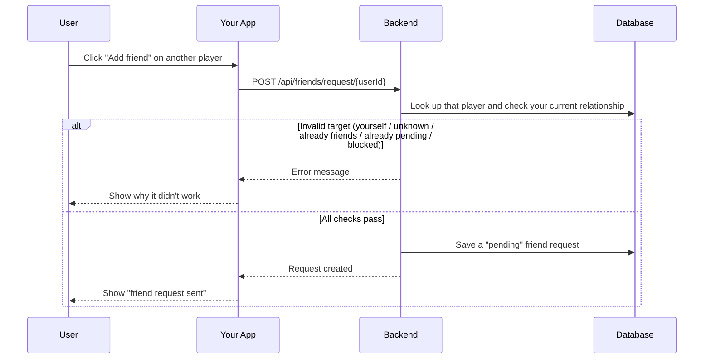
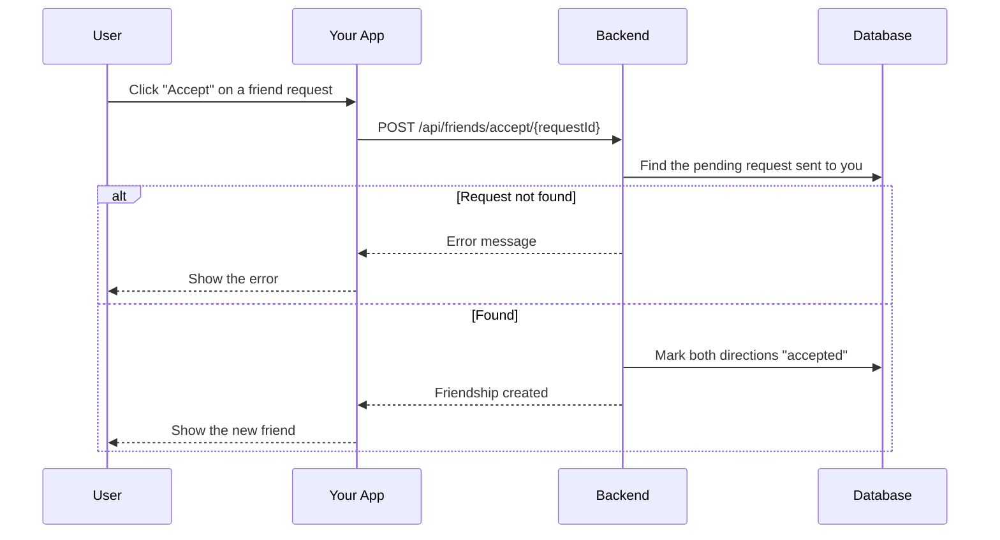
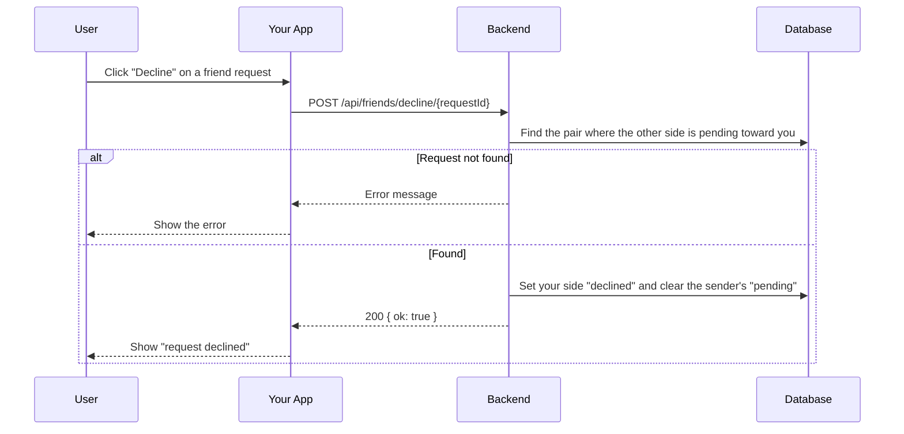
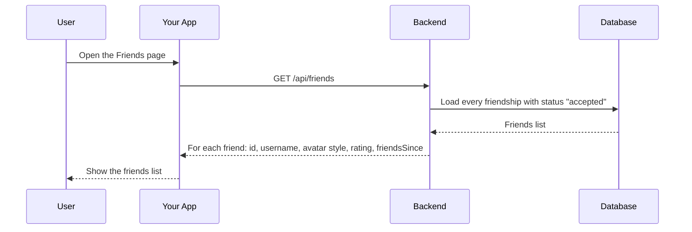
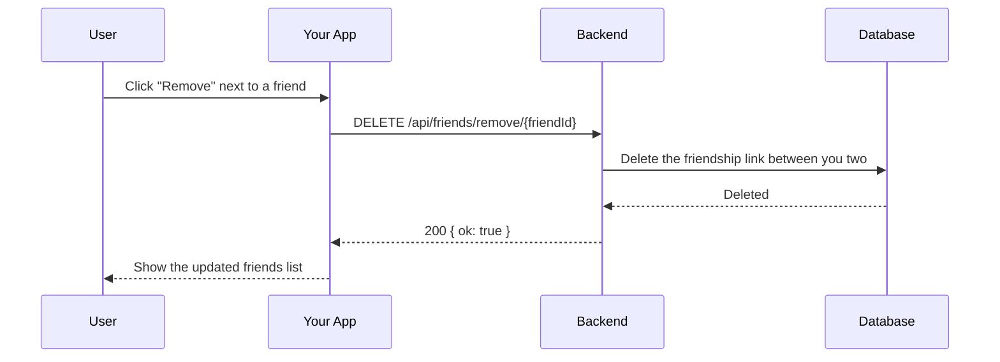
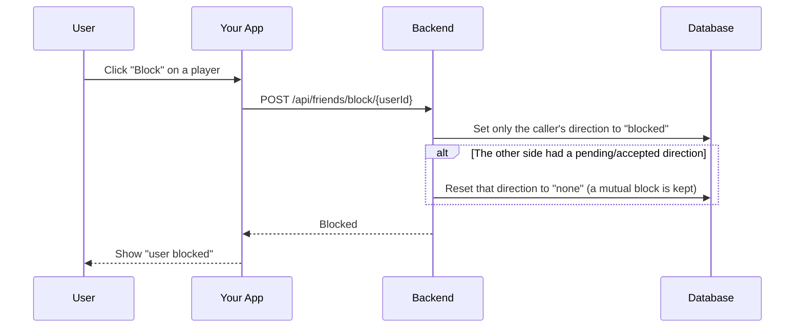
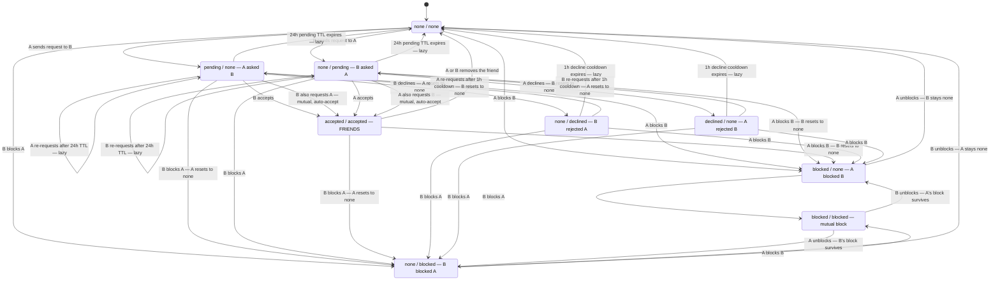

# Friends Module

## Table of Contents

- [Overview](#overview) — Friend request lifecycle and relationship management
- [Files](#files) — Every source file in the module and its role
- [Key Types / Interfaces](#key-types--interfaces) — Friendship status enum and response shapes
- [API Endpoints](#api-endpoints) — All 13 routes with method, path, auth, and description
- [Core Logic / Flow](#core-logic--flow) — Mermaid sequence diagrams for send, accept, decline, list, requests, remove, and block, the read-path block gate, the full pair state machine, the live `friendship:changed` publisher, and the one challenge route
- [Logic Paths Summary](#logic-paths-summary) — Decision trees for each operation
- [Dependencies](#dependencies) — Internal services this module relies on


---
---


## Overview

The Friends module manages the friendship lifecycle between users. It supports:

1. **Friend requests** — send a request to another user.
2. **Accept/Decline** — the recipient can accept or decline a pending request.
3. **Listing** — view all friends with their rating and friendsSince date.
4. **Pending requests** — view sent and received pending requests.
5. **Removal** — remove a friend.
6. **Blocking** — block a user.

Each user pair shares a single **superset row** (`Friendship`) keyed by `pairKey`
(the sorted `"min:max"` id pair). The row carries a **directional status per
side** (`user1Status`, `user2Status`), each one of `none`, `pending`,
`accepted`, `declined`, or `blocked`. A pair counts as friends only when *both*
directions are `accepted`; either directional `blocked` hides the pair
everywhere. A call only ever mutates the caller's own direction (taken from the
JWT), so one user can never rewrite or clear another user's block — this closes
the block/unblock bypass where the other side's status was overwritten.

A live `pending` expires after 24h and a `declined` direction stops blocking
re-requests after a 1h cooldown; both are applied lazily on read via the pure
helpers in `friendship-pair.ts`.


---
---


## Files

| File | Role |
|------|------|
| `friends.controller.ts` | HTTP routes: send, accept, decline, remove, list, requests, block/unblock, blocked list, and the one game challenge (invite, the sent list, pending, dismiss) |
| `friends.service.ts` | Business logic: directional pair transitions, requests, blocking, invites |
| `friendship-pair.ts` | Pure helpers (`pairKey`, `effectiveStatus`, `isFriendPair`, `isBlockedPair`) shared with match + presence — no NestJS/Prisma imports, so no circular DI |
| `friendship-record.ts` | Pure helpers for the live record: `viewerState` (the five viewer-relative states), `stateSince`, and the broadcaster's payload guard. No NestJS/Prisma imports |
| `friendship-events.service.ts` | The `friendship:changed` publisher: `publishPair` (both directions of a changed row) and `publishSubject` (a changed display name / avatar / rating to every accepted friend) |
| `friendship-events.module.ts` | Leaf module exporting the publisher — user, auth and match inject it without a cycle |
| `block-state.service.ts` | The read-path gate: one unordered-pair lookup (`between`) returning `none`, `viewer-blocked-target`, `target-blocked-viewer` or `both`, plus `assertUnblocked` (403 `USER_BLOCKED`, the read path's own code: the request path keeps `FRIEND_BLOCKED`, whose copy is about sending). Prisma-only, injected by User, Achievements and Friends |
| `block-state.module.ts` | The leaf module that exports `BlockStateService` (no service imports, so no cycle) |
| `friends.module.ts` | NestJS module — registers controller, service, and PrismaService; imports `BlockStateModule`, `AvatarMetaModule` and `FriendshipEventsModule` |


---
---


## Key Types / Interfaces

### FriendshipStatus Enum

```prisma
enum FriendshipStatus {
  none       // No action from this side
  pending    // This side sent a request, awaiting response (expires after 24h)
  accepted   // This side consents to the friendship
  declined   // This side rejected the last inbound request (1h sender cooldown)
  blocked    // This side blocked the other
}
```

### Friendship Model

```typescript
{
  id: string;            // Row ID
  pairKey: string;       // Sorted "min:max" id pair, unique (one row per pair)
  user1Id: string;       // Initiator (first requester/blocker)
  user2Id: string;       // Acceptor/target
  user1Status: FriendshipStatus;  // user1's own action toward user2
  user2Status: FriendshipStatus;  // user2's own action toward user1
  user1StatusAt: Date | null;     // When user1 last changed direction
  user2StatusAt: Date | null;     // When user2 last changed direction
  requestCount: number;           // Re-request bookkeeping
  lastRequestAt: Date | null;
  createdAt: Date;
  updatedAt: Date;
}
```

> A pair is friends iff `user1Status === accepted && user2Status === accepted`. Any
> `blocked` on either side hides the pair. `user1StatusAt` / `user2StatusAt` drive
> the lazy 24h pending TTL and 1h declined cooldown.

### Friends List Response Shape

```typescript
{
  id: string;  // Unique ID
  username: string;  // Player's username
  displayName: string;
  avatarStyle: string | null;  // Avatar style name
  avatarV?: number;  // Avatar-meta change stamp → the photo URL's `?v=`
  hasAvatarPhoto: boolean;
  rating: number;  // Player's rating (score)
  friendsSince: Date;  // When the friendship started
  status: 'online' | 'playing' | 'offline';  // Live presence, overlaid from Redis
}
```

> `avatarV` is read for the whole list through **one pipelined** `hgetall` per id
> (`AvatarMetaService.getMany`), not one round trip per row, and it is the same stamp a live
> `friendship:changed` record carries — so first paint and a push describe a row identically.

### Friend Requests Response Shape

```typescript
{
  sent: Array<{  // Requests I sent (my own direction is 'pending')
    id: string;  // Pair row ID (used as requestId for accept/decline)
    userId: string;  // ID of the other user
    username: string;
    displayName: string;
    avatarStyle: string | null;
    avatarV?: number;
    createdAt: Date;
  }>;
  received: Array<{  // Requests sent to me (the other direction is 'pending')
    id: string;  // Pair row ID (used as requestId for accept/decline)
    userId: string;  // ID of the sender
    username: string;
    displayName: string;
    avatarStyle: string | null;
    avatarV?: number;
    createdAt: Date;
  }>;
}
```

> Both lists hide any pair where either side is `blocked`, and drop entries whose
> `pending` is older than the 24h TTL. `id` is the pair row ID, so the same value
> works for both `POST /api/friends/accept/:requestId` and
> `POST /api/friends/decline/:requestId`.


---
---


## API Endpoints

| Method | Path | Auth | Description |
|--------|------|------|-------------|
| `POST` | `/api/friends/request/:userId` | JWT | Send friend request to target user |
| `POST` | `/api/friends/accept/:requestId` | JWT | Accept a pending friend request |
| `POST` | `/api/friends/decline/:requestId` | JWT | Decline a pending friend request |
| `DELETE` | `/api/friends/remove/:friendId` | JWT | Remove a friend by friend's user ID |
| `GET` | `/api/friends` | JWT | List all friends (optional `?username=` filter) |
| `GET` | `/api/friends/requests` | JWT | List pending sent and received requests |
| `GET` | `/api/friends/blocked` | JWT | List users I have blocked |
| `POST` | `/api/friends/block/:userId` | JWT | Block a user |
| `POST` | `/api/friends/unblock/:userId` | JWT | Unblock a user |
| `POST` | `/api/friends/:friendId/challenge` | JWT | Challenge a friend to a duel (`{ hostColor }`). **Creates nothing**: the room is made by the invitee's accept, and the caller is answered with `{ ok, kind: 'challenge' }` |
| `POST` | `/api/friends/:friendId/invite` | JWT | Offer a friend a seat in the waiting room the caller already sits in (`{ gameId }`); answers with the room |
| `POST` | `/api/friends/challenges/:friendId/accept` | JWT | Answer a challenge: gate both seats, create the room, seat the challenger then the invitee, answer the invitee's credentials |
| `POST` | `/api/friends/challenges/:friendId/decline` | JWT | Refuse a challenge: writes one rung of the pair's refusal ladder (`{ ok, streak, until }`) |
| `GET` | `/api/friends/challenges/sent` | JWT | The offers this caller has out (`SentChallenge[]`), which is what every CHALLENGE button greys itself from |
| `GET` | `/api/friends/invites/pending` | JWT | Get my pending offer (a challenge, or a seat in a room) |
| `POST` | `/api/friends/invites/dismiss` | JWT | Dismiss a pending offer without answering it (no ladder write) |

> **Two routes, one per act.** A challenge and a room invite are different objects with
> different lifecycles, and 19.6 split the two shapes that used to share
> `POST /api/friends/:friendId/invite`:
>
> | Act | Route | Body | Room | Answered by |
> |---|---|---|---|---|
> | Challenge (a duel) | `POST /api/friends/:friendId/challenge` | `{ hostColor }` | made at the **accept** | `challenges/:friendId/accept` or `/decline` |
> | Room invite (a seat) | `POST /api/friends/:friendId/invite` | `{ gameId }` | already exists | joining it (`POST /api/match/join/:code`) |
>
> Both send the same four writes — the friendship gate, the `game_invite` notification,
> the invitee's `invite:` record and the sender's `challenge:` record — and neither field
> is optional in practice: a present-but-empty value is refused at the boundary rather
> than read as absent, and each route refuses its own field when it is missing
> (`400 CHALLENGE_COLOR_REQUIRED` / `400 FRIEND_INVITE_ROOM_REQUIRED`).

> **Real-time touches:** friend requests and accepted friendships fire a `NotificationService.notify()` push (bell + `notification` frame), and friend lists show live presence status via `PresenceService.getStatuses()`. A challenge or a room invite sends a `game_invite` notification discriminated by `payload.kind` (`'challenge'` or `'room'`), and an accepted challenge sends `challenge_accepted` back to the challenger, who is already seated in the room it created. The sent record is not pushed, because only the sender reads it, and what spends it is its own five-minute stamp, the friend's answer (accept and decline both delete it), or — for a room invite — the room no longer waiting.


### Timeouts

Three clocks govern the pair row, and all three are **lazy** — nothing is scheduled on the
database; `effectiveStatus()` (`friendship-pair.ts`) normalises the stored status on the
next read, and the refusal deadline is compared on the next send.

| Timeout | Value | Source | Effect when it elapses |
|---|---|---|---|
| Pending request TTL | 24 h | `PENDING_TTL_MS` (`friendship-pair.ts`) | A live `pending` direction reads as `none`: the sender may re-request (`requestCount` +1) and the row drops out of the sent/received lists |
| Decline cooldown | 1 h | `DECLINE_COOLDOWN_MS` (`friendship-pair.ts`) | A `declined` direction reads as `none`, so the declined sender may re-request; before it elapses a retry returns `400 FRIEND_REQUEST_COOLDOWN` |
| Refusal cooldown (challenge) | 2 h → 4 h → 24 h, then 24 h forever | `REFUSAL_LADDER_MS` (`friendship-pair.ts`), stored as `userNRefusalsUntil` | Challenges *toward* the refuser are allowed again; the streak (`userNRefusalStreak`) stays until an accepted challenge on that side resets it, so the next refusal lands on a longer rung |
| Unblock cooldown | none | — | Unblocking is immediate — contact can restart with a fresh request, no waiting period |
| Pending offer record | 5 min | Redis `invite:<userId>`, set `EX 300` by either send | `GET /api/friends/invites/pending` stops returning the offer and Redis drops the key. A challenge that lapses this way costs **nothing**: a timeout is not a refusal |
| Sent-offer record | 5 min | Redis hash `challenge:<senderId>` (`EX 360` on the key, one stamp per entry) | `GET /api/friends/challenges/sent` skips the entry, so the friend may be challenged again; an accept or a decline deletes it earlier, and so does a room invite whose room is no longer `WAITING` |

> The two friendship timeouts are per-direction and independent: each side's
> `pending`/`declined` expires off its own `user1StatusAt` / `user2StatusAt` timestamp. The
> ladder is per-direction for the same reason — four columns, so neither player's rung can
> move the other's — and it lives on the row rather than in Redis because it is not
> transient: the deadline is a couple of hours but the streak outlives it.


---
---


## Core Logic / Flow

### 1. Send Friend Request

Sequence of steps when a user sends a friend request to another user.


### 2. Accept Friend Request

Sequence of steps when a user accepts a pending friend request.


### 3. Decline Friend Request

Sequence of steps when a user declines a pending friend request.


### 4. List Friends

Sequence of steps when a user lists their friends.


### 5. Remove Friend

Sequence of steps when a user removes a friend.


### 6. Block User

Sequence of steps when a user blocks another user.



### 7. Blocks on the read paths (the profile gate)

A block is not only a write-path refusal. Every endpoint that renders a profile checks the
pair, because a deep link or a `curl` bypasses the click and the client router:

| Route | On a block between caller and target |
|---|---|
| `GET /api/user/:username` | `200` with the degraded shape and `visibility` (`blocked-by-you` / `blocked-by-them`): identity + avatar only |
| `GET /api/user/:username/games` | `403 USER_BLOCKED` |
| `GET /api/achievements?username=` | `403 USER_BLOCKED` |
| `GET /api/friends?username=` | `403 USER_BLOCKED` |
| `GET /api/user/id/:userId/avatar` | Served: the bytes are not a capability (the same picture is on the leaderboard) |

`BlockStateService` (`block-state.service.ts`) is the single asker: one `findUnique` by `pairKey`,
no joins, returning `none`, `viewer-blocked-target`, `target-blocked-viewer` or `both`.
`visibilityFor()` maps it to the wire value and reads `both` as `blocked-by-you`, since the caller's
own block is the one still there to lift; after that unblock the next read reports
`blocked-by-them`. It is a Prisma-only leaf behind `BlockStateModule`, so injecting it into
`UserService` does not drag `FriendsService` (and `MatchModule` behind it) into the user module.

The degraded card offers **Unblock** (`POST /api/friends/unblock/:userId`, then a profile refetch);
the blocked party gets the explicit line *"You have been blocked by this user."* Disclosing is a
choice — there are no DMs and `sendFriendRequest` already refuses blocked pairs — and it is what
lets the blocked party know to stop trying. See [`../API-list.md`](../API-list.md) for the exact
payload.


### 8. Full Pair State Machine

The six diagrams above walk through one operation at a time. This one shows the whole
model at once: every persisted row state and every action **user1 (A)** or **user2 (B)**
can take that changes it. Each state is the stored directional pair
`(user1Status, user2Status)` — so the same two people only ever have one box on the
diagram. Solid arrows are real writes to the row; `(lazy)` arrows are expiries applied on
the next read, meaning the stored value is left alone until something normalises it.



> **Legend.** `A` is `user1` (whoever created the row first) and `B` is `user2`. Every
> write touches only the caller's own direction, so A can never change or clear B's status
> — the one exception is the conditional reset, which sets the *other* direction to `none`
> and only when that side is not itself `blocked`. That single rule is what makes the
> mutual-block case (`blocked / blocked`) survive one-sided unblocks, and why a block by
> A always hides the pair from B while still leaving B's own block intact.

> **Fail-closed checks — attempts that change no state.** An action either satisfies its
> precondition or never reaches Prisma. These are rejected (or idempotent):
>
> | Attempted action | Rejected when | Result |
> |---|---|---|
> | A requests B | either side is `blocked` | `403 FRIEND_BLOCKED` |
> | A requests B | both directions are already `accepted` | `400 FRIEND_ALREADY` |
> | A requests B | A's own direction has a live `pending` | `400 FRIEND_REQUEST_PENDING` |
> | A requests B | B's direction is `declined` inside the 1h cooldown | `400 FRIEND_REQUEST_COOLDOWN` |
> | A requests themself | — | `400 FRIEND_REQUEST_SELF` |
> | A accepts B | no live inbound `pending` for A | `404 FRIEND_REQUEST_NOT_FOUND` |
> | A accepts B | either side is `blocked` | `403 FRIEND_BLOCKED` |
> | A declines B | no live inbound `pending` for A | `404 FRIEND_REQUEST_NOT_FOUND` |
> | A removes B | the pair is not currently friends | `404 FRIEND_NOT_FOUND` |
> | A blocks B | A already blocked B | idempotent `200` |
> | A blocks themself | — | `400 FRIEND_BLOCK_SELF` |
> | A unblocks B | A's own direction is not `blocked` | `404 FRIEND_BLOCK_NOT_FOUND` |
> | A invites B to a game | the pair is not currently friends | `403 NOT_FRIENDS_WITH_USER` |
> | A invites B to a game | either side is `blocked` | `403 FRIEND_BLOCKED` |
> | A invites themself | — | `400 FRIEND_INVITE_SELF` |
> | A challenges or invites B | an offer to B is already out (5 min, or its room still waiting) | `409 CHALLENGE_ALREADY_SENT` |
> | A challenges B | B refused a challenge recently and the ladder's window still runs | `409 CHALLENGE_COOLDOWN` (carries `retryAfterMs`) |
> | A challenges B | A already holds a seat in a live game | `403 MATCH_ALREADY_SEATED` (a duel would seat them twice) |
> | A challenges B | no `hostColor` in the body | `400 CHALLENGE_COLOR_REQUIRED` |
> | A invites B into a room | no `gameId` in the body | `400 FRIEND_INVITE_ROOM_REQUIRED` |
> | A invites B into a room | the room is not the caller's, or is not `WAITING` / `PVP` | `403 MATCH_NOT_PLAYER` / `403 MATCH_ALREADY_STARTED` / `403 MATCH_PVP_ONLY_INVITE` (from `assertInvitableRoom`) |
> | A accepts B's challenge | A holds no pending challenge from B | `404 CHALLENGE_NOT_PENDING` |
> | A accepts B's challenge | A is not `online` / A already holds a seat | `403 CHALLENGEE_OFFLINE` / `403 CHALLENGEE_BUSY` |
> | A accepts B's challenge | B is not `online`, or holds a seat, after the 2 s poll | `403 CHALLENGER_OFFLINE` / `403 CHALLENGER_BUSY` |
> | A declines B's challenge | A holds no pending challenge from B | `404 CHALLENGE_NOT_PENDING` |
>
> The four accept failures name **which side** is missing and none of them touches the
> ladder: a challenger who was not looking at the screen is never charged a refusal for a
> failed accept. Only `POST /api/friends/challenges/:friendId/decline` writes a rung.


---
---


### 9. Live records on the session socket (`friendship:changed`)

The screens used to poll for this: `Home.tsx` every 12 s, `Friends.tsx` every 15 s and the in-game
friend list every 5 s. Since Phase 3 a write publishes **one record per recipient** instead, and the
client merges it over its first-paint snapshot.

```
friends.service.ts (mutation)     FriendshipEventsService.publishPair(a, b)
        │                                   │
        │  1. publishPair(user, target)     ├─ Prisma: the pair row + both profiles (1 query)
        ├──────────────────────────────────▶├─ presence.getStatuses([a, b])  ← 0 watchers → stop
        │                                   ├─ avatars.getMany([a, b])       ← 1 pipelined read
        │                                   └─ publish friendship:<a> and friendship:<b>
        │                                              │ each: { state, friend }, viewer-relative
        │                                              ▼
        │                                    RealtimeBroadcaster (Redis subscriber)
        │                                              │ parseFriendshipRecord() guards the shape
        │                                              ▼
        │                                    gateway.emitToFriends(recipient, record)
        │                                              │ server.in('friends:of:<id>').emit(...)
        ▼                                              ▼
   HTTP response                             every tab of that account
```

> **The profile select reads the career row (fixed 2026-11-02).** `PROFILE_SELECT` asks for
> `stats: { select: { rating: true } }` and builds `rating: user.stats?.rating ?? 0`. The
> account/stat split (`bb381b2`) moved `rating` off `User`, and the select here was missed: every
> publish threw a Prisma validation error that the publisher's own `catch` swallowed into a warning,
> so friends lists and the chat filter's live path (`noteBlockState`) silently stopped updating.
> The `chat/` probe family in `Test-harnesses/` caught it; keep the two selects in step with
> `friends.service.ts`'s list and blocked routes, which already read `stats`.

**Audience is a subscription, not a graph.** Every session socket joins `friends:of:<ownUserId>` in
`handleConnection`, next to `user:<id>`; the id comes from the handshake, never from a client payload,
so a crafted join cannot read another account's rows. Joining at connect (rather than on a
client-sent `friends:watch`) also removes the subscribe-before-first-paint race: the listener exists
for the whole life of the connection, and there is no second client → server event.

**The zero-watcher short-circuit uses the presence row, not an in-memory counter.** A record is built
only if at least one recipient is not `offline` in Redis. That is the same signal an in-memory counter
would carry (a row exists while a socket is open), it needs no new state, and it is correct across
instances — the only cost of its 45 s TTL is a rare wasted read. The common case (the other account
has no tab open) costs one `mget` and no Prisma read.

**Nine trigger sites**, all fire-and-forget after the write commits (a live-update failure must never
fail the mutation):

| Trigger | File | Publication |
|---|---|---|
| request (first contact, resend, mutual auto-accept) | `friends.service.ts` | `publishPair(caller, target)` |
| accept | `friends.service.ts` | `publishPair(pair.user1Id, pair.user2Id)` |
| decline | `friends.service.ts` | `publishPair(...)` → both sides read `none` |
| remove | `friends.service.ts` | `publishPair(...)` |
| block | `friends.service.ts` | `publishPair(...)` → blocker `blocked`, other side `none` |
| unblock | `friends.service.ts` | `publishPair(...)` → back to `none` (or `blocked` if the other side still holds one) |
| display-name change | `auth.service.ts` (`updateProfile`) | `publishSubject(userId)` → an `accepted` record to every accepted friend |
| avatar upload / delete | `user.service.ts` | `publishSubject(userId)` |
| postgame rating | `match.postgame.service.ts` | `publishSubject(userId)` per human participant, after the transaction |

The last three are the **content** half of a row (display name, avatar, rating): they had no trigger
before, and they are exactly what the 12 s / 15 s pollers were quietly keeping honest.

**Viewer-relative state.** `viewerState` maps the stored pair to one of `accepted`, `pending-in`,
`pending-out`, `blocked`, `none`. Order matters: the viewer's own block reads `blocked` (it is theirs
to lift), a block held by the other side reads `none` (the row disappears rather than announcing
itself), and a `declined` direction inside its cooldown reads `none`. `requestId` is set only while a
request is pending, because that is the id accept/decline take, and `friendsSince` is the timestamp of
the **current** state (friends since / blocked since / requested at).

**Repair paths, not a patch log.** A record is the whole row, so a lost frame is repaired by the next
read: the screens re-fetch on mount, on socket reconnect and on window focus. That is why no `seq` or
version field exists — a WebSocket is ordered per connection, and a new connection resyncs. Known
bounded staleness: a pending request that hits its 24 h TTL (`effectiveStatus`) while the screen is
open does not re-push, so it lingers until the next focus/refocus.

**Third-party lists are never pushed.** `GET /api/friends?username=X` stays fetch-on-navigate: its
payload would have to be filtered per viewer, which is exactly the viewer-dependence the room model
avoids. Only the owner's own list is live.

### 10. Challenge a friend, and answer it (`POST /api/friends/:friendId/challenge` → `/accept` | `/decline`)

A challenge is a duel, and nothing about it exists until the friend answers it:

```mermaid
sequenceDiagram
    participant Sender
    participant Server as FriendsService
    participant Match as MatchService
    participant Redis
    participant B as The friend

    Sender->>Server: POST /api/friends/{friendId}/challenge { hostColor }
    Server->>Server: self? pair friends? either side blocked?
    alt an offer to this friend is still out
        Server-->>Sender: 409 CHALLENGE_ALREADY_SENT
    end
    alt the friend's ladder still runs
        Server-->>Sender: 409 CHALLENGE_COOLDOWN (retryAfterMs)
    end
    alt the sender already holds a seat
        Server-->>Sender: 403 MATCH_ALREADY_SEATED
    end
    Server->>B: notification game_invite { kind: 'challenge', fromUserId, hostColor }
    Server->>Redis: SET invite:{friendId} = { kind: 'challenge', fromUserId, hostColor, sentAt } (5 min)
    Server->>Redis: HSET challenge:{sender} {friendId} -> { kind: 'challenge', sentAt }
    Server-->>Sender: { ok: true, kind: 'challenge' } — no room exists yet

    B->>Server: POST /api/friends/challenges/{sender}/accept
    Server->>Server: gate: B online? B seated? then poll A (100 ms x 20)
    alt either side missing
        Server-->>B: 403 CHALLENGER_OFFLINE / _BUSY / CHALLENGEE_OFFLINE / _BUSY
    end
    Server->>Match: createInvite(sender, undefined, hostColor)
    Match-->>Server: the room, sender seated at their corner
    Server->>Match: joinMatch(gameId, B, firstFreeColor(hostColor))
    Match-->>Server: B's credentials
    Server->>Server: reset B's own rung on the pair row
    Server->>Redis: DEL invite:{B}; HDEL challenge:{sender} {B}
    Server->>A: notification challenge_accepted { gameId, inviteCode }
    Server-->>B: credentials — B enters the room
```

**The room is created at the accept, not at the send.** A room made at the send holds an
id, seats and colours for a challenge that may never be answered, and it blocks both
players from starting anything else while it waits. So the send writes the four records
and stops, and the accept is the one request that creates: `createInvite` seats the
challenger at the corner they named, `joinMatch` seats the invitee at the first free
one (`firstFreeColor`), and the challenger is told with `challenge_accepted` — a frame
carrying the room code, because they are the host and the lobby's rejoin is what opens
it. A join that fails after the room was made closes the room rather than leaving it
waiting with the challenger's seat inside.

**The accept is gated on both seats.** `presence.getStatus(user) === 'online'` and
`seatedMatch(user) == null`, checked for the invitee once and for the challenger on a
100 ms poll for about two seconds (`awaitChallengerFree`) — the two answers arrive a
second or two apart in practice, and refusing on the first tick would spend a challenge
that was about to be answered. The four answers are named and none of them is a refusal:
`CHALLENGER_OFFLINE`, `CHALLENGER_BUSY`, `CHALLENGEE_OFFLINE`, `CHALLENGEE_BUSY`.

**The refusal ladder.** A decline is the only act that costs anything: the pair row's
`userNRefusalStreak` (the refuser's own side) goes up by one and `userNRefusalsUntil`
becomes `now + REFUSAL_LADDER_MS[streak - 1]` — two hours, then four, then a day, and a
day for every one after. The next challenge *toward* the refuser is `409
CHALLENGE_COOLDOWN` until that instant passes; the refuser may still challenge the other
way, and a room invite is not gated by it (a seat offer is answered by joining, not by
declining). An accept resets the accepter's own side to zero, and a challenge that simply
expires costs nothing at all — ignoring an invitation is not the same act as refusing it,
so a player who was not looking at the screen is never locked out.

Two consequences worth naming, because they follow from "the ladder prices a history of
refusals" rather than from a timer: the streak survives an unfriend (the pair row does, at
`none`/`none`) and picks up where it left off if the friendship is made again, and a block
leaves both sides exactly where they were — a block is not a refusal, so it neither adds a
rung nor clears one, and a window bought before the block can still be running after the
unblock.

**One offer per friend at a time.** Before either route runs, the sender's own
`challenge:<senderId>` hash is read through the same reader the sent list uses, so a
second press is `409 CHALLENGE_ALREADY_SENT` instead of a second pending offer. The
record is spent by its own five-minute stamp, by the friend's answer (accept and decline
both delete it), and — for a room invite — by the room no longer being `WAITING`
(`MatchService.isWaitingRoom`). The reader is `GET /api/friends/challenges/sent`, which
is what every CHALLENGE button greys itself from after a reload: no SPA constant mirrors
the window, so the grey state cannot outlive the server's own answer.

**The room invite is unchanged in spirit.** `POST /api/friends/:friendId/invite` offers a
seat in the room the caller already sits in, so it never creates anything and answers with
that room. The friend is still not seated by it: a seat owns a colour, so they claim one
when they join, and a friend already seated elsewhere is refused where the seat is
actually taken (`403 MATCH_ALREADY_SEATED` from `joinMatch`).


---


## Logic Paths Summary

### Block / unblock fan-out (M3)

```
POST /api/friends/block/:userId  (JWT)
  ├── upsert the pair to 'blocked' (+ the two publishes it already had)
  ├── publishRoomsChanged(redis)            → a room holding either side stops being a row
  └── publishBlocksChanged(redis, a, b, true) → 'blocks:changed' on the engine, which stamps the
                                              pair's cut with that room's own chat sequence

POST /api/friends/unblock/:userId (JWT)
  └── publishBlocksChanged(redis, a, b, false) → the room's ledger drops the pair
```

The engine side is `socket/block-subscriber.ts`: it scans the live rooms, keeps the pair only when
both accounts are seated in one, and writes `{ a, b, atSeq }` into that room's state (an unblock
removes it). Pre-block lines are never deleted, so the player who blocked keeps the record of what
happened; a block placed mid-game is never announced and never ejects anybody.

The other two surfaces a block closes are about the door rather than the room, and both are in the
match module: a room that seats either side is not a row in the other's open list
(`lobbyRoomsFor`, server-side), and its seats cannot be claimed (`assertNoBlockedSeat` answers the
blocker `403 MATCH_SEAT_BLOCKED` and the blocked party the neutral `403 MATCH_ROOM_UNAVAILABLE`).
A seat already held is never touched, so the waiting-room case is the same as the mid-game one:
the match plays out and the host's remedy is ABORT. See
[backend-match-module.md](backend-match-module.md) → Blocked pairs at the door.

### Send Friend Request Path
```
POST /api/friends/request/{userId} (JWT required)
  ├── Check target is self → 400 FRIEND_REQUEST_SELF
  ├── Check target exists → 404 USER_NOT_FOUND
  ├── Load the pair by pairKey
  ├── No row → create pair (caller = user1, user1Status 'pending') + notify → 201
  ├── Either side 'blocked' → 403 FRIEND_BLOCKED
  ├── Both sides 'accepted' → 400 FRIEND_ALREADY
  ├── Caller's own direction live 'pending' → 400 FRIEND_REQUEST_PENDING
  ├── Other side 'declined' within 1h → 400 FRIEND_REQUEST_COOLDOWN
  ├── Other side live 'pending' (mutual request) → set both 'accepted', notify → 200
  └── Otherwise (re)send: caller 'pending', reset an expired other side → 201
```

### Accept Friend Request Path
```
POST /api/friends/accept/{requestId} (JWT required)
  ├── Load row by id; caller must be a member → 404 FRIEND_REQUEST_NOT_FOUND
  ├── Other direction must be live 'pending' → 404 FRIEND_REQUEST_NOT_FOUND
  ├── Either side 'blocked' → 403 FRIEND_BLOCKED
  ├── Set both directions 'accepted'
  └── 200 (friendship row); notifies the sender friend_accepted
```

### Decline Friend Request Path
```
POST /api/friends/decline/{requestId} (JWT required)
  ├── Load row by id; caller must have a live inbound 'pending' → 404
  ├── Caller's direction := 'declined' (starts the sender's 1h cooldown)
  ├── Sender's direction := 'none'
  └── 200 { ok: true }; notifies the sender friend_declined
```

### List Friends Path
```
GET /api/friends (JWT required)   ← first paint / reconnect / window focus only
  ├── With ?username=<other>: blockState.assertUnblocked → any block → 403 USER_BLOCKED
  ├── Find pairs where caller is user1/user2 AND both directions 'accepted'
  ├── Map to { id, username, displayName, avatarStyle, hasAvatarPhoto, rating, friendsSince }
  ├── One pipelined avatar-meta read → avatarV per row
  ├── Overlay live presence via PresenceService.getStatuses()
  └── 200 [{ …, status }]; every later change arrives as friendship:changed
```

### Remove Friend Path
```
DELETE /api/friends/remove/{friendId} (JWT required)
  ├── Load pair by pairKey; must be friends (both 'accepted') → 404 FRIEND_NOT_FOUND
  ├── Reset both directions to 'none' (row kept as a log)
  └── 200 { ok: true }; notifies the friend friend_removed
```

### Block User Path
```
POST /api/friends/block/{userId} (JWT required)
  ├── Check target is self → 400 FRIEND_BLOCK_SELF
  ├── No row → create pair (caller = user1, 'blocked')
  ├── Caller already 'blocked' → idempotent 200
  ├── Set caller's direction 'blocked'; reset the other side to 'none'
  │   unless the other side is itself 'blocked'
  └── 200 { ok: true } ({ id } when the block row is created)
```

### Unblock User Path
```
POST /api/friends/unblock/{userId} (JWT required)
  ├── Load pair by pairKey; the caller's own direction must be 'blocked' → 404
  ├── Set caller's direction 'none'; reset the other side to 'none'
  │   unless the other side is itself 'blocked'
  └── 200 { ok: true } (friendship is not restored)
```


---
---


## Dependencies

| Dependency | Purpose |
|-----------|---------|
| `PrismaService` | Database access (Friendship, User models) |
| `PresenceService` | Live status in friend lists |
| `MatchService` | Create the room a challenge's accept makes (`createInvite`), seat the invitee in it (`joinMatch`), assert a room the caller already sits in (`assertInvitableRoom`), read whether a room invite's room is still `WAITING` (`isWaitingRoom`), and ask whether an account holds any seat at all (`seatedMatch`) |
| `NotificationService` | Push `friend_request` / `friend_accepted` / `friend_declined` / `friend_removed` / `game_invite` (both `kind`s) / `challenge_accepted` notifications |
| `BlockStateService` | `getFriends`'s pair gate on `?username=` (403 `USER_BLOCKED`); reads never trust the client router |
| `AvatarMetaService` | `avatarV` for the friends / requests / blocked lists (one pipelined read per list) |
| `FriendshipEventsService` | The `friendship:changed` publisher called after every membership mutation |

| `friendship-pair.ts` | Shared pure predicates (`pairKey`, `isFriendPair`, `isBlockedPair`) reused by match + presence, plus the refusal ladder (`REFUSAL_LADDER_MS`, `refusalSide`, `nextRefusal`) that only this module reads |
| `Redis` (ioredis) | Pending offer records (`invite:<userId>`, either kind) and the sent-offer hash (`challenge:<senderId>`) that `GET /api/friends/challenges/sent` reads and the 409 is decided on |
| `JwtAuthGuard` | Protects all friend endpoints |