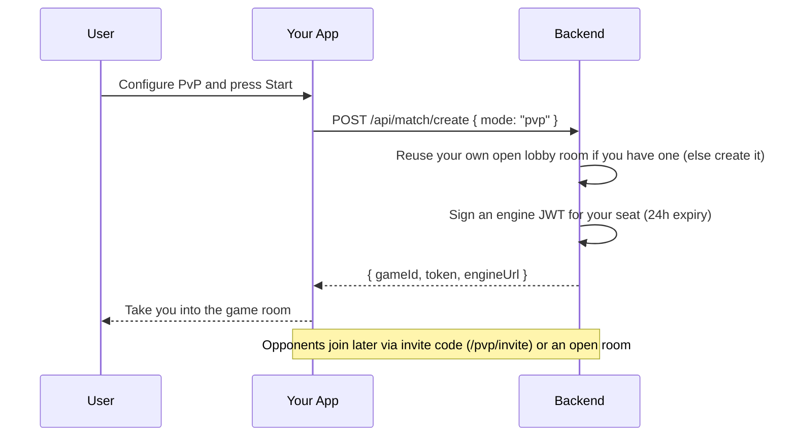
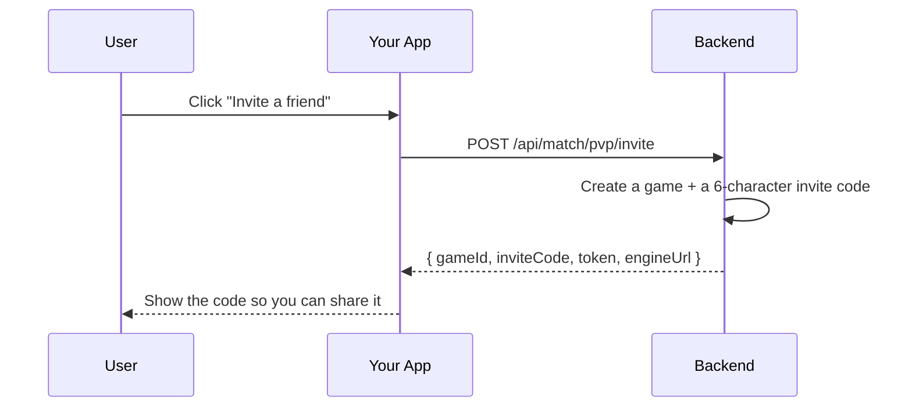
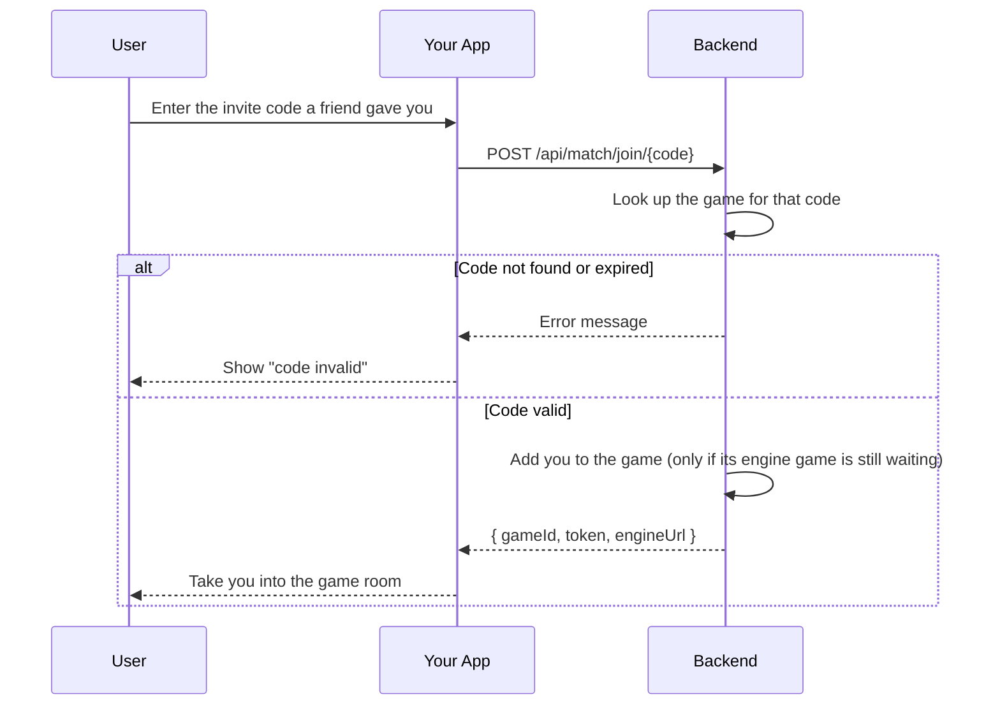
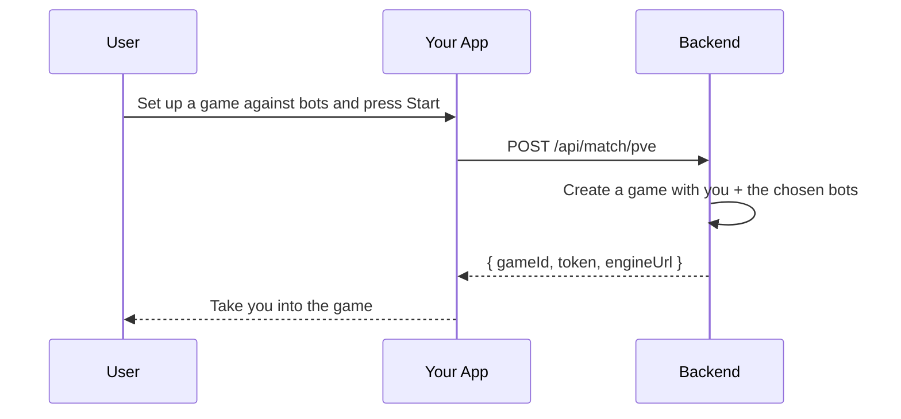
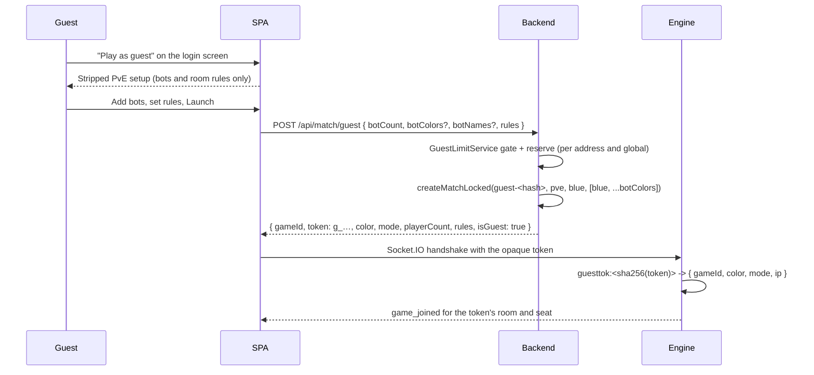

# Match Module

## Table of Contents

- [Overview](#overview) — Matchmaking and the game lifecycle
- [Files](#files) — Every source file in the module and its role
- [Key Types / Interfaces](#key-types--interfaces) — Match creation DTOs and response shapes
- [API Endpoints](#api-endpoints) — Matchmaking endpoints and in-game actions
- [Engine GameState Readers](#engine-gamestate-readers-seat-finalizationts) — Reads of the engine's own live state
- [Strict State Lock](#strict-state-lock-active-gamets) — One live game per player, enforced on every create/join path
- [Core Logic / Flow](#core-logic--flow) — Mermaid sequence diagrams for match flows
- [Logic Paths Summary](#logic-paths-summary) — Decision trees for each operation
- [Lobby invalidation](#lobby-invalidation-roomschanged--roomslist--roomsmine) — `rooms:changed`, the one snapshot and the per-viewer diff that replaced the polls
- [Which seats a result may write](#which-seats-a-result-may-write-post-apigameend) — the bot flag, the account check, and who earns a rating
- [Dependencies](#dependencies) — Internal services this module relies on
- [Configuration / Environment](#configuration--environment) — Redis and engine configuration


---
---


## Overview

The Match module is the bridge between the REST API and the real-time ludo-engine. It handles:

1. **Matchmaking** — creates or joins PvP, PvE, or invite games.
2. **Game lifecycle** — moves the engine's game state through `waiting` → `active` → `finished`, and the match record through `WAITING` → `ACTIVE` → `ABORTED`, or deletes the hash once the game-end callback has written the results.
3. **Room browsing** — `GET /api/games/rooms` lists the PvP rooms you may enter (open lobby rooms, plus your own still-reclaimable seats in games that have already started), and `GET /api/games/mine` lists the rooms you are seated in.

The module uses Redis for short-lived match data (queues, active games) and lets the ludo-engine own the actual game logic over Socket.IO.


---
---


## Files

| File | Role |
|------|------|
| `match.controller.ts` | HTTP routes: matchmaking, game actions, room browsing, engine callbacks |
| `match.service.ts` | Facade — composes the four split services (`MatchCreatorService`, `MatchPlayerService`, `MatchQueryService`, `MatchPostgameService`) and re-exports the `GameEndPayload` type from `match.postgame.service.ts` (`ENGINE_WS_URL` is defined/exported by `match.creator.service.ts`) |
| `match.creator.service.ts` | Match creation: PvP/PvE/hotseat, invite codes, room joining, bot seeding |
| `match.player.service.ts` | In-game actions: join, rejoin, invite friend, ready, exit, cancel |
| `match.query.service.ts` | Browse queries: open rooms, my rooms |
| `match.postgame.service.ts` | `POST /api/game/end` processing (scoring, ratings, persists the clash tallies, achievements) |
| `seat-finalization.ts` | Engine GameState readers — `isSeatFinalized()` (can this seat still be rejoined?) and `isEngineGameStarted()` (has the ready-check already started the game?). Used by `GET /api/games/mine`, `GET /api/games/rooms`, `POST /api/game/:id/rejoin`, `POST /api/match/join/:code`, and the create reuse lookup |
| `active-game.ts` | The strict state lock — `findLiveMatch()`: the live game this player already holds a seat in (`{ gameId }`, or `null`). Composes the `match:*` hash status with `isEngineGameStarted()`; backs every create (all modes), `POST /api/match/join/:code`, `POST /api/game/:id/invite`, rejoin refusal, and the sign-out that ends the room. `matchSeatIds()` lists a hash's four seat ids for the account-deletion sweep |
| `engine-token.util.ts` | `signEngineToken()` — signs the game-scoped Socket.IO tokens with `ENGINE_JWT_SECRET` and `aud: 'ludo-engine'` (the single place both mint sites below go through) |
| `match.module.ts` | NestJS module — registers all services, PrismaService |


---
---


## Key Types / Interfaces

### MatchMode

```typescript
type MatchMode = 'pvp' | 'pve' | 'hotseat'
```

### CreateMatchBody

```typescript
{
  mode: 'pvp' | 'pve' | 'hotseat';  // REQUIRED — no silent fallback
  playerCount?: number;      // 2-4 (2 or 4 for PvE)
  botCount?: number;         // 0 - (playerCount-1), PvE only
  botColors?: string[];      // Optional per-bot slot colors
  botNames?: string[];       // Optional per-bot assistant names, index-aligned with botColors
  seatColors?: string[];     // Optional human seat colors, the host's corner first
  hostColor?: string;        // REQUIRED at runtime: the host's own corner (no fallback)
}
```

The host owns a corner before any other seat exists: `hostColor` is required in every mode and
`MATCH_INVALID_COLOR` answers its absence or a colour outside the room. The written `seatColors` starts
with the host's colour and continues in canonical order, cut to `playerCount`, and a PvE or hotseat
create refuses a list that does not hold the host's colour. A PvP joiner claims theirs in the join
request (`color`), and the claim is final: `joinMatch` resolves that colour's slot and writes it with
`HSETNX`, so one of two racing joiners gets the seat and the other gets `MATCH_COLOR_TAKEN`. There is no
default corner and no in-room swap.

`botNames` names the bot on each `botColors` slot. The backend stores each one as `player{n}_displayName = bot-<color> (<assistant>)`, which the engine copies to that seat's `displayName`; the seat keeps its `bot-<color>` identity, and the hash's `player{n}_isBot = 'true'` is what marks it as a bot. An empty or missing entry leaves the seat showing its plain id.

### InviteFriendDto

```typescript
{
  friendId: string;  // REQUIRED, UUID — validated by class-validator. The route
                     // then requires a both-directions-accepted, unblocked pair.
}
```

### MatchResponse

```typescript
{
  gameId: string;            // UUID of the match
  token: string;             // JWT for the Socket.IO handshake
  engineUrl: string;         // Socket.IO endpoint name. Derived from `FRONTEND_URL`
                             // (`ENGINE_WS_URL`, prefix `http` → `ws`). The SPA does not use it
                             // to connect — it connects to its own origin.
  color: string;             // Assigned seat color (server-chosen)
  mode: 'pvp' | 'pve' | 'hotseat';  // Game mode (persisted for refresh/rejoin)
  playerCount: number;       // How many players/seats
  inviteCode?: string;       // 6-char code (invite games only)
}
```


---
---


## API Endpoints

| Method | Path | Auth | Description |
|--------|------|------|-------------|
| `POST` | `/api/match/pvp/invite` | JWT | Create invite-only PvP match |
| `POST` | `/api/match/join/:code` | JWT | Join PvP match by invite code |
| `POST` | `/api/match/pve` | JWT | Start PvE (vs bot) game |
| `POST` | `/api/match/create` | JWT | Unified match creation (mode required: pvp/pve/hotseat) |
| `POST` | `/api/match/guest` | public (CSRF + rate limited) | Anonymous, ephemeral PvE room behind a stripped setup screen; returns the same handoff with `isGuest: true` |
| `POST` | `/api/game/:id/ready` | JWT | Signal player is ready |
| `POST` | `/api/game/:id/exit` | JWT | Acknowledge leaving post-game |
| `POST` | `/api/game/:id/abort` | JWT | Cancel unstarted game |
| `POST` | `/api/game/:id/rejoin` | JWT | Rejoin a room after refresh |
| `POST` | `/api/game/:id/invite` | JWT | Invite a friend into a WAITING PvP room |
| `GET` | `/api/games/rooms` | JWT | List the PvP rooms the caller may enter (open lobby rooms + their own reclaimable seats in started games) |
| `GET` | `/api/games/mine` | JWT | List rooms the user is seated in |
| `POST` | `/api/game/end` | engine key (`X-Engine-Key`) | Engine callback — process game end (scoring/achievements); persists `clashDefends` / `clashAttacksWon` per participant |
| `POST` | `/api/game/:id/started` | engine key (`X-Engine-Key`) | Engine callback — mark game started |

> **Invite body validation:** `POST /api/game/:id/invite` takes an
> `InviteFriendDto` (`{ friendId }`). `friendId` is validated as a required UUID
> by the global `ValidationPipe`, so an empty or malformed body is rejected at the
> boundary instead of silently skipping the friendship check. The handler then
> requires one friendship pair row where both directions are `accepted` and
> neither is `blocked`, reusing the shared `friendship-pair.ts` predicates.

> **One live game at a time:** every create and every join path refuses a caller
> who already holds a seat in a live game with `403 MATCH_ACTIVE_GAME`; the only
> exception is reclaiming the very room being rejoined. See
> [Strict State Lock](#strict-state-lock-active-gamets).


---
---


## Engine GameState Readers (`seat-finalization.ts`)

**Source:** `backend/src/match/seat-finalization.ts`

Both helpers read the engine's own live state instead of trusting the `match:*` hash, because the hash can lag behind the engine (and, before the guards below existed, a duplicate create could rewrite a live `ACTIVE` room back to `WAITING`).

### `isSeatFinalized(redis, gameId, color)`

This helper answers one question: can this seat still be rejoined? It is used in three places — `GET /api/games/mine` (stop advertising a match to a departed player), `GET /api/games/rooms` (stop offering a rejoin row for a seat the engine is done with) and `POST /api/game/:id/rejoin` (refuse to mint a token for a seat that is gone). It is evaluated on the caller's seat regardless of the hash status, because a `WAITING` room has engine state too.

The engine owns the authoritative live game state (`game:{gameId}` hash, field `state`, one JSON blob). A seat whose `PlayerMeta.status` is `exited` (pruned on grace expiry, or removed by End Game) is terminal: the player can never resume that seat, so the backend must stop treating the match as rejoinable for them. `exited` is the only terminal status.

Deliberately **not** terminal:

| Status | Why it can still rejoin |
|--------|-------------------------|
| `disconnected` | The grace window (45 s) is running; the player can still come back |
| `inactive` | A waiting-room leave, or a seat that has not joined a live game yet |

The helper is fail-open: a missing key, unreadable value, or schema drift returns `false`, which keeps the match advertised rather than locking a legitimate player out.

A torn-down room has no engine state at all (teardown deletes `game:{gameId}`), so this helper cannot refuse a rejoin into it — that gate is the hash status, checked first in `MatchPlayerService.rejoin()`: a hash reading `ABORTED` (or legacy `ENDED`) answers `404 MATCH_GAME_NOT_FOUND`, the same statuses the strict lock below ignores. A `WAITING` room never carries one of them, so reclaiming a lobby seat is unaffected.

### `isEngineGameStarted(redis, gameId)`

Answers: has the engine's ready-check already started this game? A room is only a lobby until then, and a game that has started accepts no new seats.

- `GET /api/games/rooms` uses it to keep started rooms out of the joinable list for every viewer who does not hold a seat in them (the hash status alone is not enough: a room whose hash was rewritten back to `WAITING` is still a running game).
- `POST /api/match/join/:code` → `MatchPlayerService.joinMatch()` re-checks it, so a stale hash cannot be used to seat a new player into a running game.

It reports `true` for any engine status other than `waiting` and `false` when the engine has no state yet (a pure lobby room) — the same fail-open policy as `isSeatFinalized`.

> The holes these gates closed, and the socket rules that depend on them, are in [`../architecture.md`](../architecture.md) → Security & Threat Model.


---
---


## Strict State Lock (`active-game.ts`)

**Source:** `backend/src/match/active-game.ts`

One live game per player. `findLiveMatch(redis, userId, exceptGameId?)` returns the room this player already holds a seat in — `{ gameId }`, or `null` — and it is the single implementation behind every "one game at a time" refusal (a caller that only needs the boolean tests the result):

| Call site | Effect when a live game exists |
|-----------|--------------------------------|
| `MatchCreatorService.createMatchLocked()` — `POST /api/match/create`, `/api/match/pve`, `/api/match/pvp/invite` | `403 MATCH_ACTIVE_GAME`, checked before the idempotent PvP reuse lookup so a mid-game caller is never handed any room |
| `MatchPlayerService.joinMatch()` — `POST /api/match/join/:code`, `POST /api/game/:id/invite` (seats the invited friend), `POST /api/friends/:friendId/invite` (seats the challenged friend) | `403 MATCH_ACTIVE_GAME` |
| `MatchPlayerService.rejoin()` — `POST /api/game/:id/rejoin` | `403 MATCH_ACTIVE_GAME` for a **different** room; the room being rejoined never counts (`exceptGameId`), so reclaiming your own seat still works. Checked after the closed-room gate above (`404` for `ABORTED`/`ENDED`) |
| `AuthService.logout()` — `POST /api/auth/logout` | not a refusal: the revoked token already names the user, so the same answer decides which room to publish `match:abandon` for, and the engine ends that seat (see [Sign-out ends the match](#sign-out-ends-the-match)) |

A room counts as live when the caller is seated in it and either

- the hash status is `ACTIVE` — the game is on (`POST /api/game/:id/started` flips it), or
- `isEngineGameStarted()` reports `true` — the hash can lag behind the engine, so a `WAITING` room whose ready-check already started the game is still live.

Rooms whose hash says `ABORTED` (an abort, or the engine's expiry teardown) are finished and never lock their players out, even while the hash lingers for the rest of its TTL; a room finished by its results has no hash at all (the game-end callback deletes it), and a legacy `ENDED` value written by an older build is treated as finished too. A `WAITING` lobby room is not live either: a player may keep one lobby room open and still create or join elsewhere — the create reuse lookup hands their existing seat back instead of opening a second room.

The check is backend-authoritative because the backend owns the `match:*` state. The frontend mirrors it as a hint only: `LudoLobby` greys out host/join (with a tooltip) while `/api/games/mine` reports a room, and `Lobby`'s launch button does the same from a one-shot `/api/games/mine` read. `NotificationToast` goes further on accept: if a challenge arrives while another game is stored in `activeMatch`, it `POST`s `/api/game/:id/abort` for that game first — which marks that room `ABORTED`, however far along it was — so switching rooms cannot trip this lock. A refused create/join surfaces as the localized `errors.MATCH_ACTIVE_GAME` message wherever the request was made.

### Sign-out ends the match

Signing out must not leave a live room behind a seat that can never come back (D7). `AuthService.logout` revokes the refresh token — `SessionService.revoke()` returns the `userId` it already read, so no second lookup — and then asks `findLiveMatch()` which room that account holds. When there is one, it publishes `match:abandon` with `{ gameId, userId }` through `publishMatchAbandon()` in `common/channels.ts`.

The backend stops there on purpose. The room state belongs to the ludo-engine, and the departure is not a hash write: `finalizeDeparture` parks the seat's pieces, advances the turn, publishes `player_exited` + `state_update`, and tears the room down when fewer than two active humans remain (a 2-player room and any PvE room therefore end; a 3-4 player room plays on with the seat `exited`). The engine's `MatchAbandonSubscriber` owns that call and applies it under the game lock, exactly like a grace-window expiry. No `MatchModule` dependency is added to `AuthModule`: `active-game.ts` imports only `ioredis` and `seat-finalization.ts`, so `AuthService` calls it directly with the Redis client it already holds.

Both steps are best effort and independent. A Redis hiccup on the publish is logged, never surfaced: the sign-out itself already happened, and the seat still ends through its own disconnect window — `handlePlayerDisconnect` opens one on the closing socket, and its expiry finalizes the same seat with `'timeout'` instead of `'leave'`.


---
---


## Core Logic / Flow

### 1. Create a PvP Match



### 2. Create Invite Match



### 3. Join by Invite Code



### 4. Start PvE Game




---
### 5. Guest PvE Game (public door)



The full design, including the budgets, the registry keys and the settlement paths, is in
[`../guest-mode.md`](../guest-mode.md).

- **No account, no session.** The route has no `JwtAuthGuard`; CSRF and the
  global throttler still apply, and nginx gives the exact location its own
  `guest` zone (10 r/m, burst 5) instead of the generic `/api/` budget.
- **The payload cannot widen the room.** `CreateGuestMatchDto` takes
  `botCount` (1-3), optional `botColors`/`botNames` and the three rules; `mode`,
  `playerCount`, `seatColors` and `gameId` are not accepted. The mode is forced
  to `pve`, the human seat is blue, and the seat order is derived as
  `['blue', ...botColors]` so sparse bot layouts are dealt as shown.
- **The seat id is per mint:** `guest-<sha256(token)>`, never a per-IP id (a
  shared NAT id would hand the second student a `MATCH_ACTIVE_GAME` refusal).
  The create lock and the live-match scan are skipped: the id is unique, so
  both are no-ops, and a full hash scan per anonymous mint is pure cost.
- **Budgets** live in `GuestLimitService`'s single `GUEST_LIMITS` block:
  per-address mints (soft 10 -> delay ladder, hard 40 / 6 h), aborts priced
  double at the next mint, 3 live rooms per address and a global live-room
  ceiling. The engine writes the abort/live counters from its own socket path;
  the backend decides every limit.
- **The engine trusts a registry, not a signature.** `guesttok:<sha256(token)>`
  is written at mint with a 1 h TTL; the handshake branches on the `g_` prefix,
  resolves the record and marks the socket `isGuest`. Guests may drive the
  game events and `end_game`/`leave_game`, and are refused `player_ready` and
  `update_modifiers` silently (an allow-list, so future
  events are closed by default).
- **Nothing is written at the end.** The match hash carries `isGuest=true`, so
  the engine never calls `/api/game/end` or `/api/game/:id/started` for it: no
  `MatchHistory` rows, no `PlayerStats` counters and no leaderboard, exactly like
  hotseat. An abort
  instead prices the counter, frees the live-room slots and revokes the token;
  a normal finish frees the slots without pricing an abort.


---

## Logic Paths Summary

### Create PvP Path
```
POST /api/match/create   (mode: "pvp")
  ├── The caller already sits in a live game → 403 MATCH_ACTIVE_GAME
  │   (strict state lock, all modes, checked before any reuse)
  ├── Validate the mode and the seat counts
  ├── Reuse lookup: does the caller already sit in one of their own PvP rooms?
  │   ├── hash WAITING + engine game not started + their seat not finalized
  │   │   → hand back that room and their EXISTING seat (colour, role,
  │   │     inviteCode, playerCount) and write nothing to the hash
  │   └── otherwise → create a fresh room below. A started game is never
  │       reused: the player keeps ghosting in it (or keeps its 45 s
  │       reclaimable seat) and may start or join something else meanwhile
  ├── Write the match hash (status WAITING) with a 24h TTL
  ├── Sign the engine JWT for the host seat (`jwt.sign`, 24h expiry)
  └── Return { gameId, token, engineUrl }
```

### Invite Path
```
POST /api/match/pvp/invite
  ├── Same create-or-reuse path as above (host seat, inviteCode on create),
  │   including the strict state lock
  └── Return { gameId, inviteCode, token, engineUrl }

POST /api/match/join/:code
  ├── SCAN match:* for a room whose inviteCode matches and whose status is WAITING
  │   ├── no match → 404 MATCH_INVITE_INVALID
  │   ├── the caller is the host → 400 MATCH_OWN_INVITE
  │   └── found → joinMatch (see In-Game Actions Path)
```

### PvE Path
```
POST /api/match/pve
  ├── The caller already sits in a live game → 403 MATCH_ACTIVE_GAME
  ├── Create the match with the host and the chosen bots
  ├── Write the match hash with status ACTIVE
  ├── Sign the engine JWT for the host seat
  └── Return { gameId, token, engineUrl }
```

### In-Game Actions Path
```
POST /api/game/:id/ready
  └── Mark player ready → return { message, gameId }

POST /api/game/:id/exit
  └── Acknowledge post-game exit → return { message, gameId }

POST /api/game/:id/abort
  ├── Verify the caller holds a seat → else 403 MATCH_NOT_PLAYER
  ├── Mark the room ABORTED, then publish the room change
  └── `match_cancelled` to every other seat the hash does *not* flag
      `player<N>_isBot` (a bot seat has no bell to ring) → return { gameId }

POST /api/game/:id/invite
  └── Seat the invited friend through joinMatch, so the strict state lock
      applies to them too → return their seat to the host

POST /api/game/:id/rejoin
  ├── A live game in ANOTHER room → 403 MATCH_ACTIVE_GAME (this room excluded)
  ├── Verify the caller holds a seat → else 403 MATCH_NOT_PLAYER
  ├── Their seat is finalized (isSeatFinalized, any hash status) → 403 MATCH_SEAT_EXPIRED
  └── Clear the reservation flag and mint a fresh engine JWT

POST /api/match/join/:code → joinMatch
  ├── The caller already holds a seat → hand back that seat (rejoin rules above)
  ├── A live game in another room → 403 MATCH_ACTIVE_GAME
  ├── hash status is not WAITING → 403 MATCH_ALREADY_STARTED
  ├── the engine has already started the game → 403 MATCH_ALREADY_STARTED
  ├── not a PvP room → 403 MATCH_PVP_ONLY_JOIN
  ├── room full → 403 MATCH_ROOM_FULL
  └── Seat the caller in the next free slot → return { gameId, token, engineUrl }

GET /api/games/mine
  ├── Scan match:* hashes where the caller is seated
  ├── Skip rooms that are not WAITING or ACTIVE
  └── Their seat is finalized (isSeatFinalized, any status) → skip, so no
      REJOIN MATCH button is offered for a seat that is gone

GET /api/games/rooms
  ├── Scan match:* hashes (WAITING or ACTIVE, PvP)
  ├── The caller holds a seat in the room → REJOIN row
  │   ├── their seat is finalized → skip (nothing left to rejoin)
  │   └── otherwise list it even when the game is live or the room is full
  ├── The caller holds no seat → JOIN row
  │   ├── hash status ACTIVE, or the engine has started the game → skip
  │   │   (a started room is visible only to its own reclaimable seats)
  │   └── room full → skip
  └── Every row carries mySeat, so the lobby knows to rejoin instead of join,
      plus readRoomRules(hash): clashEnabled, noSafeZones, freeExit and
      clashKeyShift, which the browser shows as the MODES cell (absent fields read
      as the standard room; the switch count is 0 unless clash mode is on)
```


---
---


## Lobby invalidation (`rooms:changed` → `rooms:list` / `rooms:mine`)

The lobby and the rejoin banner are pushed, not polled (socket consolidation, Phase 2).

**Publishers.** Every write that can change either list publishes `rooms:changed` with no payload:

| Side | Where |
|------|-------|
| Backend | `MatchCreatorService` (`createMatch` write, `handoffExistingRoom` seat reclaim), `MatchPlayerService` (`joinMatch` seat, `rejoin` reclaim, `exitGame` free seat, `cancelGame` abort, `markStarted`), `MatchPostgameService` (`processGameEnd` deletes the hash) — all through `publishRoomsChanged(this.redis)` from `backend/src/common/channels.ts` |
| Engine | `RedisGameStore`'s match-key methods: `updateMatchData`, `setIdleSince`, `clearIdleSince`, `setSeatUser`, `clearSeatUser`, `clearMatchSeat`, `reserveMatchSeat`, `abortMatch` — each calls its own `notifyRoomsChanged()`, because the engine is a separate build with no import path into the backend |

Both sides are best-effort: a failed publish is logged and repaired by the tick below, never raised to
the caller that caused the write.

**The diff.** `RealtimeBroadcaster` subscribes to the channel, debounces **500 ms** (a burst is one
snapshot read), calls `MatchQueryService.snapshot()` once, and derives each connected viewer's payload
from it:

- `snapshot()` reads every `match:*` hash in one scan, **one engine-state read per room** (which seats
  the engine finalized, and whether it started), and one Postgres query for the hosts. Everything
  viewer-independent is resolved once.
- `lobbyRoomsFor(snapshot, viewerId)` and `myRoomsFor(snapshot, userId)` are the pure filters that
  build the two payloads. They are the *same functions* the REST routes use, so the push and
  `GET /api/games/rooms` / `/api/games/mine` cannot drift.
- A payload is emitted only when its JSON changed for that viewer, so a room that changed for
  somebody else never repaints this viewer's screen.
- The cache is pruned to the accounts that still have a socket, so a reconnect always receives the
  current state instead of diffing against stale bytes.

**The repair tick.** Every 30 s the broadcaster recomputes and emits on change, and logs
`[rooms] repair tick emitted N diff(s)` when it had to. It is both insurance (a crash between write
and publish, a reconnecting subscriber) and the counter that makes a missed publish visible: a steady
non-zero count is a coverage hole in the publisher list above.

**The client.** `LudoLobby` and `RetroNavbar` subscribe to the events and keep one REST read for first
paint (plus one per reconnect, since the push carries only a diff). Neither screen polls any more.


---
---


## Which seats a result may write (`POST /api/game/end`)

A finished game becomes rows, ratings and a leaderboard entry in one transaction, and only
human seats are allowed in. The engine already reports human seats only
(`result-submitter.ts` drops a seat whose state says `isBot`), but the backend answers that
question itself instead of trusting the payload:

- **The room hash's flag is the answer.** `botSeatColors(matchData)` reads
  `match:<gameId>`'s `player<N>_isBot = 'true'`, taking each slot's colour from
  `player<N>_color` (a hotseat room may skip a colour). Every reported participant whose colour
  is in that set is dropped before anything is written; nothing looks at the shape of an id.
- **The flag-filtered list is the one everything downstream uses.** It is what the PvP minimum
  counts (`MATCH_END_PVP_MIN_PLAYERS`), what the transaction inserts and rates, what goes into
  `leaderboard:global`, and what receives the `match_finished` bell entry and the friends'
  `publishSubject` refresh.
- **A seat with no `User` row writes nothing.** The row and the rating are written only after
  `tx.user.findUnique()` returns a user: `game_participant.user_id` is a foreign key, so an
  unknown id would roll back the whole transaction (every other participant's rating included).
  This is also what keeps a `bot-<color>` id out of the record when the room hash is gone (a
  Redis restart mid-game leaves nothing flagged) — the account check, not an id prefix.
- **The winner's colour still comes from the report.** A bot may win a PvE game; the client
  should render "red won" with a placeholder name. `notifyMatchFinished` therefore takes both
  lists: `participants` for the rank-1 colour, and the scored list for the username lookup and
  for who gets a bell.

`Test-harnesses/bot-seats/postgame-seat-probe.ts` is the live proof: six rooms POSTed to this
route with the engine key, including a PvP room whose only second seat is a bot (refused) and a
seat flagged `isBot` that carries a real account's id (that account stays untouched).


`processGameEnd` moves every human participant's rating inside one transaction. A friend's list shows
that rating, and before Phase 3 the 12 s / 15 s pollers were what kept it honest. Now, after the
transaction commits and the postgame notifications are sent, the service calls
`FriendshipEventsService.publishSubject(userId)` once per participant that got a row — the seats the
room flags as bots were dropped before the transaction, and a seat with no `User` row got no row to
publish: the publisher reads the subject's fresh row and pushes an `accepted` record with the new
`rating` to every accepted friend who has a socket open.

Two properties are deliberate:

- **After the commit, fire-and-forget.** A live-update failure is logged, never raised into
  `POST /api/game/end`, and nothing is published for a rating that could still roll back.
- **One publish per participant, no coalescing.** The four participants of a 4-player game are four
  different subjects with four different audiences, so a per-`(recipient, subject)` coalescer would
  merge nothing; a single game-end request publishes at most one record per (friend, participant)
  pair.

See [backend-friends-module.md](backend-friends-module.md) → *Live records on the session socket* for
the record's shape and the watcher short-circuit.


---


## Implementation Notes

- **Room rules are normalized once, at the service boundary** (`match.creator.service.ts`). `normalizeRoomRules` applies the defaults and the coercion for every caller, and `roomRuleHashFields` writes the result in the same `HSET` as the seats, so a room never exists without its rules. Keys and defaults live in `room-rules.ts`; the engine freezes them at join, and the lobby may change them only while the room is WAITING.

- **The key-shift count is clamped in two places, on purpose.** `clashKeyShift` is the one rule that is a number (0, 1 or 2 switches per clash) rather than a boolean, so it carries its own clamp: `clampClashKeyShift` in `backend/src/match/room-rules.ts` on this side of the wire, and the same body in `backend/app/ludo-engine/src/engine.ts` on the engine side, which the join also reads through when it builds a game from the match hash. The two are separate packages with no shared import path, so `room-rules-harness.ts` compares the two function bodies instead of trusting a comment: same text, same behaviour. Both force 0 whenever `clashEnabled` is false, so "the mutator is on but clash is off" cannot be stored or read, and a junk value (a string, a float, a boolean, an array) clamps to a legal count rather than reaching the state.


---


## Dependencies

| Dependency | Purpose |
|-----------|---------|
| `Redis` (ioredis) | Match state, invite codes; match.postgame posts finished-game ratings into `leaderboard:global` (zadd) |
| `PrismaService` | Game history, rating updates, achievement evaluation |
| `NotificationService` | `game_invite` / `match_cancelled` / `match_finished` pushes to the seated players |
| `AchievementsService` | Achievement evaluation after a game ends (`match.postgame`) |
| `JwtService` | Host for the engine-token signer (`engine-token.util.ts` overrides the secret per call, so the module's own `JWT_SECRET` is not what signs match tokens) |
| `secrets.ts` | `ENGINE_API_KEY` (validating engine callbacks, compared in constant time by `verifySecret`) and `ENGINE_JWT_SECRET` (signing engine tokens) |

> Presence is **not** a match dependency: no `match.*` service imports `PresenceService`.
> Presence is read off the session socket now (see `backend-presence-module.md`): the connection is the
> liveness signal, and the match page only sends `presence:playing` on enter/leave.


---
---


## Configuration / Environment

| Variable | Default | Used By |
|----------|---------|---------|
| `REDIS_HOST` | `redis` | Redis connection for match state |
| `REDIS_PORT` | `6479` | Redis port |
| `REDIS_PASSWORD` | (from secrets) | Redis authentication |
| `ENGINE_API_KEY` | (from secrets) | Validates `POST /api/game/end` and `/api/game/:id/started` from engine. Compared with `verifySecret()` (both sides SHA-256-hashed, then `timingSafeEqual`, so a wrong-length key cannot throw or leak its length) and the entrypoint preflight rejects a build where it is empty |
| `ENGINE_JWT_SECRET` | (from secrets) | Signs the Socket.IO engine tokens handed to clients (`signEngineToken`, `engine-token.util.ts`) — separate from the session `JWT_SECRET` so one leaked key cannot forge the other token family. Required: the preflight rejects a build without it |
| `FRONTEND_URL` | `https://localhost:8443` (from `.env`) | Derives `ENGINE_WS_URL` by replacing `http` with `ws`; required, so the app throws at startup if it is unset |

### Tunable constants

| Constant | File | Default | What it controls |
|----------|------|---------|------------------|
| `SLOT_COLORS` | `match.creator.service.ts`, `match.player.service.ts` | blue, red, green, yellow | Seat order used when creating/joining rooms |
| `ENGINE_WS_URL` | `match.creator.service.ts` | derived from `FRONTEND_URL` | WebSocket URL handed to clients for the ludo-engine |
| `POINTS_PER_PIECE` | `common/scoring.ts` | 2 | Rating points per piece brought home (halved for PvE) |
| `WIN_BONUS_PIECE` | `common/scoring.ts` | 1 | Extra "piece" counted for the winner when scoring |