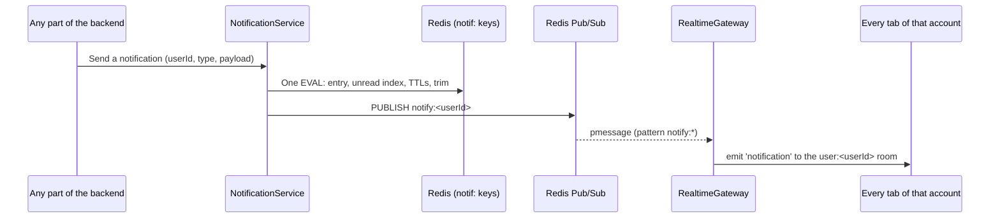

# Notification Module

## Table of Contents

- [Overview](#overview) — Real-time notifications via the session socket + a Redis bell
- [Session socket & Redis Pub/Sub transport](#session-socket--redis-pubsub-transport) — how a frame reaches every tab
- [Storage: Redis instead of Postgres (D12)](#storage-redis-instead-of-postgres-d12) — the two `notif:` keys
- [Failure contract](#failure-contract) — notifications never throw; delivery is best-effort
- [Files](#files) — Source file inventory
- [Key Types / Interfaces](#key-types--interfaces) — NotificationType, NotificationPayload
- [API Endpoints](#api-endpoints) — the two write routes
- [Core Logic / Flow](#core-logic--flow) — Mermaid sequence diagram of notify → socket delivery
- [Logic Paths Summary](#logic-paths-summary) — Decision trees
- [Dependencies](#dependencies) — Internal and external dependencies


---
---


## Overview

The Notification module delivers notifications to users and keeps their bell. It combines two mechanisms:

1. **Storage** — the bell is a Redis structure per account (D12): a `notif:<userId>` hash of id → frame JSON plus a `notif:<userId>:unread` sorted set of the unread ids. Both expire after 14 days, hold at most 150 entries, and lose an entry the moment it is read.
2. **Real-time push** — `notify()` publishes on Redis Pub/Sub (`notify:<userId>`) and the session socket delivers the frame to every tab that account has open (`notification`). The unread list is re-sent on every connect (`notifications:unread`), which is the bell's only read path: there is no SSE stream and no REST list route.

Notification types: `friend_request`, `friend_accepted`, `friend_removed`, `friend_declined`, `game_invite`, `achievement`, `match_finished`, `match_cancelled`, `profile_updated`, `display_name_changed`, `friend_online`, `friend_offline`, `avatar_changed`.

> **The `friend_*` types are not the friendship feed.** Each one is addressed to a single side of a
> pair (`friend_request` → the target, `friend_accepted` → the requester, `friend_removed` → the
> removed friend) and carries only a display name; none of them says which list a row belongs to or
> what the viewer-relative state is. The live lists ride `friendship:changed` on the session socket
> instead (see [backend-friends-module.md](backend-friends-module.md) → *Live records on the session
> socket*): one record per changed pair, both sides, with the whole row. `friend_online` /
> `friend_offline` keep their job — they are the only live source for the friends list's presence
> dots, which the client reads out of the notification stream.

> `avatar_changed` is a SHORT-LIVED/TRANSIENT state update rather than a notification: its payload is `{ userId, username, has, style, v, updatedAt }`. It is delivered with `notifyTransient()` to **the owner alone** (never `broadcast()`), so no other account is ever told that this user changed their photo. Clients flip that user's avatar immediately — to the photo on upload (`has: true`) or back to the generated avatar on delete (`has: false`) — and put `v` in the photo URL so the browser is forced to fetch the new bytes. One event, one audience: the owner's other tabs stay in step while the tab that uploaded already applied the change locally. The `avatar_changed` event itself never reaches the bell: the change is confirmed to that same single audience by a stored `profile_updated` entry (`items: ['avatar']`, written by the same upload/delete call in `UserService`), so it lands in the owner's own bell and toast and in nobody else's.
>
> `display_name_changed` is owner-only for the same reason: `AuthService.updateProfile` pushes it with `notifyTransient(userId, …)`, so the actor gets a single confirmation toast ("You have changed your Displayname to …") and no other user is told. Its payload is `{ fromUserId, fromUsername, oldDisplayName, displayName }`. It never reaches the bell either.
>
> The frames ride the session socket (`/ws`, see [`../architecture.md`](../architecture.md) → *Session realtime*), so Socket.IO's own ping/pong is the keep-alive. Nothing in this module writes a heartbeat: the connection is kept alive by the transport, and a socket that reconnects is handed the unread list again. See [`../architecture.md`](../architecture.md) → Connection liveness.

> The module is imported by `FriendsModule`, `MatchModule`, `AchievementsModule`, `PresenceModule`, `AuthModule`, `UserModule` and `RealtimeModule`. The first six inject `NotificationService` and call `notify()` / `notifyTransient()`; the realtime gateway installs the deliverer and reads the connect snapshot. It exports `NotificationService` so any module can send a notification.


---
---


## Session socket & Redis Pub/Sub transport

A frame travels over two linked mechanisms:

- **Redis Pub/Sub** is the message bus. `notify()` publishes the event to the
  recipient's per-user channel (`notify:<userId>`); `broadcast()` publishes to
  the global channel (`notify:all`). Redis decouples the emitter from delivery:
  any backend service can publish without knowing who is connected.
  `broadcast()`/`notify:all` is still wired end-to-end but currently has **no
  callers**: every event is either per-user (`notify`) or per-recipient
  (`notifyTransient`), so nothing is announced to every connected client.
- **The session socket** is the final hop to the browser. The service owns one
  pattern subscription (`psubscribe('notify:*')`) for the life of the process,
  rather than a per-user subscribe/unsubscribe cycle, and hands each parsed frame
  to a **deliverer** that the gateway installs at boot. The gateway routes
  `notify:<userId>` to that account's `user:<userId>` room and `notify:all` to
  every socket. Multi-tab is a property of the room: every tab that account has
  open receives the frame, with no per-user array to maintain and no per-user
  stream cap to enforce (the old F-11 cap and its 429 went with SSE).

The unread list is pushed on connect: `handleConnection` calls
`getUnread(userId)` and emits `notifications:unread`. That snapshot is what
repairs a frame published while the socket was down, and it is re-sent on every
reconnect. The client merges by `id` in both directions, so a frame that races
the snapshot is neither lost nor duplicated. It is also the only read path: a
client that cannot open the socket shows "notifications unavailable" rather than
an empty bell.

### Storage: Redis instead of Postgres (D12)

A notification is a nudge, not durable data: what it announces (a friend request,
an achievement, a finished match) already lives in its own table. The bell is
therefore two bounded, self-cleaning keys per account:

| Step | Redis |
| --- | --- |
| write (`notify`) | one `EVAL`: `HSET notif:<uid> <id> <json>`, `ZADD notif:<uid>:unread <createdAt ms> <id>`, `EXPIRE` both at 14 days, then while the set is past 150 `ZPOPMIN` the oldest id and `HDEL` it |
| unread read (`getUnread`) | `ZREVRANGE notif:<uid>:unread 0 -1`, `HMGET notif:<uid> ...`, dropping ids whose field has gone |
| `markRead` | `HDEL notif:<uid> <id>` + `ZREM notif:<uid>:unread <id>`: reading deletes |
| `markAllRead` | `DEL notif:<uid> notif:<uid>:unread` |
| account deletion | `DEL notif:<uid> notif:<uid>:unread` (replaces the old `onDelete: Cascade`) |

The trim runs inside the write, so a second tab cannot push the set past the cap
between two client calls. The id is an app-side `randomUUID()` and `createdAt` is
stamped once, so the zset score and the payload agree. `getUnread` drops ids whose
hash field has gone, so the badge never counts a ghost. A read in one tab is
visible to the others at their next connect, because the snapshot is the
reconciliation point and there is no removal frame. There is no cleanup job:
the TTL is the cleanup. A Redis restart without persistence empties every bell:
enabling AOF (the Redis durability item in `todo.md`) is what makes the 14-day
window real. A `FLUSHALL` or an eviction still costs the bell, and that is a
deliberate scope call: "notifications are not long-term data".


---
---


## Failure contract

Notifications are a **non-critical side effect** of the actions that trigger them
(friend request/accept/decline/remove, game invite, game end, achievement unlock,
avatar update, …). A notification failure must never make a successful action look
failed, and must never partially fail the action it accompanies. The service
therefore guarantees:

- **`notify()`, `broadcast()` and `notifyTransient()` never throw.** No caller
  needs a try/catch around them; any existing `.catch()` is defensive only.
- **`notify()` writes to Redis first.** If the write fails, the notification is
  dropped and logged (`[notifications] write failed ...`); the caller's action is
  unaffected. If only the live Redis publish fails, the stored entry is kept: the
  recipient still sees it in the bell on the next connect, just without a
  real-time toast (`[notifications] live push failed ...`).
- **`broadcast()` / `notifyTransient()` are purely ephemeral** (a socket frame,
  nothing stored). A failed publish logs a warning and nothing is lost: there was
  nothing to store in the first place.
- **No connection state lives in this service.** The old per-user Subject arrays,
  the SSE teardown path and the F-11 stream cap are gone: delivery is the
  gateway's room emit, and a socket that drops simply reconnects and receives the
  snapshot.


---
---


## Files

| File | Role |
|------|------|
| `notification.controller.ts` | HTTP routes: mark read / mark all read (the only two left) |
| `notification.service.ts` | The `notif:` store (Lua write, reads, deletes), the Redis pub/sub subscription and the deliverer hook, `notify()` helper |
| `notification.module.ts` | NestJS module: registers controller/service, exports `NotificationService` |


---
---


## Key Types / Interfaces

### NotificationType

```typescript
export type NotificationType =
  | 'friend_request'
  | 'friend_accepted'
  | 'friend_removed'
  | 'friend_declined'
  | 'game_invite'
  | 'achievement'
  | 'match_finished'
  | 'match_cancelled'
  | 'profile_updated'
  | 'display_name_changed'
  | 'friend_online'
  | 'friend_offline'
  | 'avatar_changed';
```

### NotificationPayload

```typescript
export interface NotificationPayload {
  id: string;  // Unique ID (randomUUID, minted by the service)
  type: NotificationType;  // Type of notification
  payload: Record<string, unknown>; // per-type data (e.g. { fromUsername, gameId, ... })
  read: boolean;  // Kept for the wire shape; always false, because reading deletes
  createdAt: string; // ISO string, also the zset score in ms
}
```


---
---


## API Endpoints

| Method | Path | Auth | Description |
|--------|------|------|-------------|
| `PATCH` | `/api/notifications/:id/read` | JWT | Read one notification: the server deletes it (idempotent, a missing id is a no-op) |
| `POST` | `/api/notifications/read-all` | JWT | Read everything: both `notif:` keys are deleted |

The frames themselves (`notification`) and the unread list (`notifications:unread`)
arrive on the session socket, not over HTTP. There is no list route: a client that
cannot open the socket cannot receive a notification either, so a REST snapshot
would only ever be a list that never updates.

The two writes stay on HTTP because they are user actions over ids the client
already received: the JWT refresh, the route throttle and the error surface are
already there.


---
---


## Core Logic / Flow

### 1. Notify → socket delivery

Sequence of steps when any service calls `notificationService.notify(userId, type, payload)`.


### 2. Connect snapshot

`handleConnection` joins the account's rooms, then emits `notifications:unread`
with `getUnread(userId)` (newest first). Every reconnect repeats it, and the
client merges by id, so the bell is rebuilt from the server without a REST read.


---
---


## Logic Paths Summary

### Connect
```
socket connect (cookie handshake)
  ├── join user:<userId> (notifications, revocation)
  ├── join friends:of:<userId> (friendship rows)
  ├── presence: openConnection + presence:hello
  └── emit notifications:unread ← getUnread(userId)
```

### Mark Read
```
PATCH /api/notifications/:id/read (JWT)
  └── MULTI: HDEL notif:<uid> <id> + ZREM notif:<uid>:unread <id>

POST /api/notifications/read-all (JWT)
  └── DEL notif:<uid> notif:<uid>:unread
```

### List Unread / Mark Read
```
RealtimeGateway.handleConnection
  └── getUnread(userId): ZREVRANGE unread 0 -1 → HMGET notif:<uid> → drop gone ids

PATCH /api/notifications/:id/read (JWT)
  └── MULTI: HDEL notif:<uid> <id> + ZREM notif:<uid>:unread <id>

POST /api/notifications/read-all (JWT)
  └── DEL notif:<uid> notif:<uid>:unread
```


---
---


## Dependencies

| Dependency | Purpose |
|-----------|---------|
| `ioredis` | The `notif:` store (write, read, delete) and pub/sub (publish + one pattern subscription) |
| `secrets.ts` | Redis password (`REDIS_PASSWORD`) |
| `JwtAuthGuard` | Protects the two write routes |
| `RealtimeGateway` | Installs the deliverer and emits the connect snapshot |


---
---


## Configuration / Environment

| Variable | Default | Used By |
|----------|---------|---------|
| `REDIS_HOST` | `redis` | Store + pub/sub connection |
| `REDIS_PORT` | `6479` | Store + pub/sub connection |
| `REDIS_PASSWORD` | (from secrets) | Redis authentication |
