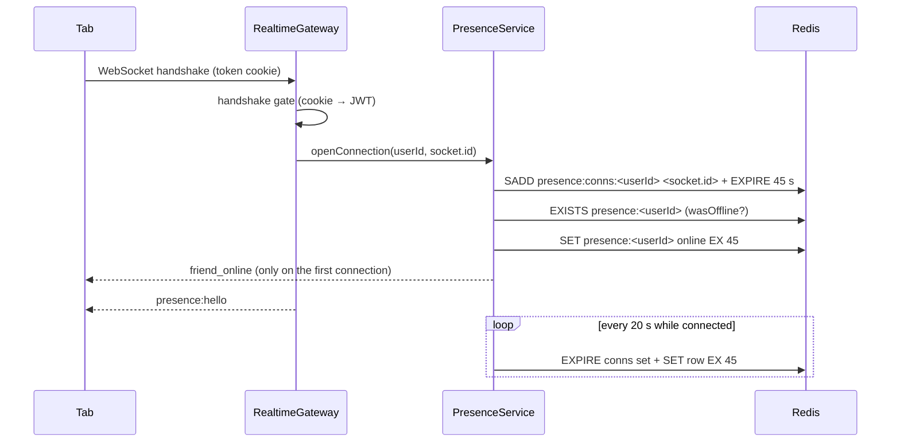
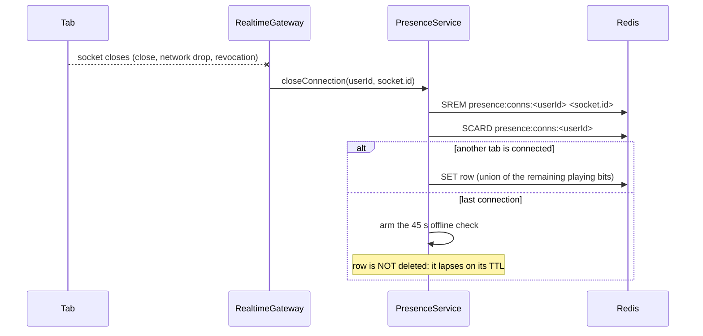

# Presence Module

## Table of Contents

- [Overview](#overview) — Online/offline presence tracking, driven by the session socket
- [Files](#files) — Every source file in the module and its role
- [Key Types / Interfaces](#key-types--interfaces) — The socket event's DTO and the status values
- [API Endpoints](#api-endpoints) — No REST surface (D11): the socket events that carry presence
- [Core Logic / Flow](#core-logic--flow) — Mermaid sequence diagrams for connect, close and the count
- [Logic Paths Summary](#logic-paths-summary) — Decision trees for each operation
- [Dependencies](#dependencies) — Internal services this module relies on
- [Configuration / Environment](#configuration--environment) — Redis connection settings


---
---


## Overview

The Presence module tracks whether a user is currently online, offline, or playing. Since the
session socket shipped (socket consolidation, Phase 1) the state is driven by **the connection
itself**: `RealtimeGateway.handleConnection` registers the socket against the account, a server-side
timer refreshes the Redis row every 20 s while it lives, and `handleDisconnect` removes only that
socket from the account's connection set. A closed tab therefore stops refreshing and its row
lapses on the 45 s TTL — no client heartbeat is sent at all.

The module provides:

1. **Connection lifecycle** — `openConnection` / `setPlaying` / `closeConnection`, called by the
   gateway: join `presence:conns:<userId>`, write `presence:<userId>` (`online` | `playing`, 45 s
   TTL), keep both alive while the socket lives.
2. **Playing flag** — `presence:playing { playing }` is the socket's only client → server event,
   stored **per connection** (D3) so a tab leaving a match never clears a sibling tab's flag; the row
   carries the union.
3. **Offline edge** — when the last connection of an account closes, a 45 s check is armed. It
   re-reads the connection set when it fires (a reconnect cancels the edge by construction) and
   publishes `friend_offline` once the row has actually lapsed.
4. **Online count** — a coalesced `presence:count` publish (≤ 1 per 5 s) that the broadcaster turns
   into the `counts:online` socket event, plus `currentCount()`, the cached number the gateway hands
   a freshly connected socket so the badge paints without a request. `presence:conns:*` keys are
   excluded: a connection set is not an account.
5. **Presence broadcasts** — `friend_online` on the first connection of an account, `friend_offline`
   from the offline edge; both are transient notifications to every accepted friend, delivered over
   the existing notification stream.
6. **No REST surface** — D11 deleted the module's controller outright: `POST /api/presence/heartbeat`
   and `GET /api/presence/online-count` are gone (both `404`), and with them `PresenceService.heartbeat()`,
   `HeartbeatDto` and `PRESENCE_THROTTLE`. A presence number or state has exactly one source: the
   connection.

> **Which direction this is.** The **client → server** presence heartbeat is gone: liveness is now
> the socket's own ping/pong (20 s / 20 s in `realtime.constants.ts`, deliberately under the 45 s
> TTL, so a dead peer's socket closes before its row lapses). That is still a different thing from
> the **server → client** SSE keep-alive (`SSE_HEARTBEAT_MS` in `notification.controller.ts`), which
> exists so ngrok does not reset the idle notification stream. See
> [`../architecture.md`](../architecture.md) → Connection liveness.


---
---


## Files

| File | Role |
|------|------|
| `presence.service.ts` | Connection bookkeeping (membership set, row, refresh timers, offline edge, count push and its cache), batched status lookup, friend toasts |
| `presence.constants.ts` | The TTL (45 s), the 20 s refresh, the `presence:conns:` prefix, the `presence:count` channel and its 5 s coalescing window |
| `presence.module.ts` | NestJS module — provides the service (no controller, D11) and exports it |


---
---


## Key Types / Interfaces

### PresencePlayingDto (the socket event)

```typescript
class PresencePlayingDto {
  playing: boolean;   // required: the client re-asserts the whole bit on every connect
}
```

Validated by an explicit `ValidationPipe({ whitelist: true })` on the gateway handler (a gateway is
not a controller, so the global pipe's reach there is not assumed — D10). A refused payload is
dropped by `SilentEventRejectionFilter` without a log line: the event carries no ack and the socket
is unthrottled, so an ERROR per bad packet would let one client flood the log.

### Presence Status Values

Presence is a runtime Redis concept, not a database enum. `PresenceStatus` is a TypeScript type alias:

```typescript
export type PresenceStatus = 'online' | 'playing' | 'offline';
```

A missing Redis presence key *is* the offline state. The 45 s TTL is the authority: a live connection
refreshes it every 20 s, and a dead one stops refreshing.


---
---


## API Endpoints

**None.** D11 (Phase 1.6) deleted `presence.controller.ts`, its two routes and the
`PRESENCE_THROTTLE` entry: `POST /api/presence/heartbeat` and `GET /api/presence/online-count`
both answer `404`, and `grep -rn "/api/presence" backend/src frontend/src` returns nothing. There is
no REST fallback for a browser whose socket cannot be established, by design — a second transport
would be a second source of truth for the same state. `PresenceService.clear()` went with the DELETE
route in Phase 1 (D3: a close never clears the row).

### Socket events (`/ws` namespace, path `/ws-socket.io`)

| Direction | Event | Payload | Meaning |
|-----------|-------|---------|---------|
| server → client | `presence:hello` | none | the socket is registered: authenticated, in `user:<id>`, presence connection counted |
| client → server | `presence:playing` | `{ playing: boolean }` | sent on game enter/leave and re-asserted on every `connect` |
| server → client | `counts:online` | `{ count: number }` | the site-wide badge: coalesced to ≤ 1 push per 5 s, and also emitted to a socket as it connects (the cached `currentCount()`) |


---
---


## Core Logic / Flow

### 1. A connection registers



### 2. A tab closes



The armed check re-reads the connection set when it fires, so a reconnect inside the window cancels
the edge instead of producing a false `friend_offline`. When it fires with no connections it reads
the row's remaining TTL: still present → re-arm (a reconnect inside the TTL); gone → publish
`friend_offline` to every accepted friend and request a badge refresh.

### 3. Presence is the zero-watcher check for friendship records

The presence row doubles as the answer to "does anybody have a tab open for this account?", which is
what `FriendshipEventsService` asks before building a `friendship:changed` record: `getStatuses([a, b])`
is one `mget`, and if both sides read `offline` the publisher stops — no profile read, no publish.
The plan called for an in-memory watcher counter; the presence row carries the same meaning (a row
exists exactly while a socket is open), needs no extra state, and unlike an in-memory map it is
correct across instances. The only cost is its 45 s TTL: a socket that closed a moment ago still reads
`online`, which wastes a read and never loses a record.

The same connection is the friendship subscription: `handleConnection` joins `friends:of:<ownUserId>`
next to `user:<id>`. See [backend-friends-module.md](backend-friends-module.md) → *Live records on the
session socket*.

### 4. The online count

`openConnection` / the offline edge call `requestCountPush`, which publishes `presence:count` at most
once per 5 s (leading edge, trailing fold). `RealtimeBroadcaster` subscribes to that channel, converts
the value with `Number.isFinite`, and emits `counts:online { count }` to every socket. The count itself
is a `SCAN presence:*` with the `presence:conns:` keys filtered out, and the push caches the number in
`lastCount`: `currentCount()` returns it, and the gateway emits it to a socket right after
`presence:hello`, so a socket that connects between two coalesced pushes still paints at once (D11).


---
---


## Logic Paths Summary

### Connection Path
```
RealtimeGateway.handleConnection (handshake already authenticated)
  ├── socket.join(user:<id>) and socket.join(friends:of:<id>)
  ├── PresenceService.openConnection(userId, socket.id)
  │   ├── SADD presence:conns:<userId> <socket.id> + EXPIRE 45
  │   ├── EXISTS presence:<userId> → friend_online only when it was absent
  │   ├── SET presence:<userId> online EX 45 (the union of this instance's bits)
  │   └── start a 20 s refresh for this socket
  └── emit presence:hello
```

### Playing Path
```
presence:playing { playing } (ValidationPipe: whitelist + IsBoolean)
  ├── an unknown socket (the close raced it) → ignored
  └── SET presence:<userId> playing|online EX 45, from the union of live connections
```

### Disconnect Path
```
RealtimeGateway.handleDisconnect
  ├── stop this socket's refresh
  ├── SREM presence:conns:<userId> <socket.id>
  ├── SCARD > 0 → keep the row, re-derive the playing bit
  └── SCARD = 0 → arm the 45 s offline check (row untouched)
```

### Offline Edge Path
```
offline check fires
  ├── SCARD > 0 → a reconnect won, nothing is published
  ├── row still alive (PTTL ≥ 0) → re-arm for the remaining TTL
  └── row gone → friend_offline to every accepted friend + a badge refresh
```

### Online Count Path
```
a connection edge (first connection, or an offline lapse)
  ├── requestCountPush (coalesced to ≤ 1 per 5 s)
  │   ├── SCAN presence:* keys, minus the presence:conns: sets
  │   ├── cache the number (lastCount)
  │   └── PUBLISH presence:count <n>
  └── broadcaster → counts:online { count } to every socket
a socket connects
  └── currentCount() → counts:online { count } right after presence:hello (D11)
```


---
---


## Additional Service Methods

The `PresenceService` provides the connection API the gateway calls, plus the read methods the rest
of the application uses:

| Method | Signature | Purpose |
|--------|-----------|---------|
| `openConnection` | `openConnection(userId, socketId, playing?): Promise<void>` | Register a socket: membership set, row, refresh timer, `friend_online` on the edge |
| `setPlaying` | `setPlaying(userId, socketId, playing): Promise<void>` | The `presence:playing` bit, per connection |
| `closeConnection` | `closeConnection(userId, socketId): Promise<void>` | Remove only this socket's member; arm the offline check when it was the last |
| `getStatus` | `getStatus(userId: string): Promise<PresenceStatus>` | Single-user lookup — e.g. profile pages |
| `getStatuses` | `getStatuses(userIds: string[]): Promise<Record<string, PresenceStatus>>` | Batched lookup for friends lists |
| `getOnlineCount` | `getOnlineCount(): Promise<number>` | Site-wide online count via SCAN, connection sets excluded |
| `currentCount` | `currentCount(): number \| null` | The last number a push computed, for the gateway's connect-path emit; `null` until the first push |

`PresenceStatus` is a type alias: `'online' | 'playing' | 'offline'`. A missing Redis key *is* the offline state — the TTL handles cleanup automatically.


---
---


## Dependencies

| Dependency | Purpose |
|-----------|---------|
| `Redis` (ioredis) | Presence rows, the per-account connection set, the `presence:count` publish |
| `PrismaService` | Look up the user's accepted friends for presence broadcasts |
| `NotificationService` | Push transient `friend_online` / `friend_offline` toasts |
| `RealtimeGateway` | Calls the connection API from `handleConnection`, `handleDisconnect` and `presence:playing`, and emits `counts:online` from `currentCount()` |


---
---


## Configuration / Environment

| Variable | Default | Used By |
|----------|---------|---------|
| `REDIS_HOST` | `redis` | Redis host for presence state |
| `REDIS_PORT` | `6479` | Redis port |
| `REDIS_PASSWORD` | (from secrets) | Redis password |