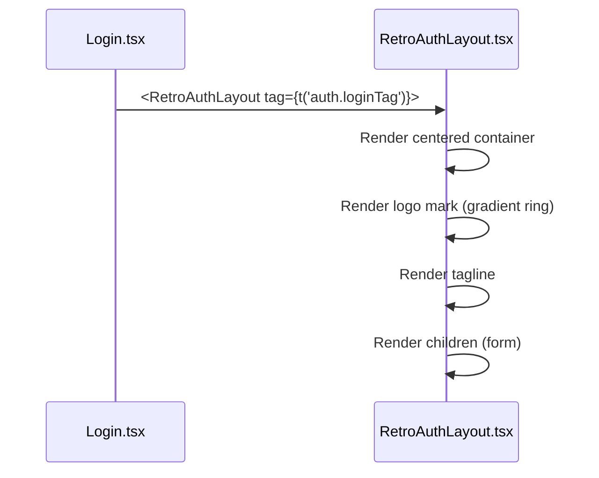
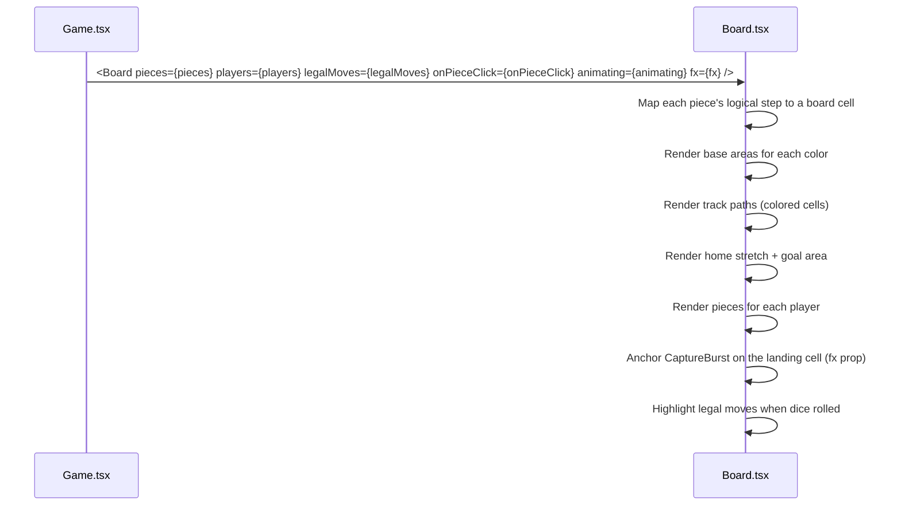
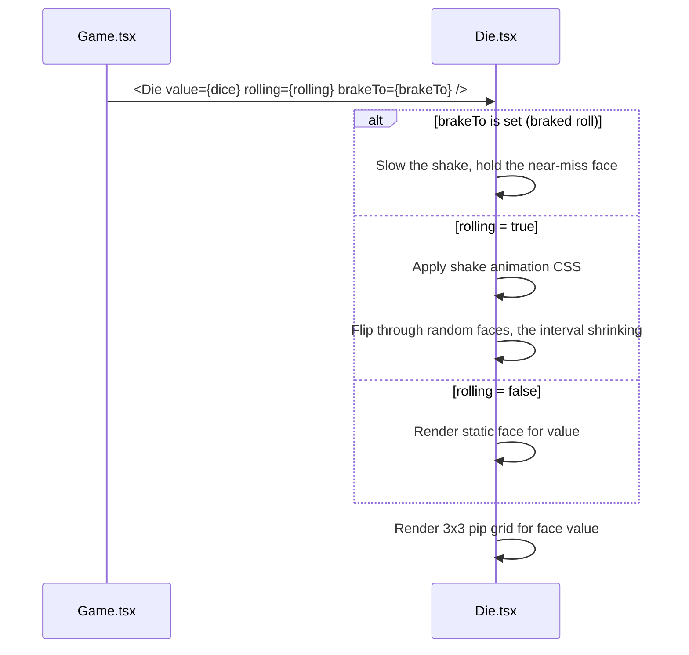
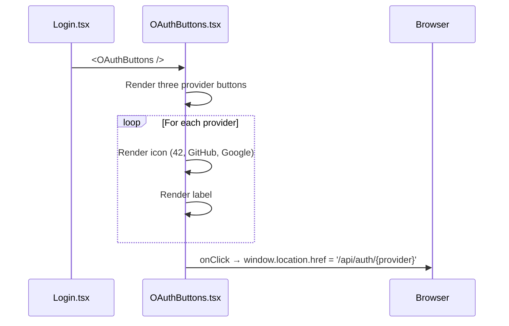

# Frontend — Shared Components

## Table of Contents

- [Overview](#overview): Reusable UI (user interface) components used across pages
- [Files](#files): Source file inventory
- [Key Types / Interfaces](#key-types--interfaces): Component props and shared helpers
- [Core Logic / Flow](#core-logic--flow): Mermaid sequence diagrams for each component
- [Logic Paths Summary](#logic-paths-summary): Decision trees for rendering
- [Tailwind Utilities (`styles/tw.ts`)](#tailwind-utilities-stylestwts): The shared utility-class constants
- [Implementation Notes](#implementation-notes): Portals, compact mode, nav-label auto-sizing, avatar attributes, CJK (Chinese, Japanese and Korean) text sizing
- [Dependencies](#dependencies): Internal and external dependencies


---
---


## Overview

The shared components are reusable UI (user interface) building blocks used on several pages. They are:

1. **NavDock / RetroNavbar / LobbyChat**: the seated navigation column. `NavDock` owns the `<aside>` spacer and the dock's width; `RetroNavbar` renders the rail inside it; `LobbyChat` fills the chat slot at the bottom of the dock, and `ChatNameCard` is the card a press on a name opens, mounted by the lobby and by the room (19.7).
2. **RetroAuthLayout**: centered layout for the authentication pages (login, signup, 2FA, forgot/reset password).
3. **Board / Die**: the Ludo board and the animated die.
4. **UserAvatar**: avatar rendering.
5. **OAuthButtons**: Google, GitHub and 42 provider buttons.
6. **NotificationBell / NotificationToast**: the notification bell and toasts.
7. **CyberModal / ResultsModal**: cyber-styled modal base and the post-game results overlay.


---
---


## Files

| File | Role |
|------|------|
| `src/components/NavDock.tsx` | The dock every docked page mounts: the sticky `<aside>` spacer, the width, and the forwarding to `RetroNavbar`. Width and chat state come from `hooks/useDockPrefs.ts`, so the spacer and the bar cannot disagree. Mounted by exactly five screens (Home, Leaderboard, Friends, Profile ×2, LudoLobby); `/game`, `/gamelobby/table` and `/guest` mount no dock |
| `src/components/RetroNavbar.tsx` | The bar inside the dock: account pill and popover, five nav buttons with auto-fitted labels, the rejoin banner, and the notification bell. The banner speaks for a PvE or PvP seat only (`rejoinableRoom()`, so a hotseat room costs the dock nothing and cannot hide a simulation), fills its first line from the row's own `gameType` through `navbar.rejoinModeLabel` (`REJOIN PVE MATCH`), and draws its `ROOM:` line only when the row has a code (20.6). Takes its geometry (`isCompact`, `chatOn`, `onToggleChat`) from `NavDock`. Its bell block is marked `data-chat-reserve`, the floor the dock's chat card measures itself against (19.3) |
| `src/components/LobbyChat.tsx` | The dock's chat slot, wired to the public channel: the header and ON/OFF pill, a screen that previews the newest three lines, and the card it portals to `document.body` (its floor is the bell row the bar marks `data-chat-reserve`, one pixel of gap, and its size is `ChatCard.tsx`'s `CHAT_CARD_WIDTH` × `CHAT_CARD_HEIGHT`, 440 × 560, shortened only by a short window). The card carries the transcript (newest at the bottom, merged by message id), a composer that is disabled while the socket is down, and one reserved status line under it whose height fits every string it can show in every language. A name in the transcript opens `ChatNameCard.tsx`'s card (19.7), the same one the room opens: ADD FRIEND asks on its first press and sends on its second, ACCEPT REQUEST answers a pending one, and BLOCK sits last but one under a rule, confirmed through `ConfirmActionModal`; every outcome lands in the status line rather than in a toast. What the lobby adds to that card is CHALLENGE, passed only for a friend while the viewer is in a PvP room: the app's one route through `useChallenges` with the viewer's own `gameId`, greyed from the server's sent list. The feed is filtered against the viewer's own block list, so a blocked pilot's lines leave the plate and the transcript (and return on unblock) without a refetch; the plate's preview and the card paint that same filtered list. Since M3 the head, the transcript **and the composer** are imported from `ChatCard.tsx`, since 19.8 the reserved band under the composer is too (`ChatStatusBand`), and the head it shares carries no panel switch here, so the lobby and the board paint one channel, count one counter and reserve one height. The ring itself is `hooks/useChatFeed.ts`'s, the same hook the room drives |
| `src/components/ChatCard.tsx` | The chat card, in one place (M3): `ChatCardHead` (the channel, its scope, the way out, and — when a host has a panel — that panel's switch beside CLOSE: the INVITE COMMS glyph in a doubled 44 × 36 box with its title as a caption under the press, absent in the lobby), `ChatCardFeed` (a system line is one centred muted row rendered from its `code`, a player's line is two rows), `ChatStatusBand` (the reserved line under the composer, exported since 19.8: one grid whose text cell is as tall as the longest string the band can hold in this language, and nothing else — a control is the head's, so a switch never changes what the band reserves), `ChatCardComposer` (`n / 300` from `chatLength`, the same helper both pre-send guards call, so the counter and the refusal count one unit; disabled when the transport is down or a clash is up) and `ChatCard` — the compact slot (`gameChat.slotTitle`, `ENCRYPTED COMMS`: the room's channel is the private one and its name says so, 20.3, against the lobby's public `# HYPERSPACE COMMS`; the newest three lines) that opens the same card as an overlay anchored to the slot's rectangle, with an optional `sidePanel` portaled 8 px past the card's right edge (or its left, when the right will not fit, both clamped inside the viewport), opened by the head's switch and closed by it, by Escape or by closing the card, plus `inert` while a clash runs. `onOpenName` hands the host the pressed name and its rectangle, so the card a host opens lands beside it; a press inside any `[data-chat-overlay]` or above an open modal is not the transcript's outside press, and Escape stands down while an overlay is up, so the stack dismisses one press at a time. The card's size is this file's too (19.3): `CHAT_CARD_WIDTH` (440), `CHAT_CARD_HEIGHT` (560) and `CHAT_CARD_MARGIN` (16) are exported, so the dock draws the board's card at the board's size, and the height is a budget rather than a ceiling — the head and the reserved band are drawn inside it, so the transcript gives up the rows and the card never grows under what a channel has to say. The shell it wears — the account popover's gradient under `blur(24px) saturate(180%)`, a 1px cyan edge and an outside glow, radius 10, padding 14 — is `chatSurface.ts`'s `CHAT_SURFACE` since 24, one recipe for this card, the lobby's copy of it and the INVITE COMMS panel, and a module of its own because `react/only-export-components` accepts a number beside the components but not an object literal |
| `src/components/chatCardTypes.ts` | `ChatCardLine` (id, sender, text, `at` as ms), `ChatCardStatus` (a resolved one-line refusal or confirmation), `ChatHeadGlyph` (the head's switch: glyph, label, pressed, press) and `systemLineText` (a stored line's `code` → this reader's locale). Split out so `ChatCard.tsx` exports components (and the card's one size, 19.3) only, and so the page, the store's socket types and the profile's transcript renderer can share the shape without importing the card. The character cap and its counter are **not** here: `CHAT_MAX_CHARS` and `chatLength` live in `common/src/chat.constants.ts` (`../__shared__/chat.constants` is this tree's copy) because both servers count the same units |
| `src/components/ChatNameCard.tsx` | The card a name opens (M3/19.7), one component for both channels so a pilot met in the lobby and a pilot met across the board are offered the same acts: the pressed name, the friendship state the host read (`friends`, `requests`, `loading`), ADD FRIEND (two presses — the first relabels the button to `chat.card.addFriendConfirm`, the second sends, because a request cannot be withdrawn), ACCEPT REQUEST, and BLOCK last but one under a rule, confirmed through `ConfirmActionModal`, whose consequence is the friendship sentence when there is a friendship or a pending request to lose and the stranger's sentence when there is not. CHALLENGE is the one optional act (`challenge?: { sent, onPress }`): the lobby passes it for a friend while it has a PvP room, and that press is a room invite rather than a duel (19.6), while a room passes nothing because inviting from a room belongs to the occupancy panel. It portals itself at z-10005, over the transcript's 10004, placed once off the pressed rectangle (220 px wide, clamped inside the window), closes on Escape or an outside press (both standing down while the confirm is up), and reports every outcome to the host's band before closing, so one surface reports and none repeats it |

| `src/components/InviteComms.tsx` | The waiting room's INVITE COMMS panel (M3), mounted through `ChatCard`'s `sidePanel` and only while the room is `WAITING`: the friends whose presence reads `online` and who are not in `view.players`, challenging through `useChallenges` with the room's own `gameId` (`POST /api/friends/:friendId/invite`), greyed from the server's sent list and answering in a band under the well. Off by default behind the card head's switch, 240 px wide in a portal beside the card, scrolling inside it — and since 19.8 it costs the board's column nothing, so a full room says nobody is free instead of vanishing. Since 24 it wears the card's shell (`CHAT_SURFACE`), the card's head, well, rows and band, and the card's height rather than a ceiling, so an empty panel is card-shaped; the head's second line states the room's occupancy (`{{seated}} / {{capacity}} SEATS TAKEN`). Since 19.7 its friend list is the page's one `useFriendships` read, passed in, so a waiting room opens the page and the panel with one snapshot rather than two |
| `src/hooks/useChatFeed.ts` | The transcript both channels paint (19.8): the ring, its cap, a `chat:history` frame that replaces it and a `chat:message` frame that appends after an id check, so the lobby (`store.tsx`, capped at `CHAT_HISTORY`) and the room (`Game.tsx`, capped at `CHAT_LINES_KEPT` = 200) cannot order or dedupe differently. A transport-free state container: the host owns the socket and the events |
| `src/components/ConfirmActionModal.tsx` | The app's one destructive confirm: `CyberModal` on its own portaled layer at z-10006, above the name card's 10005 and the transcript's 10004, so a gate opened from a stacked surface sits on top of it. The friends screen's BLOCK and REMOVE and both name cards' BLOCK (`ChatNameCard`, 19.7) render it |
| `src/components/railButton.ts` | Shared rail-button styles: `railButtonStyle(active)` and `railHoverHandlers(active, edge)`, used by the navbar rail buttons |
| `src/components/RetroAuthLayout.tsx` | Retro-styled authentication page container (`tag`, optional `topRight` pinned 12px inside the card's top-right corner, `children`), `LandscapeNotice` (the bordered strip above the card, mounted here only: the table screen and the PvP waiting room mount no copy), and `NeonCheck`: the terms tick glyph |
| `src/components/LanguageSwitcher.tsx` | Segmented EN/MS/FR switch in two renderings: the compact `pill` used by `Login` (`topRight`) and `LegalPage`, and the two-line `tabs` used by the `RetroNavbar` account popover |
| `src/components/Board.tsx` | Ludo board: tracks, bases, pieces, legal-move highlights. Every safe square (the four tinted starts and the four pre-start cells) wears the same `SafeStar` — white core, black outline, so it stays legible on both the near-black track and the four neon start cells — and the `noSafeZones` rule withholds all eight together. Cell geometry (step → board cell) lives in `src/game/boardGeometry.ts`, and the capture burst it draws is `src/components/CaptureBurst.tsx` |
| `src/components/CaptureBurst.tsx` | The capture burst: one expanding ring plus eight sparks, drawn around a 0×0 anchor at the caller's origin so the caller decides where on screen it goes. `opacity` scales the whole thing. Pure cosmetic, no input |
| `src/components/Die.tsx` | Dice component: face rendering, accelerating roll tumble and a braked die's near-miss settle |
| `src/components/ColorPaletteModal.tsx` | The colour picker for one seat: a fixed 2×2 in board-quadrant order (`BOARD_QUADRANTS`) with a taken corner drawn as an inert dashed slot, and a turn-order diagram beside it — four numbered rings joined by clockwise arrows, numerals and arcs derived from `SEAT_COLORS`, corners not on offer dimmed to 35 %. `sm:max-w-2xl` with the diagram in a 150 px left column (stacked and centred below `sm`), and the whole body scrolls inside `max-h-[90vh]` |
| `src/components/RoomRuleToggle.tsx` | One room-rule row, shared by the create screen's rules panel (`pages/Lobby.tsx`) and the host's in-game one (`pages/Game.tsx`): glyph, label, description and the on/off switch, with the 520/320 Hz toggle blip. The caller owns the order, so both panels read clash → mid-clash key shift → free exit → no safe zones → the cosmetic attack animations last |
| `src/components/UserAvatar.tsx` | Avatar image: keyed by the immutable `userId`; requests the photo only when the seat is not a bot and a photo is known to exist (payload flag or a live `avatar_changed` override, which the backend pushes to that user's own clients only), otherwise renders the DiceBear default. A failed load marks that id broken for the session so it is not retried; an optional `onPhotoError` callback runs when that happens, so a parent component can show a message (the Profile page uses it to show a warning in the user's language) |
| `src/dicebear.ts` | DiceBear helper: generates an avatar data URI (Uniform Resource Identifier) (`avataaars`/`bottts`/`identicon`) |
| `src/components/OAuthButtons.tsx` | OAuth provider buttons (42, GitHub, Google) |
| `src/components/NotificationBell.tsx` | Bell icon, unread badge and dropdown — an **index**, not an action surface (22.7): every stored row either routes or is a receipt, and the accept/join/enter-table verbs the panel used to carry are gone. A router takes you where the state lives (`notificationDestination.destinationFor()`) and clears the whole family that lands there (`markReadMany` over the rows sharing the destination string, which is why the `?tab=` is part of the key); a stamp clears itself and goes nowhere. A lapsed `game_invite` is a stamp whatever its type: its payload carries `expiresAt`, its row prints `EXPIRED`, and nothing is offered that cannot be accepted. Renders at most 60 rows, the same bound as the store and the batch route |
| `src/components/NotificationToast.tsx` | The live cards and the boot digest, on one clock (`TOAST_AUTOCLOSE_MS` = 8000, and the `notifAutoClose` preference can switch the clock off). An action **deletes** the entry it spoke for (`dismissToast(id, 'read')` → `markReadMany`), while the clock only hides a card (`'timeout'`), leaving its entry unread in the bell; the digest is a report on the load — rows and total computed once from the handshake snapshot and frozen — not a window on a burst. A `game_invite` is answered here by one of two presses: a `challenge` (no room yet) posts the accept route, prints any of the four named failures in its own band (`CHALLENGER_OFFLINE` / `_BUSY`, `CHALLENGEE_OFFLINE` / `_BUSY`) and only then navigates, while a `room` invite carries the room code to the lobby and nothing more — a notification reports an event and never ends a game, so a seat already held is released by the player's own Abort. Its tag and its `DUEL`/`INVITE` badge both come from `payload.kind` through `notificationParts`, and so does the bell's, so the two surfaces cannot drift; a `challenge_accepted` frame offers one ENTER TABLE press, because the challenger is already seated in the room it names |
| `src/components/notificationParts.ts` | What the bell, its rows and the digest share so they cannot drift (22.2/22.9): `parseNotificationPayload` (the defensive parse for rows that arrived as JSON strings), `getNotificationTypeBadge(type, payload)` (the bracketed tag and its colour, where `game_invite` keys off `payload.kind` — a room invite prints `[MATCH_INVITE]`, a challenge `[MATCH_CHALLENGE]`), `offerMechanism` / `offerMechanismLabel` (the mechanism an offer travelled by, `'challenge'` or `'room'`, rendered `DUEL` / `INVITE`; never a headcount, because a challenge builds its four-seat room at the accept), `notificationAge` (just now / minutes / hours / days) and the two liveness tests, `isOfferExpired` for a bell row and `isPendingOfferLapsed` for a strip row |
| `src/components/NotificationRow.tsx` | One stored entry drawn as a row — unread diamond, tag, age, sentence — moved out of the bell when the digest report needed the same sentence for the same type. The sentence is a switch over the stored types (`friend_request`, `match_finished`, `profile_updated` with its seven `profileItem*` labels, …), a `game_invite` reads `matchChallengeText` or `matchInviteText` by mechanism, and the tag is `notificationParts`', so the bell and the report cannot word one entry two ways. A lapsed offer prints `EXPIRED` in the tag slot and its press is an acknowledgement |
| `src/components/notificationDestination.ts` | `destinationFor(n)`, one pure function returning the route a row click takes, or `null` for a stamp (22.7). The returned string is **also** the prune key: a click marks read every row that shares it. Routers: `friend_request`, `friend_accepted` and a challenge → `/friends?tab=friends`; a room invite and `challenge_accepted` → `/gamelobby?join=<code>`; `achievement` → `/profile?tab=achievements`; `match_finished` / `match_abandoned` / `match_cancelled` → `/profile?tab=history`. Stamps: `friend_removed` and `friend_declined` (no page shows a severed link), `profile_updated` (its detail is in the row), and a lapsed offer whatever its type |
| `src/components/PendingOffers.tsx` | The live offers strip on the Friends page (22.9), above the search field in the friends tab: one row per offer still open, newest first — the sender's handle, the mechanism word (`DUEL` or `INVITE`), the age, then one verb — ten rows and it scrolls, `EXPIRED` where a verb was. ACCEPT posts `/api/friends/challenges/:fromUserId/accept`, takes the seat and lands on the game through `setActiveMatch`, exactly as the toast does; JOIN is `navigate('/gamelobby?join=<code>')` and nothing else, because a room invite is an address; the four named refusals print in one band above the rows. It recomputes on mount, on window focus, and once at the nearest `expiresAt`: no poll, no Redis event, no push |
| `src/components/AutoCloseToggle.tsx` | The `notifAutoClose` switch, one component with two homes (`RetroNavbar`'s account popover and the bell panel). The preference rides `store.tsx` and defaults on; it decides only whether a card obeys the clock — the bell keeps every entry either way, and the toggle itself is never what dismisses anything |
| `src/components/ProfileEditModal.tsx` | Edit-profile dialog |
| `src/components/DeleteAccountModal.tsx` | Delete-account dialog (sets a password first for OAuth-only accounts) |
| `src/components/LegalModal.tsx` | Privacy Policy / Terms of Service popup, opened from Home's footer and from the Signup terms link |
| `src/components/MarkdownViewer.tsx` | Renders the markdown legal documents |
| `src/components/CyberModal.tsx` | Cyber-styled modal base (`CyberButton`, `CyberModal`) used for confirmations and dialogs |
| `src/components/ControlsSettingsModal.tsx` | The in-game controls popover (`pages/Game.tsx`): three key rows — dice, select piece, goal count — and the retro audio switch, on the `LegalModal` shell, 340 px wide, closed by the backdrop or Escape |
| `src/components/ResultsModal.tsx` | Post-game results overlay: podium, rank badges, outcome title, return-to-lobby; guest-only Play again, exit label and refusal text |
| `src/avatarCache.ts` | Avatar state store, keyed by immutable user id: live `avatar_changed` overrides (`{has, style}`, delivered only to the owner's own clients, so its value is always about this user's own photo), a remount stamp per user, and a `broken` set so a failed photo is not retried |


---
---


## Key Types / Interfaces

### RetroAuthLayout Props

```typescript
type RetroAuthLayoutProps = {
  tag?: string;          // Optional tagline displayed above the form
  children: ReactNode;   // Form content
}
```

### NeonCheck Props

```typescript
type NeonCheckProps = {
  offsetTop?: boolean;   // Nudges the box down 1px to line up with the first text line
  checked?: boolean;     // Draws the tick and the glow; an empty box when false
  className?: string;    // Extra classes, such as the focus ring Signup passes in
}
```

### Board Component

Presentational: it takes all game state as props and never reads the store itself.

```typescript
type BoardProps = {
  pieces?: Array<{ id: string; color: string; step: number; isInGoal: boolean; isInBase: boolean }>
  players?: Array<{ color: string; status: string }>
  legalMoves?: Array<{ pieceId: string; from: number; to: number; isCapture: boolean; isHomeEntry: boolean }>
  onPieceClick?: (pieceId: string) => void
  animating?: { pieceId: string; step: number } | null  // renders that piece at `step` during the move animation
  fx?: { color: string; to: number } | null             // transient capture-burst overlay
}
```

### CaptureBurst Component

```typescript
type CaptureBurstProps = {
  color: string;      // the seat's base colour, used by the ring and half the sparks
  opacity?: number;   // multiplies the whole burst; the clash card's copy uses
                      // CAPTURE_FX_CARD_OPACITY (0.7), the board's uses 1
}
```

No positioning props: the burst is drawn around a 0×0 anchor at its parent's origin and
the caller places the parent. The board puts that anchor in the landing cell's centre
(`gridRow`/`gridColumn` + `alignSelf`/`justifySelf: center`), and `Game.tsx` pins it over
the same cell in viewport coordinates for the clash card's dim copy.

### Die Component

```typescript
type DieProps = {
  value: number;                // 1-6, the server's face once the roll lands
  rolling?: boolean;            // If true, tumbles through random faces
  brakeTo?: number | null;      // Set by a braked roll: shows the neighbour of this
                                // face until the roll lands (the near-miss)
}
```

### OAuthButtons

No props; it renders the three provider buttons.


---
---


## Core Logic / Flow

### 1. RetroAuthLayout

Sequence of steps when an authentication page renders.


### 2. Board

Sequence of steps when the game board renders.


### 3. Die

Sequence of steps when the die renders.


### 4. OAuthButtons

Sequence of steps when the provider buttons render.



---
---


## Logic Paths Summary

### RetroAuthLayout Path
```
<RetroAuthLayout tag={tag}>
  └── Render centered container
       ├── Logo mark (CSS gradient ring)
       ├── Tagline text
       └── {children}
```

### Board Path
```
<Board />
  └── useApp() → mode, seats, dice, rolling, turn
       ├── Calculate geometry for mode
       ├── Render base areas (4 corners)
       ├── Render track cells (colored paths)
       ├── Render home stretches
       ├── Render goal area
       ├── Render pieces
       ├── fx set → anchor CaptureBurst on that cell
       └── Highlight legal moves
```

### Die Path
```
<Die value={dice} rolling={rolling} brakeTo={brakeTo} />
  ├── brakeTo set → near-miss face (brakeTo ± 1), slower shake
  ├── rolling = true → accelerating face flips, shake
  └── rolling = false → render static face
       └── Render 3x3 pip grid for value
```

### OAuthButtons Path
```
<OAuthButtons />
  ├── Render 42 button → onClick → '/api/auth/42'
  ├── Render GitHub button → onClick → '/api/auth/github'
  └── Render Google button → onClick → '/api/auth/google'
```

### RetroNavbar Account Popover Path
```
<RetroNavbar /> account button
  ├── Render avatar button with initials
  ├── onClick → toggle popover
  ├── Language option → setLang(lang)
  └── Sign out → logout() → POST /api/auth/logout → navigate('/login')
```


---
---


## Tailwind Utilities (`styles/tw.ts`)

`src/styles/tw.ts` holds Tailwind class strings that several components share, so the same long list of utility classes is not written out at every place it is used.

Rules that apply to the whole file:

- **No theme logic.** Every colour comes from the custom properties declared on `:root, [data-theme='synthwave']` in `retrowave.css`.
- **`!` (the important modifier) marks a real specificity conflict.** Four constants need it: `GAME_WINDOW_HEADER_EXTRA`, `CYBER_BTN_PINK`, `CYBER_BTN_YELLOW` and `CYBER_BTN_DANGER`, where another utility of the same specificity would otherwise win.
- **`@keyframes` and custom easing curves** (`--flicker`) cannot be written as utility classes, so they stay in `retrowave.css` and are referenced with `var()` or arbitrary `animation:` values.
- **State controlled by JavaScript** (open/closed, glitching, an active LED) is written as a literal or conditional class, or as a `data-*` attribute read through a `group-data-` variant.

Per-constant notes:

| Constant | Notes |
|---|---|
| `THEME_TRIGGER_BTN_BASE` | The account and notification trigger buttons. Callers set inline background, border and shadow; `active` is a literal class set by JavaScript, so `&.active` matches it. |
| `THEME_POPOVER_MENU_BASE` | The account popover panel, coloured by the `--fs-*` custom properties. Open/closed/up/down is JavaScript state (`THEME_POPOVER_MENU_HIDDEN` / `_ACTIVE_DOWN` / `_ACTIVE_UP`); the `popover-slide-*` keyframes stay in CSS. |
| `CRT_SCREEN` | The "page shell" shared by Home, Profile, Leaderboard, Friends, Lobby, Game and LudoLobby. Every value comes from a custom property. |
| `GRID_BACKGROUND` | The fixed cityscape background layer used by RetroAuthLayout and the page shells, with a darkening gradient on its `after:` layer. |
| `GAME_WINDOW_HEADER_EXTRA` | The Game.tsx-only header look. `!bg-[#140a35]` beats `WINDOW_HEADER`'s plain default. |
| `ARCADE_START_TITLE` | `whitespace-nowrap` is required: at 1.5px letter-spacing the heading and its spaced arrows are wider than the overlay, so the arrows would wrap onto their own lines. |
| `CYBER_MODAL_*` | CyberModal's overlay, box, body and glitch layers. The modal state travels through the `data-modal-state` and `data-glitching` attributes, read with `group-data-` variants. |
| `CYBER_BTN_*` | The modal buttons. `_PINK`, `_YELLOW` and `_DANGER` use `!` on their `--btn-accent`/`--btn-shadow` overrides so they beat `CYBER_BTN_BASE`'s defaults. |
| `RESULTS_INVOICE` / `TICKET_CONTAINER` / `INVOICE_VALUE` | ResultsModal's "vending machine ticket", printed by the `printVendingTicketJitter` keyframe; the invoice uses Atkinson Hyperlegible Mono with `top-6` and `z-5`. |
| `PAY_TAG_BASE` / `PAY_TAG_*` | The payment tags: border, background and colour come from the rank modifier class. |


---
---


## Implementation Notes

- **Overlays rendered through a portal.** `NotificationBell`'s dropdown and `RetroNavbar`'s account popover both render into `<body>`. A high `z-index` cannot escape an ancestor's stacking context (the sticky sidebar's `position: sticky` creates one, which traps even very large z-indices), so the overlays render outside it. Their position comes from the trigger's current `getBoundingClientRect()` instead of CSS anchoring.
- **Avatars are keyed by the immutable user id, and a version marker is appended when the URL changes.** `UserAvatar` takes `userId` (the photo key) and keeps `username` only as the DiceBear seed and alt text, so a display-name rename can never invalidate an avatar URL. It requests `/api/user/id/<userId>/avatar` only when the seat is not a bot **and** a photo is known to exist: the payload's `hasAvatarPhoto` or a live `avatar_changed` override in `avatarCache.ts` (the socket `avatar_changed` frame is pushed to that user's own clients only, so this only matters for the signed-in user's own photo). Anything else renders the DiceBear default, so a user without a photo never causes a 404 request. **A change also appends `?v=<stamp>`**, because React re-rendering is not enough on its own: a byte-identical image URL can be served from the browser's in-memory image cache without any request, so `no-cache` never gets the chance to revalidate. The stamp value comes from the socket frame (or `Date.now()` for the uploader's own client, so its own view needs no frame); the event only ever reaches the owner's own clients, so other accounts pick the change up on their next profile/roster fetch. A failed load records that id in the store's `broken` set, so the session stops retrying it. `ResultsModal` passes each row's own `userId`, `hasAvatarPhoto`, and `avatarStyle` from `LastResult` (carried from the engine's roster), so an opponent with a photo is shown with it, a bot or a non-host hotseat seat renders the generated avatar, and no row requests a URL that would 404. In hotseat, `Game.tsx` stamps the store's `/me` id onto the host's own seat (the colour that device joined the match with), so the host's row is the one local seat that keeps a photo. The viewer's own row keeps the store's live `/me` flag instead, because the profile page writes it on upload or delete. **The arena lobby's seat roster and the game's pilot cards use the same three-field contract**: the host's own seat passes the store's `/me` facts (photo, style), while each local hotseat pilot seat passes only its typed-in name and a bot seat passes its assistant-name label, so those seats render the generated avatar and request nothing. The full pipeline (storage, the shared Redis record, caching and freshness) is described in [`avatar-system.md`](../avatar-system.md).
- **`DeleteAccountModal` is a two-step dialog.** Accounts created through a provider have no password, so they set one first, because deletion always requires the password. They then confirm with that password and an acknowledgement checkbox. On success the store's `logout()` clears the session and the user lands on `/login`.
- **The capture burst is one visual, placed by its callers.** `CaptureBurst` renders a ring and eight sparks around a 0×0 anchor at its parent's origin and takes no position of its own: the board anchors it inside the landing cell, and `Game.tsx` re-anchors the same component in viewport coordinates when a clash result card is covering the board. The two copies therefore cannot drift apart, and `CAPTURE_FX_MS` is the single source for how long a burst runs (it is interpolated into the inline `animation` strings; the keyframes carry no duration). The burst's keyframes are injected once by the component under `capture-fx-keyframes`, so the board and the card share one definition.
- **CJK label sizing (`RetroNavbar` account popover).** CJK (Chinese, Japanese and Korean) glyphs fill the em box, while Latin letters take up roughly half of it, so Latin labels use a smaller px value and look the same size.
- **Dock widths and the compact rail.** `useDockPrefs` (`src/hooks/useDockPrefs.ts`) is the single source: `WIDE_MIN_PX` (1280) is the compact threshold, and the dock is `DOCK_CHAT_PX` (360) above it and `DOCK_RAIL_PX` (88) below. Two widths, not three: the chat does not resize the dock, because a dock that resizes when a decoration toggles drags the page sideways and re-wraps every column of the dashboard under the reader. `NavDock` puts that number on the sticky `<aside>` and has nothing to animate; `RetroNavbar` is `width: 100%`, so the spacer and the bar cannot drift apart. The preference is `localStorage`'s `retro_chat`, read synchronously on first render so the dock never paints one chat state and then flips to the other. Below the threshold the labels are hidden from JavaScript rather than by CSS, because parts of the bar are plain inline styles, and the chat slot is not rendered at all.
- **The dock's height is a flex budget.** The nav track is `flex: 0 1 auto` (content height, shrinkable, `overflow-y: auto`), the chat slot is `flex: 1 1 0` with a 112 px floor on the screen in both states, and the notifications are pinned last. At 720p the fixed stack is 531 px of the 656 px dock, so the panel gets the remaining 125 and the track is not the box that shrinks; below about 707 px of window height the track scrolls, with a thin cyan scrollbar rather than the default light one. The slack above and below the track therefore becomes the panel: no fixed height anywhere.
- **The chat screen's OFF state is the same plate, black.** OFF mounts no picture, so the rows are not tab stops and no live region announces into a tube that is not showing one, and the plate keeps its footprint, so the switch moves nothing outside itself. The ON/OFF pill in the header is drawn in both states, so turning the screen off never removes the way back on. The switch only ever animates the inside of the plate: `chat-screen--on` opens a raster from a line to the frame and brings the picture up under a bloom (420 ms), `chat-screen--off` collapses it to a dot (260 ms), and both sit inside `@media (prefers-reduced-motion: no-preference)` so a reduced-motion user gets the same two states with no movement.
- **RetroNavbar track layout.** The nav track uses `overflow-y: auto` only as a fallback. The track is not shifted vertically, because at short window heights a shift pushes the last item over the theme button.
- **RetroNavbar nav-label auto-sizing.** The five nav labels differ in width by language (for example `HOME` against `LEADERBOARD` and `CARTA KEDUDUKAN`), so one fixed font size would either truncate the longest label or look too small for the others. Instead the rail measures its widest label and applies the largest font size that fits the button to all five labels, so they stay uniform. A hidden probe `span` copies the label typography (Atkinson Hyperlegible Next, weight 900, 1px letter-spacing) at `NAV_PROBE_PX` (100px); text width scales linearly with font size, so the fitted size is `(available - letter-spacing total) * 100 / glyph width`. The available width is the button content box minus its 14px side padding, the 34px icon, the 12px icon-to-label gap and a 2px safety margin. The result is clamped between `NAV_LABEL_MIN_PX` (9) and `NAV_LABEL_MAX_PX` (20); `NAV_LABEL_BASE_PX` (13.6, about 0.85rem) is only the value used before the first measurement. The measurement re-runs on language change, window resize and `document.fonts.ready`, because the display-font metrics are only final once the web font has loaded. In compact mode the labels are not rendered, so the measurement is skipped.


---
---


## Dependencies

| Component | Depends On | Purpose |
|-----------|-----------|---------|
| `RetroAuthLayout` | `styles/tw.ts` | `GRID_BACKGROUND` class constant, inline styles |
| `Board` | `theme.ts`, `game/boardGeometry.ts`, `CaptureBurst` | `COL`, the step → cell mapping, and the landing cell's burst |
| `CaptureBurst` | `react`, `game/timing.ts` | Its own keyframes and the burst's one duration constant; no theme import, the caller passes the CSS colour |
| `Die` | `react` | Inline `shake` animation and pip-grid faces (no theme import) |
| `OAuthButtons` | `theme.ts` | `btnOutline` style |
| `NavDock` | `hooks/useDockPrefs.ts`, `RetroNavbar`, `LobbyChat` | The dock's width and chat preference, forwarded into the bar |
| `RetroNavbar` | `store.tsx` | `useApp` for `user`, `lang`, `setLang`, `logout` |
