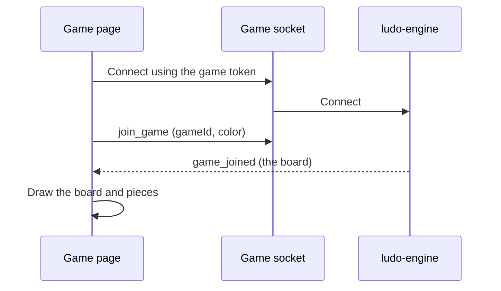
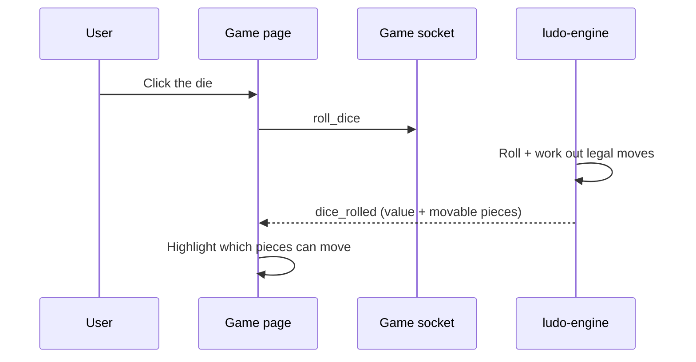
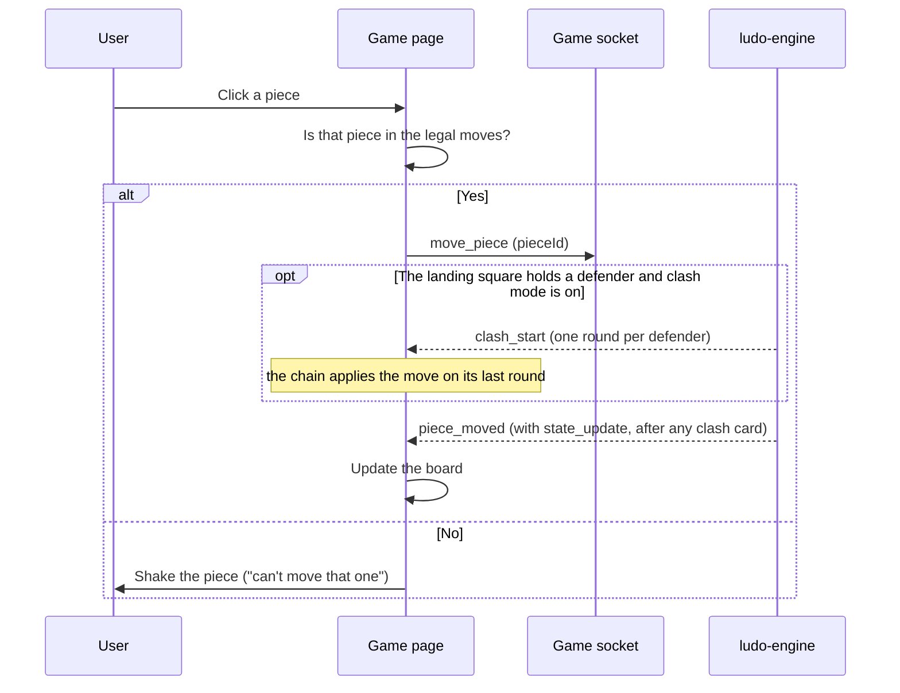

# Frontend — Game

## Table of Contents

- [Overview](#overview): Ludo board, waiting room, clash QTE, rules deck and results
- [Files](#files): Source file inventory
- [Key Types / Interfaces](#key-types--interfaces): Component props and state shapes
- [Core Logic / Flow](#core-logic--flow): Mermaid sequence diagrams for game interaction
- [Logic Paths Summary](#logic-paths-summary): Decision trees for join, dice, movement and game end
- [Dependencies](#dependencies): Internal and external dependencies


---
---


## Overview

The Game page (`/game`) is the real-time gameplay screen. It has:

1. **Ludo board**: drawn by the `Board` component, with the four colored tracks, safe stars, clash-chain badges, and Barrier Buster pips.
2. **Dice roller**: the `Die` component, which animates the roll and shows 1-6.
3. **Piece interaction**: pieces drawn on the board; you can click them when it is your turn, including the armed Barrier Buster exit.
4. **Waiting room and room rules**: the PvP READY/seat screen and the host-only clash, hardcore, and free-exit toggles.
5. **Clash QTE**: `ClashOverlay`, shared by keyboard and touch, with the result-card release handshake.
6. **Rules and results**: the ten-page rules deck in `CyberModal`, and `ResultsModal` for every end path.
7. **Real-time engine connection**: connects to the Ludo Engine through Socket.IO (`connectSocket`), using the match token from `activeMatch`.

> **Note:** The Game page is fully real-time. It connects to the engine on the page's own origin (`/socket.io/`) and sends `join_game`, `roll_dice`, `move_piece`, `skip_bust`, `arm_barrier`, `clash_input`, `clash_card_hold`, `update_modifiers`, `player_ready`, `select_color` and `end_game`. It renders `game_joined`, `dice_rolled`, `piece_moved`, `turn_skipped`, `clash_*`, `modifiers_updated`, `game_ended` and the presence/lobby frames. Game state is dispatched into `game/reducer.ts`; see `socket.ts` for the complete event contract.

**Guest mode.** When `activeMatch.isGuest` is true, the page joins under the localized `guest.playerName`, sends both exits to `/login`, and passes the guest props to `ResultsModal`. **Play again** posts the stored `guestSetup` to `/api/match/guest` and navigates to `/game?gameId=<new id>`, which remounts the page because `App` keys the route on `gameId`. A `GUEST_LIMITED` or `GUEST_CAPACITY` refusal is shown on the end card, which stays open. See [`../guest-mode.md`](../guest-mode.md).


---
---


## Files

| File | Role |
|------|------|
| `src/pages/Game.tsx` | Game page: socket handlers, waiting room, roster, controls, rules deck and results wiring |
| `src/components/Board.tsx` | Board component: renders the Ludo track, pieces, bases, safe-zone stars, chain badges and token pips |
| `src/components/Die.tsx` | Die component: dice face rendering with roll animation |
| `src/game/ClashOverlay.tsx` | Clash QTE: phases, press bars, result card, keyboard listener and touch pads |
| `src/game/reducer.ts` | Pure reducer that turns engine events into local view state |
| `src/game/timing.ts` | Client-side presentation delays shared with the engine's timing contract |
| `src/game/types.ts` | GameState, PlayerColor, LegalMove, MoveResult and others |
| `src/socket.ts` | Socket.IO client: `connectSocket()`, typed Server/Client event maps |
| `src/utils/device.ts` | `isMobileOS()` predicate that selects the touch pad path |
| `src/components/UserAvatar.tsx` | Pilot-card and results avatar: account photo or seeded DiceBear fallback |
| `src/components/ResultsModal.tsx` | End-of-match invoice, shared by every game mode |
| `src/components/CyberModal.tsx` | Shared modal frame for the abort dialog and ten-page rules deck |


---
---


## Key Types / Interfaces

### Game State (engine-driven)

```typescript
// The engine holds the authoritative GameState; game/reducer.ts derives this
// render-only view. `activeMatch` remains the source for gameId/token/mode.
type GameViewState = {
  pieces: Piece[];
  players: PlayerMeta[];
  currentTurn: PlayerColor;
  turnPhase: 'WAITING_FOR_ROLL' | 'WAITING_FOR_MOVE';
  diceValue: number | null;
  legalMoves: LegalMove[];
  winner: PlayerColor | null;
  status: 'waiting' | 'active' | 'finished';
  myColor: PlayerColor;              // activeMatch.color, then my_color_changed
  readyPlayers: PlayerColor[];
  lastRolls: Partial<Record<PlayerColor, number>>;
  paused: boolean;
  pauseTurnOwner?: PlayerColor;
  clash: ClashState | null;          // live QTE; overlays only while set
  clashResult: ClashResult | null;   // result-card window
  clashMode: boolean;                // room rule
  noSafeZones: boolean;              // inverted: true = hardcore
  freeExit: boolean;                 // room rule
  resultCardUntil?: number;          // engine input-freeze timestamp
};
```

### Seat

```typescript
// store.tsx: the lobby/setup roster handed to the Game page.
type Seat =
  | { type: 'you' }
  | { type: 'bot'; name: string }
  | { type: 'player'; name: string }
  | { type: 'empty' }
```

### PlayerColor

```typescript
type PlayerColor = 'red' | 'green' | 'yellow' | 'blue'
```


---
---


## Core Logic / Flow

### 1. Engine Connection & Join

Sequence of steps when the Game page mounts with an active match.


### 2. Dice Roll

Sequence of steps when the player clicks the die.


### 3. Piece Movement

Sequence of steps after the player clicks a movable piece.



---
---


## Logic Paths Summary

### Connect & Join Path
```
Game mounts with activeMatch
  ├── connectSocket(activeMatch.token)
  ├── on 'connect' → emit('join_game', gameId, color, userId, displayName)
  │    └── Hotseat: one join_game per local seat, then the host seat's identity join
  │        (a single socket controls every seat)
  ├── on 'game_joined' → dispatch into reducer
  ├── Hotseat turn rotation → re-emit join_game for the now-current seat so the
  │    engine's turn validation follows the seat actually being played
  └── Reconnect: on reconnect → re-emit join_game
```

### Dice Roll Path
```
User clicks die
  └── emit('roll_dice')
       └── on 'dice_rolled' → dispatch { value, legalMoves, bonusRoll, currentTurn } → highlight pieces
```

### Piece Move Path
```
User clicks piece
  ├── Check if piece is in legalMoves for current dice
  │   ├── Yes → emit('move_piece', pieceId)
  │   │   └── on 'piece_moved' → dispatch → update board
  │   └── No → show invalid feedback
```

### Game End Path
```
on 'game_ended' { winner, resultDetail }
  ├── setLastResult({ winner, resultDetail, mode, playerCount, players })
  └── Open the ResultsModal overlay in-game
```


---
---


## Implementation Notes

- **The socket effect depends on identity fields only.** The connect effect watches `activeMatch.gameId` and `.token`, never the whole `activeMatch` object. Changing `.mode`, `.color` or `.playerCount` after connect (a lobby seat or colour change) therefore cannot close and reopen the socket during the handshake. Long-lived handlers read the current value through `activeMatchRef`, so they never hold a stale `activeMatch`.
- **Duplicate-move guard.** `pendingMoveRef` is set as soon as `move_piece` is sent, and cleared when the server replies with `piece_moved` or a rejection. Without it, a second click on a piece that still looks legal, before the reply arrives, sends a duplicate `move_piece` that the engine rejects with "Invalid turn phase".
- **`canRoll` also requires `status === 'active'`.** This closes a short race condition (two operations competing in timing) at the end of a game: the winning move can leave the other roll inputs looking usable for one render before `game_ended` arrives, which would let a click through as a "Game not active" rejection.
- **Seat identity on the first render.** For a PvP (player versus player) joiner, `ck === view.myColor` can be out of date until the server replies: the engine assigns the seat through a `lobby_update`; the page turns that changed colour into a local `my_color_changed` action and a fresh `join_game`, both of which may happen after the first render, so the seat briefly appears to belong to someone else. The page also accepts a direct `playerMeta.username === user.username` match (the same check the active-game pilot card uses) so it recognises the seat immediately.
- **Refresh safety for cached matches.** After a browser refresh, a cached `activeMatch` can arrive with no `mode`. The page reads it again from `GET /api/games/mine`, so a hotseat or PvE (player versus environment) game can never be treated as a plain PvP rejoin.
- **"RETURN TO LOBBY" does not leave the match.** The button only navigates back to `/gamelobby`: it emits no `leave_game` and calls no exit endpoint. Unmounting the page drops the socket, which opens the engine's 45 s disconnect grace window for that seat. Inside the window the lobby offers a **REJOIN** row for the room (`GET /api/games/rooms` → `mySeat: true`, and `GET /api/games/mine` still lists it), and rejoining restores the same colour and pieces. Once the window expires the engine marks the seat `exited` and parks its pieces at `step = -1`; both endpoints then stop advertising the room to that player: the seat stays behind as a ghost, and the player is free to start or join another game.
- **`dice_rolled` is matched to the turn before the event** (`game/reducer.ts`). On the no-move and third-six-forfeit paths the engine advances `currentTurn` before it emits, so the event's own `currentTurn` can already name the *next* player while the rolled value belongs to the player who rolled.
- **Bot names are translated.** Engine bots are named `bot-<color>`; `localizedBotName(t, name)` turns that into a translated "bot-<colour>" and keeps the "(assistant)" name the lobby assigned the seat, so French renders "bot-red (Siri)" as "bot-rouge (Siri)". Names that do not match are returned unchanged. Used by this page and `ResultsModal`.
- **Turn labels fall back to a translated colour word.** The live turn announcement pill, the game status marquee bar, the status line under the pilot banner, the turn-swap notice, the paused-reconnect banner and the roll-log and capture-log fallbacks all name the seat in control. When a seat has no name to show, they read the colour word through `localizedColor(t, color)`, which maps a `PlayerColor` to the shared `lobby.color*` keys, so French shows "Rouge" where English shows "Red". `utils/botName.ts` exports it next to `localizedBotName`, and the callers upper-case it where the English label is all caps.
- **`nextTurn` mirrors the engine's turn advance** (`game/reducer.ts`). It walks `state.players[]` in order and gives the turn to the next seat that has not left. A disconnected seat with an open grace window holds the turn, so the prediction must not skip past it; otherwise the board would name the wrong pilot in control between the move and the next server frame.
- **The waiting-for-reconnect banner has two triggers** (`pages/Game.tsx`). Either the engine set `paused` (a PvP player dropped during their own turn, so the pending dice and moves are frozen), or the turn is parked on a disconnected seat (they dropped during another player's turn and play continued until the turn reached them). While either holds, `isMyTurn` is false and `canRoll` is blocked, so no action can be sent on a frozen board. PvE and hotseat never pause.
- **An exited seat renders as gone but stays in the list.** Its pieces are off the board and it can never hold the turn, so the pilot card greys it out and never marks it as in control. The row itself is kept because the results card needs the full roster.
- **The Barrier Buster is armed by hand, and the ENGINE owns the switch** (`pages/Game.tsx` + `components/Board.tsx`). In clash mode a "Wall Break Tokens" column sits beside the roster (`game.barrierColumnHeader` caption row with the `game.barrierColumnTitle` tooltip, then one bordered cell per pilot with `BARRIER_BUSTER_TOKEN_CAP` glyph slots, lit once per token in hand, captioned with `game.barrierToggleHint` or `game.barrierArmedCaption`); only the seat this device owns, on its turn and holding a token, can operate that cell as ARM/DISARM and it emits `arm_barrier`. The SPA does not decide the switch: `bustArmed` is read from `view.players[].barrierArmed`, the engine refuses to arm an empty hand, deletes the flag from every seat when the turn advances, clears it when a spend empties the hand, and answers arm and disarm with a `state_update`. The dice-window `game.barrierBusterBtn` stays as the contextual prompt when the roll actually offers a priced landing, and `game.skipBustBtn` sits below ABORT, always visible in clash mode and greyed unless `canSkipBust` (active, unpaused, my turn, no clash, every pending move priced). Option C makes the list the same either way: the engine lists and prices a wall landing whether or not the seat is armed, and `Board` merely REVEALS it (tap target plus the `BUSTER_GLYPH` ×R tag) while `bustArmed` is true, so a stray tap on a piece in prison cannot spend a token; an unarmed `move_piece` is refused by the engine. Skip emits `skip_bust`, which the engine answers with `turn_skipped`: the reducer clears the move list and takes the turn the event names, and the recon log records it (`game.bustSkipped`). The roll itself is never re-rolled by either control.
- **The PvP waiting room has one rules panel, and the engine is the authority** (`pages/Game.tsx`). While `view.status === 'waiting'` and `activeMatch.mode === 'pvp'`, the panel below READY (`game.rulesControl`) shows the three room rules as controlled checkboxes: clash (`game.clashMode`), hardcore (`game.noSafeZones`) and free exit (`game.freeExit`), each with its description and a 520/320 Hz on/off blip. A change emits one `update_modifiers` object, replacing only the toggled field and echoing the other two from the view; there is no optimistic local state. The engine enforces host-only and `WAITING`, persists the rules and answers with `modifiers_updated`, whose `clashEnabled` / `noSafeZones` / `freeExit` fields the reducer maps back to `clashMode` / `noSafeZones` / `freeExit`. The panel is visible to every PvP seat and carries the `game.hostOnlyRules` hint; a non-host toggle produces no broadcast, so the controlled checkbox stays where the server state says. PvE and hotseat have no waiting-room panel: their rules are chosen on the setup screen before the room exists.

- **The clash freeze is released by the engine; the result card keeps its own client timer** (`pages/Game.tsx` + `game/ClashOverlay.tsx` + `game/reducer.ts`). When `clash_result` lands the client sends `clash_card_hold(cardId, CLASH_RESULT_MS + CARD_HOLD_MARGIN_MS)`: its own card duration in its own clock, echoed with the engine's `cardId` (`attacker-defender-moveCounter`). The engine clamps it, keeps the smallest deadline and answers `clash_card_released` once every participating user has reported, so the freeze ends when the cards do instead of always after 4 s; a card with no registered participant user (bot against bot, and hotseat's local seats) keeps the short 2 s card and needs no receipt. The reducer keeps `clash` and `clashResult` on that frame and only records the shortened deadline: the overlay's own timer (deps `[result]` only, callback through a ref) ends the card at `CLASH_RESULT_MS`, so a release that lands mid-card cannot hide the result and a parent re-render can never restart the timer. `canRoll` deliberately keeps NO timing term: the engine refuses a roll outside its phase and during the freeze, so a missing frame costs one refused click instead of the dead roll button that a client-side clock comparison used to cause.
- **The clash QTE has one touch path, and a tap is worth two presses** (`game/ClashOverlay.tsx` + `utils/device.ts`). `isMobileOS()` (UA match plus the iPadOS `MacIntel` + `maxTouchPoints` clause) picks the input mechanism: on a tablet each side gets a 2x2 pad of `TOUCH_BUTTON` (3 cm) circles with a 1 cm gap and a 1 cm `TOUCH_EDGE_BUFFER` (additive to `env(safe-area-inset-*)`), on a desktop the keydown listener (which stays live in touch mode too, so a tablet with a keyboard case has both). A pad press emits the same `clash_input`, with a second argument of `TOUCH_TAP_COUNT` (2): the engine clamps it to `CLASH_TAP_COUNT_MAX` and still caps the EVENTS at 110 ms per side, so a tap is a heavier press rather than a faster stream. The pads render from `clash_start` (so the announce and countdown are the rotation runway), draw their decoys from the side's own nine keys, and re-draw per chain round; the portrait gate and the best-effort `screen.orientation.lock('landscape')` apply only where the touch path is active.
- **The clash key box and press bar use fixed pixel sizes** (`game/ClashOverlay.tsx`). The key box is 67×61 px with a 2 px border, measured from Atkinson Hyperlegible Bold at 54 px: the widest glyph (W, 47.7 px advance) and the tallest (Q, 39.7 px with descender) keep 2 mm (about 7.56 px) clearance on every side. Width is the advance plus 4 mm plus two borders; height is the line-box model plus two borders. The press bar is a 168 px track for 42 presses, so each press adds exactly 4 px and the bar is full only at the target.


- **The rules deck is the one rules UI, and its last four pages are the room-rule copy.** `Game.tsx` renders ten pages inside the shared `CyberModal` (`isSystemModalOpen`), tabbed by `rulesTab0..9` and advanced with NEXT PAGE until the last page's START PLAYING closes it: 0-5 the classic deck (objective, rolling a 6, captures, stars, blockades, home lane), 6 clash, 7 hardcore, 8 free exit, 9 the Barrier Buster. Every page draws its copy from `gameExtra.rulesPage*`; page 0 also uses `gameExtra.rulesCombatControls` / `rulesRollDiceLabel` / `rulesSelectWarpLabel` / `spacebarKey` / `leftClickKey`. All of them live in the three locales, and the deck is the only rules surface: there is no diagram component and no other rules modal. The clash page's extra line (`rulesPage6Chain`) is the live chain rule: landing on a wall is one clash per defender, each round a fresh key race, which is the `captureCount` the board shows as a ×R badge and the overlay as a ROUND n / total pill. The hardcore page states both halves of `noSafeZones`: the stars stop protecting anywhere on the track (the four start squares are in the engine's `SAFE_TRACK_POSITIONS`, so they lose their immunity too; only the home lane still shields a piece), and a stack on a star - exempt in a standard room - blocks the path. The breakable-wall gate is PER SQUARE (`wallIsAttackable`): clash mode plus a token in hand opens a wall on an ordinary square, while a wall parked on a star needs the hardcore flag as well, because a protected star neither blocks the path nor can be attacked. The free-exit page notes that a 6 keeps its bonus roll and that the exit is an ORDINARY move from step 0 finishing on the roll itself (`to` = the roll: a 5 lands on step 5, a 6 on step 6): a barrier on its own track - its landing square included - blocks it exactly as it blocks any other move, and only a barrier on the square it LANDS on can be fought (clash mode, one clash per defender). Breaking the barrier it LANDS on is the token's job, so the Barrier Buster page (9) carries the rest: every seat is dealt `STARTING_BUSTER_TOKENS` (1) at game start (`barrierTokens`, shown in the token column beside the roster, with `BARRIER_BUSTER_TOKEN_CAP` glyph slots lit once per token in hand), the token-priced exit (`spendsBarrierToken`, marked with `BUSTER_GLYPH` on the piece only while the seat is armed) is offered only when the plain exit is illegal for that roll AND the roll lands exactly on a wall, so a piece never carries two exits on one roll and a tap can never spend a token by accident. The bust is a LANDING, never a crossing: a wall further along the corridor stays out of reach, and the roll still has to reach the wall's square exactly. The token is spent on the ATTEMPT - inside the game lock against the fresh state, so a replayed emit finds the move snapshot cleared and cannot spend a second, and a repulsed chain keeps it spent - while a clash won against exactly one defender pays one back, up to `BARRIER_BUSTER_TOKEN_CAP` (three). A turn the bust is holding is passed with SKIP, which keeps the token in hand. Every won chain credits one `barrierBreaks` when its landing square stood a barrier (the `achTearDownThisWall` tally, two in one game).
- **Every pilot card shows an avatar, bots included.** A seat with an account passes its `userId`, `hasAvatarPhoto` and `avatarStyle` to `UserAvatar`, which asks for the photo only when one is known to exist and otherwise renders the generated DiceBear avatar seeded from the seat's name. A bot has no account, so `seatAvatarName()` seeds it with the assistant name the lobby gave that seat (`avatarSeed()` in `utils/botName.ts`), which is the seed the lobby table and the results invoice reuse, and `isBot` keeps the photo request off. **In hotseat, only the host's seat can show a photo.** The engine leaves `userId` undefined for every local seat (one socket drives them all), so they take the generated path, seeded from the name typed into the lobby; the host's own seat is the exception, because it is the seat this device joined the match with (`activeMatch.color`, always slot 0). That card reads the store's `/me` facts instead (`user.id`, `user.hasAvatarPhoto`, `user.avatarStyle`), so the host keeps their uploaded photo, and it seeds the generated avatar with the account username, which is the seed the navbar and the lobby host row already use. No other local seat issues a photo request.
- **One duplex star marks all eight safe squares** (`components/Board.tsx`). The four start cells and the four pre-start cells (`SAFE_TRACK_POSITIONS`, mirrored from `board-mapper.ts`) render the same `SafeStar` at 44% of the cell: a white core in a black outline, because no single color clears all five fills the star has to sit on. The two layers cover each other's blind spots — white measures 20.2:1 on the near-black cell but only 1.3–1.4:1 on green/yellow/blue, where the black ring measures 14.9–16.6:1; on the red start cell white is 3.8:1 and the ring 5.6:1, both above the 3:1 non-text threshold. A single hue was tried first and lost: `#b14aff` read pale on the pink start cell (same-hue clash) and the deep-indigo `#3c0fe6` candidate measured 2.3:1 against both the dark cell and the pink start, so it sank into the track. The black ring also matches the `Sphere` pieces, which are drawn with a `#000000` stroke. The `noSafeZones` room rule withholds every one of the eight, start cells included. Before this, the starts drew a white star unconditionally and only the other four were rule-aware, so turning safe zones off hid 4 of 8 and left the set looking like two different features. A start cell keeps its owner tint with the rule on, because the tint names the SEAT while the star names the protection.
- **One helper builds the results handoff.** `toResultPlayers(players, winner?)` maps the live roster onto `LastResult.players` for all three builders (`game_ended`, the abandoned fallback, and `endGame`), so every path carries the same avatar facts to the invoice. It reads `activeMatchRef`/`userRef` rather than the render's own values, because the socket handlers outlive the render that created them. The optional `winner` records that seat as four pieces: the winning move can still be mid-animation when `game_ended` arrives, so the view lags the final count. Hotseat's host seat gets the store's `/me` identity stamped onto it (the same `activeMatch.color` test as the pilot card), which is what lets `ResultsModal` recognise the host's row by `userId` and show their photo. A bot row keeps its raw `bot-<color> (<assistant>)` label, because the invoice localizes it for display and seeds the generated avatar from it.


---
---


## Dependencies

| Dependency | Purpose |
|-----------|---------|
| `store.tsx` | `useApp` for `user`, `activeMatch`, `seats`, `setPlaying`, `lastResult`, `setLastResult`, `setActiveMatch` and `guestSetup` |
| `socket.ts` | `connectSocket` and the typed Socket.IO event maps |
| `game/reducer.ts` | Pure state reducer for engine events (`GameViewState`, `initialView`, `applyEvent`) |
| `game/types.ts` | `GameState`, `PlayerMeta`, `PlayerColor`, `LegalMove`, `MoveResult`, `ClashState` |
| `game/ClashOverlay.tsx` | Clash QTE overlay for keyboard, touch pads and the result card |
| `game/timing.ts` | Client presentation delays (`CLASH_*`, `MOVE_STEP_ANIM_MS`, `RESULTS_MODAL_DELAY_MS`, guards) |
| `components/Board.tsx` | Renders Ludo board track, pieces, bases, safe-zone stars, chain badges and token pips |
| `components/Die.tsx` | Renders the dice face and the roll animation |
| `components/UserAvatar.tsx` | Pilot-card avatar: the account photo when one is known to exist, otherwise the generated DiceBear avatar (bots and hotseat's local seats have no account, so they take the generated path; the host's own seat keeps the store's `/me` photo instead) |
| `components/ResultsModal.tsx` | End-of-match invoice and guest Play Again/exit controls |
| `components/CyberModal.tsx` | `CyberModal` frame for the rules deck and abort dialog, plus `CyberButton` |
| `utils/device.ts` | `isMobileOS()` for the ClashOverlay touch path |
| `theme.ts` | `SEAT_COLORS` for the roster and `COL` for the board/base fills |
| `styles/tw.ts` | Shared layout/class constants used by the page |
| `styles/retrowave.css` | Theme variables, clash colors and keyframes |
| `api.ts` | `getApi`, `postApi` and `translateErrorCode` |
| `router.ts` | `navigate` for lobby/login/game transitions |
| `utils/audio.ts` | `retroAudio` sound effects |
| `utils/botName.ts` | `localizedColor` and `localizedBotName` for the turn labels and the seat names, `avatarSeed` for generated avatars |
