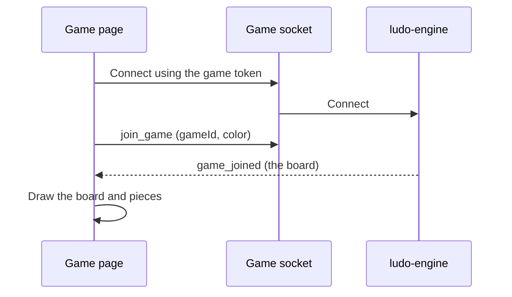
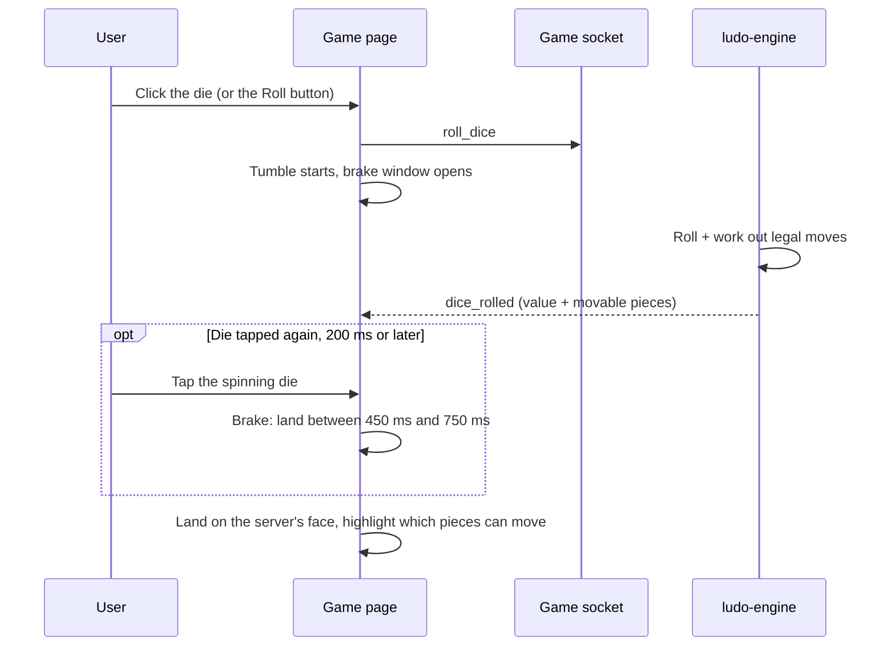
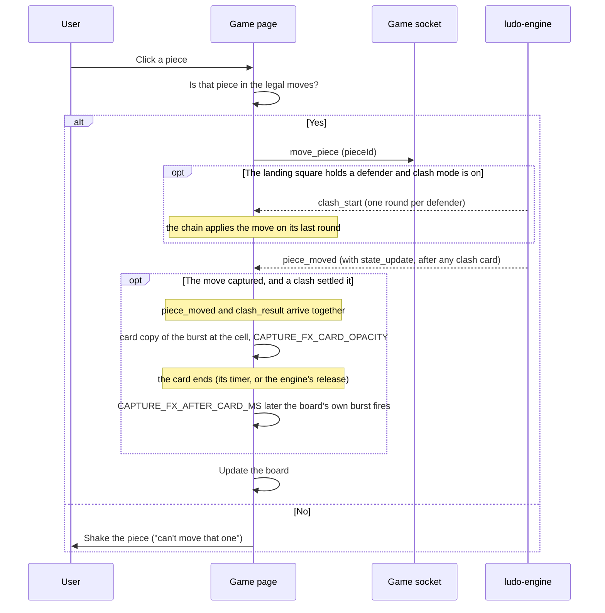

# Frontend — Game

## Table of Contents

- [Overview](#overview): Ludo board, waiting room, clash QTE, rules deck and results
- [Files](#files): Source file inventory
- [Key Types / Interfaces](#key-types--interfaces): Component props and state shapes
- [Core Logic / Flow](#core-logic--flow): Mermaid sequence diagrams for game interaction
- [Logic Paths Summary](#logic-paths-summary): Decision trees for join, dice, movement and game end
- [Dependencies](#dependencies): Internal and external dependencies


---
---


## Overview

The Game page (`/game`) is the real-time gameplay screen. It has:

1. **Ludo board**: drawn by the `Board` component, with the four colored tracks, safe stars, clash-chain badges, and Wall Breaker pips.
2. **Dice roller**: the `Die` component, which animates the roll and shows 1-6.
3. **Piece interaction**: pieces drawn on the board; you can click them when it is your turn, including the armed Wall Breaker exit.
4. **Waiting room and room rules**: the PvP READY/seat screen and the host-only room-rule rows — clash, the mid-clash key shift it owns, free exit, the hardcore no-safe-zones rule, then the cosmetic attack-animations toggle last.
5. **Clash QTE**: `ClashOverlay`, shared by keyboard and touch, with the result-card release handshake.
6. **Rules and results**: the ten-page rules deck in `CyberModal`, opened by the GAME RULES button under the board, and `ResultsModal` for every end path.
7. **Real-time engine connection**: connects to the Ludo Engine through Socket.IO (`connectSocket`), using the match token from `activeMatch`.
8. **Controls and settings**: the CONTROLS & SETTINGS button under the board opens a 340 px popover — the three key rows (dice, select piece, goal count), the auto-close row, the language and theme switches, and the retro audio switch, which sits outside the scrolling body.
9. **The room's channel** (M3): `ChatCard` in the left column, under the roster, in PvP rooms only. It is the private channel by name as well as by construction (20.3): `# ENCRYPTED COMMS` in the expanded card's head, `ENCRYPTED COMMS` on the compact plate, against the lobby's public `# HYPERSPACE COMMS`. The slot shows the newest three lines; pressing it opens the full card as an overlay (transcript, composer with a `n / 300` counter, one reserved status band). The transcript is `useChatFeed`'s (19.8), the same hook the lobby's public channel drives. While the room is still `WAITING`, `InviteComms` is offered as the card's `sidePanel`: the friends who are online and **not** already seated here, portaled beside the card, off until the card head's switch (beside CLOSE) asks for it, challenging through `useChallenges` with the room's own `gameId` (`POST /api/friends/:friendId/invite`) and greying from the server's sent list. The panel unmounts at the start; the card does not. A clash leaves the card mounted and readable but takes every key (`inert`). Pressing a pilot's name in the transcript opens `ChatNameCard` (19.7), the card the lobby opens too, with the duel left out.

> **Note:** The Game page is fully real-time. It connects to the engine on the page's own origin (`/socket.io/`) and sends `join_game`, `roll_dice`, `move_piece`, `skip_wall_breaker`, `arm_wall_breaker`, `clash_input`, `clash_card_hold`, `update_modifiers`, `player_ready`, `chat:send` and `end_game`. It renders `game_joined`, `dice_rolled`, `piece_moved`, `turn_skipped`, `clash_*`, `modifiers_updated`, `chat:message`, `chat:history`, `game_ended` and the presence/lobby frames. Game state is dispatched into `game/reducer.ts`; see `socket.ts` for the complete event contract. The seat's colour is not chosen here: it is claimed on the Lobby screen and arrives with the join.

**Guest mode.** When `activeMatch.isGuest` is true, the page joins under the localized `guest.playerName`, sends both exits to `/login`, and passes the guest props to `ResultsModal`. **Play again** posts the stored `guestSetup` to `/api/match/guest` and navigates to `/game?gameId=<new id>`, which remounts the page because `App` keys the route on `gameId`. A `GUEST_LIMITED` or `GUEST_CAPACITY` refusal is shown on the end card, which stays open. See [`../guest-mode.md`](../guest-mode.md).


---
---


## Files

| File | Role |
|------|------|
| `src/pages/Game.tsx` | Game page: socket handlers, waiting room, roster, controls, rules deck and results wiring |
| `src/components/Board.tsx` | Board component: renders the Ludo track, pieces, bases, safe-zone stars, chain badges and token pips |
| `src/components/CaptureBurst.tsx` | The capture burst (ring + eight sparks) around a caller-placed anchor; the board and the clash card's dim copy share it |
| `src/components/Die.tsx` | Die component: dice face rendering, the accelerating tumble and a braked die's near-miss settle |
| `src/game/ClashOverlay.tsx` | Clash QTE: phases, press bars, result card, keyboard listener and touch pads |
| `src/game/ResultFx.tsx` | The clash card's scene: one fixed stage, three acts (attack, jail, and the breach's cloud), the mirrored pair (defender left, attacker right, each looking at the other through `PieceFigure`'s `pose` — defenders `right`, attacker `left`, in every act), the wall's stage (defenders on a column that recedes and shrinks, under a dome of `n` frozen rings about x 85, the attacker in the right-hand bay, one clear at the cast change) and the breach's mushroom cloud with the winner's sentence inside it, its injected keyframes written in each act's own milliseconds, the per-act sound schedule, and the flash card's crop and stage scale |
| `src/game/boardGeometry.ts` | Logical step → board cell mapping (track loop, home lanes, per-colour offsets), shared by the board and the capture burst's anchor |
| `src/game/pieceParts.ts` | The 1970s piece set: four bobbleheads in a 100-unit box as data (`PiecePart[]`), the per-seat value ladder that paints them (`piecePalette`), the 1980s set's lifted rung (`piecePalette80`), and the crew's stance |
| `src/game/pieceParts80.ts` | The 1980s piece set: four characters (punk, cyborg, netrunner, biker) in the same 100-unit box, feet on the same line, as `PIECE_PARTS_80`. Generated from the supplied sprite sheet by `.scratch/80s/emit80.py`; painted by `piecePalette80`. It also carries the two seams a pose reads, both emitted rather than counted by hand: `PIECE_HEAD_80` (how many parts sit above the neck) and `PIECE_FACE_80` (the slice of each head a turn may move), so the characters are drawn with nothing in their hands and a pose turns a face plate inside a head that stays put (`todo.md` [30](todo.md#rv30-set)) |
| `src/components/PieceFigure.tsx` | Those parts as SVG, for either set via its `set` prop, shared by the board's `Sphere` and the clash result's cast |
| `src/game/reducer.ts` | Pure reducer that turns engine events into local view state |
| `src/game/timing.ts` | Client-side presentation delays (the seventeen both builds count come from `common/src/timing.constants.ts`), the dice brake's landing clamp, the capture burst's length, card opacity and post-card beat, and `clashCardMs` — the result card's own length per path, which the overlay's timer and the engine's receipt both read |
| `src/game/types.ts` | GameState, PlayerColor, LegalMove, MoveResult and others |
| `src/socket.ts` | Socket.IO client: `connectSocket()`, typed Server/Client event maps |
| `src/utils/device.ts` | `isMobileOS()` predicate that selects the touch pad path |
| `src/components/UserAvatar.tsx` | Pilot-card and results avatar: account photo or seeded DiceBear fallback |
| `src/components/ResultsModal.tsx` | End-of-match invoice, shared by every game mode |
| `src/components/CyberModal.tsx` | Shared modal frame for the abort dialog and ten-page rules deck |
| `src/components/ControlsSettingsModal.tsx` | The in-game controls popover opened from under the board: three key rows (dice, select piece, goal count), the auto-close row, the navbar's language and theme switches, and the retro audio switch, on the `LegalModal` shell |
| `src/components/ChatCard.tsx` | The room channel's card, shared with the lobby: `ChatCardHead` (with the INVITE COMMS switch beside CLOSE, doubled and captioned, which only the room passes), `ChatCardFeed`, `ChatStatusBand` (the reserved line under the composer, text only), `ChatCardComposer`, and `ChatCard` (compact slot → overlay, optional `sidePanel` portaled beside the overlay, `inert` while a clash runs). The slot's header reads `gameChat.slotTitle` — `ENCRYPTED COMMS`, the private half of the channel naming (20.3), said in full rather than in one word — and since 20.4 the slot row is the room's slack absorber (`flex: 1 1 auto` + `minHeight: 0`), which is what carries the plate down to the tallest column's bottom edge. The size is exported from here too (19.3: `CHAT_CARD_WIDTH` 480, `CHAT_CARD_HEIGHT` 560, `CHAT_CARD_MARGIN` 16), one card for both hosts. Since 24 it is one shell too: `CHAT_SURFACE` (`chatSurface.ts`, a module of its own because a constant export may be a number but not an object literal) is the overlay's recipe, spread by the lobby's copy of the card and by the INVITE COMMS panel, and the panel's height is the card's rather than a ceiling |
| `src/components/ChatNameCard.tsx` | The card a press on a name opens, shared with the lobby (19.7): the friendship state, ADD FRIEND in two presses, ACCEPT REQUEST, BLOCK through `ConfirmActionModal`, and an optional `challenge` the room never passes. Portaled at z-10005 over the transcript, placed off the pressed rectangle, reporting into the card's band |

| `src/components/InviteComms.tsx` | The waiting room's INVITE COMMS panel: friends online and not seated here, offered from the card head's switch beside CLOSE (portaled beside the card), challenging through `useChallenges` (`POST /api/friends/:friendId/invite` with the room's id) and greying from the server's sent list. A full room lists nobody rather than disappearing (19.8), and its friend list is the page's `useFriendships` read passed in as `friends` (19.7), so the room opens one snapshot for both surfaces. Since 24 the panel is the card's second half rather than a board window: `CHAT_SURFACE`'s shell and the card's entrance class, a head of the card's title block with the room's occupancy under it, a centred well holding the rows at the composer's metrics, and a band under the well in the card's two tones — all at the card's height, so an empty room is a card-shaped panel that says so |
| `src/hooks/useChatFeed.ts` | The room transcript's ring: `chat:history` replaces it, `chat:message` appends after an id check, capped at `CHAT_LINES_KEPT` = 200. The lobby's public channel drives the same hook with `CHAT_HISTORY` = 500 |


---
---


## Key Types / Interfaces

### Game State (engine-driven)

```typescript
// The engine holds the authoritative GameState; game/reducer.ts derives this
// render-only view. `activeMatch` remains the source for gameId/token/mode.
type GameViewState = {
  pieces: Piece[];
  players: PlayerMeta[];
  currentTurn: PlayerColor;
  turnPhase: 'WAITING_FOR_ROLL' | 'WAITING_FOR_MOVE';
  diceValue: number | null;
  legalMoves: LegalMove[];
  winner: PlayerColor | null;
  status: 'waiting' | 'active' | 'finished';
  myColor: PlayerColor;              // activeMatch.color, then my_color_changed
  readyPlayers: PlayerColor[];
  paused: boolean;
  pauseTurnOwner?: PlayerColor;
  clash: ClashState | null;          // live QTE; overlays only while set
  clashResult: ClashResult | null;   // result-card window
  clashMode: boolean;                // room rule
  clashKeyShift: 0 | 1 | 2;          // room rule: key switches per clash
  noSafeZones: boolean;              // inverted: true = hardcore
  freeExit: boolean;                 // room rule
  captureFx: boolean;                // room rule: attack animations
  resultCardUntil?: number;          // engine input-freeze timestamp
};
```

### Seat

```typescript
// store.tsx: the lobby/setup roster handed to the Game page.
type Seat =
  | { type: 'you' }
  | { type: 'bot'; name: string }
  | { type: 'player'; name: string }
  | { type: 'empty' }
```

### PlayerColor

```typescript
type PlayerColor = 'red' | 'green' | 'yellow' | 'blue'
```


---
---


## Core Logic / Flow

### 1. Engine Connection & Join

Sequence of steps when the Game page mounts with an active match.


### 2. Dice Roll

Sequence of steps when the player clicks the die. A second tap on the spinning die
brakes it: the roll lands somewhere between 450 ms and its natural 750 ms window.


### 3. Piece Movement

Sequence of steps after the player clicks a movable piece.



---
---


## Logic Paths Summary

### Connect & Join Path
```
Game mounts with activeMatch
  ├── connectSocket(activeMatch.token)
  ├── on 'connect' → emit('join_game', gameId, color, userId, displayName)
  │    └── Hotseat: one join_game per local seat, then the host seat's identity join
  │        (a single socket controls every seat)
  ├── on 'game_joined' → dispatch into reducer
  ├── Hotseat turn rotation → re-emit join_game for the now-current seat so the
  │    engine's turn validation follows the seat actually being played
  └── Reconnect: on reconnect → re-emit join_game
```

The socket's reconnect budget is sized against the seat, not the transport (`src/socket.ts`):
`reconnectionAttempts: 16`, `reconnectionDelay: 2000`, `reconnectionDelayMax: 3000` and
`randomizationFactor: 0`, which is 2 s, then every 3 s, so the last attempt lands at 47 s — past the
45 s window a live seat keeps, so the client is still connected when `seat_expired` arrives instead of
going quiet. `window.focus` and `document.visibilitychange` re-run `socket.connect()` when the socket
is down, because a frozen or backgrounded tab stops counting attempts; the listener pair is removed in
the same effect's cleanup as the socket itself.

### Dice Roll Path
```
User clicks die (or taps the die at rest)
  └── emit('roll_dice'), tumble starts, brake window opens at the tap
       ├── tap the spinning die again after 200 ms → brake: land at 450..750 ms
       └── on 'dice_rolled' → the landing timer holds the value
            └── land at diceLandAt(start, valueAt, brakeAt)
                 └── dispatch { value, legalMoves, bonusRoll, currentTurn } → highlight pieces
```

### Piece Move Path
```
User clicks piece
  ├── Check if piece is in legalMoves for current dice
  │   ├── Yes → emit('move_piece', pieceId)
  │   │   └── on 'piece_moved' → dispatch → update board
  │   │        └── captured → capture burst on the landing cell
  │   │             └── clash settled the move → the card wears a dim copy
  │   │                  (CAPTURE_FX_CARD_OPACITY), the board's burst waits for the
  │   │                  card to go + CAPTURE_FX_AFTER_CARD_MS
  │   └── No → show invalid feedback
```

### Game End Path
```
on 'game_ended' { winner, resultDetail }
  ├── setLastResult({ winner, resultDetail, mode, playerCount, players })
  └── Open the ResultsModal overlay in-game
```


---
---


## Implementation Notes

- **The box under the board is two controls.** CONTROLS & SETTINGS (`gameExtra.controlsSettings`, cyan) opens `components/ControlsSettingsModal.tsx`: a 340 px popover on the `LegalModal` shell (backdrop click and Escape close, the same UI beeps) holding three key rows — dice/`spacebarKey`, select piece/`leftClickKey`, and the goal count as plain text — the auto-close row, and, since 32.1, the dock's own language and theme switches, mounted as a fourth host rather than forked: `LanguageSwitcher` takes `variant="tabs"` with the store's `lang`/`setLang`, and `ThemeSwitcher` takes no props. The retro audio switch — which reads `muted` from the page and calls `retroAudio.toggleMute()` back, labelled `game.audioOn` / `game.audioOff` — closes the column but is the popover's **footer, outside the scrolling body**: the rows cap themselves at `calc(100dvh - 2rem)` with `overflowY: auto`, because the second and third switches stand above the audio row, and the switch that unmutes a silent game is the one control that must not be scrolled for (its beep is played by the press, so a hidden row reads as dead). GAME RULES (`gameExtra.gameRulesBtn`, pink) resets `rulesPage` to 0 and opens the ten-page deck. Both sit in one flex row in COLUMN 2, below the board and outside the waiting-room gate, so they are there while the room waits and mid-game; that column is `order-1` when the layout stacks, so a tablet and a phone get the same pair under the board.
- **The room's channel is one card with two hosts** (`components/ChatCard.tsx`, M3). `ChatCard` renders the compact slot (the newest three lines plus `gameChat.openHint`) and, on press, the same card as a fixed overlay anchored to the slot's rectangle — the placement `LobbyChat` already used, because where the slot sits depends on the roster's overhang and the window height, and on `/game` the slot is *sized* by that same overhang: the roster above it is `calc(100% + rosterOverhang)`, 46 px past its grid track for the display names and 152 in a clash, where the Wall Breaker column rides along, and the slot's host takes the identical width rather than the track's own. Two windows stacked in one column end on one edge, so the feed does not sit short of the roster over it, and the overhang is read from the same expression the roster uses (`rosterOverhang`), so a clash room's wider panel widens both and no state draws them out of line. The host's wrapper is also what absorbs the stretched column's slack; the slot keeps `flex: 1 1 auto` inside it, so the plate's height, its pin on OPEN ⤢ and its overlay anchor are unchanged. The transcript, the composer (`n / 300`, UTF-16 like the server) and the one reserved status band live **inside** the card, so a `game_state` re-render cannot drop a draft; the card's height is a budget rather than a ceiling (19.3: `CHAT_CARD_HEIGHT`, 560, exported from the same file and imported by the dock), so the head and the band are drawn inside it and the transcript gives up the rows instead of the card growing under them; the lines live in `useChatFeed` (`hooks/useChatFeed.ts`, capped at 200) so a frame cannot drop a line. `chat:history` replaces the local copy on every join and rejoin (it is the authority, already cut for this seat), and `chat:message` is deduped by id at the seam — both rules are the hook's, which is also what the lobby's public channel drives, so the two surfaces cannot order or dedupe differently (19.8). A clash sets `inert`: the card stays open and readable, the composer is disabled and Escape is the only key it takes. The in-game name card is `ChatNameCard` (19.7), the same component the lobby mounts — ADD FRIEND in two presses, ACCEPT REQUEST, BLOCK through `ConfirmActionModal` — mounted with no `challenge` and reading a `useFriendships` snapshot the page owns, because the invite panel owns inviting in that context; its outcomes land in the transcript card's band, which stays open beneath it. The lobby imports the same head, feed, band and composer (it passes no glyph, so the head has no switch and shows only CLOSE), so both channels paint one transcript, show one `n / 300`, refuse at one length and reserve one band height.
- **The room's channel is named for what it is** (`locales/*.ts`, 20.3). `gameChat.title` reads `# ENCRYPTED COMMS` — the expanded card's head and its dialog label, and the default `titleKey` the room's card passes to `ChatCardHead` — and `gameChat.slotTitle` reads `ENCRYPTED COMMS`, on the compact plate's header row and as its accessible name. The pair is now the contrast the lobby's public channel was missing: `chat.title` stays `# HYPERSPACE COMMS`, this one is private by construction (only the seats in the room read it, and the transcript is stored with the match), and two of its own strings already said so — `gameChat.emptyDesc` ("only the pilots in this room read this channel") and `gameChat.scope` (`THIS MATCH ONLY`). The plate's header now says both words as well: that header row holds the title alone (`WINDOW_HEADER` is `flex justify-between` with a single child, and the occupancy column is the side panel's, portaled outside the card), so a second word costs only its own width — 15 characters at `--font-heading`'s 0.75rem come to roughly 105 px against a 250 to 310 px track, which leaves the untruncating header room to spare and lets a shut card name the channel as fully as an open one. `gameChat.inviteTitle` keeps its meaning (INVITE COMMS), `gameChat.scope` was left alone, and the lobby's two hard-coded `aria-label`s (`LobbyChat.tsx`) are the lobby's: a naming pass is not where a missing key gets fixed.
- **The room ends on one line, and the feed is what fills the last of it** (`pages/Game.tsx` + `components/ChatCard.tsx`, 20.4). The main grid is `alignItems: 'stretch'` rather than `'start'`, so every column takes the row's height instead of stopping at its own content; the left column adds `minHeight: 0` so it may be shorter than its children, and `ChatCard`'s slot row — the column's last child — takes `flex: 1 1 auto` with its own `minHeight: 0`, so it absorbs the slack. The plate's body already grows inside the window (`WINDOW_BODY`'s `grow`), which is what pins `gameChat.openHint` (`OPEN ⤢`) to the new bottom edge instead of leaving it in the middle of the panel; no state, no new control, and `data-chat-reserve` (19.3) is untouched because nothing here moves horizontally. The bottom lands on the **tallest column**: in practice the board column, whose board is capped at `min(650px, 66vh)` and which carries the CONTROLS & SETTINGS row below it, but a long recon log in column 3 wins late in a game and the plate follows it — the rule is that the plate fills whatever the row became, not that it is locked to the board, and a hard lock would need a `maxHeight` derived from the board's cap for a case that does not exist. In a waiting room the occupancy column stretches too, so a short friend list sits in a tall window and scrolls; that is the recorded trade against `alignItems: 'flex-start'` on the plate's own row, which unbalances the pair. The stacked layout is untouched: one column, one item per row, nothing to stretch to.
- **The invite panel is the waiting room's, and only its.** `InviteComms` lists the friends whose presence reads `online` **and** whose id is not in `view.players` (the room's own seat list, never a presence snapshot), and `Game.tsx` only passes it as `sidePanel` while `view.status === 'waiting'`, so it is gone when the match starts. Since 19.8 it is a panel rather than a column: portaled beside the open card, closed by default behind the card head's switch (beside CLOSE), and therefore it no longer hides at capacity — a full room lists nobody and says so. A friend mid-match in another room still reads `online` here and pressing invite is answered in the card's band in one press; hiding them would need a live signal the gate does not have yet.
- **The waiting room is the seats, the room rules and nothing else.** The seat rail, READY and the host-gated rules panel are the whole waiting screen: the room carries no friend list and no invite control. Challenging a friend into a PvP room is offered from the waiting room's INVITE COMMS panel and from the lobby chat's name card, and `/friends` mints a room directly, all three against `POST /api/friends/:friendId/invite` (the panel and the name card pass `{ gameId }`, the friends page passes `{ hostColor }`). The rail draws `railColors`: while the room waits it is `view.players` sorted by `SEAT_COLORS` — the room's own seats in turn order, one row per seat, so a 2-seat room holding green and blue shows those two and draws no phantom red (before the first engine frame, when `view.players` is still empty, it falls back to the canonical prefix for the room's seat count); once the match is live it is `SEAT_COLORS`, so an unseated corner still reads as an empty seat.
- **The socket effect depends on identity fields only.** The connect effect watches `activeMatch.gameId` and `.token`, never the whole `activeMatch` object. Changing `.mode`, `.color` or `.playerCount` after connect (a lobby seat or colour change) therefore cannot close and reopen the socket during the handshake. Long-lived handlers read the current value through `activeMatchRef`, so they never hold a stale `activeMatch`.
- **Duplicate-move guard.** `pendingMoveRef` is set as soon as `move_piece` is sent, and cleared when the server replies with `piece_moved` or a rejection. Without it, a second click on a piece that still looks legal, before the reply arrives, sends a duplicate `move_piece` that the engine rejects with "Invalid turn phase".
- **`canRoll` also requires `status === 'active'`.** This closes a short race condition (two operations competing in timing) at the end of a game: the winning move can leave the other roll inputs looking usable for one render before `game_ended` arrives, which would let a click through as a "Game not active" rejection.
- **Seat identity on the first render.** For a PvP (player versus player) joiner, `ck === view.myColor` can be out of date until the server replies: the engine assigns the seat through a `lobby_update`; the page turns that changed colour into a local `my_color_changed` action and a fresh `join_game`, both of which may happen after the first render, so the seat briefly appears to belong to someone else. The page also accepts a direct `playerMeta.username === user.username` match (the same check the active-game pilot card uses) so it recognises the seat immediately.
- **Refresh safety for cached matches.** After a browser refresh, a cached `activeMatch` can arrive with no `mode`. The page reads it again from `GET /api/games/mine`, so a hotseat or PvE (player versus environment) game can never be treated as a plain PvP rejoin.
- **"RETURN TO LOBBY" does not leave the match.** The control is drawn for every ended game, for a live online PvP, and (20.6) for a live PvE that holds an account's seat; a guest PvE has no account to list and a live hotseat keeps QUIT TO MENU as its only exit. It only navigates back to `/gamelobby`: it emits no `leave_game` and calls no exit endpoint. Unmounting the page drops the socket, which opens the engine's disconnect grace window for that seat — 45 s in PvP, one hour in a PvE simulation. Inside the window the lobby offers a **REJOIN** row for the room (`GET /api/games/rooms` → `mySeat: true`, and `GET /api/games/mine` still lists it), and the dock's banner names the mode it opens (`REJOIN PVE MATCH`, no room line, because a simulation mints no code); rejoining restores the same colour and pieces. Once the window expires the engine marks the seat `exited` and parks its pieces at `step = -1`; both endpoints then stop advertising the room to that player: the seat stays behind as a ghost, and the player is free to start or join another game.
- **`dice_rolled` names the roller, and the recon log is engine state** (`game/reducer.ts` + `pages/Game.tsx`). On the no-move and third-six-forfeit paths the engine advances `currentTurn` before it emits, so the event carries `color` — the seat that actually rolled — and the reducer writes the face onto that seat (`players[].lastRoll`), which is what the roster's `MiniDie` renders. Nothing is guessed from the turn any more, so a rejoined client shows the right face on the right seat. The same rule governs the RECON LOGS panel: `state.log` is a capped (30) array of semantic entries the engine writes at the sites that emit the frames, shipped whole in `game_joined` (never in `state_update`) while each event frame carries the lines it just wrote in its own `log` field. The page keeps them as entries and renders each through `t()` at paint time, so a reload, a rejoin, a second tab or an engine restart rebuilds the panel and a language switch re-renders every line — including the ones written before the switch — instead of freezing the wording of the moment. A lost clash now reads as a lost attack (`game.failcapturePiece`, `game.wallAttackFailed`) rather than a capture of the attacker's own colour. The panel is a live-match window: it is not rendered at all while `view.status === 'waiting'`, because the engine writes its first line on the opening roll, so in the waiting room the box could only ever read NO TELEMETRY LOGGED.
- **A frame never overtakes the roll it followed** (`pages/Game.tsx`). A `dice_rolled` is dispatched when its die lands (the `diceLandAt` instant, `DICE_ROLL_ANIM_MS` at most), not when it arrives, so the movable pieces do not light up mid-spin; every other frame is applied on arrival. Those two rules can cross. The engine emits a roll and, 4 ms later, a `turn_skipped` when the roller passes a turn whose only exit is token-priced (the bot's declined Wall Breaker exit), so the skip reached the reducer first and the older roll — which names the seat that rolled, still current when it left the engine — overwrote the turn the engine had already moved on to. The board parked on the bot, its declined exit still lit, and since no bot acts out of turn and the human was no longer the seat to move, the room sat frozen while the engine waited for the human's roll. `handleEngineEvent` now lands a pending die before it applies any other frame, so the reducer always takes the frames in arrival order; `piece_moved` is the one exception, because its walk is meant to start on the landed face and its own dispatch already waits for the landing. Nothing is lost on the way either: before this, a second roll landing inside the first one's window replaced `rollLandFnRef` and silently dropped the earlier frame.
- **Tapping a spinning die brakes it, and the brake never touches the value** (`pages/Game.tsx` + `components/Die.tsx`). One handler covers the die's three states: at rest it starts a roll, a roll this device started brakes once `DICE_BRAKE_ARM_MS` (200 ms) has passed, and everything else — another seat's roll, a tap inside the arming window, a roll already braked — is ignored. The clock opens at the tap that started the roll, not at the server's answer, so the window lasts the same whatever the round trip is, and `rollStartRef` stays null for a roll this device did not start, which is what keeps an opponent's or a bot's dice un-brakeable. The landing is `diceLandAt(start, valueAt, brakeAt)` in `game/timing.ts`: without a brake it is the full `DICE_ROLL_ANIM_MS` (750 ms), with one it is `max(450 ms from the start, 150 ms after the tap, 150 ms after the answer)` and never past the natural end — a roll can be shortened, never extended, and a slow answer wins over the shortened window rather than settling on a face nobody sent. The die slows onto the neighbouring face (`brakeTo ± 1`, never 0 or 7) and lands on the server's value, which the dispatch carries untouched. `piece_moved` then waits out what is LEFT of the spin (`rollLandAtRef`) instead of the whole constant, so a braked roll does not leave the walk sitting still for time the roll no longer has. The die is the tap surface and its button is never disabled — that is the requirement the brake needs — while the ROLL button keeps its disabled-while-spinning state, because a brake labelled ROLLING… would need new copy in three locales before it could mean anything.
- **The capture burst survives the clash card, dimmed, and then fires for real** (`pages/Game.tsx` + `components/CaptureBurst.tsx` + `game/timing.ts`). The engine emits `piece_moved` immediately before `clash_result` (`clash-engine.ts:560`/`:565`), so a clash's capture lands in the same frame the result card takes the screen — and the overlay's `rgba(0,0,0,.72)` plus `blur(4px)` backdrop burned the whole 600 ms burst down where nobody could see it. The burst is now one component, `CaptureBurst`, drawn around a caller-placed 0×0 anchor: the board anchors it in the landing cell exactly as before, and `Game.tsx` pins a second copy over the same cell in viewport coordinates (measured from the cell's `data-cell` square at the moment the move lands, via `stepToCell` in `game/boardGeometry.ts`) at `CAPTURE_FX_CARD_OPACITY` (0.7) for exactly as long as the card. That copy sits above the overlay (`zIndex 1000`) on purpose: the card covers the middle of the board, so a copy behind it would vanish on about half the loop, which is the half a landing most often lands on. The real burst is held in `pendingCardBurstRef` and fired when `view.clash` goes null — the card's own timer and an early engine release both narrow to that one signal — `CAPTURE_FX_AFTER_CARD_MS` (50 ms) later, so the two never share a frame and the board punctuates once the player can see it again. A chain's intermediate rounds emit no `piece_moved`, so only the settling move defers anything, and a lost clash captures nothing, so it defers nothing. All three numbers are constants in `game/timing.ts`; `CAPTURE_FX_MS` is also interpolated into both copies' inline `animation` strings, which keeps the keyframes free of a hard-coded 600.
- **The opt-in flash card reads the rule through the live view, never the handler's closure** (`pages/Game.tsx` + `game/reducer.ts` + `game/ResultFx.tsx`). In a room with `captureFx` on but clash off, a capture mounts `ResultFx` in its `flash` variant (top-centre over the board column, at the clash stage's own 0.8 — the same pixels per unit, the same 4:3 and the same clock, with `FLASH_CARD_VIEWBOX` cropping the frame to the side both pieces stand on — and the cell alone at 1121 ms, the instant the bars land, because the board's own burst already played the hit), naming the attacker and the victim — the victim's colour resolved from `capturedPieceIds` against the pieces still on the board, since the card has to be armed before the pending `piece_moved` dispatch removes them, and the `e.color` fallback would paint both duellists in the attacker's hue. The socket effect is keyed on the match and not on state, so its handlers are built once per room and their `view` is the mount-time reducer state, where `initialView.captureFx` is `false`: the gate and the lookup therefore go through `viewRef.current` (written on every render), as every other live read in that effect does. Reading `view` left the card permanently off in PvE and hotseat, and — because the effect re-runs when `activeMatch.gameId` changes — let a second match in the same tab paint the PREVIOUS room's rule. The card's life is `CAPTURE_CARD_MS` — the gesture (`RESULT_FX_MS`) plus `CAPTURE_CARD_HOLD_MS` plus `CAPTURE_CARD_FADE_MS`, 2410 ms, so it can never be shorter than the clip it plays — with `CAPTURE_CARD_GRACE_MS` of dropped roll presses behind it, and the engine's bot scheduler in `socket/server.ts` waits the walk out and then the card, so a bot never plays into a caption the human is still reading.
- **Bot names are translated.** Engine bots are named `bot-<color>`; `localizedBotName(t, name)` turns that into a translated "bot-<colour>" and keeps the "(assistant)" name the lobby assigned the seat, so French renders "bot-red (Siri)" as "bot-rouge (Siri)". Names that do not match are returned unchanged. Used by this page and `ResultsModal`.
- **Turn labels fall back to a translated colour word.** The live turn announcement pill, the game status marquee bar, the status line under the pilot banner, the turn-swap notice, the paused-reconnect banner and the roll-log and capture-log fallbacks all name the seat in control. When a seat has no name to show, they read the colour word through `localizedColor(t, color)`, which maps a `PlayerColor` to the shared `lobby.color*` keys, so French shows "Rouge" where English shows "Red". `utils/botName.ts` exports it next to `localizedBotName`, and the callers upper-case it where the English label is all caps.
- **`piece_moved` names the seat it leaves holding the turn, and the reducer takes it** (`game/reducer.ts` + `socket.ts`). The engine stamps `currentTurn` on the frame once it has applied the whole turn rule — the rotation, a bonus roll that keeps the roller, the third-six forfeit, the win — so the next pilot on the board comes from the engine, which is how `dice_rolled` and `turn_skipped` already name it. Prediction is now only the fallback for a frame from an engine built before that field existed: `nextTurn` walks the rotation in colour order (`SEAT_COLORS`: blue, red, green, yellow, the engine's `COLORS`), never `players[]` order, and gives the turn to the next seat that has not left. `players[]` is seat order (the host's corner first, then the free corners), so walking the array hands the turn to the wrong seat in any room whose host is not blue and leaves the real seat's client waiting on a bot the engine is not driving, which is a freeze no frame clears until the next roll. A disconnected seat with an open grace window holds the turn, so the fallback must not skip past it.
- **The waiting room counts itself down from the room's own number** (`pages/Game.tsx` + `game/reducer.ts`). The engine publishes `room_closing { closesAt }` while a PvP waiting room sits below quorum (and `null` when it fills up or starts), so the banner's top-right corner renders `game.roomClosesLabel` above a `m:ss` counter derived from that deadline (20.5 moved the pair out of the stack below the marquee). There is no second calculation in the client and no mirrored constant: the roster frame (`lobby_update`) carries the same deadline, so a reload mid-window shows the remainder, and a room with no clock shows no banner. PvE and hotseat never get one.
- **The banner is one anchored row over a floor, and the status line only speaks when it must** (`pages/Game.tsx`, 20.5, which settles 20.7 item 2). The header used to be one centred stack: title 32, turn pill 34, status marquee 38, countdown 43, reserved error 22, room-code badge 25 — 194 px of rows, five 8 px gaps, the badge's 14 px margin and 22 px of the header's own padding, 270 in all — and a waiting room fills every one of those rows at once, so the grid started 288 px down once the header's `mb-[18px]` is counted. It is one row now, anchored to the card's own frame: `HERO_SECTION`'s padding is `5px 0 5px`, so the title hangs 5 px under the top border and the pill's lower border sits 5 px above the bottom one, and every gap between them is relative to those two edges rather than to a stack of rows — an empty band (`flex: '1 1 auto'`) between the title's line box and the pill, so a taller cluster drops the pill there instead of opening a hole above it, and `marginTop: 'auto'` on the code inside the cluster so its last line lands on the same 5 px line as the pill. That content is 72 px, 82 with the frame, which is tighter than the 94 the block was before 20.5 and reads cramped at the top of a 900 px page, so the row carries a floor: `minHeight: calc(clamp(129px, 15.4vh, 185px) - 10px)`, on the axis the board is already measured on (`min(650px, 66vh)`), the 10 px being the header's own padding so the number is border to border. The header is a flex column and the row is `flex: 1 1 auto`, so the slack lands *between* the two anchors instead of under them: both ends keep their 5 px, and the gap between them is what grows. That is 139 px at a 900 px viewport height — 40% over the 99 the first pass settled on, which read cramped against the 94 the block was before 20.5 — 157 with the header's margin, which still hands the grid 131 px back. Two things fall out of the floor: it absorbs the locale, since a wrapped `fr`/`ms` label is 88 px and still well under the 129 px floor, so the three languages can no longer give the card three heights; and it sits on the row rather than on the card, so a notice is drawn inside that row's own slack instead of under it and the card is the same height with or without one. At 900 the grid is given 709 px for a board column that needs about 645 with its controls row, so the room fits on one screen. The four decisions:
  - **The marquee is a local `statusMarquee`, not a phrase chain** — `turnSwapNotice ?? (isPausedForReconnect && pausedOwnerName ? pausedForReconnectDetail : null)`. Its four removed rows all repeated something already on screen: `game.statusRivalTurn` restated the pill's colour word, `game.statusRollNow` / `game.statusSelectPiece` restated the phase hint printed under the die in the board column, and the waiting room's `game.readyNeedsOpponent` / the rolling line were either already said by the pill or had no state behind them. What survives is the two things the pill cannot say: a turn swap notice, and whose turn the reconnect pause is holding (`game.pausedForReconnectDetail`). The band keeps its colour, glow and transition for those two, and does not render at all otherwise — no empty box holding a row open. Where it renders is the point of the band: in the corner layout the box is `position: 'absolute'` inside the empty band between the title and the pill (`left/top: 50%`, `translate(-50%, -50%)`), so the notice's height is the band's and never the card's — a turn swap or a reconnect pause moves neither the title's 5 px nor the pill's, and the board below never shifts for a line that appears for one turn. `width: 'max-content'`, capped at 640 px, because the band is only as wide as the title column (~395 px) and a box that shrank to it would wrap a two-word notice at the narrowest corner width; overrunning the band into the flanks is free, since those are empty in the middle and the cluster keeps to the top and bottom of its own. Below 1250 px there is no band — the cluster sits between the title and the pill there — so the box follows the pill in flow at `width: '100%'` / `maxWidth: 740` and the stacked card does grow for a notice, which is the one layout where nothing is anchored to a frame to protect. It is a notice and not a standing line — the pill already carries whose turn it is — so the box clears itself after `TURN_SWAP_NOTICE_MS` (1500 ms; at 700 it caught the eye and left mid-sentence, the line being 60 characters at `0.82rem`), and that clear is scheduled on a ref timer rather than on the effect's own cleanup: the effect also re-runs for a roster or locale update, and a cleanup on that path would cancel the clear without rescheduling it and leave the notice up until the next swap. A second swap inside the window restarts the clock instead of stacking timers.
  - **The countdown is the title row's right corner**, the label (`0.62rem`, muted, upper-case) centred over the number (`1rem`, bold, `--accent-yellow`, glow), both in a column with `alignItems: 'center'` so the number sits under the middle of its own label and the code below shares that axis. `role="timer"` with `aria-live="off"` is unchanged: a live timer would announce a second by second, and the number is already visible. `fontVariantNumeric: 'tabular-nums'` means the counter never changes width, so a ticking room does not shift the title.
  - **The room code moved into the same corner**, under the clock, keeping `copyRoomCode`, `codeCopied` and `RETRO_BADGE`; that is what lets the old last row die, and the `BADGE_BAR` import with it — the row was a badge bar whose only job was to centre one badge. The row is `display: 'flex'` with two empty `flex: '1 1 0'` flanks around the title column and the cluster at the end of the right one: equal flanks keep the title centred on the page instead of letting the cluster's width push it left, and `alignItems: 'stretch'` makes the row exactly as tall as that column, which is the height the cluster spends so that `marginTop: 'auto'` on the code can hang it on the pill's lower border instead of on a gap measured to land there. A grid was tried first (`1fr auto 1fr`, title in track 2, cluster in track 3 with `justifySelf: 'end'`) and dropped: its row distribution only puts the cluster's bottom on the pill's when the row is already taller than the title column, which is the one case the anchor has to survive anyway, and flex says the same thing with one rule. The cluster is capped at `min(240px, 100%)`: a 56-character French label (`fr` `game.roomClosesLabel`) is 361 px at `0.62rem` with `0.5px` tracking, so past 240 px it wraps to a second line (`lineHeight: 1.2`, and the cluster's `paddingTop` is half the difference between the title's `1.875rem` line box and that `0.744rem` first line, so the wrap adds height below an alignment that does not move) and costs 6 px of height that the row's floor absorbs wherever the floor is active, under a title that stays put; the `100%` of the flank is the backstop, so the cluster can never overrun the title whatever a locale says. That cap is also why the corner layout needs its own query: `cornerBanner`, `min-width: 1250px`, wider than the page's `desktopLayout` (1024) — beside a ~395 px title, two 240 px flanks need a ~875 px banner, and the banner is the viewport minus the 365 px nav gutter — and below it the banner stacks (title, cluster, pill) while the page keeps its three columns. Inside the corner the cluster carries `marginRight: 38` (a centimetre at 96 dpi), so the code is not flush against the card's border; the stacked branch centres it, where a margin would knock it off the axis.
  - **The engine error overlays the title instead of reserving a row.** `role="alert"` and `aria-live="assertive"` stay, and the element stays mounted so the live region exists before its text does, but it is `position: 'absolute'` across the header's top (`top: 0; left: 0; right: 0`, `zIndex: 3`, `pointerEvents: 'none'`, `overflow: 'hidden'` inside `HERO_SECTION`'s clip) and takes room only while `engineError` is set. It is the one line here worth seeing at once and rare enough to draw over the banner for; the other four are always-on status and were the ones costing height.
  - **The recorded trade**: the title is exactly centred, which costs two empty flanks and one extra breakpoint branch rather than a shift; the cluster itself is flush right rather than centred inside its flank, because centring it would leave the clock floating halfway between the title and the edge with nothing to line up against; the floor is on the row and not on the card, so the pill's 5 px line is the banner's, not the notice's: the notice is drawn in the row's own slack between the two anchors, so a swap notice or a reconnect pause costs the card nothing at either end (the stacked layout, which anchors nothing, still grows for one); and the slack the floor adds lands between the title and the pill, so the two anchors are the only fixed points and the rest is relative, at every size. No copy was deleted with the rows: every `game.status*` key is still referenced (the pill, the phase hint and the board column's own lines read them), which the i18n sweep confirms at 0 errors and the same 6 advisories. Measured at 1440 × 900: the header block is 157 px including its margin, against 288, so the board column starts about 170 px down the page instead of about 300.
- **The ABORT control has two destinations, chosen by the room and enforced by the backend** (`pages/Game.tsx`). While the room is `waiting` and the caller is its host — `view.hostId`, published with the roster frame because the host is a fact about the room rather than about a seat — the button `POST`s `/api/game/:id/abort`, which the backend accepts only for the host of a `WAITING` room and which closes the room for everyone. Every other caller emits `end_game`, which departs that one seat and lets the engine decide whether the room survives (single-socket mode or below quorum closes it). A notification can never reach either path: accepting an invite only carries the code to the lobby.
- **The waiting-for-reconnect banner has two triggers** (`pages/Game.tsx`). Either the engine set `paused` (a PvP player dropped during their own turn, so the pending dice and moves are frozen), or the turn is parked on a disconnected seat (they dropped during another player's turn and play continued until the turn reached them). While either holds, `isMyTurn` is false and `canRoll` is blocked, so no action can be sent on a frozen board. PvE and hotseat never pause.
- **An exited seat renders as gone but stays in the list.** Its pieces are off the board and it can never hold the turn, so the pilot card greys it out and never marks it as in control. The row itself is kept because the results card needs the full roster.
- **The badge under an exited seat comes from `departedReason`.** `pages/Game.tsx` reads the seat's own field, so a seat the engine finalized with `'leave'` — a manual leave of a live room, or a sign-out — reads `game.pilotAborted` (**ABORTED**) while every other exit (a grace-window timeout, the End Game button) reads `game.pilotLeft` (**LEFT**); a `disconnected` seat keeps `game.reconnecting`. The field is part of the persisted `PlayerMeta`, so the label is right after a reload as well as on the live `state_update` the engine publishes after a departure. Nothing else about the seat changes: `exited`, pieces at `step = -1`.
- **Hotseat's abort control reads "QUIT TO MENU" and leaves the page.** For `activeMatch.mode === 'hotseat'` the button label is `gameExtra.quitToMenuBtn` instead of `gameExtra.abortSimulationBtn`; confirming still runs the existing End Game path (`end_game`, which ends the room), then clears the result-card state and navigates to `/gamelobby`, the screen the player came from. PvE and PvP keep their labels and modal flows: neither has a single player who owns every seat and then walks away.
- **The Wall Breaker is armed by hand, and the ENGINE owns the switch** (`pages/Game.tsx` + `components/Board.tsx`). In a live clash match (`showWallBreakerColumn`: clash on and the room out of `waiting`) a "Wall Break Tokens" column sits beside the roster (`game.wallBreakerColumnHeader` caption row with the `game.wallBreakerColumnTitle` tooltip, then one bordered cell per pilot with `WALL_BREAKER_TOKEN_CAP` glyph slots, lit once per token in hand, captioned with `game.wallBreakerToggleHint` or `game.wallBreakerArmedCaption`); only the seat this device owns, on its turn and holding a token, can operate that cell as ARM/DISARM and it emits `arm_wall_breaker`. The SPA does not decide the switch: `breakerArmed` is read from `view.players[].wallBreakerArmed`, the engine refuses to arm an empty hand, deletes the flag from every seat when the turn advances, clears it when a spend empties the hand, and answers arm and disarm with a `state_update`. The dice-window `game.wallBreakerBtn` stays as the contextual prompt when the roll actually offers a priced landing, and `game.skipBustBtn` sits below ABORT, always visible once the match is live and greyed unless `canSkipBust` (active, unpaused, my turn, no clash, every pending move priced). Option C makes the list the same either way: the engine lists and prices a wall landing whether or not the seat is armed, and `Board` merely REVEALS it (tap target plus the `WALL_BREAKER_GLYPH` ×R tag) while `breakerArmed` is true, so a stray tap on a piece in prison cannot spend a token; an unarmed `move_piece` is refused by the engine. Skip emits `skip_wall_breaker`, which the engine answers with `turn_skipped`: the reducer clears the move list and takes the turn the event names, and the engine writes the recon line (`game.wallBreakerSkipped`) into the state and onto the frame. The roll itself is never re-rolled by either control.
- **The PvP waiting room has one rules panel, and the engine is the authority** (`pages/Game.tsx`). While `view.status === 'waiting'` and `activeMatch.mode === 'pvp'`, the panel below READY (`game.rulesControl`) shows the room rules as controlled inputs, in the same order as the create screen and hardest last (`RoomRuleToggle` rows): clash (`game.clashMode`), the mid-clash key shift it owns (`game.clashKeyShift`, a checkbox plus its 1 / 2 count), free exit (`game.freeExit`), hardcore no safe zones (`game.noSafeZones`), then the cosmetic attack animations (`game.captureFx`, independent of clash) last, each plain rule with its description and a 520/320 Hz on/off blip. A change emits one `update_modifiers` object through `emitRule`, replacing only the toggled field and echoing the rest from the view; there is no optimistic local state. The engine enforces host-only and `WAITING`, persists the rules and answers with `modifiers_updated`, whose `clashEnabled` / `noSafeZones` / `freeExit` / `captureFx` fields the reducer maps back to `clashMode` / `noSafeZones` / `freeExit` / `captureFx`. The panel is visible to every PvP seat and carries the `game.hostOnlyRules` hint; a non-host toggle produces no broadcast, so the controlled checkbox stays where the server state says. PvE and hotseat have no waiting-room panel: their rules are chosen on the setup screen before the room exists.
- **The waiting room carries no in-game control** (`pages/Game.tsx`). Column 3 is a ternary on `view.status`: while the room is `waiting` it renders the setup window (READY, the ready count and the host-only rule rows) and nothing else, so the dice/roll panel cannot appear before the opening roll. Two clash-only controls are gated the same way instead of on `clashMode` alone — a greyed control with nothing behind it made a clash room's lobby look different from a plain room's: the RECON LOGS window (`view.status !== 'waiting'`; the log is empty until the engine writes its first line) and `game.skipBustBtn` (there is no turn to skip). The Wall Breaker column beside the roster follows `showWallBreakerColumn` (`clashMode && status !== 'waiting'`), and `rosterOverhang` — which reserves that column's width for the roster and narrows the board's track to match — is computed from the same flag, so the lobby is the same width in a clash room and a plain one. This also closes a real hole: waiting seats are `active` but no turn is running, so the arm cell was clickable and sent an `arm_wall_breaker` the engine answers with "Game not active".

- **The clash freeze is released by the engine; the result card keeps its own client timer** (`pages/Game.tsx` + `game/ClashOverlay.tsx` + `game/reducer.ts`). When `clash_result` lands the client sends `clash_card_hold(cardId, the card's own length + CARD_HOLD_MARGIN_MS)`: 3100 on a pair's card (2900 + 200), 4000 on a wall's (3800 + 200), 4400 on a breach (4200 + 200) and 1600 on a text-only one, because the forecast comes out of `cardMs` and never out of a constant, and an under-ask truncates where an over-ask is harmless. The engine clamps it, keeps the smallest deadline and answers `clash_card_released` once every participating user has reported, so the freeze ends when the cards do instead of always after 4400 ms; a card a human sits on runs to the ceiling that matches the card — `CLASH_WALL_RESULT_MS` (3800) while the chain continues, `CLASH_RESULT_FREEZE_MS` (4400, the longest card plus the receipt's margin) on a final one — and a card with no registered participant user (bot against bot, and hotseat's local seats) has nobody to report it, so the engine times it to its own kind plus the same margin a receipt would have sent: 3100, 4000, 4400 or 1600, which is what lets a breach's longer final card exist. The reducer keeps `clash` and `clashResult` on that frame and only records the shortened deadline: the overlay's own timer (deps `[result, cardMs]`, callback through a ref) ends the card at its own length, so a release that lands mid-card cannot hide the result and a parent re-render can never restart the timer. `canRoll` deliberately keeps NO timing term: the engine refuses a roll outside its phase and during the freeze, so a missing frame costs one refused click instead of the dead roll button that a client-side clock comparison used to cause.
- **The clash QTE has one touch path, and a tap is worth two presses** (`game/ClashOverlay.tsx` + `utils/device.ts`). `isMobileOS()` (UA match plus the iPadOS `MacIntel` + `maxTouchPoints` clause) picks the input mechanism: on a tablet each side gets a 2x2 pad of `TOUCH_BUTTON` (3 cm) circles with a 1 cm gap and a 1 cm `TOUCH_EDGE_BUFFER` (additive to `env(safe-area-inset-*)`), on a desktop the keydown listener (which stays live in touch mode too, so a tablet with a keyboard case has both). A pad press emits the same `clash_input`, with a second argument of `TOUCH_TAP_COUNT` (2): the engine clamps it to `CLASH_TAP_COUNT_MAX` and still caps the EVENTS at 110 ms per side, so a tap is a heavier press rather than a faster stream. The pads render from `clash_start` (so the announce and countdown are the rotation runway), draw their decoys from the side's own nine keys, and re-draw per chain round; the portrait gate and the best-effort `screen.orientation.lock('landscape')` apply only where the touch path is active.
- **The clash key box and press bar use fixed pixel sizes** (`game/ClashOverlay.tsx`). The key box is 67×61 px with a 2 px border, measured from Atkinson Hyperlegible Bold at 54 px: the widest glyph (W, 47.7 px advance) and the tallest (Q, 39.7 px with descender) keep 2 mm (about 7.56 px) clearance on every side. Width is the advance plus 4 mm plus two borders; height is the line-box model plus two borders. The press bar is a 168 px track for 42 presses, so each press adds exactly 4 px and the bar is full only at the target.
- **The result card's scene is one scene, played twice, and its clock is derived from the card's own budget** (`game/ResultFx.tsx` + `game/ClashOverlay.tsx` + `common/src/timing.constants.ts`). Both outcomes are the same picture with the roles swapped, so `kind` decides nothing but whose colour is on the ink: the **winner** fires a beam across the lane, the beam strikes the **loser**, the field cracks under it, and after a ~600 ms beat an electrified cell slams closed on it from the winner's side. `capture` (the attacker won) fires the attacker's beam from its own front face — the attacker's LEFT, at x 138.5, because the attacker holds the right seat — at the defender's right flank at x 42.5, and closes the cell on the defender travelling that same vector; `repulse` (the defender won) fires the defender's beam from its RIGHT face at x 36.5 at the attacker's left flank at 132.5 and closes the cell on the attacker the same way. The two places never swap: the defender stands on the left at x 6.5 and the attacker on the right at 132.5 on any card and in any act, so a chain's rounds read as one continuous shot, and the winner always fires from its own front face. The pair's cast never changes — both pieces are drawn at the same two places whichever way the round went, because a clip stops being one clip if the cast changes — and the bars are the winner's colour, which cannot collide with the prisoner's, since the prisoner is the loser. They also face each other while they stand there: the defender looks right and the attacker looks left, in every act, through `PieceFigure`'s `pose` — a **face plate** turned 37° inside a head that does not move, one matrix (`CREW_TURN`'s squash 0.8 about x 50 plus its 6-unit slide), with the 70s visor travelling across a helmet shell that stays put and the 80s `PIECE_FACE_80` plate travelling across its own head. Nothing is mirrored: the 80s figures were redrawn carrying nothing, so a `left` figure and a `right` one differ only in where the face sits, and no gradient has to be reversed (`todo.md` [30](todo.md#rv30-set)). It costs the box nothing (0 of 32 posed renders leave the 100-unit box — `tools/80s/posecheck.py` — and on all 16 posed rows of both sets `tools/80s/neckcheck.py` reads the head's outline **0.0** and the face **±6.0**, so no head leaves its collar), which is why the cast's box, the wall constants and the shot did not have to move for the pose; the box's own widening to 36 units is 32.2's, and it re-pointed the seven values measured from it, the seats held at 24.5 and 150.5 so the boxes are x 6.5 to 42.5 and 132.5 to 168.5, a 90-unit gap; the same 24 drawings also ship as stills under `frontend/public/pieces` (one `.svg` each, and it is the canon: a `.png` is a raster *of* it, written only under `STILL_PNG=1`), written by the same script from the same tables, so a swap to sprites would not be a redraw. It is parameterised by one `n`, the wall's defender count (the defenders still standing, plus the one a success takes): a wall is drawn as **its defenders under the dome that encloses them** — `n` glyphs on a column that recedes and shrinks, the front box at x 108 and each further one 0.82 of the width, a third of its own box overlapped by the piece in front and 8.4 units higher, so the four boxes are 36, 29.5, 24.2 and 19.8 wide and the group spans x 59 to 144, lowest and right-most at the front because the shot arrives from the right. Over them, four **frozen** rings about x 85 on the ground line: 78.7 is the line fitted to the ink (the minimal semicircle over those four boxes is 74.88 about x 85, plus a 4 px pad at 1.75 px/unit and half a 3.0 stroke), and 84.2, 89.7 and 95.2 follow at a 5.5 pitch; `n` draws the innermost `n`, so the line fitted to the ink is always there and the shield hugs the group it protects. The strokes invert the pair's ladder — 2.2 inside to 3.2 out — because the outermost ring is both the face the shot meets and the line that glitches out, and a 5-unit stroke cannot live on a 5.5-unit pitch anyway; all four paint in front of the glyphs, since an enclosing curve never crosses one, and the count reads twice: `n` glyphs and `n` rings. The dome sits outside the column rather than in the middle of it — the outer rim at 180.2 is 15.8 units clear of the attacker's bay and the inner rim is at 6.3, so the two outer rings leave the frame on the left. The shot is a stub in the right-hand bay — the attacker stands in frame at x 196 to 232, on the same ground line, outside the dome — so a capture runs 202 to the face at 173.1 (the outermost ring's own right flank at the strike height, `STRIKE_Y` 84, which is the line every shot in the game travels on) and a repulse comes back off that same face to the attacker's flank at 196, the one place in the game where a shot reverses; the face is the one mark that moves with the count — 167.2 at three rings, 161.1 at two, 155.0 at one — so a wall's beam is 28.9 units on a capture and 22.9 on a repulse at four rings, the beam travels its own width rather than `BEAM_TRAVEL_PX`, and keeps the act's 247 ms arrival, so a wall reads as a punch at close range. One success subtracts one defender **and** one line: the struck defender's fade begins on the 418 subtraction and completes at 880, and the outermost ring — the face — glitches twice and is gone by 1000. A wall's attack act is 900 ms longer than the pair's (`SCENE_WALL_BEAT_MS` 900, so `SCENE_WALL_ATTACK_MS` 1600): the dome takes the hit at 260, blobs over to its peak at 700 (1.04 wide and 0.97 tall, scaled about the ground under its centre so the rim travels and the column's feet stay put), resolves by 880, loses the face ring between 880 and 1000, and then **holds** for the last 600 — the stillness a 1v1 card gets from the jail's own tail, which a wall cannot borrow while its shield is the thing that was hit. Everything inside the head of the act is untouched by the extra 900: the beam still arrives at 247, the flare still peaks at 323, the line is still subtracted at 418, and the four marks that are pinned there keep `fx(name)`'s 700 while the three wall marks take `wallFx(name)`'s 1600 and `wPct`. A wall's act then **clears** at 1600 — the one cast change in the sequence — and the jail act re-presents the pair on the pair stage, so the cell always closes on the pair stage, the wall's own prisoner included (`fxWallClear` out at 1600, `fxCastIn` in 96 ms later, `forwards`-filled so the pair holds opacity 0 for the whole attack act). At `n === 1` the wall is a total breach, the last defender and its line going exactly as any other does — the last defender is not a special case — and then, after that first clear, the **cloud act**: a mushroom cloud (a veiled stem and a head of three puffs, one group scaling up out of the ground line, plus a flat blast ring that races out and fades in the act's first 500 ms) grows where the dome stood, on its centre at x 85, the sentence naming the winner pulses twice inside it, and the frame is cleared a second time as the jail's pair arrives. So a breach card is attack + cloud + jail — three acts and two cuts — the longest card there is (`CLASH_BREACH_RESULT_MS` 4200: a wall's 1600 attack, the cloud and the jail, where a wall that does not break is `CLASH_WALL_RESULT_MS` 3800) and the only one with no read window after the scene, because its sentence lives inside the cloud act instead: it starts 400 ms in (`CLOUD_TEXT_LEAD_MS`, 2000 ms of the card) and finishes exactly with the act. The sentence is `<name> breaks through the wall !!!` in all three locales, the name resolved in `ClashOverlay` from the winner's seat (`displayName`, then `username`, then the colour word, which is the fallback the headline uses too) so `ResultFx` still draws a finished string and never sees a player, and its size is computed from the string's own length — `max(11, min(27, floor(224 / (0.62 * length))))`, with `textLength` 224 and `lengthAdjust='spacingAndGlyphs'` when even the floor overflows — and the halo and hairline it was tuned with (6 and 0.75 units) scale with it, so a long name stays open instead of drowning in glow. `ClashOverlay` picks the kind from fields the frame already carries — `result.attacker ?? clash.attacker` and `winner === attacker` — with `totalRounds` and the remaining-defender count feeding `n`, and renders the stage above the headline keyed on `cardId`, so each round of a chain mounts its own scene and fires its own sound exactly once. `RESULT_FX_MS` (1900) is now the SUM of its two acts — `SCENE_ATTACK_MS` (700) and `SCENE_JAIL_MS` (1200) — and `RESULT_HEADLINE_READ_MS` (1000) and the card's own `CLASH_RESULT_MS` (2900) with it, all declared once in `common/src/timing.constants.ts` and copied to each tree's `__shared__/timing.constants` — not `game/timing.ts`, and no longer re-exported by the engine — so the card, the reported hold, the freeze and the chain's next round move together from one edit. A wall's attack act is that act plus `SCENE_WALL_BEAT_MS` (`SCENE_WALL_ATTACK_MS` 1600), which is what makes a wall's card `CLASH_WALL_RESULT_MS` (3800) and a breach's `CLASH_BREACH_RESULT_MS` (4200); `SCENE_CLOUD_MS` (1400) is the third act a breach adds, and `CLASH_TEXT_ONLY_MS` (1400) is the card with the acts switched off. Each element's `animation` string is budgeted in the act that owns it — `fx(name)` for the attack's 700 (the marks pinned to its head, on a wall too), `wallFx(name)` for a wall's three marks over its 1600, `cloudFx(name)` for the cloud's 1400 after the attack act, `jailFx(name)` for the jail's 1200 — so nothing can outlive its act, and the keyframes are written in milliseconds and converted to that act's percentages (`aPct`, `wPct`, `jPct`, `cPct`). The jail is the second act everywhere and the THIRD on a breach, so its start is one number (`jailStartMs`, 700 on a pair, 1600 on a wall, 3000 on a breach) and everything that belongs to it is derived from it: its own animations, the cast-in of the pair, and the slam's beat. The read window is not an act: `readFx(name, startMs)` takes its start, which on a breach is 400 ms into the cloud (2000) — and a breach has no read window after the scene at all. The cell's two beats are read in the JAIL act's own clock (`CAGE_START_IN_JAIL_MS` 136 and `CAGE_LAND_IN_JAIL_MS` 421 of its 1200, i.e. 836 and 1121 ms of a pair's card, the instants the one-gesture card played) and the sound table's snap is *derived* from the jail's start plus that landing (`jailStartMs + CAGE_LAND_IN_JAIL_MS`), so the snap is heard on the slam rather than 191 ms before it — 1121 ms of a pair's card, 2021 of a wall's and 3421 of a breach; the soundtrack is per act rather than per host (25.5): `playLaserBeam` at 0, `playBarrierPuncture` once per layer 40 ms apart from 260, `playBreachBloom` at low weight on the flare's 323 ms peak, `playShatterTick` at the 418 ms glitch, `playBarrierDeflect` on a wall repulse and `playAttackFailed` on a 1v1 one, the full `playBreachBloom` opening the cloud at 1600, and `playCageSlam` on the cell at 1121 (2021 on a wall, 3421 on a breach). A non-clash capture reuses the same component as the opt-in flash card (top-centre over the board, the same soundtrack since 25.5 — both hosts mount the same acts, so the flash card keeps its laser), at the clash stage's own 0.8: `CLASH_STAGE_MAX_PX` 420 and `FLASH_CARD_STAGE_MAX_PX` 336 are the two ends of one ratio (48vw of 60vw, and 192 of 240 units, both at 1.75 px per unit), and `FLASH_CARD_VIEWBOX` `0 15 192 144` is a 0.8-scaled crop of the same 4:3 frame, so nothing about either clip is rescaled. The one gate on every act of every card is the room's `captureFx`, and it reaches this component as the overlay's `animations` prop: off means no stage, no scene sound and a text-only card of `CLASH_TEXT_ONLY_MS`, whose receipt asks for 1600 instead of 3100 — and the receipt's number is always the card's own, through `clashCardMs` in `game/timing.ts` (which the overlay's timer and `Game.tsx` both call), so a wall asks for 4000 and a breach 4400 and nothing has to repeat the test. `prefers-reduced-motion` no longer participates anywhere in the stack — the OS hook and the `fxFade` cross-fade are deleted, in both `ResultFx` and `ClashOverlay`, because every fact the scene carries is also in the card's text (25.7). `aria-hidden`, no input, and `pointerEvents: 'none'` on the stage.
- **A mid-clash key switch is scheduled on the SERVER clock, and the letter is read, never guessed** (`game/ClashOverlay.tsx` + `game/reducer.ts` + `pages/Lobby.tsx` + `pages/Game.tsx`). The room rule `clashKeyShift` (0, 1 or 2) makes the required letter change mid-race. The engine draws one schedule per side (`attackerKeys`/`defenderKeys`, element 0 being the legacy `attackerKey`/`defenderKey`) plus the absolute instants (`switchAt`) and stamps `serverNow` on the frame; the reducer turns that stamp into ONE offset per clash (`serverNow - Date.now()` at receipt), and the overlay schedules a timer per switch against it. The render tick is 250 ms and could be a quarter second late, so the tick never drives a switch: it only supplies the derived index, and the timer sets the exact one. The badge flips on Y with the face edge-on exactly AT the instant (`CLASH_SWITCH_FLIP_MS` before and after), the touch pad re-scrambles its four circles (`drawPad` also keys on the switch index, so a letter the schedule is about to ask for cannot already be under the thumb) and lands them on X with a `CLASH_SWITCH_PAD_STAGGER_MS` stagger, and a banner (`game.clashKeyShiftWarn`, `CLASH_SWITCH_WARN_MS` ahead) never names the new letter — since 4.7 that banner is a cue in its own right: it pulses (`clash-switch-warn--on`, one 400 ms `pulse-glow` breath inside the stylesheet's existing motion gate, so `prefers-reduced-motion` leaves it simply lit) and the `playCyberReject()` sting sounds WITH the warning, 400 ms before the flip, because the flip already carries the banner, the pad re-scramble and the round's own tone. Under `prefers-reduced-motion` the flip is a cross-fade at the same instants. Both schedules ride the one room-wide frame on purpose: a hotseat socket owns both seats and needs both, and a client cannot press for a seat it does not own. The count is host-only in both room-rules panels (a checkbox plus a `1 / 2` select, disabled unless Clash Mode is on, keeping its own count so re-enabling restores it), and the reducer reads the canonical value from `state_update`/`modifiers_updated`.


- **The rules deck is the one rules UI, and its last four pages are the room-rule copy.** `Game.tsx` renders ten pages inside the shared `CyberModal` (`isSystemModalOpen`), tabbed by `rulesTab0..9` and advanced with NEXT PAGE until the last page's START PLAYING closes it: 0-5 the classic deck (objective, rolling a 6, captures, stars, blockades, home lane), 6 clash, 7 hardcore, 8 free exit, 9 the Wall Breaker. Every page draws its copy from `gameExtra.rulesPage*`; page 0 also uses `gameExtra.rulesCombatControls` / `rulesRollDiceLabel` / `rulesSelectWarpLabel` / `spacebarKey` / `leftClickKey`. All of them live in the three locales, and the deck is the only rules surface: there is no diagram component and no other rules modal. The clash page's extra line (`rulesPage6Chain`) is the live chain rule: landing on a wall is one clash per defender, each round a fresh key race, which is the `captureCount` the board shows as a ×R badge and the overlay as a ROUND n / total pill. The hardcore page states both halves of `noSafeZones`: the stars stop protecting anywhere on the track (the four start squares are in the engine's `SAFE_TRACK_POSITIONS`, so they lose their immunity too; only the home lane still shields a piece), and a stack on a star - exempt in a standard room - blocks the path. The breakable-wall gate is PER SQUARE (`wallIsAttackable`): clash mode plus a token in hand opens a wall on an ordinary square, while a wall parked on a star needs the hardcore flag as well, because a protected star neither blocks the path nor can be attacked. The free-exit page notes that a 6 keeps its bonus roll and that the exit is an ORDINARY move from step 0 finishing on the roll itself (`to` = the roll: a 5 lands on step 5, a 6 on step 6): a wall on its own track - its landing square included - blocks it exactly as it blocks any other move, and only a wall on the square it LANDS on can be fought (clash mode, one clash per defender). Breaking the wall it LANDS on is the token's job, so the Wall Breaker page (9) carries the rest: every seat is dealt `STARTING_WALL_BREAKER_TOKENS` (1) at game start (`wallBreakerTokens`, shown in the token column beside the roster, with `WALL_BREAKER_TOKEN_CAP` glyph slots lit once per token in hand), the token-priced exit (`spendsWallBreakerToken`, marked with `WALL_BREAKER_GLYPH` on the piece only while the seat is armed) is offered only when the plain exit is illegal for that roll AND the roll lands exactly on a wall, so a piece never carries two exits on one roll and a tap can never spend a token by accident. The wall break is a LANDING, never a crossing: a wall further along the corridor stays out of reach, and the roll still has to reach the wall's square exactly. The token is spent on the ATTEMPT - inside the game lock against the fresh state, so a replayed emit finds the move snapshot cleared and cannot spend a second, and a repulsed chain keeps it spent - while a clash won against exactly one defender pays one back, up to `WALL_BREAKER_TOKEN_CAP` (three). A turn the wall break is holding is passed with SKIP, which keeps the token in hand. Every won chain credits one `clashWallBattlesWon` when its landing square stood a wall (the `achTearDownThisWall` tally, two in one game).
- **Every pilot card shows an avatar, bots included.** A seat with an account passes its `userId`, `hasAvatarPhoto` and `avatarStyle` to `UserAvatar`, which asks for the photo only when one is known to exist and otherwise renders the generated DiceBear avatar seeded from the seat's name. A bot has no account, so `seatAvatarName()` seeds it with the assistant name the lobby gave that seat (`avatarSeed()` in `utils/botName.ts`), which is the seed the lobby table and the results invoice reuse, and `isBot` keeps the photo request off. **In hotseat, only the host's seat can show a photo.** The engine leaves `userId` undefined for every local seat (one socket drives them all), so they take the generated path, seeded from the name typed into the lobby; the host's own seat is the exception, because it is the seat this device joined the match with (`activeMatch.color`, always slot 0). That card reads the store's `/me` facts instead (`user.id`, `user.hasAvatarPhoto`, `user.avatarStyle`), so the host keeps their uploaded photo, and it seeds the generated avatar with the account username, which is the seed the navbar and the lobby host row already use. No other local seat issues a photo request.
- **One duplex star marks all eight safe squares** (`components/Board.tsx`). The four start cells and the four pre-start cells (`SAFE_TRACK_POSITIONS`, mirrored from `board-mapper.ts`) render the same `SafeStar` at 44% of the cell: a white core in a black outline, because no single color clears all five fills the star has to sit on. The two layers cover each other's blind spots — white measures 20.2:1 on the near-black cell but only 1.3–1.4:1 on green/yellow/blue, where the black ring measures 14.9–16.6:1; on the red start cell white is 3.8:1 and the ring 5.6:1, both above the 3:1 non-text threshold. A single hue was tried first and lost: `#b14aff` read pale on the pink start cell (same-hue clash) and the deep-indigo `#3c0fe6` candidate measured 2.3:1 against both the dark cell and the pink start, so it sank into the track. The black ring also matches the pieces that stand on the same cells, which are outlined in near-black (`ink`, `#0a0716`) in both sets. The `noSafeZones` room rule withholds every one of the eight, start cells included. Before this, the starts drew a white star unconditionally and only the other four were rule-aware, so turning safe zones off hid 4 of 8 and left the set looking like two different features. A start cell keeps its owner tint with the rule on, because the tint names the SEAT while the star names the protection.
- **One helper builds the results handoff.** `toResultPlayers(players, winner?)` maps the live roster onto `LastResult.players` for all three builders (`game_ended`, the abandoned fallback, and `endGame`), so every path carries the same avatar facts to the invoice. It reads `activeMatchRef`/`userRef` rather than the render's own values, because the socket handlers outlive the render that created them. The optional `winner` records that seat as four pieces: the winning move can still be mid-animation when `game_ended` arrives, so the view lags the final count. Hotseat's host seat gets the store's `/me` identity stamped onto it (the same `activeMatch.color` test as the pilot card), which is what lets `ResultsModal` recognise the host's row by `userId` and show their photo. A bot row keeps its raw `bot-<color> (<assistant>)` label, because the invoice localizes it for display and seeds the generated avatar from it. A seat whose engine status is `exited` is marked `abandoned` on its row: the invoice keeps its name and gives it no podium place and no rank badge, so a dropped player who kept a pieces-home count can never be crowned over the real winner.
- **A card can come from the database, not from a frame (M1).** The frame that ends a match is addressed to the sockets still inside the room, so a seat that was away when the room ended gets nothing. `Game.tsx` therefore asks `GET /api/game/:id/result` on the three signals that mean "this room will not be joined": a mount whose match is already terminal, a refused `join_game` (`MATCH_GAME_NOT_FOUND`), and `reconnect_failed` after the socket's 16 attempts. A `finished` answer sets `matchOverRef`, so `join_game` is never re-emitted over a decided match, and renders the card from the row (`rowAsLastResult`: the seat snapshot gives the roster and the abandoned flags, and a room that did not finish names no champion, so `winner` is `null`). `pending` leaves the socket alone; `unknown` keeps whatever card the page already holds. An abandoned card built locally no longer names the seat that held the turn as the winner either.


---
---


## Dependencies

| Dependency | Purpose |
|-----------|---------|
| `store.tsx` | `useApp` for `user`, `activeMatch`, `seats`, `setPlaying`, `lastResult`, `setLastResult`, `setActiveMatch` and `guestSetup` |
| `socket.ts` | `connectSocket` and the typed Socket.IO event maps |
| `game/reducer.ts` | Pure state reducer for engine events (`GameViewState`, `initialView`, `applyEvent`) |
| `game/types.ts` | `GameState`, `PlayerMeta`, `PlayerColor`, `LegalMove`, `MoveResult`, `ClashState` |
| `game/ClashOverlay.tsx` | Clash QTE overlay for keyboard, touch pads and the result card |
| `game/ResultFx.tsx` | The result card's gesture stage: `ResultFx` and `ResultFxKind` (cosmetics only, no input) |
| `game/timing.ts` | Client presentation delays (`CLASH_SWITCH_*`, `DICE_BRAKE_*`, `CAPTURE_FX_*`, `diceLandAt`, `clashCardMs`, `RESULTS_MODAL_DELAY_MS`, guards). The clash windows, the result card's acts and the two animations are imported from `../__shared__/timing.constants` |
| `game/boardGeometry.ts` | `stepToCell` and `TRACK_CELLS`: the step → cell mapping the board renders from and the burst's anchor is measured on |
| `components/CaptureBurst.tsx` | The capture burst's ring and sparks, anchored by whoever draws it (board cell, or the clash card's cell copy) |
| `components/Board.tsx` | Renders Ludo board track, pieces, bases, safe-zone stars, chain badges and token pips |
| `components/Die.tsx` | Renders the dice face and the roll animation |
| `components/UserAvatar.tsx` | Pilot-card avatar: the account photo when one is known to exist, otherwise the generated DiceBear avatar (bots and hotseat's local seats have no account, so they take the generated path; the host's own seat keeps the store's `/me` photo instead) |
| `components/ResultsModal.tsx` | End-of-match invoice and guest Play Again/exit controls |
| `components/CyberModal.tsx` | `CyberModal` frame for the rules deck and abort dialog, plus `CyberButton` |
| `utils/device.ts` | `isMobileOS()` for the ClashOverlay touch path |
| `theme.ts` | `SEAT_COLORS` for the roster rail and the turn order, `BOARD_QUADRANTS` for the palette grid, `COLOR_KEYS` for the colour words, `COL` for the board/base fills |
| `styles/tw.ts` | Shared layout/class constants used by the page |
| `styles/retrowave.css` | Theme variables, clash colors and keyframes |
| `api.ts` | `getApi`, `postApi` and `translateErrorCode` |
| `router.ts` | `navigate` for lobby/login/game transitions |
| `utils/audio.ts` | `retroAudio` sound effects |
| `utils/botName.ts` | `localizedColor` and `localizedBotName` for the turn labels and the seat names, `avatarSeed` for generated avatars |
