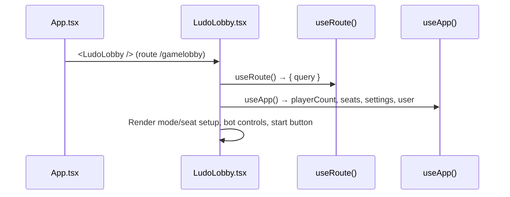
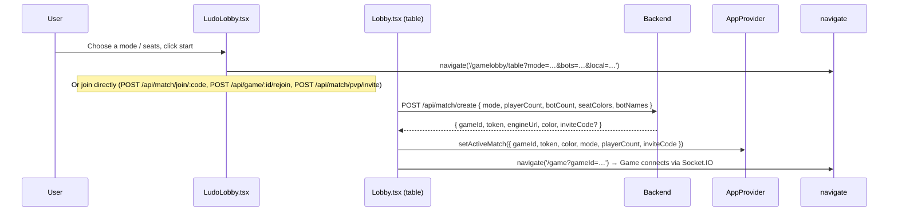

# Frontend — Lobby

## Table of Contents

- [Overview](#overview): Pre-game lobby for seat setup, bot setup and mode selection
- [Files](#files): Source file inventory
- [Key Types / Interfaces](#key-types--interfaces): Seat, PlayerCount and BOT_POOL types
- [Core Logic / Flow](#core-logic--flow): Mermaid sequence diagrams for lobby setup and game start
- [Logic Paths Summary](#logic-paths-summary): Decision trees for seat management and game start
- [Strict State Lock Hint](#strict-state-lock-hint): One live game per player, mirrored as a UI hint
- [Dependencies](#dependencies): Internal and external dependencies


---
---


## Overview

The lobby is at `/gamelobby` (`LudoLobby.tsx`), with a separate table/room screen at `/gamelobby/table` (`Lobby.tsx`). Players set up and start a game here. It has:

1. **Seat setup**: player count (2-4, read from the `?mode=` query param) and seat assignment (`you`, `player`, `bot`, or empty).
2. **Bot setup**: add or remove bots.
3. **Mode selection**: PvP (player versus player), PvE (player versus environment) or hotseat.
4. **Match creation**: `LudoLobby.tsx` lists the rooms the caller may enter (`GET /api/games/rooms`; each row carries `mySeat`, where `true` means "you hold a seat here, so this is a REJOIN row": including a room whose game already started, as long as your seat is still inside its 45 s grace window) and the games they are seated in (`GET /api/games/mine`), and joins them (`POST /api/match/join/:code`, `POST /api/game/:id/rejoin`) or creates a PvP (player versus player) invite (`POST /api/match/pvp/invite`); for local PvE/hotseat play it hands off to the table screen (`/gamelobby/table?mode=…`). The table screen (`Lobby.tsx`) is the one that calls `POST /api/match/create` with the exact `seatColors` and `botNames`, stores the returned `activeMatch` (gameId and engine token) in the store, then navigates to `/game`, where the Socket.IO connection starts.

> **Note:** The lobby communicates with the real backend. Creating a match returns engine credentials (`gameId`, `token`, `engineUrl`), which the Game page uses to connect through Socket.IO.

**Guest mode.** `/guest` renders the same screen with the `guest` prop set: bots fill every other seat, there is no mode picker and no active-game poll, and the launch posts `POST /api/match/guest` instead of `POST /api/match/create`. The payload is kept in the store as `guestSetup` so the end card's **Play again** can mint the same room again, and the return button goes to `/login`. See [`../guest-mode.md`](../guest-mode.md).

**Room browser.** The "OPEN QUANTUM ROOMS" window is a six-column table: sector code, host
callsign, capacity, stakes, modes, and action. `GET /api/games/rooms` also returns the room's three
rule flags, so the MODES cell names the variant before a player takes a seat: `BASE GAME` when no
mutator is on, otherwise only the active ones (`CLASH MODE`, `NO SAFE ZONES`, `FREE EXIT`), with the
same icons and accent colours as the create-screen toggles. The cell's `title` carries the full
localized list, so a chip clipped by a narrow column still resolves without a hover-only "i" (which
touch users could not reach). Header and rows live in one scroll box with a sticky header, and the
shared template pins every track (`minmax(0, …)` for the flexible ones plus a fixed action width):
a scrollbar on the rows alone, a long chip, or a wider JOIN/REJOIN button sizing only its own grid
would otherwise resolve the two grids differently and leave each label a few pixels to the right of
the value below it, worse from left to right.


---
---


## Files

| File | Role |
|------|------|
| `src/pages/LudoLobby.tsx` | Main lobby page (`/gamelobby`): mode/seat setup, match creation |
| `src/pages/Lobby.tsx` | Table view (`/gamelobby/table`): room state, ready, invites |


---
---


## Key Types / Interfaces

### Seat

```typescript
export type Seat =
  | { type: 'you' }
  | { type: 'bot'; name: string }
  | { type: 'player'; name: string }
  | { type: 'empty' }
```

### PlayerCount

```typescript
export type PlayerCount = 2 | 3 | 4
```

### BOT_POOL

```typescript
// From theme.ts
export const BOT_POOL = ['Siri', 'Alexa', 'Cortana']
```

Bot assistant names, shown as-is because they need no translation. Three is enough:
seat 0 is always you, so a 4-seat table holds at most 3 bots.

The chosen name is also the in-game label. `Lobby.tsx` sends the names as `botNames`,
the backend stores them on the seats as `displayName` (`bot-<color> (<assistant>)`), and
the engine hands them back in the game state, so the table screen and the game screen
agree. Detail: [backend-match-module.md](../backend/backend-match-module.md),
[frontend-game-module.md](frontend-game-module.md).


---
---


## Core Logic / Flow

### 1. Lobby Rendering

Sequence of steps when the lobby page loads.


**The seat roster shows an avatar on every occupied seat.** The host's own seat renders `UserAvatar` with
the store's `/me` facts, so it shows the uploaded photo when one exists and the generated avatar
otherwise. Each `type: 'player'` seat is a *local* hotseat pilot: it has no account, so it renders the
generated DiceBear avatar seeded from the name typed for it here (renaming the seat re-seeds the
avatar), and it issues no photo request at all. A `type: 'bot'` seat takes that same generated path,
seeded from the assistant name (`BOT_POOL`) this roster assigned it, which is the seed the arena and the
results invoice reuse. This is the lobby half of the same rule the game board follows; see
[avatar-system.md](../avatar-system.md) → 4. Game seats.

### 2. Start Game Flow

The lobby (`/gamelobby`) sets up the seats and then hands off to the table screen
(`/gamelobby/table`); the table screen creates the match.



### 3. Strict State Lock Hint

The backend allows **one live game per player** (see
[backend-match-module.md](../backend/backend-match-module.md) → Strict State Lock
(`active-game.ts`)). Both lobby screens mirror that rule as a hint, never as the
gate:

| Screen | Source of truth | What it does |
|--------|-----------------|--------------|
| `LudoLobby.tsx` (`/gamelobby`) | `GET /api/games/mine`, polled on mount and every `ROOM_POLL_MS` (5 s) | Greys out the host pass and the join-by-code field, and disables the JOIN button on rooms the caller holds no seat in (a REJOIN row stays enabled), each with a tooltip and an inline message. The header seat badge reads `ACTIVE ROOM: YES [IN-FLIGHT]` |
| `Lobby.tsx` (table, `/gamelobby/table`) | one-shot `GET /api/games/mine` on mount | Greys out LAUNCH and shows the lock message in the status box, with a tooltip |

Neither screen trusts the store's persisted `activeMatch`: it survives a closed tab
and would lock the screens forever after a game that ended off-screen. The
authoritative `GET /api/games/mine` empties itself as soon as the room is gone, so
the buttons come back on the next read. A create or join that still slips through
(another tab started a game in the meantime) is refused by the backend with
`403 MATCH_ACTIVE_GAME`, which `api.ts` renders as the localized
`errors.MATCH_ACTIVE_GAME` message in the same error slot.


---
---


## Logic Paths Summary

### Lobby Render Path
```
<LudoLobby /> (/gamelobby)
  ├── useRoute() → query (mode preselect)
  ├── useApp() → playerCount, seats, settings, user
  ├── Render seat grid for seats[0..playerCount)
  │   ├── type = 'you' → host seat (account avatar: uploaded photo, else generated)
  │   ├── type = 'bot' → bot name + remove button + generated avatar (assistant-name seed)
  │   ├── type = 'player' → named local pilot seat + generated avatar seeded from the name
  │   └── type = 'empty' → "+ Add" card
  └── Render Start button (enabled when a valid setup is chosen)
```

### Match Creation Path
```
LudoLobby.tsx (/gamelobby)
  ├── Local setup → navigate('/gamelobby/table?mode=…&bots=…&local=…')
  ├── Create room → POST /api/match/pvp/invite
  │   └── Refused while GET /api/games/mine is non-empty (you are already seated somewhere);
  │       the same signal greys out the host pass and the join controls
  ├── Room row → room.mySeat → POST /api/game/:id/rejoin (REJOIN row, own seat)
  │              otherwise → POST /api/match/join/:code (JOIN row)
  ├── Invite-code box → a code matching one of your own row → rejoin
  │                     any other code → POST /api/match/join/:code
  └── Success → setActiveMatch(result) → navigate('/game?gameId=…')

Lobby.tsx (table, /gamelobby/table)
  ├── LAUNCH disabled while GET /api/games/mine reports a room (one-shot read on mount)
  ├── POST /api/match/create { mode, playerCount, botCount, seatColors, botNames }
  │   ├── Error (bad mode / bots in non-pve) → show message
  │   └── Success → setActiveMatch(result)
  └── navigate('/game?gameId=…') → Game connects via Socket.IO
```

### Seat Management Path
```
addBot(i)
  └── Find unused bot name from BOT_POOL → seats[i] = { type: 'bot', name }

removeBot(i) / removePlayer(i)
  └── seats[i] = { type: 'empty' }

addPlayer(i)
  └── seats[i] = { type: 'player', name }
```


---
---


## How Seat Colours Are Sent

For hotseat and PvE, the created game is exactly the occupied seats (the host is always seat 0 / blue, then each added local player or bot in seat order). `Lobby.tsx` therefore sends the **exact** `seatColors` list rather than a count. Without it, the engine's `playerCount`-based default fills the gaps again and brings back seats the user deliberately skipped.


---
---


## Implementation Notes

- **Rule toggles reuse the seat sounds** (`Lobby.tsx`). Switching a rule on plays the seat-added blip (520 Hz); switching one off plays the seat-removed blip (320 Hz). Both use the shared 0.05 s duration, so the rules panel sounds like the seat controls beside it.


---


## Dependencies

| Dependency | Purpose |
|-----------|---------|
| `store.tsx` | `useApp` for mode, seats and game actions |
| `router.tsx` | `navigate('/game')` on start |
| `theme.ts` | `BOT_POOL` constant, inline styles |
| `components/UserAvatar.tsx` | Seat avatar: the host's uploaded photo when one exists, otherwise the generated DiceBear avatar seeded from the seat name (local hotseat pilots have no account, so they only ever get the generated one) |