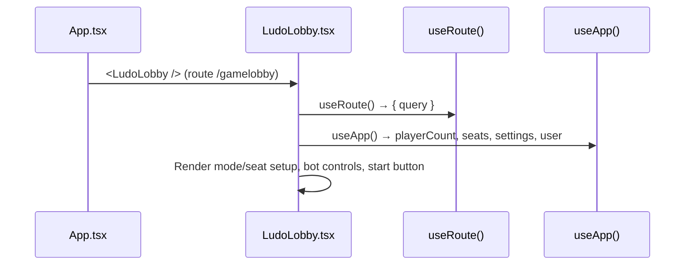
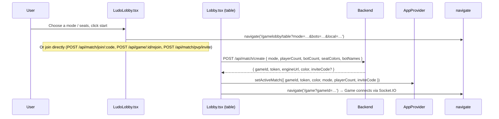

# Frontend — Lobby

## Table of Contents

- [Overview](#overview): Pre-game lobby for seat setup, bot setup and mode selection
- [Files](#files): Source file inventory
- [Key Types / Interfaces](#key-types--interfaces): Seat, PlayerCount and BOT_POOL types
- [Core Logic / Flow](#core-logic--flow): Mermaid sequence diagrams for lobby setup and game start
- [Logic Paths Summary](#logic-paths-summary): Decision trees for seat management and game start
- [One-Seat Lock Hint](#3-one-seat-lock-hint): One seat per player, mirrored as a UI hint
- [Dependencies](#dependencies): Internal and external dependencies


---
---


## Overview

The lobby is at `/gamelobby` (`LudoLobby.tsx`), with a separate table/room screen at `/gamelobby/table` (`Lobby.tsx`). Players set up and start a game here. It has:

1. **Seat setup**: player count (2-4, read from the `?mode=` query param) and seat assignment (`you`, `player`, `bot`, or empty). **A seat owns a colour**: the host picks theirs first, from the corners still free, and an empty card *is* a free colour, so its add action seats a bot or a local pilot at that colour. The palette is `ColorPaletteModal.tsx`, built from `freeColors` on the room row (or from the four corners before a room exists), so it cannot offer a taken colour. It draws a fixed 2×2 in board-quadrant order (`BOARD_QUADRANTS`: red/green above, blue/yellow below) and keeps a taken corner as an inert dashed slot, so a colour never moves between openings; the column beside it is the turn-order diagram, numbered from `SEAT_COLORS`. The seated colours travel as `seatColors`, which is seat identity — who sits where — not the rotation.
2. **Bot setup**: add or remove bots.
3. **Mode selection**: PvP (player versus player), PvE (player versus environment) or hotseat.
4. **Match creation**: `LudoLobby.tsx` lists the rooms the caller may enter (`GET /api/games/rooms`; each row carries `mySeat`, where `true` means "you hold a seat here, so this is a REJOIN row": including a room whose game already started, as long as your seat is still inside its 45 s grace window) and the games they are seated in (`GET /api/games/mine`), and joins them (`POST /api/match/join/:code`, `POST /api/game/:id/rejoin`) or creates a PvP (player versus player) invite (`POST /api/match/pvp/invite`); for local PvE/hotseat play it hands off to the table screen (`/gamelobby/table?mode=…`). The table screen (`Lobby.tsx`) is the one that calls `POST /api/match/create` with the exact `seatColors` and `botNames`, stores the returned `activeMatch` (gameId and engine token) in the store, then navigates to `/game`, where the Socket.IO connection starts.

5. **Two reference pages in the rooms header** (34, item 2): GAME RULES opens the ten-page rules deck in the lobby itself — `components/GameRulesModal/GameRulesModal.tsx`, the same component the game mounts, so there is still one rules UI — and MEET THE SQUADS navigates to `/squads`, which draws the four squads of the era the theme is in (`pages/Squads.tsx`, below).

> **Note:** The lobby communicates with the real backend. Creating a match returns engine credentials (`gameId`, `token`, `engineUrl`), which the Game page uses to connect through Socket.IO.

**Guest mode.** `/guest` renders the same screen with the `guest` prop set: bots fill every other seat, there is no mode picker and no active-game poll, and the launch posts `POST /api/match/guest` instead of `POST /api/match/create`. The payload is kept in the store as `guestSetup` so the end card's **Play again** can mint the same room again, and the return button goes to `/login`. See [`../guest-mode.md`](../guest-mode.md).

**Landscape notice.** `common.landscapeNotice` is mounted by the auth shell only (`LandscapeNotice` in `components/RetroAuthLayout.tsx`, the bordered strip above the card). The table screen and the PvP waiting room mount no copy of it, so the landscape/keyboard warning appears once, before sign-in, and the two waiting screens stay uniform.

**Room browser.** The "OPEN QUANTUM ROOMS" window is a six-column table: sector code, host
callsign, capacity, stakes, modes, and action. Its header is three groups — the counter, the arena's two
reference buttons (GAME RULES and MEET THE SQUADS, 34 item 2) and the room-code field with the **ACCESS
ROOM** button — and the page's error line sits on a row of its own directly under it (see below). The field
takes the code uppercase on change, 8 characters maximum, Enter submits, and it is disabled while
`GET /api/games/mine` reports a room (the same lock as the host pass).
`GET /api/games/rooms` also returns the room's three
rule flags, so the MODES cell names the variant before a player takes a seat: `BASE GAME` when no
mutator is on, otherwise only the active ones (`CLASH MODE`, `FREE EXIT`, `NO SAFE ZONES`), with the
same icons and accent colours as the create-screen toggles. The cell's `title` carries the full
localized list, so a chip clipped by a narrow column still resolves without a hover-only "i" (which
touch users could not reach). Header and rows live in one scroll box with a sticky header, and the
shared template pins every track (`minmax(0, …)` for the flexible ones plus a fixed action width):
a scrollbar on the rows alone, a long chip, or a wider JOIN/REJOIN button sizing only its own grid
would otherwise resolve the two grids differently and leave each label a few pixels to the right of
the value below it, worse from left to right. The scroll box has no height of its own: the window takes
the height the passes leave behind, so the box fills it and scrolls. From 1024 px the lobby uses the
shared `page-fit-shell` / `page-fit-column` pair, so the shell is `100dvh`, the main column owns the
remaining height and the room list is the only scroller, with a stable gutter. Below 1024 px the page
keeps its natural height and the 180 px window floor; the document scrolls there, which is how a short
window keeps a usable list.

**Empty list.** One centred line of `--text-soft` at `calc(0.78rem + 1pt)` in the list's own box
(`padding: 28px 0`): `NO OPEN PVP ARENAS FOUND. INITIALIZE AN ARENA AT LEVEL 1`
(`ludoLobbyPasses.noOpenRooms`). It names the thing the window actually holds (arenas, not "combat
rooms") and the one control that makes one, the Level 01 pass directly above it, instead of pointing at a
"pass #01" the page does not label that way. The sentence is short enough to stay on one line where the
older copy wrapped: 489 px of text in the 840 px the list has at 1280 (FR 515, MS 419), and still one
line in a 556 px box, where the previous EN and MS lines broke to two. The translations use the
vocabulary the rest of the page already uses (`ARÈNE PVP` / `NIVEAU`, `ARENA PVP` / `TAHAP`).

**Entry passes.** Three ticket passes stack above the rooms window in a flex column as tall as the dock
(`calc(100vh - 64px)`): host a new arena, hotseat, and bots. They sit **3 px apart**, so they read as one
stack of tickets rather than three separate cards, and each is `RETRO_TICKET_PASS`, 124 px minimum (157 px
at the 1280 content width, where the host copy wraps to three lines). The three action pills share one
width, the widest label the active language can produce, because each pill stacks every label in a single
grid cell, hidden (`PassActionPill`): no measuring, and a translation needs no code. The 1.5 px transparent
border on `TICKET_ACTION_PILL` is part of that, so the borderless host pill is not 3 px narrower than the
other two.

**The error line, and the two buttons over it.** Section 34's item 2 split the header's middle. It used to
hold the page's error channel — a zero-width span that grew into the row's slack and centred the message
there. Two buttons cannot share a slot measured that way (a definite zero width exists to keep *text* out of
the line-breaking maths; two buttons in that slot would need not to exist for the maths), so the slack went
to the buttons and the message moved to a row of its own directly beneath the header. The header is three
groups now: the counter (`flex: 0 1 auto`, `minWidth: 0`, still ellipsised), GAME RULES and MEET THE SQUADS
(`flex: 1 1 auto`, `justifyContent: 'center'`, 8 px apart, wrapping) and the code field with ACCESS ROOM
(`flexShrink: 0`). Both buttons wear one module constant, `HEADER_ACTION_STYLE`, which is the ACCESS ROOM
button's own recipe — 32 px tall, `0 14px` padding, `rgb(var(--accent-cyan-rgb) / 0.22)` on `--accent-cyan`
with its 16 px bloom — so the strip reads as three controls of one kind. The counter and the field were not
restyled, which is why they still share the line where they already did. The header keeps `flexWrap: 'wrap'`:
where the three groups no longer fit, the strip takes a second line rather than shrinking the field.

The message is a move, not a restyle. Same white 0.75 rem mono, the same localized `ludoLobbyExtra.errorPrefix`
in front of it, the same bloom drawn from `--state-off-rgb`; what changed is that it is `display: block` in a
full-width row of its own — padding `6px 14px`, the `#190a38` ground and the cyan rule **only while there is a
message**, so an empty row collapses to nothing and the header sits exactly where it did — and therefore wraps
instead of ellipsising: the whole sentence is what a failure now gets, and `title` still carries it untruncated.
The row is always mounted with `role="status"`, so the live region exists before a message does and the failure
is announced as it arrives. The old span's measurements retired with the span: the header can no longer grow
57 → 87 px with a long message, because the message is not in that row, and the 4 px margin that squared the
message against the group's 8 px gap went with it — the row's 14 px padding is the header's own, so a message
starts on the same left edge as the counter above it, in all three locales.

The column is one stack, so it is a flex column rather than a 12-column grid: one `gap: 3px`, the same air
the passes keep between themselves and the same 3 px that separates Level 03 from the rooms window's top
edge. The window closes the stack with `flex: 1 1 0` and a 180 px floor, the list filling whatever height is
left (see above). Nothing else reserves space in the column: the error row collapses to zero height whenever
it is empty, so the 3 px gutter is still the only strip that is not content.

**The squads page.** MEET THE SQUADS leaves the lobby for `/squads` (`pages/Squads.tsx`), registered in
`FULL_ROUTES` beside `/gamelobby` and behind the session gate like `/friends`. It is a page rather than a
panel because it holds no state: no room, no seat, nothing to resume. It mounts the lobby's own shell — the
CRT screen, `NavDock` with `activeRoute="/gamelobby"` so the dock still reads GAME LOBBY — a title and one
`RETRO_BADGE` carrying the era, and one `RETRO_WINDOW` whose body is the four cards, scrollable inside the
window so the heading and the RETURN TO GAME LOBBY button stay put however long the bios run. That only works
because the page is a fixed-height column and not a document: the row is `h-screen`, the column `h-full
flex-col`, and the window `flex: 1, minHeight: 0`, so the deck is the one box that gives way — with
`min-h-screen` the column was content-sized, the window outgrew the `100vh` root and an 800 px window clipped
the second row with nothing to scroll. The grid is `repeat(auto-fit, minmax(min(100%, max(320px, 45%)), 1fr))`:
two columns wherever the body has ~660 px, one when it does not, and never three — a third track cannot fit,
because 45% of the deck three times over is already more than the deck — so blue and yellow stay under red and
green instead of blue joining the top row, which is the board's 2×2 read wrong. The cards are
`BOARD_QUADRANTS` in order, so the 2×2 is the picker's 2×2 and the board's corners: each holds `PieceFigure`
at 88 px in a 96 px frame, headed `RED — CREAM PLATE CREW`-style — the seat's colour in its own `COL.base`
hue, then the nickname from `squadsPage.nick*` after a `' — '` the page supplies, because the separator is
punctuation and the nickname is the only translatable half — and the bio under it. Which four squads and
which words come from the store's `theme`: `era70` words for the 70s set, `era80` for the 80s, both decades in
all three locales because the page follows the switcher instead of offering a toggle of its own.


---
---


## Files

| File | Role |
|------|------|
| `src/pages/LudoLobby/` | Main lobby page (`/gamelobby`): mode/seat setup, match creation |
| `src/pages/Lobby/` | Table view (`/gamelobby/table`): room state, ready, invites |
| `src/pages/Squads.tsx` | The four squads of the era the theme is in (`/squads`, 34 item 2): the lobby shell and dock, one card per `BOARD_QUADRANTS` seat with `PieceFigure` and the era's nickname and bio, and RETURN TO GAME LOBBY |


---
---


## Key Types / Interfaces

### Seat

```typescript
export type Seat =
  | { type: 'you' }
  | { type: 'bot'; name: string }
  | { type: 'player'; name: string }
  | { type: 'empty' }
```

### PlayerCount

```typescript
export type PlayerCount = 2 | 3 | 4
```

### BOT_POOL

```typescript
// From theme.ts
export const BOT_POOL = ['Siri', 'Alexa', 'Cortana']
```

Bot assistant names, shown as-is because they need no translation. Three is enough:
the host is never a bot, so a 4-seat table holds at most 3 bots.

The chosen name is also the in-game label. `Lobby.tsx` sends the names as `botNames`,
the backend stores them on the seats as `displayName` (`bot-<color> (<assistant>)`), and
the engine hands them back in the game state, so the table screen and the game screen
agree. Detail: [backend-match-module.md](../backend/backend-match-module.md),
[frontend-game-module.md](frontend-game-module.md).


---
---


## Core Logic / Flow

### 1. Lobby Rendering

Sequence of steps when the lobby page loads.


**The seat roster shows an avatar on every occupied seat.** The host's own seat renders `UserAvatar` with
the store's `/me` facts, so it shows the uploaded photo when one exists and the generated avatar
otherwise. Each `type: 'player'` seat is a *local* hotseat pilot: it has no account, so it renders the
generated DiceBear avatar seeded from the name typed for it here (renaming the seat re-seeds the
avatar), and it issues no photo request at all. A `type: 'bot'` seat takes that same generated path,
seeded from the assistant name (`BOT_POOL`) this roster assigned it, which is the seed the arena and the
results invoice reuse. This is the lobby half of the same rule the game board follows; see
[avatar-system.md](../avatar-system.md) → 4. Game seats.

**The launch panel's bot tally.** `// BOT UNITS:` (`lobby.botUnitsLabel`, `lobby.unitsCount`) is a row of
the ARENA LAUNCH CONTROL window, and it renders only where a bot can actually be seated: the same
`allowAddPlayers` flag that decides whether a seat offers **+ ADD AI BOT** in the first place. Hotseat
arrives as `bots=0&local=1`, so its panel has no bot row at all and runs pilots → arena mode → sector
matrix → win condition, with the rows' 14 px gap closing up where the row was; the PvE and guest
variants keep it. Nothing is lost, because in hotseat `canStart` asks for two local pilots rather than
one bot, so that line could only ever read a permanent `0 UNITS`.

**The launch line and the two buttons.** The status box under the launch controls carries one sentence at a
time, and its ready state reads `>>> ARENA SYSTEMS READY. COMBAT ENABLED <<<` (`lobby.allSystemsPassed`, 43
characters in en against the 56 it replaced, one space after `READY.`); the 0.62 rem mono line keeps the
block one size across its four messages, so the button below it does not move when the sentence changes.
Both full-width buttons in the window — LAUNCH and RETURN TO GAME LOBBY — are `${RETRO_BTN} justify-center`:
the shared class is an `inline-flex` row with no `justify`, so a short label like `// ADD BOT TO START //`
sat against the left edge of a frame that ran on to the panel's right one.

### 2. Start Game Flow

The lobby (`/gamelobby`) sets up the seats and then hands off to the table screen
(`/gamelobby/table`); the table screen creates the match.



### 3. One-Seat Lock Hint

The backend allows **one seat per player**, in a waiting room or a live game (see
[backend-match-module.md](../backend/backend-match-module.md) → The one-seat lock
(`active-game.ts`)). Both lobby screens mirror that rule as a hint, never as the
gate:

| Screen | Source of truth | What it does |
|--------|-----------------|--------------|
| `LudoLobby.tsx` (`/gamelobby`) | `GET /api/games/mine` once on mount (and on every socket reconnect), then the `rooms:mine` push | Greys out the host pass and the code field in the rooms window header, and disables the JOIN button on rooms the caller holds no seat in (a REJOIN row stays enabled), each with a tooltip and an inline message. The header seat badge reads `ACTIVE ROOM: YES [IN-FLIGHT]` |
| `Lobby.tsx` (table, `/gamelobby/table`) | one-shot `GET /api/games/mine` on mount | Greys out LAUNCH and shows the lock message in the status box, with a tooltip |

The lobby's room list follows the same shape: one `GET /api/games/rooms` for first paint, then
`rooms:list` from the session socket (see
[backend-match-module.md](../backend/backend-match-module.md) → Lobby invalidation). Neither the list
nor the lock is polled.

Neither screen trusts the store's persisted `activeMatch`: it survives a closed tab
and would lock the screens forever after a game that ended off-screen. The
authoritative `GET /api/games/mine` empties itself as soon as the room is gone, so
the buttons come back on the next read. A create or join that still slips through
(another tab started a game in the meantime) is refused by the backend with
`403 MATCH_ALREADY_SEATED`, which `api.ts` renders as the localized
`errors.MATCH_ALREADY_SEATED` message in the rooms window's header.


---
---


## Logic Paths Summary

### Lobby Render Path
```
<LudoLobby /> (/gamelobby)
  ├── useRoute() → query (mode preselect)
  ├── useApp() → playerCount, seats, settings, user
  ├── Render seat grid for seats[0..playerCount)
  │   ├── type = 'you' → host seat (account avatar: uploaded photo, else generated)
  │   ├── type = 'bot' → bot name + remove button + generated avatar (assistant-name seed)
  │   ├── type = 'player' → named local pilot seat + generated avatar seeded from the name
  │   └── type = 'empty' → "+ Add" card
  └── Render Start button (enabled when a valid setup is chosen)
```

### Match Creation Path
```
LudoLobby.tsx (/gamelobby)
  ├── Local setup → navigate('/gamelobby/table?mode=…&bots=…&local=…')
  ├── Create room → POST /api/match/pvp/invite
  │   └── Refused while GET /api/games/mine is non-empty (you are already seated somewhere);
  │       the same signal greys out the host pass and the join controls
  ├── Room row → room.mySeat → POST /api/game/:id/rejoin (REJOIN row, own seat)
  │              otherwise → POST /api/match/join/:code (JOIN row)
  ├── Invite-code field (rooms window header) → a code matching one of your own row → rejoin
  │                     any other code → POST /api/match/join/:code
  └── Success → setActiveMatch(result) → navigate('/game?gameId=…')

Lobby.tsx (table, /gamelobby/table)
  ├── LAUNCH disabled while GET /api/games/mine reports a room (one-shot read on mount)
  ├── POST /api/match/create { mode, playerCount, botCount, seatColors, botNames }
  │   ├── Error (bad mode / bots in non-pve) → show message
  │   └── Success → setActiveMatch(result)
  └── navigate('/game?gameId=…') → Game connects via Socket.IO
```

### Seat Management Path
```
addBot(i)
  └── Find unused bot name from BOT_POOL → seats[i] = { type: 'bot', name }

removeBot(i) / removePlayer(i)
  └── seats[i] = { type: 'empty' }

addPlayer(i)
  └── seats[i] = { type: 'player', name }
```


---
---


## How Seat Colours Are Sent

For hotseat and PvE, the created game is exactly the occupied seats, each at the colour its card claimed. `Lobby.tsx` therefore sends the **exact** `seatColors` list rather than a count: without it the engine's `playerCount`-based default fills the gaps again and brings back seats the user deliberately skipped. That list is seat identity, not the rotation — turn order is colour order (blue → red → green → yellow) in every mode, so a room whose cards hold green and blue opens on blue. Nothing on the card prints a seat number either: the header is `// {{color}}`, the host tag is `[HOST / PILOT]`, and a local pilot's default name is the raw id `player-<color>`, localized where it is painted (`joueur-jaune` in French), so a language switch renames the seat instead of freezing the wording it was created in.


---
---


## Implementation Notes

- **Rule toggles reuse the seat sounds** (`components/RoomRuleToggle.tsx`, shared by `Lobby.tsx` and `Game.tsx`). Switching a rule on plays the seat-added blip (520 Hz); switching one off plays the seat-removed blip (320 Hz). Both use the shared 0.05 s duration, so the rules panel sounds like the seat controls beside it.


---


## Dependencies

| Dependency | Purpose |
|-----------|---------|
| `store/store.tsx` | `useApp` for mode, seats and game actions |
| `router.tsx` | `navigate('/game')` on start |
| `theme.ts` | `BOT_POOL` constant, inline styles |
| `components/UserAvatar.tsx` | Seat avatar: the host's uploaded photo when one exists, otherwise the generated DiceBear avatar seeded from the seat name (local hotseat pilots have no account, so they only ever get the generated one) |