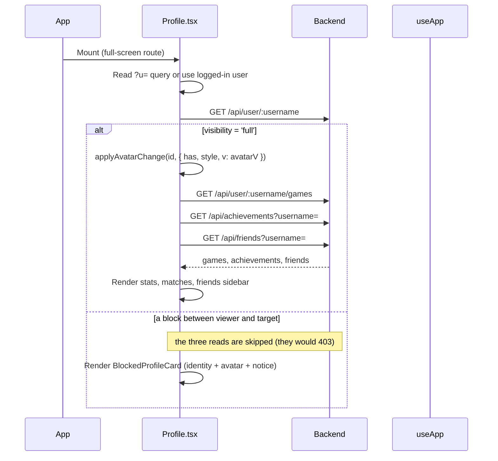
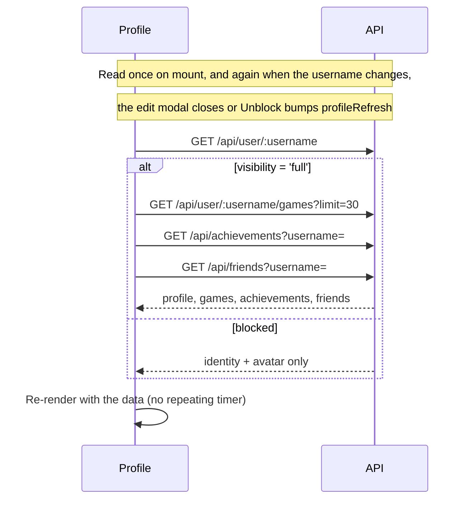

# Frontend — Profile Page

## Table of Contents

- [Overview](#overview) — User profile with statistics, match history and a friends panel
- [Files](#files) — Source file inventory
- [Key Types / Interfaces](#key-types--interfaces) — Profile, match history, and friend types
- [Core Logic / Flow](#core-logic--flow) — Data fetching, and when it repeats
- [Dependencies](#dependencies) — Internal and external dependencies


---
---


## Overview

The Profile page (`/profile`) shows a user's profile with statistics, recent match history and a friends panel. It is a full-screen route (rendered directly by the router); the page mounts its own `NavDock`. The route is signed-in only.

1. **Profile header** — the player's display name plus their username (shown so others can add them by username), a status indicator, avatar initials, rating and the date the account was created. The window title bar (`// PILOT PROFILE • NAME ( USERNAME: handle )`) ends with a click-to-copy button that puts the handle on the clipboard (`profile.usernameCopy` → `profile.usernameCopiedOk` for 1.5 s, `profile.copyUsernameTooltip` on hover, UI beep) — closing the line the way `// ROOM: {{code}} [COPY]` closes the PvP badge, because the handle is the immutable identifier while the display name can be renamed.
2. **Stats grid** — wins, losses, win rate, best streak.
3. **Recent matches** — each game with the other human players' names, the result (victory, defeat or draw), pieces in goal and the date. A game against bots lists only you.
4. **Friends panel** — friends with their online status and their rating; shown only on your own profile.
5. **Avatar actions (own profile)** — the `EDIT AVATAR`, `RESET` and `EDIT PROFILE` buttons, and below them a **message area with a fixed height**. The area shows upload and reset errors in red, and the photo-load warning (`profile.photoLoadError`) in amber. Because the height is fixed, a longer translation in Malay or French wraps onto more lines without moving the content below it.
6. **Blocked card** — a block between the viewer and this player degrades the whole page (see *Blocked profile* below).

When the page loads it reads the profile first, then the game history, achievements and friends **only if the profile came back `visibility: 'full'`**. It reads them again when the username changes or the edit modal closes. It does **not** repeat on a timer. A refresh after **Unblock** shows the full page again.

### Blocked profile

`GET /api/user/:username` answers `200` with `visibility: 'blocked-by-you' | 'blocked-by-them'` and identity + avatar only; the three collateral reads are skipped (they would `403 FRIEND_BLOCKED`). `BlockedProfileCard` in the same file then renders the avatar, the name and the same click-to-copy `@username` chip (`UsernameCopyChip`; a block hides the relationship, not the identifier), a `CONTACT UNAVAILABLE` notice, and:

| `visibility` | Copy | Action |
|---|---|---|
| `blocked-by-you` | `profile.blockedByYou` | **UNBLOCK** (`POST /api/friends/unblock/:userId`, then bumps `profileRefresh` so the effect refetches) |
| `blocked-by-them` | `profile.blockedByThem` — *"You have been blocked by this user."* | **RETURN TO MY PROFILE** only |

A mutual block reports `blocked-by-you` (the viewer's own block is the one they can lift); after unblocking, the refetch reports `blocked-by-them`.


---
---


## Files

| File | Role |
|------|------|
| `src/pages/Profile.tsx` | Profile page component |
| `src/components/NavDock.tsx` | The seated navigation dock (profile page is full-screen) |
| `src/store.tsx` | `useApp` for authentication state, presence and API (Application Programming Interface) calls |
| `src/theme.ts` | `STATUS_STYLE` (and the `PresenceStatus` type) for the status indicator |


---
---


## Key Types / Interfaces

### UserProfile

```typescript
{
  id: string;  // Unique ID
  username: string;  // Player's username
  displayName?: string;  // Name shown in the game
  avatarStyle: string | null;  // Avatar style name
  avatarV?: number;  // Avatar record stamp, applied as the photo URL's `?v=`
  visibility?: 'full' | 'blocked-by-you' | 'blocked-by-them';  // Defaults to full
  hasAvatarPhoto: boolean;  // Whether a custom photo is uploaded
  rating: number;  // Player's rating (score)
  highestRating: number;  // Best rating ever reached
  wins: number;  // Games won
  losses: number;  // Games lost
  winStreak: number;  // Wins in a row right now
  bestWinStreak: number;  // Longest winning streak ever
  createdAt: string;  // When the record was created
  status: 'online' | 'playing' | 'offline';  // Current status
}
```

A blocked payload carries only `id`, `username`, `displayName`, `avatarStyle`, `hasAvatarPhoto`,
`avatarV` and `visibility`: the stats and `status` are **absent**, not zeroed, which is why the page
branches on `visibility` before reading any of them.

### MatchHistory

```typescript
{
  games: Array<{  // List of games played
    gameId: string;  // ID of the game
    status: string;  // Current status
    gameType: 'PVP' | 'PVE';  // Match type
    color: string;  // Seat color
    rank: number | null;  // Position in the ranking
    piecesCaptured: number;  // Pieces knocked off
    piecesInGoal: number;  // Pieces finished (0-4)
    ratingDelta: number;  // Rating change from this game
    startedAt: string;  // When the game started
    endedAt: string | null;  // When the game ended
    participants: Array<{  // Every human who played; a game against bots lists only you
      username: string;  // Player's username
      avatarStyle: string | null;  // Avatar style name
      hasAvatarPhoto?: boolean;  // Whether a custom photo is uploaded
      color: string;  // Seat color
      rank: number | null;  // Position in the ranking
      piecesInGoal: number;  // Pieces finished (0-4)
    }>;
  }>;
  total: number;  // Total number of items
  page: number;  // Page number
  limit: number;  // Items per page
}
```

### Friend

```typescript
{
  id: string;  // Unique ID
  username: string;  // Player's username
  displayName?: string;  // Name shown in the game
  avatarStyle: string | null;  // Avatar style name
  hasAvatarPhoto?: boolean;  // Whether a custom photo is uploaded
  rating: number;  // Player's rating (score)
  friendsSince: string;  // When the friendship started
  status: 'online' | 'playing' | 'offline';  // Current status
}
```


---
---


## Core Logic / Flow

### Page Load



### Data Refresh




---
---


## Achievements (own profile)

Your own profile renders the 16 achievements defined by `ACHIEVEMENTS_DEF` in `Profile.tsx`. The thresholds match the backend registry, which is the version that runs (see [backend-achievements-module.md](../backend/backend-achievements-module.md)). Match types are PvP (player versus player) and PvE (player versus environment, against bots).

| Key | Requirement |
|-----|-------------|
| `achFirstBlood` | 1 win (PvP or PvE) |
| `achOnFire` | `User.winStreak` >= 2 |
| `achDiceMaster` | 3 wins |
| `achBabySteps` | 1 bot win |
| `achTheDiceLoveMe` | 3 bot wins |
| `achTactician` | 5 wins |
| `achMaster` | 8 wins |
| `achGrandBotMaster` | 12 wins |
| `achWorldChampion` | 15 wins |
| `achft_Transcendence` | 10 PvP wins (PvE never counts) |
| `achLoveTheMachine` | 3 consecutive PvE games, any outcome (a PvP game resets it) |
| `achSpeedDemon` | win in under 30 minutes (unknown duration means no unlock) |
| `achUnstoppable` | 3 captures in a single game |
| `achSteadyDefender` | 2 clash rounds won as defender in one clash-mode game |
| `achMercilessAttacker` | 2 clash rounds won as attacker in one clash-mode game |

Hotseat games never count towards any achievement. The badge/tab counter shows `unlocked / 15`.


---
---


## Dependencies

| Dependency | Purpose |
|-----------|---------|
| `store.tsx` | `useApp()` for `user` and navigation |
| `router.tsx` | `useRoute()` to read the `?u=` query parameter |
| `theme.ts` | `STATUS_STYLE` and the `PresenceStatus` type for the profile/friends status dots |
| `api.ts` | `translateErrorCode()`, which turns an error code from a `fetch` response into text in the user's language |
| `components/UserAvatar.tsx` | Renders the avatar; `onPhotoError` runs when a photo fails to load |