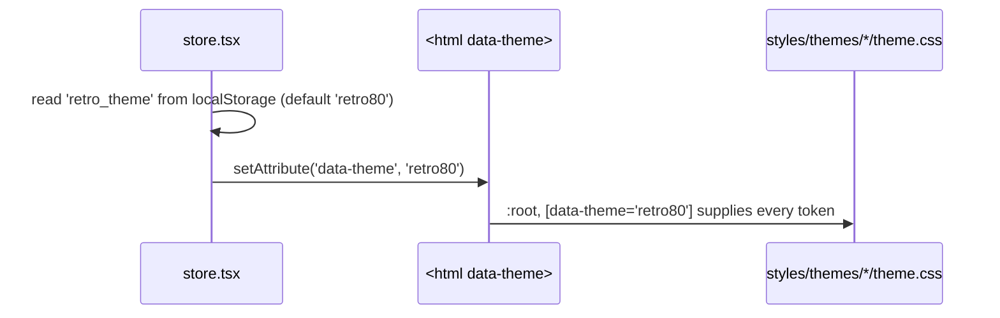

# Frontend — Styles & Theming

## Table of Contents

- [Overview](#overview) — The stylesheets and how theming works
- [Files](#files) — Source file inventory
- [Key Types / Interfaces](#key-types--interfaces) — Theme tokens
- [Core Logic / Flow](#core-logic--flow) — How the theme reaches the screen on boot
- [Dependencies](#dependencies) — Internal and external dependencies


---
---


## Overview

Styling is split between CSS files and TypeScript constants, with a clear rule for what belongs where:

1. **`styles/themes/retro80/theme.css`** and **`styles/themes/retro70/theme.css`** — one palette table per era, each beside the plate it paints (the 80s cityscape, the 70s orbital colony). `retro80` also carries `:root`, so a document with no `data-theme` yet reads the default palette. Every name one table declares, the other declares too, in the same order: `scripts/check-theme-literals.mjs` fails the build otherwise, because a name declared in one table and not the other renders as `unset` under that era and no screenshot catches it.
2. **`styles/theme-base.css`** — the two tables imported in order, then nothing else: the order is load-bearing, since both selectors are specificity 0-1-0 and only source order decides which wins for an `<html>` that matches both.
3. **`styles/app.css`** — the component sheet: the scrollbar, `@keyframes`, and the few rules that must stay in CSS, all reading the tokens. Since 2026-11-12 it is only that list. The `#color-scheme` fieldset's sheet (160 lines, 15 rules) that no component mounted, the fifteen banner blocks that introduced no rules and the one selector (`canvas#snakeCanvas`) no file names were removed, which took the file from 709 lines to 500; `scripts/dead-refs.mjs` now fails `npm run lint` and `npm run build` when a selector or a `tw.ts` constant loses its last reader (recommendation E in the [styling audit](todo.md#rv33-audit), [the ruling](todo.md#rv33-ruled)).
4. **`index.css`** — imports Tailwind, sets base element styles (`body`, `input`, `a`), and holds the Home page's layout rules with two responsive `@media (max-height: …)` breakpoints.
5. **`styles/tw.ts`** — long Tailwind utility-class strings shared by several components. Each constant replaces one `app.css` rule one-for-one; where a rule cannot be expressed as utilities (`@keyframes`, custom easing curves such as `--flicker`), it stays in `app.css` and is referenced with `var()` or an arbitrary `animation:` value.

**Theme switching is CSS-only.** No JavaScript reads a theme name to pick colors — a component never checks "which theme is active". `theme.ts` holds only what is *data* rather than style: the Ludo palette (`COL`), the turn order (`SEAT_COLORS`), the picker's quadrant order (`BOARD_QUADRANTS`), the colour-word map (`COLOR_KEYS`), the bot pool and the presence colours (`STATUS_STYLE`). Its twelve `CSSProperties` exports went on 2026-11-12: eleven had no importer at all, and the one that had a reader, `btnOutline`, became `OAUTH_BTN` in `styles/tw.ts`.

`src/styles/fonts.css` is generated, never hand-edited: `node scripts/vendor-fonts.mjs` downloads the Atkinson Hyperlegible Next/Mono woff2 files into `public/fonts/` and writes the twelve `@font-face` rules for them. It is imported first in `main.tsx`, so every `--font-heading`/`--font-display`/`--font-mono` reference resolves to a face that ships with the app instead of one fetched from Google.

### Cascade and CSS-only rules

`index.css` imports Tailwind, whose preflight supplies the base reset, so neither the theme tables nor `app.css` define a reset of their own. Both are imported unlayered, so a rule written there outranks every Tailwind utility class.

These rules stay in CSS because no utility expresses them:

| Rule | Why it stays in CSS |
|------|---------------------|
| `.crt-screen` | `body:has(.game-page)` targets the class by name, so it also has to stay on the element in the JSX. |
| `.field-error` | Reserves the error slot's height per breakpoint; an inline `style` cannot express a `@media` query. |
| `@keyframes arcade-start-pulse` | Applied the same way. It animates `scale` only: Tailwind's `-translate-x-1/2` sets the standalone `translate` property, which composes with `transform`, so a keyframe `translateX` would add a second -50 percent shift. |

**Where colour is declared, measured.** An audit on 2026-11-12 (`todo.md` [33](todo.md#rv33-audit)) sorted every occurrence of the ink family by the form that carries it: 23.6 per cent arrived as a utility class, 52.9 per cent as an inline `style` holding nothing but the token, 21.6 per cent as an inline `style` computed at render, and 1.9 per cent as a stylesheet rule. Across the whole tree the ratio repeated — 1074 `style={{` regions against 442 `className` attributes and 97 `tw.ts` constants — so inline styles, not utilities, were where most colour was written, and the majority of those were static values a utility could have carried. The remediation was ruled and run the same day (`todo.md` [the ruling](todo.md#rv33-ruled)): the 30 objects that came from the twelve shared recipes became eleven `tw.ts` constants plus one utility (`text-(--text-main)`), the 71 single-use recipes stayed style objects **by rule**, and the 18 paint-only static objects the tree held beyond that group became utilities too, so `check-theme-literals.mjs` gates the shape — *an inline object holding nothing but paint, every value a literal* — and opens with zero rows. `app.css` lost its unmounted fieldset sheet (160 lines, 15 rules) and fifteen banner blocks that introduced no rules on the way, from 709 lines to 500. The channel rule itself is policy, not a recommendation: utility → `tw.ts` constant → inline `style` only when the value is computed → `app.css` only when CSS must own it.


---
---


## Files

| File | Role |
|------|------|
| `src/styles/fonts.css` | Generated `@font-face` rules for the self-hosted Atkinson Hyperlegible Next/Mono faces (source of truth: `scripts/vendor-fonts.mjs`, files in `public/fonts/`) |
| `src/styles/themes/retro80/theme.css` | The 1980s palette table on `:root, [data-theme='retro80']`, with its cityscape plate beside it |
| `src/styles/themes/retro70/theme.css` | The 1970s palette table on `[data-theme='retro70']` — the same names, the same order, every value different — with its orbital-colony plate beside it |
| `src/styles/theme-base.css` | Imports the two tables in order; the order is what decides the default |
| `src/styles/app.css` | The component sheet: scrollbar, `@keyframes`, and the few rules that must stay in CSS |
| `src/index.css` | Tailwind import, base element styles, Home page layout rules, scrollbar fallback |
| `src/styles/tw.ts` | Shared Tailwind utility-class constants (documented in [frontend-components-system.md](frontend-components-system.md)) |
| `src/theme.ts` | Data only: `COL`, `SEAT_COLORS`, `BOARD_QUADRANTS`, `COLOR_KEYS`, `BOT_POOL`, `STATUS_STYLE` and the `PresenceStatus` type |
| `src/store.tsx` | Owns the `theme` state and applies `data-theme` to `<html>` |


---
---


## Key Types / Interfaces

### The theme

Two themes ship, and each is its own token table: **Retrowave '80**, declared on `:root, [data-theme='retro80']` (the default), and **Retro 70's**, declared on `[data-theme='retro70']` in the file after it. The store writes `data-theme` onto `<html>` and `<body>` on boot and on every switch, and the choice survives a reload in `retro_theme`. An unknown or renamed value fails validation and falls through to `retro80`.

### Theme tokens (CSS custom properties)

`:root, [data-theme='retro80']` declares the whole token set, for example:

```css
--bg-primary, --bg-secondary, --bg-card   /* backgrounds */
--accent-cyan, --accent-pink, --accent-yellow, --accent-purple
--text-main, --text-muted, --text-soft  /* white, muted lavender, paler step for captions */
--border-color, --box-shadow, --card-border-style
--font-heading, --font-display, --font-mono  /* Atkinson Hyperlegible Next (heading/display), Atkinson Hyperlegible Mono */
--crt-scanline-opacity, --crt-flicker-opacity
--window-header-bg, --window-header-text
--state-on, --state-on-ink, --state-off   /* the pass/fail pair, see below */
--accent-yellow                          /* the accent that is also the third state, see below */
--accent-*-rgb, --state-on-rgb, --state-off-rgb, --ink-rgb, --shade-rgb, --bg-primary-rgb   /* `r g b`, read as `rgb(var(--x-rgb) / a)` */
```

A component only ever references `var(--accent-cyan)` (and so on), so the colour comes from the stylesheet.

**The state pair.** `--state-on` (`#00ff88` / avocado `#82903f`) and `--state-off` (`#ff0055` / cranberry rose `#e8697d`) are the only two colours that report a condition: on/off, joined/muted, valid/refused, met/missed, in/out. They are not accents, so they are not reused for a seat, a mode or a rule, and the two halves always move together (a row reads "on" by contrast with a row that reads "off"). `--state-on-ink` is the text that sits on a lit pill. Seat hues, the hero art and the mode chrome stay literal, because colour is the seat and a mode's colour is its name. Both halves moved together on 2026-11-09, which is why the accent pink that sat beside a moved green (the profile's defeats card, a lost match, the blocked card, the down delta) moved onto `--state-off` too: `--accent-pink` is the red seat's own hue, so it cannot report a failure. The pair also replaced the two unread channel tokens `--success-rgb` and `--warn-rgb`.

**The navy grounds.** The second family (`todo.md` [33](todo.md#rv33-family2)) is the ramp behind the chrome: `--bg-primary` (the shell's ground), then `--bg-void-rgb` (`5 2 18` / `12 9 8`), `--bg-panel-rgb` (`10 2 28` / `17 14 12`), `--bg-raise-rgb` (`20 6 46` / `30 24 21`) and `--bg-card-rgb` (`25 10 56` / `43 30 21`). It is five stops because the components had spelled thirty-two: a census of the tree found the same five roles written 97 times in navy shades that differ by two or three units per channel, which is a ramp nobody chose. So the family's codemod folds each site onto the nearest stop — 38 of the 88 it converted resolve to the literal they carried, the other 50 move by at most 5/255 per channel, and a check confirms no gradient's two ends folded onto the same stop, so nothing flattened. The 70s values are not the 80s ones translated channel by channel: a cold navy reads purple over walnut, so each stop keeps its *lightness step* off that era's `--bg-primary`, which is what `--bg-start-overlay` already argues for a single card. Nine sites are left: the hover and selected lifts (`35,12,70`, `28,10,64`, `28,8,62`, `30,8,55`) and three gradient ends whose nearest stop is more than five units away. Those want a sixth stop, and the 70s value of a *lifted* surface is a design call rather than a codemod's, so they are family 2b and their literals stand until it lands.

**The ink family.** `--ink-rgb` (`255 255 255` / warm cream `255 231 189`) is the neutral every surface tints with, `--shade-rgb` (`0 0 0` / warm black `26 16 9`) is the shadow under it, and `--text-main` is the ink as text; the 70s values are warm on purpose, because a cold white or a cold black reads purple and blue-grey over walnut. The first family of the sweep (`todo.md` [33](todo.md#rv33-plan) step 2) moved 242 reader lines across 35 files onto them: `rgba(255,255,255,a)` became `rgb(var(--ink-rgb) / a)`, a bare `#ffffff` used as text became `var(--text-main)`, `#000000` became `rgb(var(--shade-rgb))`, and Tailwind's own `text-white`/`bg-black` utilities — which bypass the tokens entirely — were folded into the same forms (`text-(--text-main)`, `bg-[rgb(var(--shade-rgb))]`), compact inside the brackets so the arbitrary value stays one class. Under `retro80` every one of the 242 resolves back to the literal it replaced, character for character; the change is the 70s. Canvas and SVG painters keep their literals, because their palette is drawn rather than read: `pieceParts`, the hero backdrops, the goal and capture sparks, the die, the result spark. So do the mask channel (white is full coverage there, not a colour, so it must not warm) and the surfaces another step owns — the board's fringes and the clash card. Each of those is on the guard's inventory with the reason, and `--propose` prints the rows a tree would need. `scripts/colour-census.mjs --groups` sizes the next family: distinct values, counts and files, grouped by hue band.

**The third state.** `--accent-yellow` (`#ffe600` / amber `#ffb000`) is the caution: a warning, a caution or an in-progress row (an abandoned match, an empty photo slot, a room that cannot launch, a legal move). It is not a third `--state-*` token, because the accent already names the colour and a second name would drift from it, and it is never a verdict. It needed no new value: the 70s amber reads 9.05:1 on that theme's card and sits 29.0° of hue from the avocado and 50.8° from the rose, so the three conditions stay distinguishable. Seat hues, the hero art and the mode chrome stay literal (`todo.md` [27](todo.md#warn-colour)); everything that paints reads the token, and `scripts/check-theme-literals.mjs` (run by `prebuild` and `lint`) fails the build on a literal outside its named inventory.


---
---


## Core Logic / Flow



1. On startup the store reads `retro_theme` from `localStorage` (default `retro80`) and sets the `data-theme` attribute on both `document.documentElement` and `document.body`.
2. `themes/retro80/theme.css` declares the tokens on `:root, [data-theme='retro80']`, so the values resolve with or without the attribute; `themes/retro70/theme.css` declares the same names in the same order under `[data-theme='retro70']`.
3. Components and `tw.ts` constants only reference tokens (`var(--accent-pink)`) or plain Tailwind utilities.


---
---


## Dependencies

| Dependency | Purpose |
|-----------|---------|
| `store.tsx` | `theme` / `setTheme` state; persists `retro_theme` and sets the `data-theme` attribute |
| `styles/tw.ts` | Consumes the tokens through Tailwind arbitrary values; documented separately |
| Tailwind CSS | Imported by `index.css` (`@import 'tailwindcss'`) |
| Google Fonts | `Atkinson Hyperlegible Next` (headings, UI, body) and `Atkinson Hyperlegible Mono` (tabular/mono text), requested once in `index.html` |
