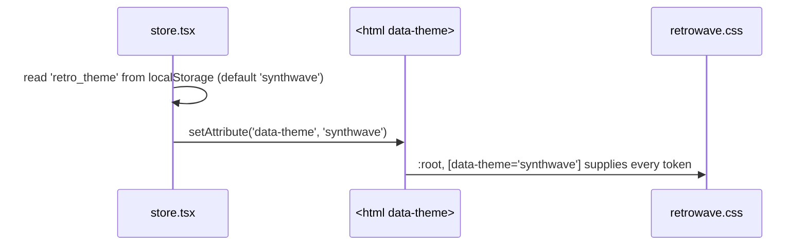

# Frontend — Styles & Theming

## Table of Contents

- [Overview](#overview) — The stylesheets and how theming works
- [Files](#files) — Source file inventory
- [Key Types / Interfaces](#key-types--interfaces) — Theme tokens
- [Core Logic / Flow](#core-logic--flow) — How the theme reaches the screen on boot
- [Dependencies](#dependencies) — Internal and external dependencies


---
---


## Overview

Styling is split between CSS files and TypeScript constants, with a clear rule for what belongs where:

1. **`retrowave.css`** (584 lines) — the theme design system. Defines the Synthwave '84 color and font custom properties on `:root, [data-theme='synthwave']`, plus the scrollbar styles, `@keyframes` animations, and the few rules that must stay in CSS.
2. **`index.css`** (179 lines) — imports Tailwind, sets base element styles (`body`, `input`, `a`), and holds the Home page's layout rules with two responsive `@media (max-height: …)` breakpoints.
3. **`styles/tw.ts`** — long Tailwind utility-class strings shared by several components. Each constant replaces one `retrowave.css` rule one-for-one; where a rule cannot be expressed as utilities (`@keyframes`, custom easing curves such as `--flicker`), it stays in `retrowave.css` and is referenced with `var()` or an arbitrary `animation:` value.

**Theme switching is CSS-only.** No JavaScript reads a theme name to pick colors — a component never checks "which theme is active". The app ships a single theme, and `theme.ts` holds a few fixed (non-switching) constants for it: the Ludo palette (`COL`), the presence colours (`STATUS_STYLE`) and gold/panel inline styles.

`src/styles/fonts.css` is generated, never hand-edited: `node scripts/vendor-fonts.mjs` downloads the Atkinson Hyperlegible Next/Mono woff2 files into `public/fonts/` and writes the twelve `@font-face` rules for them. It is imported first in `main.tsx`, so every `--font-heading`/`--font-display`/`--font-mono` reference resolves to a face that ships with the app instead of one fetched from Google.

### Cascade and CSS-only rules

`index.css` imports Tailwind, whose preflight supplies the base reset, so `retrowave.css` defines no reset of its own. `retrowave.css` is imported unlayered, so a rule written there outranks every Tailwind utility class.

These rules stay in CSS because no utility expresses them:

| Rule | Why it stays in CSS |
|------|---------------------|
| `.crt-screen` | `body:has(.game-page)` targets the class by name, so it also has to stay on the element in the JSX. |
| `.field-error` | Reserves the error slot's height per breakpoint; an inline `style` cannot express a `@media` query. |
| `@keyframes arcade-start-pulse` | Applied the same way. It animates `scale` only: Tailwind's `-translate-x-1/2` sets the standalone `translate` property, which composes with `transform`, so a keyframe `translateX` would add a second -50 percent shift. |


---
---


## Files

| File | Role |
|------|------|
| `src/styles/fonts.css` | Generated `@font-face` rules for the self-hosted Atkinson Hyperlegible Next/Mono faces (source of truth: `scripts/vendor-fonts.mjs`, files in `public/fonts/`) |
| `src/styles/retrowave.css` | Theme design system — the `[data-theme='synthwave']` token set, font tokens, scrollbar, `@keyframes` |
| `src/index.css` | Tailwind import, base element styles, Home page layout rules, scrollbar fallback |
| `src/styles/tw.ts` | Shared Tailwind utility-class constants (documented in [frontend-components-system.md](frontend-components-system.md)) |
| `src/theme.ts` | One-theme TypeScript constants (`COL`, `SEAT_COLORS` for the turn order, `BOARD_QUADRANTS` for the picker's 2×2, `COLOR_KEYS` for the colour→locale-key map, `BOT_POOL`, `STATUS_STYLE`, `goldText`, `btnGold`/`btnGoldSmall`/`btnOutline`, `card`, `input`, `label`, `sectionLabel`, `avatarBlue`/`avatarDim`, `feltPanel`, `pill`) |
| `src/store.tsx` | Owns the `theme` state and applies `data-theme` to `<html>` |


---
---


## Key Types / Interfaces

### The theme

Two themes ship, and both are token sets in the same stylesheet: **Synthwave '84**, declared on `:root, [data-theme='synthwave']` (the default), and **Retro 70's**, declared on `[data-theme='retro70']` after it. The store writes `data-theme` onto `<html>` and `<body>` on boot and on every switch, and the choice survives a reload in `retro_theme`.

### Theme tokens (CSS custom properties)

`:root, [data-theme='synthwave']` declares the whole token set, for example:

```css
--bg-primary, --bg-secondary, --bg-card   /* backgrounds */
--accent-cyan, --accent-pink, --accent-yellow, --accent-purple
--text-main, --text-muted, --text-soft  /* white, muted lavender, paler step for captions */
--border-color, --box-shadow, --card-border-style
--font-heading, --font-display, --font-mono  /* Atkinson Hyperlegible Next (heading/display), Atkinson Hyperlegible Mono */
--crt-scanline-opacity, --crt-flicker-opacity
--window-header-bg, --window-header-text
--state-on, --state-on-ink, --state-off   /* the pass/fail pair, see below */
--accent-*-rgb, --state-on-rgb, --state-off-rgb, --ink-rgb, --shade-rgb, --bg-primary-rgb   /* `r g b`, read as `rgb(var(--x-rgb) / a)` */
```

A component only ever references `var(--accent-cyan)` (and so on), so the colour comes from the stylesheet.

**The state pair.** `--state-on` (`#00ff88` / avocado `#82903f`) and `--state-off` (`#ff0055` / cranberry rose `#e8697d`) are the only two colours that report a condition: on/off, joined/muted, valid/refused, met/missed, in/out. They are not accents, so they are not reused for a seat, a mode or a rule, and the two halves always move together (a row reads "on" by contrast with a row that reads "off"). `--state-on-ink` is the text that sits on a lit pill. Seat hues, the hero art and the mode chrome stay literal, because colour is the seat and a mode's colour is its name. Both halves moved together on 2026-11-09, which is why the accent pink that sat beside a moved green (the profile's defeats card, a lost match, the blocked card, the down delta) moved onto `--state-off` too: `--accent-pink` is the red seat's own hue, so it cannot report a failure. The pair also replaced the two unread channel tokens `--success-rgb` and `--warn-rgb`.


---
---


## Core Logic / Flow



1. On startup the store reads `retro_theme` from `localStorage` (default `synthwave`) and sets the `data-theme` attribute on both `document.documentElement` and `document.body`.
2. `retrowave.css` declares the tokens on `:root, [data-theme='synthwave']`, so the values resolve with or without the attribute.
3. Components and `tw.ts` constants only reference tokens (`var(--accent-pink)`) or plain Tailwind utilities.


---
---


## Dependencies

| Dependency | Purpose |
|-----------|---------|
| `store.tsx` | `theme` / `setTheme` state; persists `retro_theme` and sets the `data-theme` attribute |
| `styles/tw.ts` | Consumes the tokens through Tailwind arbitrary values; documented separately |
| Tailwind CSS | Imported by `index.css` (`@import 'tailwindcss'`) |
| Google Fonts | `Atkinson Hyperlegible Next` (headings, UI, body) and `Atkinson Hyperlegible Mono` (tabular/mono text), requested once in `index.html` |
