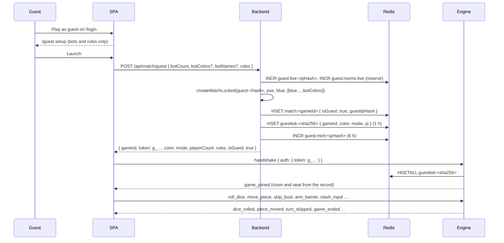

# Guest Mode

## Table of Contents

- [Overview](#overview): the anonymous door and the four properties it guarantees
- [Files](#files): every file the path touches, by layer
- [Limits](#limits): the `GUEST_LIMITS` block and the three layers in front of it
- [Core Logic / Flow](#core-logic--flow): mint, handshake and settlement
- [Redis keys and data at rest](#redis-keys-and-data-at-rest): what is written, by whom, for how long
- [Event allow-list](#event-allow-list): what a guest socket may send
- [Lifecycle and settlement](#lifecycle-and-settlement): the ways a guest room ends and what each costs
- [Frontend behaviour](#frontend-behaviour): routes, the memory-only handoff, the exits
- [Failure modes and guarantees](#failure-modes-and-guarantees): what each refusal leaves behind
- [Verification](#verification): the 17-check probe and the regression nets
- [Known limitations](#known-limitations): accepted trade-offs and the follow-ups they imply
- [Related documents](#related-documents): where the rest of the detail lives


---
---


## Overview

Guest mode is an anonymous PvE game started from the login screen. A visitor presses
**Play as guest**, sets up bots and room rules, and plays a normal game against the engine.
No account, no session and no database row are involved.

The mode rests on four properties:

1. **One new public route.** `POST /api/match/guest` is the only account-less room allocator
   in the backend. CSRF, the NestJS throttler and an nginx zone still apply, and the body is
   validated by a DTO before any Redis key is written.
2. **A normal engine room.** The engine sees an ordinary PvE room: the same seats, bots, room
   rules and socket events. Only the credential differs.
3. **Nothing durable is written.** No `MatchHistory` row, no `PlayerStats` counter, achievement or
   leaderboard entry exists for a guest room. The Postgres schema is untouched, exactly as for
   hotseat.
4. **The door is bounded.** Per-address budgets price mints and aborts, a global ceiling bounds
   live guest rooms, and the engine reports an abort back into the counters that gated the mint.

In one line: **a per-mint seat id and a 1 h Redis registry record replace the account and the
signed match token; the engine plays the room as a normal PvE room and settles the same counters
when it ends.**

### Why not a guest account

A throwaway `User` row would leave rows behind, need a cleanup job, collide with unique
constraints and leak into leaderboard, achievement and profile queries. Guest mode therefore
writes no Postgres row at all. The cost is that a guest has no identity to persist anything
against: no history, no rating, no rejoin and no achievements.

The room itself is created by the same `createMatchLocked()` path as a signed-in PvE game, with
the account-shaped steps skipped: no username or display-name lookup (a `guest-` id has no row),
no create lock and no live-match scan (the id is unique per mint, so the scan can never match).
The seat id is `guest-<sha256(token)>`, unique per mint. A per-address id was rejected: it would
hand the second student on a shared campus NAT the first student's `MATCH_ACTIVE_GAME` refusal.


---
---


## Files

### Backend

| File | Role |
| --- | --- |
| `backend/src/match/match.controller.ts` | `POST api/match/guest`: no guard; `@Ip()` for the budgets; `@Throttle(MATCH_THROTTLE.guest)`; a DTO class so the global `ValidationPipe` runs. |
| `backend/src/match/match.service.ts` | Facade method `createGuestMatch(ip, dto)`, like every other route in the module. |
| `backend/src/match/match.creator.service.ts` | `createGuestMatch()`: gate and reserve, forced `pve`, seat derivation, mint, registry write, `recordMint()`. `createMatchLocked()` accepts `opts.guestToken`/`opts.guestIpHash` and writes `isGuest`/`guestIpHash` into the match hash. |
| `backend/src/match/guest-limit.service.ts` | The `GUEST_LIMITS` block, the hashed-address counters, the delay ladder, `acquire()`/`release()`/`recordMint()`, and the two 429 codes. |
| `backend/src/match/guest-token.util.ts` | `g_` token mint, sha256 hash, registry key `guesttok:<hash>` and the per-mint seat id. |
| `backend/src/match/dto/create-guest-match.dto.ts` | The whole accepted body: `botCount` (1-3), optional `botColors`/`botNames`, and the three rules. |
| `backend/src/match/match.module.ts` | Provides `GuestLimitService` next to the other match services. |
| `backend/src/common/throttles.ts` | `MATCH_THROTTLE.guest` (20 per minute), the burst backstop. |
| `nginx/conf/nginx.conf` | `limit_req_zone $binary_remote_addr zone=guest:10m rate=10r/m;` |
| `nginx/conf/app.inc` | `location = /api/match/guest` spends the `guest` zone with `burst=5 nodelay`. |

### Engine

| File | Role |
| --- | --- |
| `backend/app/ludo-engine/src/socket/auth.ts` | `GUEST_TOKEN_PREFIX` (`g_`) and `GUEST_EVENTS`, the allow-list. |
| `backend/app/ludo-engine/src/socket/server.ts` | The handshake branches on the `g_` prefix and resolves the registry; `settleGuestExit()` runs once per socket on `end_game` (after the teardown) and immediately on `leave_game`. |
| `backend/app/ludo-engine/src/redis.ts` | `getGuestSession()`, `settleGuestAbort()`, `releaseGuestRoom()` and `revokeGuestToken()`, with the counter names mirrored from the backend. |
| `backend/app/ludo-engine/src/socket/result-submitter.ts` | Skips `/api/game/end` and `/api/game/:id/started` for a guest room; releases both live-room slots when a guest game finishes normally. |
| `backend/app/ludo-engine/src/socket/post-game.ts` | Unchanged: a PvE room (guest included) is torn down on `end_game`. |
| `backend/app/ludo-engine/src/socket/socket-handlers.ts` | Unchanged: the ordinary `leave_game` and disconnect paths. |

### Frontend

| File | Role |
| --- | --- |
| `frontend/src/App.tsx` | Registers `/guest` (renders `<Lobby guest />`), lists it as public, and opens `/game` to a visitor only while a guest handoff is held in memory. |
| `frontend/src/pages/Login.tsx` | The **Play as guest** button and its hint. |
| `frontend/src/pages/Lobby.tsx` | The `guest` prop: same setup screen, bots only, no active-game poll, no local mode, launch posts `/api/match/guest` and stores the setup for "Play again". |
| `frontend/src/pages/Game.tsx` | Reads `activeMatch.isGuest`, joins under the localized guest name, sends both exits to `/login`, and remints for "Play again". |
| `frontend/src/store.tsx` | `ActiveMatch.isGuest` and `guestSetup`, both memory-only (never in `sessionStorage`). |
| `frontend/src/components/ResultsModal.tsx` | Guest-only "Play again" and the guest exit label. |
| `frontend/src/locales/{en,fr,ms}.ts` | The `guest` block plus the `GUEST_LIMITED` / `GUEST_CAPACITY` error strings. |

### Test harness

| File | Role |
| --- | --- |
| `Test-harnesses/guest-mode/probe-guest.mjs` | 17 checks over the live stack: mint, registry, DTO boundary, handshake, allow-list, abort settlement, concurrency refusal, the nginx zone and sparse seats. |
| `Test-harnesses/guest-mode/run.sh` | Runner: resolves the checkout, checks `socket.io-client`, links `node_modules` to the frontend deps, holds a single-run lock, applies `PROBE_TIMEOUT` and writes `logs/<probe>.out`. |


---
---


## Limits

`GUEST_LIMITS` in `guest-limit.service.ts` is the single knob block:

| Knob | Value | Effect |
| --- | --- | --- |
| `windowS` | 6 h | How far back the per-address mint and abort counters look. The window starts at the first mint and is not restarted by later ones. |
| `mintSoftLimit` | 10 | Mints past this point each cost the caller time: `min(2^n, 30)` seconds, so 2, 4, 8, 16, then 30 s. |
| `mintHardLimit` | 40 | Mints past this point answer `429 GUEST_LIMITED`. |
| `abortWeight` | 2 | One abort costs two mints of budget. An abort burns a room, a socket and bot timers and produces nothing. |
| `maxConcurrent` | 3 | Live guest rooms per address; the fourth answers `429 GUEST_LIMITED`. |
| `maxLiveRooms` | 50 | Live guest rooms across all addresses: `429 GUEST_CAPACITY`, so a botnet rotating addresses cannot fill Redis or the engine's bot loops. |
| `liveTtlS` | 1 h | Self-heal TTL on the live-room counters, so a crashed process cannot wedge an address or the global ceiling. |
| `tokenTtlS` | 1 h | Lifetime of one registry record, and therefore of one guest session. |

Three layers stand in front of the counters, in this order:

1. **nginx**, exact location: the `guest` zone at 10 r/m with `burst=5 nodelay`. A drained burst
   answers an HTML 429 without reaching Node.
2. **NestJS throttler**, `MATCH_THROTTLE.guest`: 20 per minute, a JSON 429.
3. **The counters**: the only layer that prices churn. The first two bound a burst from one
   address; the counters bound what an address can spend over six hours.

Both refusals are 429s with distinct codes because they are distinct products: `GUEST_LIMITED`
means "you have used your guest games, sign in to keep playing", `GUEST_CAPACITY` means "guests
are full, try again shortly". A refused caller never waits on the delay ladder: the hard limit is
checked first, and a delayed caller waits before its reservation is attempted.

A failed allocation gives the reservation back in the same call (`release()`), and a rejected
payload (a duplicate or unknown bot colour, for example) records no mint, so a typo costs the
address nothing.


---
---


## Core Logic / Flow



**Mint.** `createGuestMatch()` forces `mode: 'pve'`, derives `playerCount` from `botCount`, and
derives the seat order as `['blue', ...botColors]`, so a sparse layout (blue, green, yellow, no
red) is dealt as the setup screen showed it. The human is always blue and cannot ask for another
seat. `mode`, `playerCount`, `seatColors` and `gameId` are not accepted fields. The response is
the usual handoff plus `isGuest: true`; the SPA adds that flag itself and never trusts it from the
payload.

**Handshake.** The engine's middleware checks the `g_` prefix before the JWT branch. A registry
hit fills the socket's room, seat, mode, `isGuest`, `guestIpHash` and `guestTokenHash`; nothing
comes from the client. An unknown, expired or non-`pve` record is `Invalid token`, so a forged
guest token cannot reach the player branch at all. The usual per-account socket cap (4) applies
to the per-mint guest id.

**Play.** The engine drives the room as any PvE room, including the bot scheduler and the room
rules frozen at creation. The guest's display name is its localized `guest.playerName` ("Guest" by
default), sent in `join_game`; the engine's own fallback is also "Guest".

**Settle.** Exactly one of the paths in [Lifecycle and settlement](#lifecycle-and-settlement)
runs. The engine writes the abort counter and frees the two live-room slots, then deletes the
registry record. The backend is never called: `isGuest=true` in the match hash suppresses both
game-result callbacks.


---
---


## Redis keys and data at rest

| Key | Type | Contents | TTL | Written by | Read by |
| --- | --- | --- | --- | --- | --- |
| `match:<gameId>` | hash | The room, plus `isGuest=true` and `guestIpHash` (hashed address) | 24 h | Backend (mint) | Engine (`result-submitter.ts`) |
| `guesttok:<sha256(token)>` | hash | `gameId`, `color`, `mode`, `ip` (raw address) | 1 h | Backend (mint) | Engine (handshake) |
| `guest:mint:<sha256(ip)>` | counter | Successful mints in the window | 6 h from the first mint | Backend | Backend |
| `guest:abort:<sha256(ip)>` | counter | Aborts in the window | 6 h from the first abort | Engine | Backend |
| `guest:live:<sha256(ip)>` | counter | Rooms this address holds open | 1 h, self-heal | Backend (reserve), engine (release) | Backend, engine |
| `guest:rooms:live` | counter | Rooms every address holds open | 1 h, self-heal | Backend (reserve), engine (release) | Backend, engine |
| `game:<gameId>`, `game:<gameId>:moves` | state and list | The ordinary engine room state | Room lifetime | Engine | Engine |

The counters are keyed by the hashed address, like `login:fail:<hash>`, so the budgets themselves
never hold an address. The registry keeps the raw address for its 1 h life because the engine
hashes it on read; storing the hash directly is a noted follow-up (see
[Known limitations](#known-limitations)).

The room's own keys are the engine's normal ones and are deleted by the ordinary teardown. Nothing
is written to Postgres, and the match hash carries no field that a game-result callback would need.


---
---


## Event allow-list

A guest socket is a full seat for its room, but it drives an allow-list (`GUEST_EVENTS` in
`socket/auth.ts`). Anything not on the list is dropped and logged, and the socket stays open:

| Allowed | Notes |
| --- | --- |
| `join_game` | The room and the seat come from the registry, so the client's arguments are ignored. |
| `roll_dice`, `move_piece`, `skip_bust` | The three normal turn actions. |
| `arm_barrier`, `clash_card_hold`, `clash_input` | The room-rule and clash mechanics, when the room enables them. |
| `leave_game` | Prices an abort immediately (the guest has nothing to reconnect to). |
| `end_game` | Tears the room down first, then prices the abort and revokes the token. |
| `disconnect` | The ordinary disconnect path. It does not settle the counters (see limitations). |

| Refused | Why |
| --- | --- |
| `player_ready`, `select_color` | The room is already active and the seat is fixed at mint. |
| `update_modifiers` | The rules are frozen at creation and the guest is not a host. |
| any future event | The list is closed by default, so a new event is guest-refused until it is added on purpose. |

A refusal is silent: no error event and no disconnect, because a guest client is not expected to
send these and a disconnect would abandon a live room over a stray event.


---
---


## Lifecycle and settlement

| Exit | What runs | Mint budget | Live slots | Registry record |
| --- | --- | --- | --- | --- |
| Abort from the game screen (`end_game` while the game is active) | `handleEndGame()` tears the PvE room down, then `settleGuestExit()` | `+2` (one abort at `abortWeight`) | both freed | deleted |
| `leave_game` | `settleGuestExit()` first, then the ordinary leave path | `+2` | both freed | deleted |
| A win (normal finish) | `result-submitter.ts` skips both callbacks and releases both slots | unchanged | both freed | left to expire |
| Tab closed or the network drops | ordinary disconnect: the PvE room waits in its 1 h reconnect window | unchanged | freed by the 1 h TTL | left to expire |
| Token older than 1 h | the open socket keeps playing; the registry is only read at handshake | unchanged | unchanged | gone; the next handshake is `Invalid token` |
| Engine restart | rooms rebuild from Redis and the registry survives its 1 h life | unchanged | unchanged | unchanged |

Two details matter for anyone touching this code:

1. **Settlement runs once per socket.** `socket.data.guestSettled` guards it, so a client that
   sends `end_game` twice, or `end_game` after `leave_game`, is priced once. The `end_game` path
   deliberately settles *after* the teardown: revoking first would refuse an in-flight reconnect
   while the room was still being removed.
2. **A normal finish is not an abort.** The game ended, so the finish path frees the slots without
   pricing anything. The end card's **Back to login** only clears `activeMatch` and navigates, and
   the socket's disconnect does not touch the counters. **Play again** mints a fresh room with the
   same setup, so it spends one mint.

The `leave_game` path exists in the engine but the SPA does not emit it today: a guest leaves
through the abort button or the end card. It is kept for a client that wants to leave without a
teardown.


---
---


## Frontend behaviour

**Routes.** `/guest` is public and renders `<Lobby guest />`. `/game` is public for a visitor only
while `activeMatch?.isGuest === true`, so a deep link to `/game` without a guest handoff still lands
on `/login`. The public routes `/`, `/login` and `/signup` also skip the `/api/auth/me` probe, so a
signed-out visitor never triggers a 401 on load.

**The handoff is memory-only.** `activeMatch` and `guestSetup` live in React state and are never
written to `sessionStorage`. A guest pressing Back therefore cannot re-enter a room whose token was
revoked by the abort, and a reload starts a new session at `/guest`. The consequence is accepted:
a guest cannot resume a game after a reload.

**Setup screen.** The `guest` prop keeps the same seat, bot and rules controls but makes them
PvE-only: bots fill every other seat, there is no mode picker and no local mode, and the active-game
poll (`/api/games/mine`) is skipped because a guest has no account and the call would be a
guaranteed 401. The seat label reads "Guest" from `guest.playerName`, and the launch posts
`/api/match/guest` with `botCount`, `botColors`, `botNames` and the three rules, then stores the
setup for **Play again**.

**Game screen.** `isGuest` switches four things: `join_game` carries the localized guest name, both
exits navigate to `/login` instead of `/gamelobby`, the end card's return button reads **Back to
login**, and **Play again** remints from `guestSetup` and opens `/game?gameId=<new id>` so the route's
`key` remounts the page and the socket and reducer start clean. A `GUEST_LIMITED` or
`GUEST_CAPACITY` refusal arrives as a localized message, and the end card stays open so the guest
can sign in instead.


---
---


## Failure modes and guarantees

| Situation | What the caller sees | What is left behind |
| --- | --- | --- |
| The nginx `guest` zone is drained | an HTML 429, no backend call | nothing |
| The NestJS throttler is drained | a JSON 429 | nothing |
| The address is past 40 mints | `429 GUEST_LIMITED` | nothing new; the budgets recover when the 6 h window lapses |
| The address already holds 3 live rooms | `429 GUEST_LIMITED` | the three rooms stay live |
| The deployment holds 50 live rooms | `429 GUEST_CAPACITY` | other addresses keep their rooms |
| A bad body (duplicate or unknown bot colour, `botCount` outside 1-3) | a 400 validation error | both reservations released, no mint counted |
| Redis unreachable at mint | a 500 | nothing allocated; a failure after the reservation releases both slots |
| Unknown, expired or non-`pve` registry record | `Invalid token`, the socket is refused | the room, if any, ends through the ordinary idle or disconnect path |
| The token was revoked by an abort while another tab holds the same token | the open socket keeps its capabilities; the room is already gone, so its events fail | the next handshake is refused |
| The engine restarts mid-game | sockets reconnect and re-handshake from the registry | the room rebuilds from Redis, and the token still resolves |
| The browser reloads | the handoff is gone, so the SPA lands on `/login` | the old room ends through the 1 h reconnect window |
| A write to the match hash fails after the room was created | a 500 to the caller | the reservation is released, and any partial hash is left to its 24 h TTL |

The guarantees follow from those rows: a guest can never reach a guarded route (the token is not a
JWT and the engine is the only consumer), a guest can never widen its room (the DTO and the forced
`pve` mode), a guest can never write to Postgres or the leaderboard (`isGuest=true` suppresses the
callbacks), and a failed mint costs the address nothing.


---
---


## Verification

The probe lives in `Test-harnesses/guest-mode/`:

```bash
cd Test-harnesses/guest-mode
./run.sh probe-guest.mjs     # writes logs/probe-guest.out
```

It runs 17 checks against the live stack and asserts, among other things: the mint returns
`isGuest: true` with a `g_` token and no JWT shape, the registry record holds the four fields with a
1 h TTL, `botCount` 0 and 4 are refused, a blue bot seat is refused while a smuggled `mode: "pvp"`
is stripped and the room stays `pve`, a refused colour costs no budget, the engine accepts the token
and pins the room and seat (ignoring a client `userId`), `update_modifiers` is dropped with the
socket still open, `roll_dice` still answers, `end_game` tears the room down and prices one abort
while freeing the slots, a mint after an abort is still allowed, the fourth live room is
`GUEST_LIMITED` and costs no budget, the nginx zone splits the burst into HTML 429s and CSRF 403s,
and a sparse layout is dealt as `['blue', ...botColors]`.

The probe is idempotent on a dirty stack, and it is destructive on purpose: it performs a throwaway
discovery mint to learn the address the stack sees, then deletes that room, its token and its
counters and zeroes `guest:rooms:live` before the measured run. Do not run it while a real guest game
is open, and read `logs/probe-guest.out` for the measured values. The runner holds a lock for the
same reason: two overlapping probes would spend one address's budget and fight over the concurrency
cap.

Regression nets for a guest change: `nest build` in `backend/`, `npx tsc --noEmit` in
`backend/app/ludo-engine/`, `npx tsc -b` in `frontend/`, and the `oxlint` baseline (26 warnings).

Manual passes the probe cannot replace: the four surfaces (desktop Chrome, desktop Firefox, tablet,
`make tunnel`), the 10 to 40 mint ladder walked deliberately, and the `GUEST_CAPACITY` ceiling
(50 live rooms), which needs many simultaneous rooms and is not part of the 17 checks.


---
---


## Known limitations

- **A closed tab is not priced as an abort.** The room waits in the 1 h PvE reconnect window and
  both live counters free themselves by TTL. A guest who closes the tab therefore costs the address
  nothing, and holds a slot for up to an hour. The probe's abort check covers the explicit exit only.
- **The registry keeps the raw address.** `guesttok:<hash>.ip` is stored as received, because the
  engine hashes it on read. The counters are keyed by the hash, so the exposure is one 1 h record per
  live token. Storing `guestIpHash` at mint and reading it in `getGuestSession()` would remove it;
  that is the obvious follow-up.
- **The address is coarse.** Behind campus NAT or CGNAT many students share one budget, so the
  concurrency cap (3) is the lever that matters, not the mint cap. The global ceiling exists for the
  rotating-address case.
- **No resume.** The handoff is memory-only, by design, so a reload loses the room. The engine would
  accept the same token for 1 h, but the SPA no longer holds it.
- **No identity, therefore no persistence.** No history, rating, achievements, leaderboard entry,
  notifications or friend invites, and no invitation into a guest room.
- **PvE only, 1 to 3 bots.** No PvP, no hotseat and no spectator, because there is no account to
  share a room with.
- **The global ceiling is not exercised by the probe.** `GUEST_CAPACITY` is reviewed by reading the
  code and by the manual pass described above.


---
---


## Related documents

- [`backend/backend-match-module.md`](backend/backend-match-module.md): §5 Guest PvE Game, the route
  and the room it creates.
- [`ludo-engine/ludo-engine-socket-system.md`](ludo-engine/ludo-engine-socket-system.md): guest
  tokens in the handshake and the engine's event gate.
- [`security_measures.md`](security_measures.md): the edge rate limit, the engine boundary and the
  token rules this mode relies on.
- [`deploy/nginx.md`](deploy/nginx.md): the `guest` zone and location precedence.
- [`frontend/frontend-app-bootstrap-system.md`](frontend/frontend-app-bootstrap-system.md): the
  `/guest` route, the public-route gate and the memory-only handoff.
- [`frontend/frontend-lobby-module.md`](frontend/frontend-lobby-module.md): the guest setup screen.
- [`frontend/frontend-game-module.md`](frontend/frontend-game-module.md): the guest exits, the end
  card and Play again.
- [`API-list.md`](API-list.md): `POST /api/match/guest` and the WebSocket token note.
- [`../test-harness.md`](../test-harness.md): the 17-check guest probe.

**i18n.** The `guest` block and the two error codes exist in `en`, `fr` and `ms`. The guest name is
localized client-side; the engine's display-name fallback stays "Guest" for any client that sends
none.
