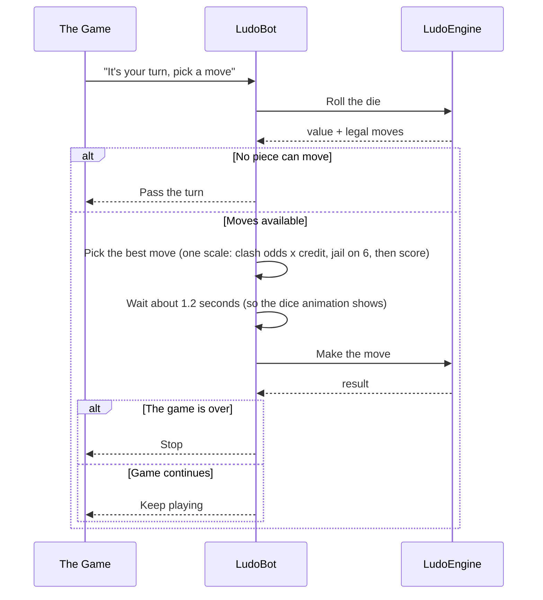
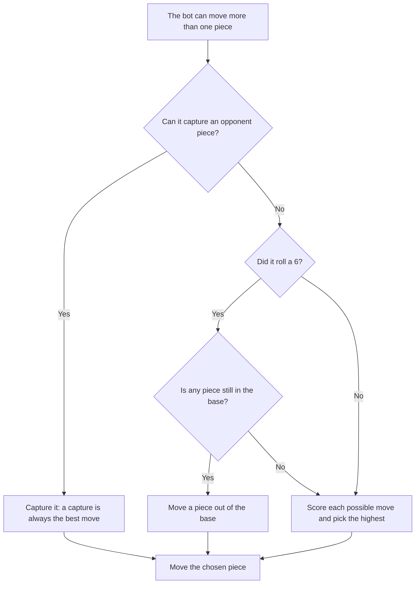

# Ludo Engine — Bot AI

## Table of Contents

- [Overview](#overview) — Heuristic-based AI opponent
- [Files](#files) — Every source file and its role
- [Key Types / Interfaces](#key-types--interfaces) — Bot helpers and decision logic
- [Core Logic / Flow](#core-logic--flow) — Sequence diagram + decision flowchart + worked board example
- [Logic Paths Summary](#logic-paths-summary) — Decision tree for move selection
- [Dependencies](#dependencies) — Internal dependencies


---
---


## Overview

The Bot AI module provides an automated opponent for single-player (PvE) games. The bot is created per game and per color, and it picks its moves using a simple scoring heuristic. It:

1. **Always takes captures** — if any legal move captures an opponent piece, it takes the first one.
2. **Frees pieces from jail on a 6** — if the dice is 6, it prefers moving a piece out of the base.
3. **Scores the remaining moves** — otherwise it ranks each move and picks the highest score.
4. **Paces its moves** — it waits about 1.2 seconds before moving so the dice animation can play.

Bot turns are scheduled by the `SocketServer` (not by the bot itself) so two bot turns never overlap. If a bot holds the turn when the engine restarts, the wake pass re-arms the turn from the persisted state, so no client has to rejoin.


---
---


## Files

| File | Role |
|------|------|
| `bot.ts` | `LudoBot` class + `getOrCreateBot()` / `isBotSeat()` helpers |


---
---


## Key Types / Interfaces

### Move selection

```typescript
// selectBestMove(legalMoves, state, diceValue)
// ONE scale for every candidate, captures included. The highest score wins, so
// there is no priority list to fall off the end of: a wall attack with nothing
// else to play is still returned (never null — that would spend the dice and
// stall the turn).
// A capture scores CAPTURE_CREDIT x p ** captureCount (see below) and takes no
// positional bonus; every other move is scored by scoreMove.
```

The credit is discounted by the odds the bot wins the clash the capture starts,
which is what stops a bot from walking into a wall it will probably lose:

```typescript
// captureOdds(state, move):
//   no clash mode (the capture just applies)            → 1
//   one round against a bot seat  (p = 0.5)             → 0.5 ** captureCount
//   one round against a human seat (p = 0.25)           → 0.25 ** captureCount
// captureCount is the number of defenders on the landing square, i.e. one clash
// round each (see move-validator.ts). The defender's seat comes from isBotSeat,
// and its colour from the landing square via MoveValidator.findPiecesAtPosition.
// One round vs a human: 7000 x 0.25 = 1750. A wall of 2: 437. Already beaten:
// no positional score reaches 1560, so a sure capture still ranks first.
```

### Move scoring (`scoreMove`)

| Condition | Score added |
|---|---|
| `move.isCapture` (takes the whole credit, no positional bonus) | `7000 × captureOdds` |
| `move.isHomeEntry` (entering goal) | +1000 |
| `move.to` lands on a safe zone | +500 |
| `move.from === 0` (leaving jail) | +100 |
| `move.from === 0` on a 6 (the old jail priority, kept as a bonus) | +1000 |
| `move.to * 10` (progress along the track) | +10 per step |

Ties keep the validator's order (`Array.prototype.sort` is stable), which
reproduces the old "first capture" choice whenever the credits are equal — every
capture in a room without clash mode, since the odds are then 1.

### Bot identity

A bot is not an account: its user id is the literal string `bot-<color>`
(`bot-red`, `bot-green`, `bot-yellow`, `bot-blue`), created by the backend when
it fills a seat. That id is identity only. The name the UI shows is the seat's
`displayName`, which the backend writes as `bot-<color> (<assistant>)` from the
name the lobby assigned, so the assistant name is never translated and each
client translates only the colour word. See
[`ludo-engine-socket-system.md`](ludo-engine-socket-system.md) → `PlayerMeta`.

| Where | Helper | Rule |
|-------|--------|------|
| Engine | `isBotUserId()` in `socket/auth.ts` | `userId.startsWith('bot-')` |
| Engine | `isBotSeat(state, color)` in `bot.ts` | the persisted seat's `isBot` flag, falling back to a `bot-` username |
| Backend | `BOT_PREFIX` / `isBotUserId()` in `backend/src/common/botname-enforce.ts` | same prefix, separate copy |

A seat is identified as a bot **from the persisted state**, never from the
in-memory seat map: that map is empty after a restart, and reading it is what
froze every bot game. `isBotSeat` is what the bot scheduler, the rejoin path and
the startup wake pass all use.

The backend writes the id and the engine reads it, so the two copies must be
changed together. The backend keeps the list of modules that filter bots — see
[`../backend/backend-database-schema-system.md`](../backend/backend-database-schema-system.md) → Bots.


---
---


## Core Logic / Flow

### Bot Move Decision

Sequence of steps when the bot evaluates and selects a move.


### Choosing Between Several Moves

When there are multiple options, the bot checks them in order — the first rule that fits wins. There is no deeper evaluation than these rules.



### Example: a real board decision

For example, it is **Green**'s turn and the bot rolls a **4**. Green has three pieces on the track and none can capture, so the bot scores each option. A landing square that is a safe zone gets a `+500` bonus, and each piece earns `+10` per step of progress. Safe zones are the shared track positions `1, 9, 14, 22, 27, 35, 40, 48`; a piece's own step is offset onto that shared loop, so green's step 9 sits on position 22 and green's step 14 sits on position 27.

```mermaid
flowchart LR
    subgraph board["Green's pieces on the main track — dice roll = 4"]
        direction LR
        c5["5<br/>G2 piece"] --- c6["6"] --- c7["7"] --- c8["8"] --- c9["9 ★<br/>safe"] --- c10["10<br/>G0 piece"] --- c11["11"] --- c12["12"] --- c13["13"] --- c14["14 ★<br/>safe"] --- c15["15"] --- c16["16"] --- c17["17"] --- c18["18"] --- c19["19"] --- c20["20<br/>G1 piece"] --- c21["21"] --- c22["22"] --- c23["23"] --- c24["24"]
    end

    classDef safe fill:#d9f0ff,stroke:#2a7ab5
    classDef piece fill:#b8f2b8,stroke:#1e7d1e
    class c9,c14 safe
    class c5,c10,c20 piece
```



| Option | Move | Lands on | Score (`scoreMove`) |
|---|---|---|---|
| 1 | G2 piece `5 → 9` | safe zone (★) | `9×10 + 500 = 590` |
| 2 | G0 piece `10 → 14` | safe zone (★) | `14×10 + 500 = 640` |
| 3 | G1 piece `20 → 24` | plain square | `24×10 = 240` |

The bot picks **option 2** (highest score, `640`) and moves G0 to step 14. In real games the same scale decides, captures included: a capture the bot is sure of scores `7000` and a lone defender `1750`, both above option 2, while a wall of two (a clash round each, `7000 × 0.25² = 437`) ranks below it — which is the point, a chain the bot probably loses is not worth walking into.


---
---


## Logic Paths Summary

### Bot Move Selection Path
```
selectBestMove(legalMoves, state, diceValue)
  ├── No legal moves → return null (pass turn)
  ├── Exactly one legal move → return it
  └── Otherwise score each move and return the highest:
      ├── isCapture → 7000 × captureOdds (1 with no clash, else 0.5 or 0.25 per round, ^ rounds); nothing else added
      ├── +1000 if isHomeEntry
      ├── +500 if lands on a safe zone
      ├── +100 if from === 0, and +1000 more of those on a 6 (the old jail priority)
      ├── +10 per step (move.to * 10)
      └── Ties keep the validator's order (a stable sort → the old "first capture")
```

### Bot Turn Path
takeTurn()
```
  ├── loadGameState → must be active, bot's turn, WAITING_FOR_ROLL
  ├── engine.rollDice(gameId)
  ├── Re-check state.currentTurn (may have changed on disconnect)
  ├── selectBestMove → if none, return
  ├── Wait 1.2s
  ├── engine.movePiece(gameId, pieceId)
  └── Return whether the game is still active
```


---
---


## Dependencies

| Dependency | Purpose |
|-----------|---------|
| `MoveValidator` | Provides the legal moves for a roll, and `findPiecesAtPosition` names the defenders a capture would fight |
| `LudoEngine` | Rolls the dice and executes moves |
| `RedisGameStore` | Loads/saves game state |
| `BoardMapper` | `isSafeZoneStep()` used in move scoring, `parsePieceId()` for the defender's colour |
| `clash.ts` | `CLASH_BOT_VS_HUMAN_WIN_CHANCE` / `CLASH_BOT_VS_BOT_WIN_CHANCE`: the same odds the clash pressers are pre-rolled against |
| `socket/auth.ts` | `isBotUserId()` for bot detection |
