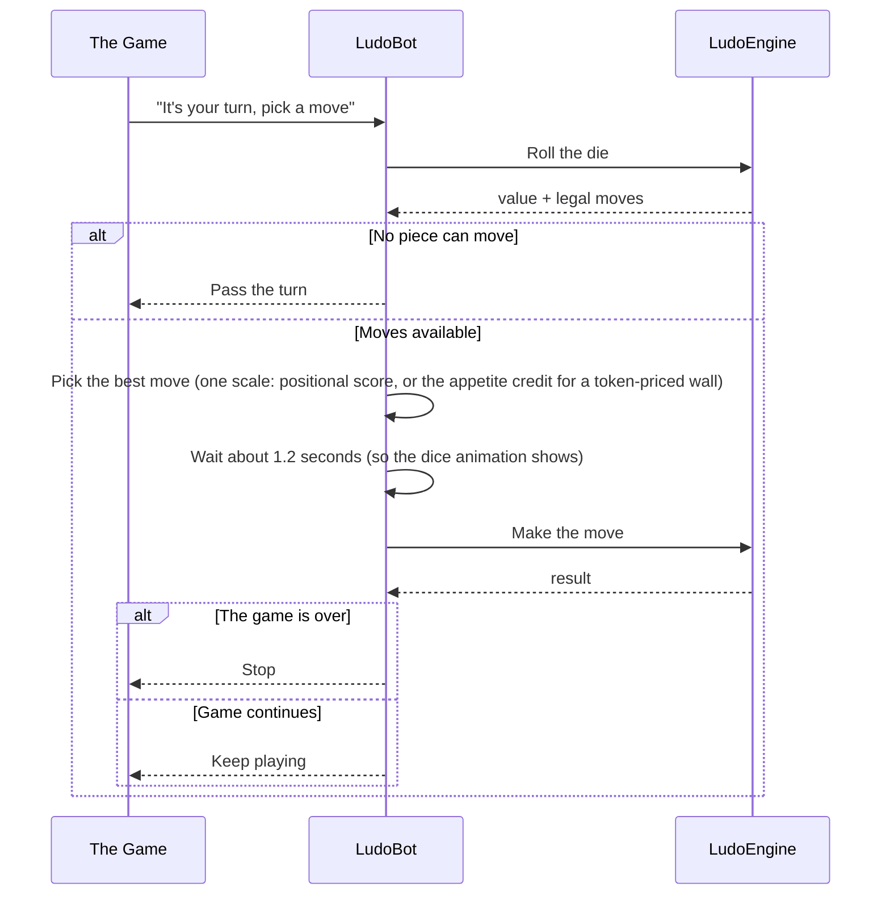
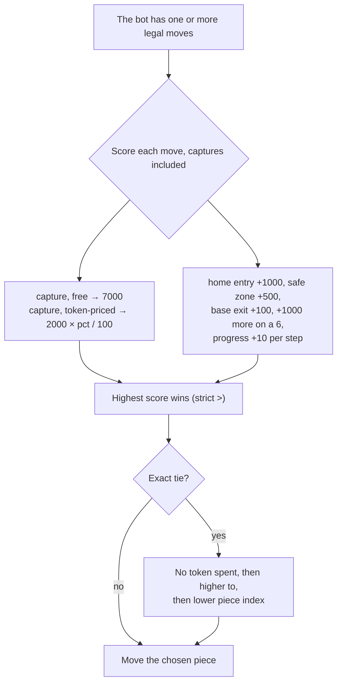

# Ludo Engine — Bot AI

## Table of Contents

- [Overview](#overview) — Heuristic-based AI opponent
- [Files](#files) — Every source file and its role
- [Key Types / Interfaces](#key-types--interfaces) — Bot helpers and decision logic
- [Core Logic / Flow](#core-logic--flow) — Sequence diagram + decision flowchart + worked board example
- [Logic Paths Summary](#logic-paths-summary) — Decision tree for move selection
- [Dependencies](#dependencies) — Internal dependencies


---
---


## Overview

The Bot AI module provides an automated opponent for single-player (PvE) games. The bot is created per game and per color, and it picks its moves using one scoring scale:

1. **Scores every legal move on one scale** — a free capture, a token-priced wall break, a home entry and a plain advance are all just numbers, and the highest wins. There is no priority list.
2. **Never passes a turn it can play** — with a legal move on the board it plays the best of them, even when that spends its last Wall Breaker token.
3. **Prices the token by its own appetite** — a wall break is worth a percentage of a fixed base, stored per seat when the bot seat is created, so a cautious bot and a reckless one sit at the same table.
4. **Paces its moves** — it waits about 1.2 seconds before moving so the dice animation can play.

Bot turns are scheduled by the `SocketServer` (not by the bot itself) so two bot turns never overlap. If a bot holds the turn when the engine restarts, the wake pass re-arms the turn from the persisted state, so no client has to rejoin.


---
---


## Files

| File | Role |
|------|------|
| `bot.ts` | `LudoBot` class + `getOrCreateBot()` / `isBotSeat()` helpers |


---
---


## Key Types / Interfaces

### Move selection

```typescript
// selectBestMove(legalMoves, state, diceValue)
// ONE scale for every candidate, captures included. The highest score wins, so
// there is no priority list to fall off the end of, and with a legal move on the
// board the answer is NEVER null: a seat that has something to play always plays
// the best of it, even when that spends its last token. That guarantee is what
// removed the old `null` return plus `skipArmedWallBreak`, which passed turns the
// bot was allowed to take.
// A capture takes no positional bonus. A FREE capture (a lone defender, a mixed
// pair, or any capture without clash mode) scores CAPTURE_CREDIT; a landing that
// spends a Wall Breaker token scores the seat's appetite instead (see below).
```

**The appetite is a credit, not a probability.** A wall break is worth a fixed
percentage of `BOT_WALL_BREAK_VALUE` (2000), stored per seat and read verbatim, so
a token is spent when a wall is worth more to this bot than anything else it can
do that turn:

```typescript
// wallBreakCredit(state) = BOT_WALL_BREAK_VALUE x pct / 100     (integers only)
//   pct by the hand it is holding:
//     1 token                        → the last token      30%  →  600
//     2 tokens                       → the reserve         60%  → 1200
//     3 tokens (the cap)             → reserve + 18        78%  → 1560
//   every number is the baseline plus the seat's signed 0-5
//   personality modifier, rolled once when the seat was created
```

The band it is weighed against is the positional score below: a plain advance tops
out at 570, a safe-zone entry at 980, a jail exit on a six at 1160 and a home entry
at 1560. So one token still breaks a wall when shuffling forward is the only
alternative (600 against 570), two tokens also beat a safe-zone entry and a jail
exit, and at the cap the credit lands exactly on a home entry (1560), which the
tie rule below resolves in favour of the token-free move. No depth term exists:
`captureCount` is not a factor, because a wall can shrink before the bot's next
turn, and depth still matters to the *outcome* one clash per defender.

### Move scoring (`scoreMove`)

| Condition | Score added |
|---|---|
| `move.isCapture` and `spendsWallBreakerToken` (takes the whole score, no positional bonus) | `2000 × pct / 100` |
| `move.isCapture` and free (lone defender, mixed pair, clash mode off) | `7000` |
| `move.isHomeEntry` (entering goal) | +1000 |
| `move.to` lands on a safe zone | +500 |
| `move.from === 0` (leaving jail) | +100 |
| `move.from === 0` on a 6 (the old jail priority, kept as a bonus) | +1000 |
| `move.to * 10` (progress along the track) | +10 per step |

Ties are total and explicit, in this order: no token spent, then the higher
`to`, then the lower piece index. The first rule is what resolves the deliberate
1560-against-1560 tie between a cap-tier wall break and a home entry; the token is
the scarce resource the appetite exists to protect, and the conservative arm is the
one that cannot read as a bug. No RNG is involved, so a replay makes the same
decision twice.

### Bot identity

A bot is not an account: its user id is the literal string `bot-<color>`
(`bot-red`, `bot-green`, `bot-yellow`, `bot-blue`), created by the backend when
it fills a seat. That id is identity and namespace, not a question: whether a
seat is a bot is its own field, `player<N>_isBot` in the match hash, written
beside the id, and that flag is the only answer. No path in the engine infers the
kind from a `bot-` string, so a seat without the flag is a human seat whatever
its id looks like. The name the UI shows is the seat's `displayName`, which the
backend writes as `bot-<color> (<assistant>)` from the name the lobby assigned,
so the assistant name is never translated and each client translates only the
colour word. See [`ludo-engine-socket-system.md`](ludo-engine-socket-system.md) →
`PlayerMeta`.

| Where | Helper | Rule |
|-------|--------|------|
| Engine | `isBotSeat(state, color)` in `bot.ts` | the persisted seat's `isBot` flag |
| Engine | `isBotMatchSeat(matchData, color)` in `socket/join-manager.ts` | the hash's `player<N>_isBot` |
| Engine | `BOT_PREFIX` in `socket/auth.ts` | `bot-`, the namespace a bot seat's id is minted in — never a test |
| Backend | `botSeatColors(matchData)` in `backend/src/match/match.postgame.service.ts` | the hash's `player<N>_isBot`, mapped through `player<N>_color`: the seats a finished game may not write a row, a rating or a leaderboard entry for |
| Backend | `BOT_PREFIX` in `backend/src/common/botname-enforce.ts` | `bot-`, the namespace a bot seat's id is minted in — never a test; `isReservedBotName()` keeps a human account out of it |
| Backend | `notifyMatchAbort` in `backend/src/match/match.player.service.ts` | the hash's `player<N>_isBot`, read straight off the `hgetall` it already has: the seats it does *not* push `match_cancelled` to |

A seat is identified as a bot **from the persisted state**, never from the
in-memory seat map: that map is empty after a restart, and reading it is what
froze every bot game. `isBotSeat` is what the bot scheduler, the rejoin path and
the startup wake pass all use.

The backend writes the id and the flag into the hash and the engine reads them,
so the two writers must be changed together. The backend keeps the list of
modules that filter bots — see
[`../backend/backend-database-schema-system.md`](../backend/backend-database-schema-system.md) → Bots.


---
---


## Core Logic / Flow

### Bot Move Decision

Sequence of steps when the bot evaluates and selects a move.


### Choosing Between Several Moves

Every legal move is scored on one scale and the highest wins. There is no priority
list to fall off the end of: a capture, a home entry and a plain advance are all
just numbers, and the largest number is played. The only two special cases are a
capture on a landing that costs a Wall Breaker token, which scores the seat's
appetite instead of the flat credit, and a tie, which the documented order breaks.



### Example: a real board decision

For example, it is **Green**'s turn and the bot rolls a **4**. Green has three pieces on the track and none can capture, so the bot scores each option. A landing square that is a safe zone gets a `+500` bonus, and each piece earns `+10` per step of progress. Safe zones are the shared track positions `1, 9, 14, 22, 27, 35, 40, 48`; a piece's own step is offset onto that shared loop, so green's step 9 sits on position 22 and green's step 14 sits on position 27.

```mermaid
flowchart LR
    subgraph board["Green's pieces on the main track — dice roll = 4"]
        direction LR
        c5["5<br/>G2 piece"] --- c6["6"] --- c7["7"] --- c8["8"] --- c9["9 ★<br/>safe"] --- c10["10<br/>G0 piece"] --- c11["11"] --- c12["12"] --- c13["13"] --- c14["14 ★<br/>safe"] --- c15["15"] --- c16["16"] --- c17["17"] --- c18["18"] --- c19["19"] --- c20["20<br/>G1 piece"] --- c21["21"] --- c22["22"] --- c23["23"] --- c24["24"]
    end

    classDef safe fill:#d9f0ff,stroke:#2a7ab5
    classDef piece fill:#b8f2b8,stroke:#1e7d1e
    class c9,c14 safe
    class c5,c10,c20 piece
```



| Option | Move | Lands on | Score (`scoreMove`) |
|---|---|---|---|
| 1 | G2 piece `5 → 9` | safe zone (★) | `9×10 + 500 = 590` |
| 2 | G0 piece `10 → 14` | safe zone (★) | `14×10 + 500 = 640` |
| 3 | G1 piece `20 → 24` | plain square | `24×10 = 240` |

The bot picks **option 2** (highest score, `640`) and moves G0 to step 14. In real games the same scale decides, captures included: a free capture scores a flat `7000` and outbids everything, because a bot never spends a token when the capture costs nothing. A token-priced wall break scores the seat's appetite instead, so the same board answers differently by hand size: `600` at one token (above option 2, which is why a bot still breaks a wall when shuffling forward is the only alternative), `1200` at two, and `1560` at the cap, where it ties a home entry and the tie rule keeps the token. The defender's kind never enters the price, and neither does the wall's depth: a four-defender wall is worth exactly the same as a two-defender one.


---
---


## Logic Paths Summary

### Bot Move Selection Path
```
selectBestMove(legalMoves, state, diceValue)
  ├── No legal moves → return null (nothing to play; the engine advanced the turn)
  └── Otherwise score each move and return the highest. Never null with a move:
      ├── isCapture and spendsWallBreakerToken → BOT_WALL_BREAK_VALUE × pct / 100
      │   (pct = 30 at the last token, 60 at the reserve, 78 at the cap, plus the
      │    seat's stored modifier; nothing else is added)
      ├── isCapture and free → CAPTURE_CREDIT (7000), nothing else added
      ├── +1000 if isHomeEntry
      ├── +500 if lands on a safe zone
      ├── +100 if from === 0, and +1000 more of those on a 6 (the old jail priority)
      ├── +10 per step (move.to * 10)
      └── Ties: no token spent, then higher to, then lower piece index
```

### Bot Turn Path
takeTurn()
```
  ├── loadGameState → must be active, bot's turn, WAITING_FOR_ROLL
  ├── arm the Wall Breaker when clash mode is on and the hand is not empty
  ├── engine.rollDice(gameId)
  ├── Re-check state.currentTurn (may have changed on disconnect)
  ├── selectBestMove, falling back to legalMoves[0] if it ever came back null:
  │   the bot always plays. There is no skip and no passed turn.
  ├── Wait 1.2s
  ├── engine.movePiece(gameId, pieceId, move.to)
  └── Return whether the game is still active
```

### Bot Personality

Four numbers, rolled once when the backend creates the bot seat and written into
the match hash beside `player<N>_isBot`. The engine copies them onto the seat at
PvE auto-start, and both readers (the decision and the clash pace) read the seat,
never a second copy.

| Field | Example | What it decides |
|---|---|---|
| `player<N>_botFastRate` | 28 | the speed in a clash against a human (`fastRate / 100`) |
| `player<N>_botSlowRate` | 72 | `100 - fastRate`: derived, recorded so the profile reads at a glance |
| `player<N>_botRiskLastToken` | 33 | the appetite at exactly one token |
| `player<N>_botRiskReserve` | 63 | the appetite at two or more tokens, before the surplus uplift |

The modifier is a signed 0 to 5, so 0 is twice as likely as any other value, and it
is added to all three baselines at once (25 / 30 / 60). It is sampled with
mulberry32, the project's generator, in `backend/src/match/bot-profile.ts`. An
absent field falls back to the baseline, so a state, replay or harness written
before the fields existed behaves exactly as it did and no migration exists.


---
---


## Dependencies

| Dependency | Purpose |
|-----------|---------|
| `LudoEngine` | Rolls the dice and executes moves |
| `RedisGameStore` | Loads/saves game state |
| `BoardMapper` | `isSafeZoneStep()` used in move scoring, `parsePieceId()` for the tie order's piece index |
| `common/src/wall-breaker.constants.ts` | `WALL_BREAKER_TOKEN_CAP`, via `WALL_BREAKER_TOKEN_CAP` re-export: the cap that opens the surplus appetite band |
| `socket/auth.ts` | `BOT_PREFIX`: the namespace a bot seat's id is minted in; a seat's kind is never read from it |
