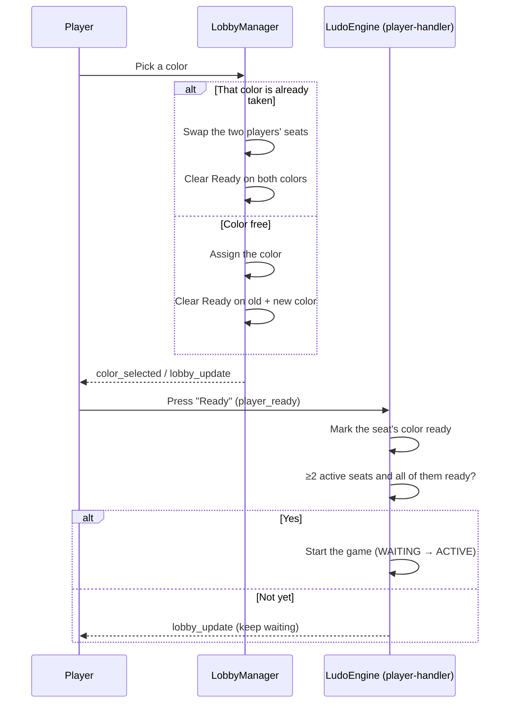

# Ludo Engine — Lobby

## Table of Contents

- [Overview](#overview) — Lobby management
- [Files](#files) — Every source file and its role
- [Key Types / Interfaces](#key-types--interfaces) — Lobby state types
- [Core Logic / Flow](#core-logic--flow) — Mermaid sequence diagrams for the lobby lifecycle and seat reservation
- [Logic Paths Summary](#logic-paths-summary) — Decision trees for each operation
- [Dependencies](#dependencies) — Internal dependencies


---
---


## Overview

The Lobby module handles the pre-game setup: players join and leave, pick
colors, mark ready, and trigger the start.


---
---


## Files

| File | Role |
|------|------|
| `lobby.ts` | `LobbyManager` — color selection (with swap); readiness is part of the engine GameState |


---
---


## Key Types / Interfaces

### Lobby data

The **match metadata hash** (`match:{gameId}`) tracks seats: `player1_id`,
`player1_color`, `player{n}_displayName`, `player{n}_isBot`, `status`, `gameType`,
etc. `player{n}_displayName` is the shown name, and for a bot seat the backend
writes it as `bot-<color> (<assistant>)` from the lobby's `botNames`, while the
seat keeps its `bot-<color>` id. `player{n}_isBot` is `'true'` on a bot seat and
absent on a human one, so the seat says what it is and no reader tests the id's
shape: the engine's join path reads that field and nothing else. Readiness is NOT
stored there: the roster and ready flags live in the engine GameState
(`state.players` + `state.readyPlayers`), which `emitLobbyUpdate` broadcasts to clients.

Beside the per-slot fields the hash holds one account record per seat,
`seatUser_<color>`. It is written when the seat is taken, kept in step when a
player changes colour, and removed when the seat is freed, so the end of the game
can resolve which account played a colour.


---
---


## Core Logic / Flow

### 1. Lobby Lifecycle



### 2. Seat keep and free

Leaving a waiting room does not delete the seat. Nothing in the hash changes: the
seat stays counted for five minutes, so the room is still full and the player
returns to the same colour on rejoin. Only an explicit Abort frees a corner.

| Event | Redis `match:{gameId}` | Engine GameState | Client roster |
|-------|------------------------|------------------|---------------|
| Participant opens Abort in a waiting room | `clearMatchSeat()` deletes `player<N>_id`, `player<N>_color`, `player<N>_isBot` and `seatUser_<color>` | seat parked as `inactive` | seat hidden |
| Host opens Abort in a waiting room | the room is closed (`status` `ABORTED`, 1 h TTL) | room closed | room closed |
| Player returns to lobby / drops in a waiting room | nothing changes: the seat row stays | `disconnected` for the five-minute waiting window | seat stays, marked away |
| A participant's waiting window expires | `clearMatchSeat()` frees the corner | seat parked as `inactive` | seat hidden |
| The host's waiting window expires | the room is closed, whoever else is seated | room closed | room closed |
| Player leaves a live game via End Game | `clearMatchSeat()` deletes `player<N>_id`, `player<N>_color`, `player<N>_isBot` and `seatUser_<color>` | seat parked as `exited` | seat shows as gone |
| Player drops a live game (page closed, or "RETURN TO LOBBY") | the seat row is left untouched, so the id and colour stay reserved | `disconnected` for the 45 s grace window (one hour in a PvE simulation), then `exited` with every piece parked at `step = -1` | seat greyed out, then gone |
| Backend abort (`POST /api/game/:id/abort`, host only, `WAITING` only) | the match is marked `ABORTED`; individual seats are not cleared | — | room drops out of the listings |
| Player rejoins | the backend's `joinMatch` userId lookup finds the reserved slot and returns the same colour | seat back to `active` | seat returns |
| Idle-abort timer fires | the room is gone | — | room closed |

A rejoin only works inside the grace window: once the seat is `exited` the backend's `isSeatFinalized` gate rejects the request with `MATCH_SEAT_EXPIRED` and never mints a token for that seat again. The seat itself stays in the room as a ghost (pieces at `step = -1`, skipped by the validator, never holding the turn).

The backend also hides a room from the moment its game starts: `GET /api/games/rooms` and `GET /api/games/mine` read the engine state (`isEngineGameStarted`) and only advertise a started room back to a player who still holds a reclaimable seat in it (the `mySeat` flag), so a departed player is neither offered a dead seat nor shown a room they can no longer enter.

`clearMatchSeat` skips the host's seat (`hostId`, whichever corner that is) and stamps `idleSince`
as it runs (`setIdleSince`, HSETNX, so an existing window is never restarted). The `IdleLobbyWatcher`
then arms the room's in-process timer for the rest of that window, publishes the deadline as
`room_closing { closesAt }`, and the stamp is what the startup wake pass replays after a restart. The
seated count is the number of seat rows with an id in them, which is why a released seat is the only
thing that can shrink it. See also [`ludo-engine-core-system.md`](ludo-engine-core-system.md) → Seat
statuses.


---
---


## Logic Paths Summary

### Seat Colour Path
```
join_game (the colour comes from the token, claimed at join)
  ├── Seat colour resolved from the token (the backend already claimed it with HSETNX)
  ├── Rotation and the board read the seat colours of the seats that joined
  └── No swap path: a colour is claimed once, so there is nothing to re-pick
```

### Ready Check Path
```
player_ready
  ├── Mark the seat's color ready in engine GameState (state.readyPlayers)
  ├── ≥2 active seats AND every active seat's color is ready?
  │   ├── Yes → start the game (WAITING → ACTIVE)
  │   └── No → keep waiting (lobby_update)
```


---
---


## Dependencies

| Dependency | Purpose |
|-----------|---------|
| `RedisGameStore` | Match seats/colors/status + GameState persistence |
| `EventPublisher` | Publishes lobby events to Redis pub/sub |
| `LudoEngine` | Game state and the ready/start gate (player-handler, join-manager) |
