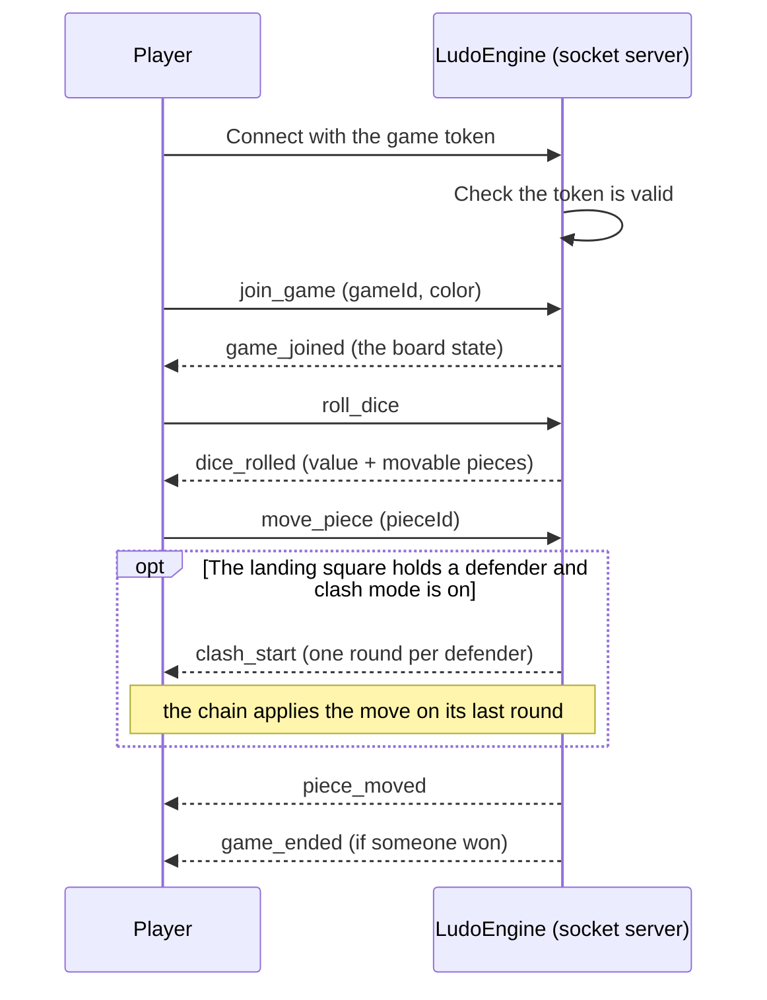

# Ludo Engine — Socket.IO Events

## Table of Contents

- [Overview](#overview) — Socket.IO server, connection, and event protocol
- [Quick Reference](#quick-reference) — What triggers each event, and the input/output of every socket event
- [Files](#files) — Source file inventory
- [Connection](#connection) — Handshake auth and JWT
- [Client → Server Events](#client--server-events) — Events emitted by the client
- [Server → Client Events](#server--client-events) — Events broadcast by the server
- [Event Reference](#event-reference) — Complete event payload reference
- [Configuration](#configuration) — Socket.IO server settings


---
---


## Overview

The ludo-engine exposes a Socket.IO server on port 3001. All game communication happens through events. The engine requires an engine-issued credential in the handshake `auth` object: an HS256 match token for a signed-in player, or an opaque `g_` guest token resolved from Redis (guest mode).

The server is started by `index.ts` which calls `SocketServer.start(3001)`. The `SocketServer` class in `socket/server.ts` registers all event handlers and holds the `engine` (game state machine) and the `store` (`RedisGameStore`, persistence).


---
---


## Quick Reference

Every socket event at a glance — direction, what triggers it, and its
input/output. Each event is documented in full below; see
[Event Reference](#event-reference) for the complete payload schemas.


---
---


### Client → Server

| Event | Triggered by | Payload (client → server) | Server action | Resulting broadcasts |
|---|---|---|---|---|
| `join_game` | Entering a room — PvP join/rejoin, PvE/hotseat seat-in (hotseat sends one call per local seat) | `(gameId: string, playerColor?, userId?, displayName?)` | Bind the socket to the room/seat (reconnect or fresh join), create the game if missing, auto-start PvE/hotseat. A non-reconnecting join to an **ACTIVE** game is only rejected when the token's own seat can no longer be resumed (exited/inactive/never seated); the refused socket is detached from the room and unbound from the seat (so it can neither observe the game nor disturb a seated player on disconnect) and told `seat_expired`/`error`. A live seat is always the token holder's own, so it is accepted as a (re)join — this keeps a reconnect working when the previous socket has not been reaped yet, and any other socket still bound to that seat is unbound (takeover) so a stale one cannot later force the seat down. Hotseat is exempt (one socket controls all its seats) | `game_joined` to the sender |
| `roll_dice` | Current player, phase `WAITING_FOR_ROLL` | `()` | Roll the die and compute the legal moves (a 3rd six auto-forfeits the turn) | `dice_rolled` |
| `move_piece` | Current player, phase `WAITING_FOR_MOVE` | `(pieceId: string)` | Validate and apply the move | `piece_moved` |
| `arm_barrier` | Current player, clash mode on, a token in hand | `(armed: boolean)` | The Barrier Buster arm switch. Engine-owned and turn-scoped (`PlayerMeta.barrierArmed`): armed means this seat may land on and break a wall, disarmed means a wall blocks the landing. Refused with an `error` frame outside clash mode, off the current turn, or when arming an empty hand. No move list is recomputed: every priced wall landing is listed whether or not the seat is armed, the switch only decides whether `move_piece` accepts it, and the flag is deleted from every seat when the turn advances (and cleared when a spend empties the hand) | `state_update` |
| `skip_bust` | Current player, phase `WAITING_FOR_MOVE`, and EVERY pending move is token-priced | `()` | Decline the held Barrier Buster turn: a PASS, not a re-roll. The dice are spent, the turn advances and the token stays in hand. Refused unless every move on the table is priced (an ordinary move means the roll is played, not skipped; there is no 6 carve-out). The engine throws inside the game lock, and the socket layer drops that refusal SILENTLY: `console.error` for the operator, no `error` frame for the player | `turn_skipped` + `state_update` |
| `clash_input` | Either side of a live clash, during the press phase | `(key: string, count?: number)` | One QTE keypress. The LIVE letter of each side's schedule picks the side (defender keys are the left block, attacker keys the right; a room with the key-shift mutator moves that letter at each switch instant, so the opening letter stops counting there), then the seat binding proves the caller owns it: in PvP only the owner's scoring key lands, in hotseat one socket owns both seats and may mash both. `count` is the tablet tap weight, which the touch pad sends as 2: it is clamped to `CLASH_TAP_COUNT_MAX` (2) and the per-side 110 ms cap still gates the events, so a pad tap is a heavier press, never a faster stream. A press that fails any check is dropped silently | `clash_press` |
| `clash_card_hold` | Either side of a live result card (the client that is showing it) | `(cardId: string, holdMs: number)` | The result-card release handshake. The client forecasts how long its OWN card will run; the engine converts it to a deadline on receipt, clamps it to `[CARD_HOLD_MIN_MS, CLASH_RESULT_FREEZE_MS]` and keeps the SMALLEST, so a receipt can only ever shorten the freeze and a missing one leaves the 4 s ceiling. Only a user who owns a seat in that card may report: a foreign `cardId` is dropped, a stranger is refused, and a receipt after the release does nothing. Hotseat is one user over both seats, so one receipt releases the card | `clash_card_released` |
| `player_ready` | Seated player in the waiting lobby | `()` | Mark ready; when every active player is ready the game starts | `game_started` |
| `select_color` | Seated player during color selection | `(color: 'red'/'green'/'yellow'/'blue')` | Move the player to the requested seat color; clears Ready on both colors involved | `color_selected` + `lobby_update` |
| `update_modifiers` | Host, room still `WAITING` | `(rules: { clashEnabled, noSafeZones, freeExit, clashKeyShift })` | Normalize and persist the four room rules (mirrored into the match hash); the switch count is clamped to 0/1/2 and forced to 0 whenever clash mode is off. Rejected when the caller is not the host or the room has started | `modifiers_updated` |
| `leave_game` | Player leaving a room (e.g. after a match) | `()` | Waiting room: seat parked `inactive` and reserved. Live game: seat parked `exited`, pieces cleared, turn advances | `player_exited` (+ `state_update` live) |
| `end_game` | Host presses "End Game" | `()` | PvE/hotseat: abort the whole game. PvP: prune this player, abort the room if fewer than 2 humans remain | `game_expired` or `player_aborted` |
| `disconnect` | Socket drops (automatic) | — | Start the reconnect grace period, but only for a live, unfinished **active** seat — an exited/finished seat has no pieces left and must not be revivable. In **PvP**, dropping during your own turn also pauses the game (`paused` + `pauseTurnOwner`); dropping during someone else's turn lets play continue until the turn reaches the departed seat, which then simply waits | `player_disconnected`, then `player_reconnected` or `player_exited` |


---
---


### Server → Client

| Event | Triggered by | Payload (server → client) | Notes |
|---|---|---|---|
| `game_joined` | A successful `join_game` | `GameState` | Sent to the joining socket only |
| `dice_rolled` | A die roll | `{ value, legalMoves, bonusRoll, currentTurn, forfeited? }` | Room-wide |
| `piece_moved` | A legal move applied | `MoveResult` | Room-wide |
| `turn_skipped` | The armed Barrier Buster exit was declined (`skip_bust`) | `{ gameId, currentTurn }` | Room-wide. The turn has already advanced in the state: the SPA's reducer clears the move list and takes the seat this names, and the room's clients would otherwise keep rendering the skipped turn and its armed move |
| `clash_start` | A capture is deferred to the QTE, or a chain starts its next round | `{ attacker, defender, attackerKey, defenderKey, attackerKeys, defenderKeys, switchAt, keyShift, serverNow, target, duration, phase, startAt, announceDeadline, countdownDeadline, pressDeadline, attackerPresses, defenderPresses, round?, totalRounds?, defenderPieceId?, remainingDefenderIds? }` | Room-wide. Keys are hidden until the press phase; the deadlines are absolute engine timestamps and the SPA draws the announce, countdown and press window from them. `attackerKeys`/`defenderKeys` are the key-shift schedules (element 0 is the legacy `attackerKey`/`defenderKey`, and each later element replaces the one before at `switchAt[i]`), `keyShift` is the room's count and `serverNow` is the engine clock the overlay derives its offset from; a room with the mutator off sends empty arrays, `0` and no switch. The chain fields appear only on a wall attack |
| `clash_phase` | The QTE moves announce → countdown → pressing | `{ phase, countdownDeadline, pressDeadline }` | Room-wide |
| `clash_press` | An accepted press | `{ color, presses }` | Room-wide, so both HUD meters stay in step |
| `clash_result` | A round resolves: the target was reached, the window expired, or a disconnect settled it | `{ cardId, winner, loser, winnerPresses, loserPresses, round, totalRounds, resultCardUntil, continues, defenderPieceId, remainingDefenderIds }` | Room-wide. `continues` true means the square still holds defenders and another round follows; `cardId` is this card's id for the release handshake (`attacker-defender-moveCounter`); `resultCardUntil` is that card's own deadline, and the bots' next turn is timed from it: a card with no human on it ends at the short 2 s ceiling, so the bots resume there instead of after the 4 s freeze |
| `clash_card_released` | Every participating user reported how long its card runs (or a card with no human in it was armed) | `{ gameId, resultCardUntil }` | Room-wide. The freeze is fixed at `resultCardUntil`; the SPA keeps the card on its own 2 s timer, so this frame never cuts the copy short |
| `game_started` | All players ready / PvE or hotseat auto-start | `{ gameId }` | Room-wide |
| `game_ended` | A match finishes (all pieces home / forfeit) | `{ winner, resultDetail }` | Room-wide |
| `game_timeout` | 60 s after `game_ended` — the finished room is torn down | — | Room-wide |
| `game_expired` | Room teardown: idle lobby (5 min, < 2 seated), single-instance disconnect window expired, or quorum lost after an exit | `{ gameId }` | Room-wide, emitted by `teardownRoom` through the engine event → publisher → broadcaster path |
| `player_exited` | Permanent exit — leaving the room or disconnect grace expired | `{ color }` | Room-wide |
| `player_aborted` | Host ended a PvP game / room aborted | `{ color, username }` | Room-wide |
| `player_disconnected` | A socket dropped (temporary) | `{ color }` | Room-wide |
| `player_reconnected` | Reconnect inside the grace window | `{ color, displayName? }` | Room-wide. Sent only when the seat really was restored, and carries the name the client reports (a rename while away rides along) |
| `seat_expired` | A `join_game` for a seat already removed (left, or its grace window expired) | `{ gameId, color }` | Sent to that socket only — the seat is gone for good, so the client shows the end-of-match card and leaves |
| `lobby_update` | Lobby seats / ready state changed | `{ players: [{ userId, username, avatarStyle, color, ready }] }` | Room-wide |
| `color_selected` | A seat color change | `{ gameId, userId, color }` | Room-wide |
| `modifiers_updated` | The host changed the room rules while the room was waiting | `{ gameId, clashEnabled, noSafeZones, freeExit, clashKeyShift }` | Room-wide. Carries what was actually persisted, not what the caller sent |
| `state_update` | A live exit moved the turn (and cleared the departed seat's pieces), a PvP disconnect set/cleared the reconnect pause, or a Barrier Buster change landed (arm, disarm, a token spent on an attempt, an armed move, a Skip, or the end of a clash chain) | full `GameState` (includes `paused` / `pauseTurnOwner` / `players[].barrierArmed` / `players[].barrierTokens` / `resultCardUntil`) | Room-wide. The SPA's reducer merges it field by field; it is also the fallback for any other pub/sub frame. Because the switch and the hand ride `players[]`, this is what refreshes every client's token column and ARM badge |
| `error` | Invalid action / failed authentication | `string` | Sent to the offending socket |


---
---


## Files

| File | Role |
|------|------|
| `index.ts` | Entry point — `SocketServer.start(3001)` |
| `socket/server.ts` | `SocketServer` class — event routing, JWT middleware, engine lifecycle |
| `socket/auth.ts` | `GameSocket` type, JWT extraction middleware |
| `socket/allowed-origins.ts` | Parses `CORS_ORIGIN` into the Socket.IO CORS allow-list (comma-split, trimmed, blanks dropped) |
| `socket/event-rate-limiter.ts` | `EventRateLimiter` — per-socket token bucket that meters inbound events |
| `socket/socket-handlers.ts` | All client→server event handlers (join, roll, move, etc.) |
| `socket/join-manager.ts` | `JoinManager` — seat resolution, game creation, reconnect vs fresh join, PvE/hotseat auto-start |
| `socket/bot-scheduler.ts` | One timer per game that drives bot turns |
| `socket/room-context.ts` | `RoomContext` + `RoomRegistry`: the in-memory owner of one awake room (that room's human seat bindings plus its idle-lobby and post-game timers) |
| `socket/idle-lobby.ts` | `IdleLobbyWatcher`: aborts a WAITING room below quorum once its persisted `idleSince` stamp is `IDLE_LOBBY_TIMEOUT_MS` old |
| `socket/post-game.ts` | End-of-game flow — post-game timeout and room teardown |
| `socket/event-publisher.ts` | `EventPublisher` — publishes each engine event to the Redis `game:{gameId}` channel. One case per event type: a type with no case is dropped silently, which is how the `turn_skipped` frame went missing until the live `barrier-buster` probe caught it (every frame the SPA consumes needs a published-frame assertion or a live probe) |
| `socket/redis-broadcaster.ts` | `RedisBroadcaster` — forwards Redis `game:*` messages into the matching Socket.IO room |
| `socket/abandon-subscriber.ts` | `MatchAbandonSubscriber` — subscribes to the backend's `match:abandon` channel and finalizes the signed-out seat through `engine.finalizeSeatDeparture(..., 'leave')`, so a sign-out ends the live match from the engine that owns the room state |
| `socket/result-submitter.ts` | POST /api/game/end callback to backend — submits the human seats that finished; skips a seat whose account cannot be recovered and logs the colour; posts nothing when no account resolves; reports the piece count read from the board rather than from a cached tally; carries the seat's clash tallies (`clashDefends` / `clashAttacksWon`) so the backend can persist them for the two clash achievements |


---
---


## Connection


---
---


### Handshake

Connect to the engine with a JWT token in the `auth` object. The browser connects to its **own origin** (`/socket.io/`), which nginx (or the Vite proxy) forwards to the engine:

```js
const io = require('socket.io-client');
const socket = io(window.location.origin, {   // same-origin → nginx → ludo-engine
  auth: { token: '<jwt-from-match-endpoint>' },
  transports: ['websocket'],
});
```

The JWT payload (issued by `MatchService`) contains:

```json
{
  "gameId": "uuid",
  "playerId": "user-id",
  "username": "username",
  "displayName": "Display Name",
  "role": "player1" | "player",
  "color": "red" | "green" | "yellow" | "blue",
  "mode": "pvp" | "pve" | "hotseat",
  "aud": "ludo-engine"
}
```

`playerId` is the account id, which the engine reads as `userId`. `color` always identifies the seat and becomes the socket's seat colour. `mode` is present only on tokens minted when the match is created; tokens from `joinMatch` and `rejoin` omit it, and the engine derives the mode from the match record instead.

Every one of these tokens is signed with the engine-dedicated `ENGINE_JWT_SECRET` — **not** the session `JWT_SECRET` — and carries `aud: "ludo-engine"`.

#### Guest tokens (opaque, not JWT)

A guest has no account and therefore no signed match token. The backend mints
`g_<32 random bytes base64url>` and stores `guesttok:<sha256(token)>` →
`{ gameId, color, mode, ip }` with a 1 h TTL. The handshake branches on the prefix,
looks the hash up, and sets `socket.data.isGuest` plus `guestIpHash`/`guestTokenHash`
besides the usual room and seat fields; an unknown or expired record is simply
`Invalid token`, so a forged guest token cannot reach the player branch at all.
Revocation is a `DEL` (on abort); capabilities are bound to the live socket, so
deleting a record stops the *next* handshake, not an open one.

A guest socket is a full seat for its room, but it drives an allow-list
(`GUEST_EVENTS` in `socket/auth.ts`): the game events, `join_game`,
`end_game`/`leave_game` and `disconnect`. `player_ready`, `select_color` and
`update_modifiers` are dropped and logged, never a disconnect. The abort path also
settles the backend's budgets from this process: `INCR guest:abort:<sha256(ip)>`
(weighted at the next mint) and the live-room decrements, then the token is revoked.
The counter names, the key shape and the 6 h window are duplicated from
`backend/src/match/guest-limit.service.ts`; the engine writes counts and decides no
limit.

The full design, including the limits, the registry keys and the settlement paths, is in
[`../guest-mode.md`](../guest-mode.md).


---
---


### CORS allow-list and socket limits

The handshake is the one engine request a browser makes on its own, so it carries CORS.
`SocketServer.start()` reads `CORS_ORIGIN` — compose builds it from `FRONTEND_URL` (defaulting to
`https://localhost:8443`, so a bare `docker compose up` still boots) plus `NGROK_FRONTEND_URL` —
parses it via `parseAllowedOrigins()` (`socket/allowed-origins.ts`) and passes the result to
`new Server(...)` as `cors.origin`:

| `CORS_ORIGIN` value | Result |
|---|---|
| `https://localhost:8443,https://x.ngrok.app` | both origins complete a handshake |
| `https://localhost:8443,` (trailing comma, no tunnel) | one origin: `parseAllowedOrigins()` drops the blank |
| unset, empty, or only blanks | `CORS_ORIGIN is not set` is logged and the process exits |

An empty list is fatal: the process logs and exits rather than falling back to `origin: '*'`, which
would let any website open a socket. A valid match token is still required to join a game; this only
bounds who may connect.

The same `new Server(...)` call bounds what a connected socket may send:

| Setting | Value | Why |
|---|---|---|
| `maxHttpBufferSize` | 64 KB | the largest legitimate event (`join_game` carrying the lobby's names) is a few KB, so 64 KB is the OWASP figure and nothing legitimate comes close |
| sockets per user | 4 | `ConnectionCounter` refuses the handshake past this. The arithmetic: one active socket, one stale while a refresh reconnects (reaped by the 15 s ping timeout), one for a clash pipe if that architecture ever ships, one slack. More than one tab is pointless. |
| `pingInterval` / `pingTimeout` | 10 s / 15 s | a dead socket is detected within ~25 s, comfortably inside the 45 s reconnect window in `player-handler.ts`, so a dropped player's seat is still reclaimable |
| per-socket event bucket | 20 events / 5 s | `socket.use()` sees every inbound event before a handler does; over budget closes the socket (`socket.disconnect(true)`), which runs the ordinary disconnect path so the seat follows the normal grace window |

The bucket is `socket/event-rate-limiter.ts`: it refills continuously rather than on a fixed window,
so a client cannot spend the whole budget at the end of one window and again at the start of the next.
One bucket is created per connection in `server.ts`, so a socket can only spend its own budget, and
`start()` also refuses to boot without `ENGINE_API_KEY` (the backend rejects every result callback
without it).

The three gates a connection passes, in order:

| Order | Gate | On failure |
|---|---|---|
| 1 | CORS: the browser's origin must be on the allow-list | Socket.IO refuses the handshake before any engine code runs |
| 2 | `verifyToken`: `HS256`, signature, `aud: ludo-engine`, live `exp` | `next(new Error('Invalid token'))`, or `'Authentication required'` when no token is sent: no connection |
| 3 | Per-socket event bucket (`EventRateLimiter`) | `socket.disconnect(true)`, then the ordinary disconnect path and the 45 s grace window |


---
---


### JWT Validation

The handshake middleware in `socket/server.ts` reads the token from `socket.handshake.auth.token` and passes it to `verifyToken` in `socket/auth.ts`. That function validates the token itself: it accepts only `HS256`, recomputes the HMAC-SHA256 signature against the engine-dedicated `ENGINE_JWT_SECRET` and compares it in constant time (a plain byte comparison would leak how much of the signature matched through response timing), requires `aud: "ludo-engine"`, and rejects an expired token (`exp`). Match tokens are minted with a 24 h lifetime (`ENGINE_TOKEN_TTL` in `engine-token.util.ts`). No external JWT library is used.

Match tokens are deliberately signed with a key distinct from the session `JWT_SECRET` and carry the engine audience, so a session access token — signed with the other key and with no `aud` — cannot be replayed against the engine to take over a seat or join an in-progress game. Two independent checks stand in the way: the signature (wrong key) and the audience (wrong token family). The rejections a wrong token meets — `alg:none`, a tampered signature, an expired `exp`, a missing or wrong `aud` — are all in `verifyToken` itself.

`verifyToken` reads the account id from `playerId`, `sub`, or `userId`, and also returns `gameId`, `username`, `displayName`, `role` (default `player`), `color`, and `mode`. The middleware stores these on `socket.data`, where `color` becomes `tokenColor` — the seat colour issued by the backend — and `gameId` is also kept as `tokenGameId` (a copy that `detachSocket` never clears). `handleJoinGame` pins the game to `tokenGameId` and prefers `tokenColor` over the colour the client sends, so neither the `gameId` nor the `playerColor` argument can redirect a socket to a seat or a match that is not its own — including after a refusal has cleared the working `gameId`. A missing token or a failed check rejects the connection.

> The threat model behind these rules, and the holes they closed, is in [`../architecture.md`](../architecture.md) → Security & Threat Model.


---
---


### Connection flow




---
---


### Rooms

- Each game has a Socket.IO room named after its raw `gameId` (no prefix) — `socket.join(gameId)` / `io.to(gameId).emit(...)`.
- Not to be confused with the Redis pub/sub **channel** `game:{gameId}`, which `RedisBroadcaster` subscribes to and then re-emits into the `{gameId}` Socket.IO room.
- Players join the room via `join_game`.
- Server broadcasts to a room using `io.to(room).emit(...)`.

### Wake pass (boot and Redis reconnect)

Redis is the system of record. The engine's per-room memory is only a cache with timers: a room is
**awake** while it has a `RoomContext` (`socket/room-context.ts`) in the server's `RoomRegistry`,
holding that room's human seat bindings plus its idle-lobby and post-game timers.

A container restart, or a Redis outage, empties that cache. A lost timer would then leave its room
frozen: a bot whose turn came up would never move, because `LudoBot.takeTurn` swallows a failed
state load and is never retried. The **wake pass** (`SocketServer.wake()`) replays the durable
deadlines in one scan, then sleeps. It has two triggers:

| Trigger | Where | Notes |
|---|---|---|
| Boot | `start()`, after `store.connect()` | Awaited, so the process serves with its deadlines re-armed |
| Redis reconnect | `store.onReady()` (the Redis `ready` event) | Fire-and-forget; the engine survives a Redis container rebuild |

For every `game:{gameId}` key the pass rebuilds that room's `RoomContext` and replays what is due:

1. grace windows whose `reconnectDeadline` has passed (`finalizeSeatDeparture(gameId, color, 'timeout')`, which wraps `finalizeDeparture`);
2. a bot seat holding the turn, re-armed from the persisted state (`isBotSeat`), so no client has to rejoin for the bots to resume;
3. the post-game timer of a finished room;
4. the idle window of a WAITING room below quorum.

It then calls `IdleLobbyWatcher.sweepAll()`, which walks `match:*` and covers the rooms that have no
game state at all (created but never joined, or dropped below quorum by a backend-only departure).
`wakeInFlight` skips a pass that overlaps a running one, for example a Redis reconnect during the
boot pass. Every action re-validates against live state, so replaying an already-settled deadline is
a no-op.

Steady state has **no periodic scans**. Each room arms its own timer from the event that created its
deadline (a join, a departure, a game end), and the wake pass is the only scan.

The clash QTE is the one exception: `ClashEngine` runs a 5 s recovery sweep
(`CLASH_SWEEP_INTERVAL_MS`) over active games that still hold a clash. A timer armed for round N
does nothing once the live round is N+1, a press deadline that has passed is resolved on the next
tick, and a chain between rounds is picked up by the sweep after its gap timer or a reconnect. A
paused chain is left alone, since only that seat's reconnect starts the next round.


---
---


## Client → Server Events


---
---


### `join_game`

Join or create a game room.

```js
socket.emit('join_game', gameId, playerColor, userId?, displayName?);
```

| Param | Type | Notes |
|---|---|---|
| `gameId` | string | Match UUID |
| `playerColor` | `'red'` \| `'green'` \| `'yellow'` \| `'blue'` | Your chosen color |
| `userId` | string | (optional) Account id of the joining user; omitted for hotseat's local seats |
| `displayName` | string | (optional) Display name for the seat. A bot seat takes it from the match's own `player{n}_displayName`, which the backend writes as `bot-<color> (<assistant>)`, so it can differ from the immutable `bot-<color>` `username` |

**Response:** `game_joined` event with full `GameState`

**Errors:** `error` with `MATCH_GAME_NOT_FOUND` when the match hash is missing or `ABORTED` (the socket is detached from the room, but stays pinned to its own game), or `seat_expired` when the token's seat can no longer be resumed.


---
---


### `end_game`

End the game prematurely (host/admin action).

```js
socket.emit('end_game');
```

**Response:** In PvP, `player_aborted` is broadcast, and `game_expired` follows if the room falls below quorum. In PvE and hotseat the whole room is torn down with `game_expired`. No result is posted.


---
---


### `roll_dice`

Roll the dice for the current turn.

```js
socket.emit('roll_dice');
```

**Response:** `dice_rolled` event (broadcast to all in room)

**Errors:** `error` if the game is paused, it is not your turn, the phase is wrong, or the current player has exited.


---
---


### `move_piece`

Move a piece using a legal pieceId.

```js
socket.emit('move_piece', pieceId);
```

| Param | Type | Notes |
|---|---|---|
| `pieceId` | string | e.g. `"red-0"` |

**Response:** `piece_moved` event (broadcast to all in room)

**Errors:** `error` if piece not in current legal moves.


---
---


### `player_ready`

Signal that the current player is ready to start the game.

```js
socket.emit('player_ready');
```

**Response:** `game_started` once every active seat is ready, and `lobby_update` on each ready toggle.


---
---


### `select_color`

Select a color for the player (used during lobby/color selection phase).

```js
socket.emit('select_color', color);
```

| Param | Type | Notes |
|---|---|---|
| `color` | string | e.g. `"red"` |

**Response:** `color_selected` plus `lobby_update`.


---
---


### `leave_game`

Leave the current game.

```js
socket.emit('leave_game');
```

**Response:** `player_exited` (plus `state_update` in a live game). The effect depends on the room state:

- **Waiting room** — the seat is parked `inactive` and its Redis row is reserved, so a rejoin returns the same colour.
- **Live game** — the seat is parked `exited`, every piece is moved to `step = -1`, and the turn advances if it was theirs.

Exits are applied by one function, `finalizeDeparture` in `backend/app/ludo-engine/src/player-handler.ts`, which also tears the room down when the departure drops it below quorum.


---
---


### `disconnect`

Automatically handled by Socket.IO on connection drop.

```js
// No manual emit needed — Socket.IO handles this
```

**Response:** `player_disconnected` is broadcast immediately; `player_reconnected` fires if the player returns inside the grace window; `player_exited` (and possible room teardown) only if the grace window expires without a reconnect.

The window is only opened for a **live** seat (`status === 'active'` and not finished). Expiry is final: `finalizeDeparture(..., 'timeout')` parks every one of that colour's pieces at `step = -1` and marks the seat `exited`, and `handlePlayerDisconnect` refuses to open a new window for a seat in that state. A later `join_game` for such a seat is therefore rejected instead of being treated as a reconnect — otherwise the seat would come back `active` with all four pieces at `-1`, which `MoveValidator` skips, leaving a player who can never produce a legal move and whose turn auto-passes forever. The rejected client gets `seat_expired` (that socket only), and the socket is detached (removed from the room and unbound from the seat) so it can neither observe room events nor, on its own disconnect, reopen the grace/prune path for a live player.

A rename is carried through the reconnect: the `join_game` payload's `displayName` is persisted and republished on `player_reconnected`, because the rest of the room only sees that event — a live game never re-broadcasts the whole lobby roster.

Expiry is not tied to the in-process timer: the window itself lives in Redis (`disconnectedPlayers[].reconnectDeadline`), so the same expiry is also replayed by a 1-minute server sweep and once at startup, through `engine.finalizeSeatDeparture(gameId, color, 'timeout')`. A restart between disconnect and expiry therefore still kicks the seat out, instead of leaving it `disconnected` with the turn held on it forever.

Advancing a turn always resets the turn-scoped snapshot (`turnPhase` → `WAITING_FOR_ROLL`, and `pendingLegalMoves` / `pendingDiceValue` / `pendingIsFirstRoll` cleared) plus the new player's `consecutiveSixes` / `hasRolled` / `bonusRoll`, so whoever inherits the turn can roll immediately. Without that, a prune landing mid-`WAITING_FOR_MOVE` kept the *departed* player's pending moves: the next player could neither roll (`Invalid turn phase`) nor move, freezing the game.

Because `player_exited` carries only `{ color }`, a live exit also republishes the full state as `state_update` — otherwise every client keeps rendering the departed player's turn (and their pieces) until some unrelated event happens to carry `currentTurn`.

**Pause and wait.** A PvP drop pauses the game only when the dropped player holds the turn: `handlePlayerDisconnect` sets `state.paused` and `state.pauseTurnOwner`, and `rollDice`, `movePiece`, and bot turns are all rejected while the flag is set. Dropping during another player's turn pauses nothing — play continues until the turn reaches the departed seat, which then waits there because no other seat owns the turn. PvE and hotseat never pause: they are single-instance games, so their only states are running and aborted, and the long window's expiry tears the room down.

The pause is cleared when its owner reconnects (`handlePlayerReconnect`, which also resumes the same turn with its pending dice and moves), when the seat is pruned (`finalizeDeparture`, which then advances the turn), and by a defensive owner-only check in `join-manager` on `join_game`. Another player's reconnect must not clear a pause that belongs to a seat still inside its grace window.

**Room teardown is emitted from one place.** `teardownRoom` emits `game_expired`, marks the match `ABORTED`, deletes the engine game state, and runs the cleanup callback. Callers do not emit `game_expired` themselves, so a client never receives it twice.

### Sign-out departures (`match:abandon`)

`POST /api/auth/logout` revokes the refresh token and then, if the account still holds a seat in a live room, publishes `match:abandon` with `{ gameId, userId }`: signing out ends the match instead of parking the seat for a reconnect that can no longer happen (D7). The backend cannot apply it — the room state lives here — so `MatchAbandonSubscriber` (its own Redis connection, subscribed in `start()` and closed in `stop()`, like the rooms broadcaster) resolves the seat and calls `engine.finalizeSeatDeparture(gameId, color, 'leave')`: the same `finalizeDeparture` under the same game lock as every other exit path.

The handler is a filter over an idempotent write:

| Condition | Result |
|---|---|
| the `match:*` hash is gone, `ABORTED` or `ENDED` | dropped — the room is already over |
| the engine state is missing or not `active` | dropped — a finished room keeps its state for the post-game window, and a WAITING room belongs to the idle watcher |
| the `userId` owns no seat in the hash | dropped — the account is not seated in this room |
| otherwise | `finalizeDeparture(..., 'leave')`: pieces parked, seat `exited`, turn advanced, `player_exited` + `state_update` published, and quorum decides between a continuing 3-4 player room and a teardown |

A redelivered message costs nothing: `finalizeDeparture` no-ops on a seat that already left. The grace window stays the fallback — with the engine down or the message lost, the socket's own disconnect still opens a window whose expiry ends the seat — and `handlePlayerDisconnect` refuses to open one for a seat the abandon already marked `exited`, so the departing client never shows "Reconnecting…" after its sign-out. The seat also records why it left (`departedReason`, `'leave'` here, `'timeout'` from a grace expiry), which is what lets a client label the empty seat **Aborted** rather than **Left**.


---
---


## Server → Client Events

| Event | Payload | When |
|---|---|---|
| `game_joined` | `GameState` (full state) | After `join_game` |
| `dice_rolled` | `{ value, legalMoves, bonusRoll, currentTurn, forfeited? }` | After dice rolled |
| `piece_moved` | `MoveResult` | After piece moved |
| `game_started` | `{ gameId }` | Game transitions from waiting → active |
| `game_ended` | `{ winner, resultDetail }` | Game finished |
| `game_timeout` | none | Post-game lobby expired (60s) — finished room torn down. The timer lives in the room's `RoomContext` and is re-armed by the wake pass after a restart |
| `game_expired` | `{ gameId }` | Room torn down: idle lobby (5 min, < 2 seated), single-instance disconnect window expired, or quorum lost after an exit |
| `player_exited` | `{ color }` | Permanent exit — left the room or the disconnect grace window expired |
| `player_aborted` | `{ color, username }` | A player aborted the game |
| `player_disconnected` | `{ color }` | A player's connection dropped |
| `player_reconnected` | `{ color, displayName? }` | A player reconnected (name included in case they renamed while away) |
| `seat_expired` | `{ gameId, color }` | Your `join_game` was refused: that seat was already removed (left, or its grace window expired) — this socket only |
| `lobby_update` | `{ players: [{ userId, username, avatarStyle, color, ready }] }` | Lobby seats changed |
| `color_selected` | `{ gameId, userId, color }` | A player picked a color |
| `state_update` | full `GameState` | A live exit moved the turn, a PvP disconnect set or cleared the reconnect pause, or a Barrier Buster change landed (arm, disarm, token spend, armed move, Skip, chain end) |
| `error` | `string` | On invalid action, or `MATCH_GAME_NOT_FOUND` when the match is missing or `ABORTED` |


---
---


## Event Reference


---
---


### GameState

```typescript
{
  id: string;                          // Unique game id (same as the match gameId)
  pieces: Piece[];                     // 16 pieces: 4 per player × 4 players
  players: PlayerMeta[];               // Per-seat player info (status, name, stats)
  currentTurn: PlayerColor;            // Whose turn it is
  consecutiveSixes: number;            // Current 6-streak (a third 6 forfeits the turn)
  moveCounter: number;                 // Total moves made in the game
  turnPhase: 'WAITING_FOR_ROLL' | 'WAITING_FOR_MOVE';  // Must the player roll, or move?
  firstRollOfTurn: boolean;            // True until the six-bonus has been used once during the current player's turn-holding streak
  pendingLegalMoves: LegalMove[];      // Server-authoritative legal moves after a roll
  pendingDiceValue?: number;           // Dice value from the most recent roll (server-authoritative)
  pendingIsFirstRoll?: boolean;        // Whether pendingDiceValue came from the first roll of the turn
  disconnectedPlayers: DisconnectState[];  // Players temporarily disconnected (grace period)
  status: 'waiting' | 'active' | 'finished';  // Game lifecycle state
  winner?: PlayerColor;                // Winner color once the game is finished
  resultDetail?: string;               // Finish reason, e.g. 'four_pieces'
  resultSubmitted?: boolean;           // Prevents duplicate backend submissions
  botBusy?: boolean;                   // Prevents overlapping bot turns
  readyPlayers: PlayerColor[];         // Players who have clicked "ready"
  paused?: boolean;                    // Whether the game is currently paused
  pauseTurnOwner?: PlayerColor;        // Whose turn it was when the game paused
  pausedReason?: string;               // Why the game paused, e.g. 'disconnect_grace'
}
```


---
---


### PlayerMeta

```typescript
{
  color: PlayerColor;                  // Seat color
  status: 'active' | 'exited' | 'inactive' | 'disconnected';  // Player lifecycle state
  username: string;                    // Immutable account name (bots: `bot-<color>`)
  displayName?: string;                // Name shown in the UI (bot seats: `bot-<color> (<assistant>)`)
  userId?: string;                     // Account id used to key the avatar; absent for bots and hotseat seats
  hasAvatarPhoto: boolean;             // Whether the account has an uploaded photo
  avatarStyle?: string;                // DiceBear style used when there is no photo
  isBot: boolean;                      // Whether this seat is a bot
  isConnected: boolean;                // Whether the player's socket is currently connected
  piecesInGoal: number;                // Pieces finished (0-4)
  hasRolled: boolean;                  // Whether the player has rolled this turn
  consecutiveSixes: number;            // Per-player 6-streak (resets on turn advance)
  bonusRoll: boolean;                  // Rolled a 6 → rolls again
  isFinished: boolean;                 // All 4 pieces in goal
  finishedAt?: string;                 // ISO timestamp when the player finished
  stats: {  // Per-game counters
    turns: number;                     // Turns taken in this game
    captures: number;                  // Pieces captured in this game
    piecesInGoal: number;              // Pieces that reached goal in this game
  };
}
```


---
---


### Piece

```typescript
{
  id: PieceId;          // e.g. "red-0"
  color: PlayerColor;   // Piece owner
  step: number;         // -1=exited, 0=prison, 1-51=track, 52-56=home lane, 57=goal
  isInGoal?: boolean;   // true when step === 57
  isInBase?: boolean;   // true when step <= 0
}
```


---
---


### MoveResult

```typescript
{
  ply: number;                 // Move number (increments each move in the game)
  color: PlayerColor;          // Player who moved
  diceValue: number;           // The roll that produced the move
  pieceId: PieceId;            // Which piece moved
  from: number;                // Starting step
  path: number[];              // Every intermediate step from `from`+1 through `to`, for step-by-step animation
  to: number;                  // Landing step
  captured: boolean;           // Whether this move captured an opponent piece
  capturedPieceIds?: PieceId[];  // Opponent pieces sent home from the landing square (a stacked block sends all of them back)
  enteredHome: boolean;        // Whether the piece entered the home lane
  bonusRoll: boolean;          // The same player rolls again (a 6 or a capture)
}
```


---
---


## Configuration

| Variable | Default | Used By |
|----------|---------|---------|
| `PORT` | 3001 | Socket.IO server listen port |
| `REDIS_HOST` | `redis` | Redis pub/sub and game store |
| `REDIS_PORT` | `6479` | Redis port |
| `REDIS_PASSWORD` | (from secrets) | Redis authentication |
| `BACKEND_URL` | `http://backend:3000` | Engine callback URL |
| `ENGINE_API_KEY` | (from secrets) | Validates engine→backend callbacks |
| `ENGINE_JWT_SECRET` | (from secrets) | Verifies the Socket.IO handshake match tokens (`socket/auth.ts`); required, and independent of the backend's session `JWT_SECRET` |
| `CORS_ORIGIN` | (from compose) | Socket.IO CORS allow-list. compose composes it from `FRONTEND_URL` + `NGROK_FRONTEND_URL`; an empty value stops the engine at boot |


---
---


### Tunable constants

Module-level constants in the socket layer — edit the value at the top of the file to tweak behaviour:

| Constant | File | Default | What it controls |
|----------|------|---------|------------------|
| `IDLE_LOBBY_TIMEOUT_MS` | `timing.ts` | 5 min | A WAITING room (< 2 seated) is aborted once its persisted `idleSince` stamp is this old. Armed per room in its `RoomContext` from the join and departure events, and replayed by the wake pass |
| `POST_GAME_TIMEOUT_MS` | `timing.ts` | 60 s | Post-game room auto-times-out after a game ends. Armed in the room's `RoomContext` and re-armed by the wake pass |
| `MOVE_STEP_ANIM_MS` / `BOT_MOVE_STEP_MS` | `timing.ts` | 180 / 220 ms | Per-step piece-move animation pacing used to time bot turns |
| `BOT_THINK_MS` | `timing.ts` | 500 ms | Flat "thinking" pause before a bot rolls |
| (removed) lobby and grace sweeps | `socket/server.ts` | — | The two 60 s `setInterval` sweeps were deleted with the restart-recovery work. See *Wake pass* above: deadlines are armed per room and replayed after a restart |
| `DICE_ROLL_ANIM_MS` | `timing.ts` | 750 ms | Frontend dice-roll animation wait before a bot acts |
| `SLOT_COLORS` | `socket/join-manager.ts` | blue, red, green, yellow | Seat order used when creating games / auto-filling bot seats |
| `BOT_PREFIX` | `socket/auth.ts` | `bot-` | Prefix that marks a user id as a bot |
| `BACKEND_URL` | `socket/auth.ts` | `http://backend:3000` | Base URL the engine POSTs results to (env `BACKEND_URL`) |
| `MAX_EVENT_BYTES` | `socket/server.ts` | 64 KB | Largest inbound event socket.io buffers and parses (`maxHttpBufferSize`), the OWASP figure |
| `MAX_SOCKETS_PER_USER` | `socket/server.ts` | 4 | Concurrent sockets one account may hold; `ConnectionCounter` refuses the next handshake |
| `PING_INTERVAL_MS` | `timing.ts` | 10 s | Socket.IO ping interval |
| `PING_TIMEOUT_MS` | `timing.ts` | 15 s | How long a socket has to answer a ping before it is closed |
| `EVENT_LIMIT` | `socket/server.ts` | 20 | Events a socket may spend from its bucket |
| `EVENT_WINDOW_MS` | `timing.ts` | 5 s | Window the bucket refills over |